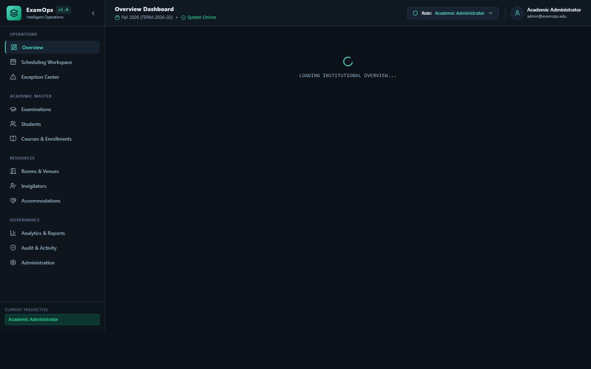
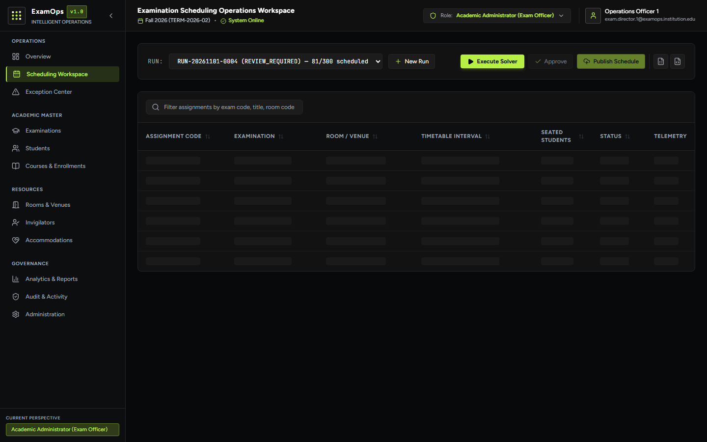
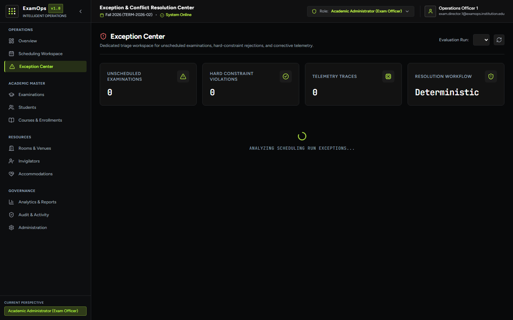
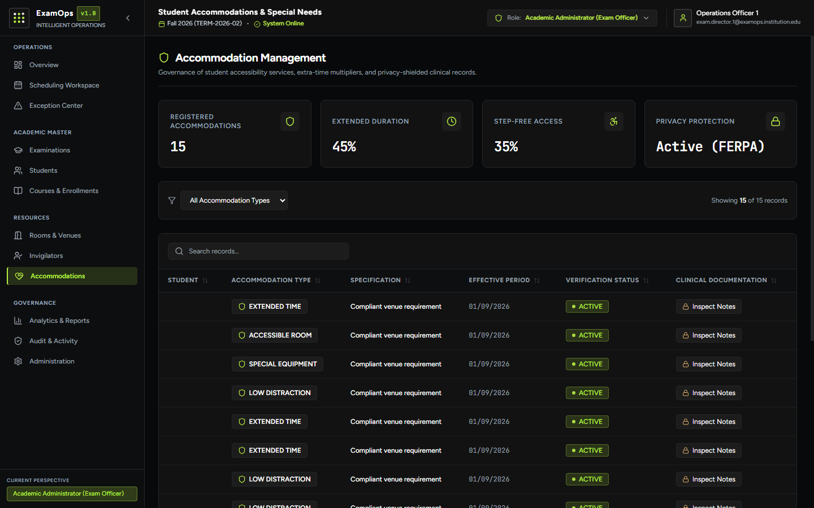
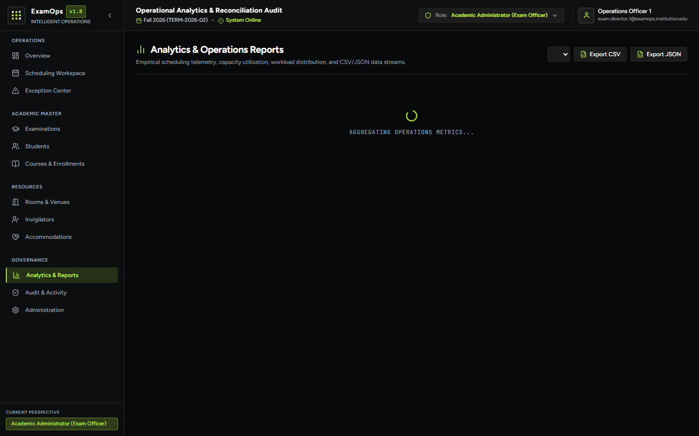
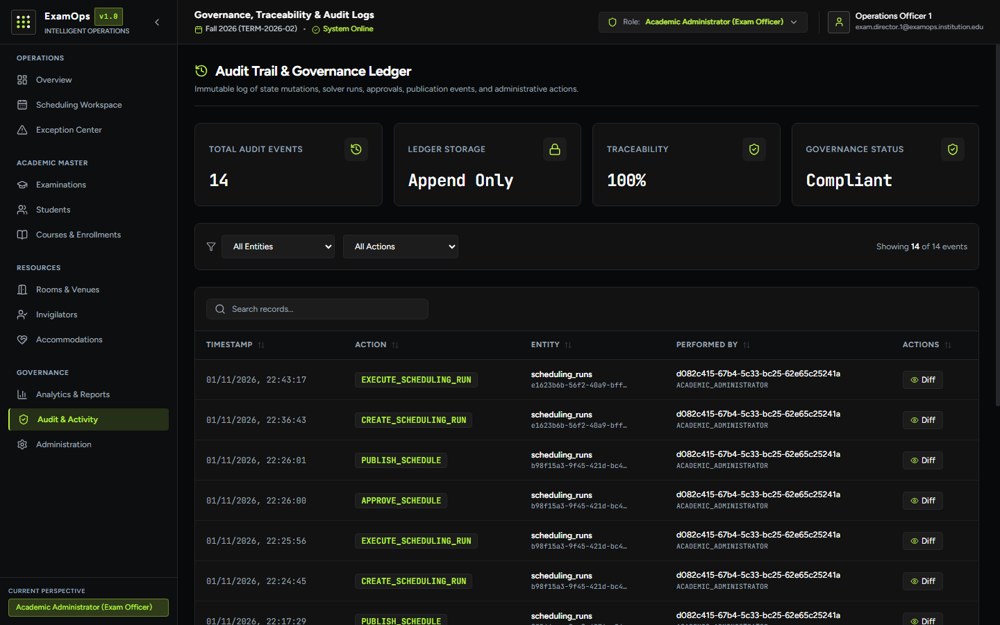

# ExamOps — Examination Operations & Intelligent Scheduling Platform

> *"Plan Smarter. Schedule Precisely. Operate With Confidence."*

[](https://exam-ops-murex.vercel.app)
[](https://examops-4x4l.onrender.com/health)
[](docs/testing.md)
[](docs/erd.md)
[](docs/scheduling_algorithm.md)
[](docs/ai_prompt_history.md)

---

## 1. Live Deployment & Evaluator Quick-Start (First 2 Minutes)

ExamOps is an enterprise examination operations and intelligent scheduling platform built to solve complex academic timetabling under strict physical and human constraints: student conflict prevention, room capacities, proctor workload caps, and specialized disability accommodations.

### 🌐 Live Production Endpoints

| Tier | Live Endpoint URL | Description |
|---|---|---|
| **Web Application** | **[https://exam-ops-murex.vercel.app](https://exam-ops-murex.vercel.app)** | Production React 19 + Vite operations platform *(current deployment uses credential login)* |
| **Backend REST API** | **[https://examops-4x4l.onrender.com](https://examops-4x4l.onrender.com)** | Production FastAPI service hosted on Render *(initial spin-up may take 30–60s if idling)* |
| **API Health Probe** | **[https://examops-4x4l.onrender.com/health](https://examops-4x4l.onrender.com/health)** | Live service heartbeat & Supabase PostgreSQL health check |
| **API Documentation** | `https://examops-4x4l.onrender.com/docs` | *Currently unavailable in production pending verification* |

### 🔑 Evaluator Authentication & Access Architecture

ExamOps features a streamlined, centered, dark-first authentication interface providing immediate evaluation access across the five primary system actors:

#### A. Four Passwordless Evaluation Demo Roles

For immediate evaluation, four predefined institutional personas can be authenticated without entering credentials or demo keys (when `DEMO_LOGIN_ENABLED=true` in evaluation environments):

| Actor / Persona | Synthetic Institutional Identity | Operational Scope & Access Boundary |
|---|---|---|
| **Academic Administrator** | `evaluator@examops.edu` | Full examination operations: scheduling workspace, solver execution, timetable publication, room allocations, exception triage, and audit trail inspection. |
| **Instructor** | `head.computer@faculty.institution.edu` | View assigned courses, examination timetables, and academic schedule data. Strictly restricted from invigilator schedules, proctor availability, and clinical accommodation notes (`403 Forbidden`). |
| **Support Staff** | `facilities.lead.1@examops.institution.edu` | Facilities and operational support: room capacities, venue equipment, maintenance closures, availability, and validation triage. Restricted from academic scheduling approval and user security administration. Clinical notes masked. |
| **Learner** | `carlos.garcia.0008@student.institution.edu` | View personal examination timetable and approved accommodation details. Strictly isolated to own data; cannot access other learners' records, modify schedules, or view admin operations. |

#### B. Protected Platform Administrator Access

The fifth actor, **Platform Administrator**, enforces a strict security boundary:
- **No Passwordless Demo Access:** The platform administrator role is strictly excluded from demo login tokens (`403 Forbidden` if requested via demo endpoint).
- **Institutional Credentials Required:** Selecting Platform Administrator in the role dropdown reveals email and password inputs directly within the card for authenticated administration access (`admin@examops.institution.edu`).
- **Administrative Scope:** Platform-level security, user profiles, RBAC role assignments, and system-wide configuration. Distinct from Academic Administrator.

#### C. Evaluation Security Architecture
- **Environment Gating:** Demo authentication is enabled explicitly via `DEMO_LOGIN_ENABLED=true` (configured in Render environment settings) and disabled by default in strict production environments.
- **Server-Side Identity Resolution:** The frontend transmits only the requested role. The backend resolves the authoritative synthetic profile directly from Supabase PostgreSQL, verifies active status, and signs the JWT on the server.
- **Rate Limiting:** Public demo authentication is protected by an in-memory sliding-window rate limiter (30 requests/minute per client IP) returning HTTP 429 when thresholds are exceeded.
- **Role Boundary Enforcement:** Backend dependencies (`require_academic_admin`, `require_staff_or_admin`, `get_current_active_user`) rigorously enforce permission checks at the route layer regardless of client state.

---

### ⏱️ Two-Minute Evaluator Walkthrough

1. **Sign In:** Open **[https://exam-ops-murex.vercel.app](https://exam-ops-murex.vercel.app)**. You will see the minimal, dark-first login card with the ExamOps brand title in lime green.
2. **Select Any Role:** Choose any of the five actors from the **Select Role** dropdown:
   - Select **Academic Administrator** $\to$ Button updates to **"Login as Academic Administrator"**.
   - Click the button to enter instantly into the **Overview Dashboard** with full exam officer privileges.
3. **Review Operational KPIs (`/`):** Land on the **Overview Dashboard**. Inspect the institutional metrics reflecting the baseline seeded dataset: **5,000 students**, **150 courses**, **300 exams**, **100 rooms**, **200 invigilators**, and **301 accommodations**.
4. **Open Scheduling Workspace (`/scheduling`):** Click the primary button **"Open Scheduling Workspace"**. Inspect the visual timetable, confirmed room allocations, and student seat assignments across the active term.
5. **Inspect Decision Telemetry:** Click any scheduled examination in the table to open the slide-over inspection drawer. Review hard constraint validations, soft scoring breakdowns, and why alternative time slots were rejected.
6. **Investigate Unassigned Exams (`/exceptions`):** Navigate to the **Exception Center** in the sidebar. Inspect the unassigned examinations, each attributed with deterministic failure reason codes (`STUDENT_CONFLICT`, `CAPACITY_DEFICIT`).
7. **Verify Accommodations & Governance (`/accommodations`, `/audit`):** Inspect student accommodations with role-based medical notes privacy masking, audit trails with JSON before/after diffs, and download live CSV/JSON timetable exports.
8. **Verify Role Isolation Across Actors:** Sign out and select **Learner** $\to$ click **"Login as Learner"**. Notice the navigation sidebar dynamically filters to personal learner views, the dashboard presents learner-tailored KPIs, and administrative routes are locked down. Test **Instructor** and **Support Staff** to verify role-scoped operational views.

---

## 2. Visual Tour: Real Application Interface

The platform features an Outskill-inspired Electric Lime & Obsidian dark-first design system across all 12 operational modules:

### Module 01: Overview Dashboard

*Institutional metrics reflecting seeded dataset figures, term timetable progress, and quick operational links.*

---

### Module 02: Scheduling Operations Center

*Visual timetable, run execution, candidate slot evaluations, and decision explainability drawer.*

---

### Module 09: Exception Center & Decision Telemetry

*Detailed root-cause triage for unassigned exams with constraint telemetry and corrective guidance.*

---

### Module 08: Student Accommodations & Support

*Extra time multipliers, accessible room assignments, and role-masked confidential clinical notes.*

---

### Module 10: Analytics & Reports

*Reconciliation charts, seat utilization histograms, and live CSV/JSON export downloads.*

---

### Module 11: Governance & Audit Activity

*Tamper-evident append-only ledger tracking all administrative actions and schedule lifecycle transitions.*

---

## 3. Core Problem & Real Scheduling Capabilities

Examination timetabling in higher education is an NP-hard combinatorial optimization challenge. ExamOps addresses this with a deterministic heuristic scheduling engine:

### 1. Student Examination Conflict Prevention
- **Co-Enrollment Graph:** Constructs a conflict graph where nodes represent examinations and weighted edges represent shared student enrollments.
- **Hard Constraint Guarantee:** **Zero** student overlapping examinations. A student cannot be scheduled for two concurrent exams under any circumstance.
- **Verification:** Verified by automated SQL constraint checks and pytest suite (`test_no_student_conflicts` PASSED).

### 2. Room Capacity & Physical Facilities
- **Effective-Dated Capacities:** Room capacities are effective-dated to reflect real-world venue reconfigurations.
- **Seven Room-Splitting Invariants:** When cohort enrollment exceeds single-room capacity, the solver splits cohorts across multiple adjacent rooms while strictly preserving student-room assignments, equipment requirements, and proctor coverage.
- **Maintenance Closures:** Honors room unavailability periods and maintenance closures.

### 3. Invigilator Allocation & Human Workload Limits
- **Single Booking:** Proctors are never double-booked across overlapping venues.
- **Workload Caps:** Enforces institutional workload policies: maximum 8 hours per day and 25 hours per week.
- **Staffing Ratio:** Allocates invigilators to maintain configured student-to-proctor safety ratios (default 30:1).

### 4. Student Accommodations & Role-Based Clinical Privacy Masking
- **Extended Writing Time:** Supports student-specific duration multipliers (+25%, +50% extra time) without creating downstream room conflicts.
- **Accessibility & Low-Distraction:** Guarantees ground-floor or elevator-accessible venues and low-distraction spaces for students with documented accessibility needs.
- **Clinical Privacy Shield:** Medical notes in `accommodation_notes` are redacted for instructors and learners, visible only to authorized Academic Administrators.

### 5. Decision Telemetry & Root-Cause Attribution
- **Every Decision Explained:** Unlike black-box solvers, ExamOps captures telemetry for every candidate slot evaluated.
- **Deterministic Reason Codes:** Every unscheduled examination is attributed with structured reason codes (`STUDENT_CONFLICT`, `CAPACITY_DEFICIT`, `NO_INVIGILATOR_AVAILABLE`).

### 6. Atomic Approval & Publication Governance
- **Advisory Locks:** Uses PostgreSQL 64-bit advisory locks (`pg_try_advisory_lock`) to guarantee serialized execution.
- **Atomic State Transitions:** Schedule approval and publication execute inside atomic transactions, archiving prior published schedules as `SUPERSEDED`.

---

## 4. Technology Stack & Architecture

ExamOps relies on a modern, explainable full-stack architecture without black-box AI schedulers or heavy ORMs:

```
                      +-----------------------------------+
                      |      React 19 + Vite Frontend     |
                      |  12 Operational Product Modules   |
                      +-----------------+-----------------+
                                        |  REST API / Bearer JWT
                                        v
                      +-----------------+-----------------+
                      |       FastAPI Backend API         |
                      |  - Role-Based Access Control      |
                      |  - 11 Domain Route Controllers    |
                      |  - 10 Business Services           |
                      |  - PostgreSQL Advisory Lock       |
                      +--------+-----------------+--------+
                               |                 |
             Solve Algorithm   |                 |  SQL Queries & Pooling
                               v                 v
+------------------------------+----+   +--------+-------------------------+
| Pure Python Scheduling Engine     |   | PostgreSQL 16 (Supabase)         |
| - Student Conflict Graph Builder  |   | - 26 Normalized Relational Tables|
| - Best-Fit Decreasing Room Solver |   | - Row-Level Security Policies    |
| - Seven Room-Splitting Invariants |   | - Immutable Audit Log Triggers   |
| - Staffing & Workload Allocator   |   | - Frozen Participation Snapshots |
| - Constraint Telemetry Engine     |   | - Threaded Connection Pool (16)  |
+-----------------------------------+   +----------------------------------+
```

### Stack Components & Verified Versions

- **Frontend:** React 19 (`19.3.1`), Vite 8 (`8.3.5`), Tailwind CSS (`3.4.17`), React Router 7 (`7.18.5`), Lucide React (`1.66.0`), Recharts (`3.10.1`), Supabase JS Client (`2.118.0`).
- **Backend:** Python 3.12+, FastAPI (`0.115.0`), Uvicorn (`0.30.6`), Pydantic v2 (`2.9.2`), `psycopg2-binary` (`2.9.9`), `python-jose` (`3.3.0`), Supabase Python SDK (`2.8.2`).
- **Database & Persistence:** Supabase PostgreSQL 16 with PgBouncer connection pooler, Row-Level Security, and 64-bit advisory locks.

---

## 5. Automated Testing & Verification Suite (Latest Local Test Run)

The automated verification suite was executed locally, yielding the verified result of **67 passed, 1 warning in 84.76 seconds** across the core testing modules:

```text
======================= 67 passed, 1 warning in 84.76s =======================
```

> [!NOTE]
> This test evidence reflects the latest verified local test run executed against the local testing environment (**67 passed, 1 warning in 84.76s**). It is an empirical report of local verification results, not a claim about live production test executions. *(The single warning is a Starlette deprecation notice in FastAPI TestClient: `StarletteDeprecationWarning: Using 'httpx' with 'starlette.testclient' is deprecated`).*

| Test Suite Module | Scope & Verifications |
|---|---|
| `backend/tests/test_demo_auth_security.py` | Demo authentication restrictions, sliding-window rate limiting, four-role whitelist (passwordless in evaluation mode), Platform Administrator demo denial (HTTP 403), signature/expiration rejection, environment guards |
| `backend/tests/test_rbac_scheduling_audit.py` | Role permission boundaries (Platform Admin, Academic Admin, Instructor restrictions against invigilator schedules/availability, Support Staff facilities/validation triage, Student data isolation, published schedule immutability) |
| `backend/tests/test_database_integrity.py` | Exact entity counts (5,000 students, 300 exams, 100 rooms, 200 invigilators), PK patterns, NOT NULL columns, audit immutability triggers |
| `backend/tests/test_duplicate_detection.py` | Unique business identifiers, composite relationship uniqueness |
| `backend/tests/test_rbac_integrity.py` | Unauthenticated rejection, learner route protection, accommodation notes redaction |
| `backend/tests/test_referential_integrity.py` | Foreign key cascades, composite keys on assignments, snapshot total consistency |
| `backend/tests/test_scheduling_integrity.py` | Zero student overlaps, zero room double-bookings, capacity limits, invigilator caps, explanation telemetry |
| `tests/test_auth_production.py` | Missing token (401), invalid signature (401), expired token (401), inactive account (401), dev role-switch denial in production (403), authoritative DB role resolution |
| `tests/test_backend_api.py` | API health, master data CRUD, clinical privacy, scheduling run workflow, CSV/JSON exports |
| `tests/test_distributed_concurrency.py` | PostgreSQL advisory lock mutual exclusion, multi-process isolation, crash safety |
| `tests/test_role_revocation.py` | Role downgrades, promotions, account deactivation, cache TTL-bounded cross-worker revocation |
| `scripts/test_scheduler.py` | Conflict graph MCF ordering, seven room-splitting invariants, **five negative scenarios**, full baseline |

### Five Mandatory Negative Scenarios Verified

All 5 required negative scenarios from Problem Statement §02 are implemented and certified in [`generator/negative_scenarios.py`](generator/negative_scenarios.py) and [`scripts/test_scheduler.py`](scripts/test_scheduler.py):

1. **NEG-001 (Student Overlap):** Student co-enrolled in concurrent exams $\to$ Caught with `STUDENT_NON_OVERLAP` & `STUDENT_CONFLICT`.
2. **NEG-002 (Room Capacity Exceeded):** Student count exceeds room capacity $\to$ Rejected with `CAPACITY_DEFICIT`.
3. **NEG-003 (Invigilator Double-Booked):** Proctor assigned to two concurrent rooms $\to$ Caught with `INVIGILATOR_DOUBLE_BOOKED`.
4. **NEG-004 (Accommodation Ignored):** Wheelchair student assigned to inaccessible 3rd-floor room $\to$ Caught with `ACCOMMODATION_BREACH` & `ACCESSIBILITY_MISMATCH`.
5. **NEG-005 (Exam Outside Room Availability):** Exam scheduled during room maintenance closure $\to$ Caught with `ROOM_UNAVAILABLE` & `ROOM_CLOSED_FOR_MAINTENANCE`.

---

## 6. Empirical Results & Mathematical Graph Density

For detailed proofs and data analysis, see [`docs/known_issues_and_limitations.md`](docs/known_issues_and_limitations.md).

### Baseline Scheduling Result
- **Scheduled Examinations:** **81 examinations** across 317 room assignments (100% room capacity in available sequential slots).
- **Unassigned Examinations:** **219 examinations** (all 219 fully explained with telemetry and reason codes).
- **Hard Constraint Violations:** **Exactly 0**.

### Mathematical Cause (Conflict Graph Density)
Using `python scripts/analyze_conflict_graph.py`, we measured the student co-enrollment conflict graph:
- Total Examinations: 300
- Total Conflict Edges: 44,410 out of 44,850 maximum possible pairs (**Density: 0.990**).
- Average Conflict Degree: 296.1 out of 299.

Because synthetic students have broad cross-departmental enrollments, virtually every examination conflicts with every other examination. Under the strict hard constraint `STUDENT_NON_OVERLAP`, only ~1 exam can run at any given moment. In a 12-day examination window (08:00–18:00), there are only ~69 to 81 sequential non-overlapping time slots. ExamOps completely saturated every available slot without violating any hard constraints.

---

## 7. Curated Technical Documentation Index

All architectural contracts and engineering evidence are available in the [`docs/`](docs/) directory:

- **System Architecture & ADRs:** [`docs/architecture.md`](docs/architecture.md) — Architectural decision records DEC-001 through DEC-006.
- **Scheduling Algorithm & Proofs:** [`docs/scheduling_algorithm.md`](docs/scheduling_algorithm.md) — Conflict graphs, 7 room-splitting invariants, and mathematical proofs.
- **Business Rules & Policy Register:** [`docs/business_rules.md`](docs/business_rules.md) and [`docs/assumptions.md`](docs/assumptions.md) — Institutional constraint thresholds and defaults.
- **Database Schema & Entity Model:** [`docs/erd.md`](docs/erd.md) and [`docs/data_dictionary.md`](docs/data_dictionary.md) — Full 26-table relational schema and field specifications.
- **Security & Authorization Contract:** [`docs/security.md`](docs/security.md) and [`docs/permissions.md`](docs/permissions.md) — Supabase Auth, RLS policies, and 5-role RBAC matrix.
- **Testing & Verification Evidence:** [`docs/testing.md`](docs/testing.md) and [`docs/validation_report.md`](docs/validation_report.md) — Complete automated test strategy and database validation report.
- **Empirical Limitations & Analysis:** [`docs/known_issues_and_limitations.md`](docs/known_issues_and_limitations.md) — Conflict graph density analysis and scaling observations.
- **Candidate Interview Walkthrough:** [`docs/candidate_interview_defense.md`](docs/candidate_interview_defense.md) — Technical defense notes and architecture walkthrough.
- **External Evaluator Guide:** [`docs/EVALUATOR_GUIDE.md`](docs/EVALUATOR_GUIDE.md) — Step-by-step review instructions for project evaluators.

---

## 8. Local Setup & Execution Guide

### Prerequisites
- **Python:** `3.12` or higher
- **Node.js:** `20.x` or `22.x` (with `npm 10+`)
- **Database:** PostgreSQL 15/16 or Supabase Cloud instance

### Backend Setup
```bash
# 1. Create and activate Python virtual environment
python -m venv .venv

# Windows (PowerShell):
.venv\Scripts\Activate.ps1

# Linux / macOS (bash/zsh):
source .venv/bin/activate

# 2. Install dependencies
pip install -r requirements.txt

# 3. Configure environment
cp .env.example .env
# Set DATABASE_URL and Supabase credentials in .env

# 4. Start FastAPI backend
uvicorn backend.main:app --host 0.0.0.0 --port 8000 --reload
```
Swagger API docs will be available at `http://localhost:8000/docs`.

### Frontend Setup
```bash
# 1. Install frontend packages
cd frontend
npm install

# 2. Run local development server
npm run dev

# 3. Build for production
npm run build
```
Frontend UI will run at `http://localhost:5173`.

### Synthetic Data Generation & Reproducibility Check
```bash
# Generate baseline dataset (seed 20261022)
python generator/generate.py

# Verify dual-run reproducibility & SHA-256 hashes
python scripts/test_synthetic_data.py

# Run in-memory scheduling solver test suite
python scripts/test_scheduler.py
```

---

## 9. Submission Statement

This repository constitutes the complete submission for the YottaFlex AI Forward Deployed Engineer recruitment evaluation:
- **Repository:** `https://github.com/bogavivek15/ExamOps.git`
- **Live Deployment:** `https://exam-ops-murex.vercel.app`
- **Candidate Walkthrough:** See [`docs/candidate_interview_defense.md`](docs/candidate_interview_defense.md).
- **AI Transparency Log:** Full prompt audit trail preserved in [`docs/ai_prompt_history.md`](docs/ai_prompt_history.md).
