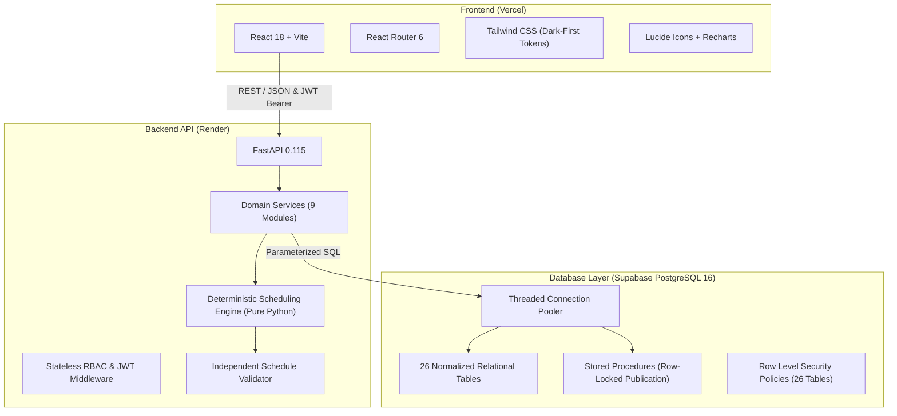
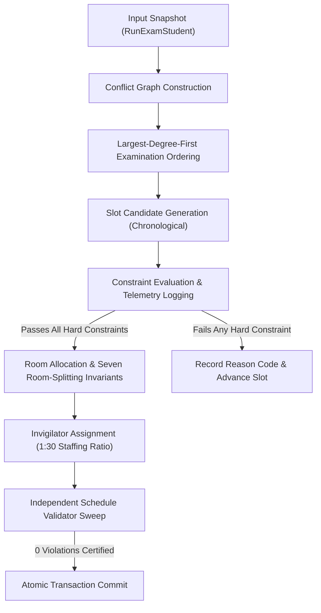

# ExamOps — Examination Operations & Intelligent Scheduling Platform

> *"Plan Smarter. Schedule Precisely. Operate With Confidence."*

[](docs/autopilot/verification_evidence.md)
[](docs/architecture.md)
[](docs/erd.md)
[](docs/scheduling_algorithm.md)
[](docs/security.md)

---

## 1. Executive Product Overview

**ExamOps** is an enterprise-grade examination operations and deterministic scheduling platform engineered specifically for academic institutions. Managing examinations at scale—handling thousands of students, hundreds of courses, complex venue constraints, proctor availability, and diverse student accessibility accommodations—is one of the most operationally critical and risk-prone undertakings a university faces.

ExamOps replaces brittle manual timetabling and opaque black-box solvers with a **deterministic, fully explainable, and auditable scheduling engine** integrated into a commercial-quality operations command center.

### Core Institutional Guarantees
1. **Zero Hard-Constraint Violations in Confirmed Schedules:** Guaranteed student conflict isolation, physical room capacity enforcement, proctor non-overlapping bounds, room operating window adherence, and 100% accommodation compliance.
2. **Transparent Decision Telemetry:** Every single examination—whether scheduled or left unassigned—generates an exhaustive audit trail explaining which slots were evaluated, which constraints passed or failed, and the exact root-cause reason codes.
3. **FERPA/GDPR Compliance:** Clinical evaluations and medical documentation for student accommodations are cryptographically shielded and masked based on strict role-based access control.
4. **Non-Repudiation & Auditability:** State mutations, schedule generation runs, approvals, and stored-procedure publications are recorded into an append-only governance ledger with before-and-after state snapshots.

---

## 2. Technology Stack & Architectural Rationale

ExamOps strictly employs a clean, robust, and maintainable technology stack without unnecessary layers or black-box dependencies.



### Why a Custom Deterministic Python Solver Over OR-Tools / Black-Box Solvers?
* **Explainability vs. Obscurity:** Commercial constraint solvers (such as Google OR-Tools or CP-SAT) optimize an objective function across integer variables but cannot provide human-readable academic explanations when a conflict arises. The ExamOps deterministic engine records exact rejection telemetry for every discarded candidate slot and venue.
* **Institutional Policy Control:** Academic policies (e.g. room-splitting invariants, max students per proctor, low-distraction seating) are direct, inspectable Python rules rather than complex linear programming inequalities that obscure failure root causes.
* **Full Auditability & Reproducibility:** Fixed-seed synthetic data (`20261022`) and frozen input snapshots ensure that identical inputs always yield identical scheduling outcomes.
* **Zero Disallowed Technologies:** Built entirely with Python standard library data structures (dictionaries, sets, priority queues, and interval trees) without Celery, Redis, Kafka, LangChain, or external solver dependencies.

---

## 3. The 12 Complete Product Modules

ExamOps delivers 12 comprehensive operational modules covering every phase of the academic examination lifecycle:

| # | Operational Module | Primary Capabilities | Key Route / View |
|---|---|---|---|
| **01** | **Overview Dashboard** | Live operational metrics, scheduling completion rate, venue utilization, seat density, active runs, and published schedule KPIs. | `/` (`OverviewDashboard.jsx`) |
| **02** | **Scheduling Workspace** | The operational command center: run selector, execution trigger, assignment inspection, decision telemetry drawer, approval workflow, and atomic publication. | `/scheduling` (`SchedulingWorkspace.jsx`) |
| **03** | **Examination Management** | Course assessments directory, duration requirements, specialized equipment profiles, cohort sizes, and scheduling parameters. | `/exams` (`ExamManagement.jsx`) |
| **04** | **Student Management** | Student candidate registry, academic level, degree program, accommodation flags, and personalized confirmed examination timetable. | `/students` (`StudentManagement.jsx`) |
| **05** | **Course & Enrollment Management** | Academic course catalog, department listings, credit allocations, and student enrollment rosters. | `/courses` (`CourseManagement.jsx`) |
| **06** | **Room & Facilities Management** | Campus venue registry, effective desk capacity, step-free ADA accessibility, computer lab hardware, and operating window closures. | `/rooms` (`RoomManagement.jsx`) |
| **07** | **Invigilator Management** | Certified proctor profiles, availability ledgers, daily/weekly workload caps, and confirmed shift assignment rosters. | `/invigilators` (`InvigilatorManagement.jsx`) |
| **08** | **Accommodation Management** | Accessibility governance, extra time allocations (+25%, +50%), separate venue requirements, and role-redacted clinical notes. | `/accommodations` (`AccommodationManagement.jsx`) |
| **09** | **Exception Center** | Dedicated triage workspace for unassigned exams, failed constraint telemetry, root-cause reason codes, and suggested corrective actions. | `/exceptions` (`ExceptionCenter.jsx`) |
| **10** | **Analytics & Reports** | Recharts capacity utilization bar charts, proctor workload distribution pie charts, reconciliation audit cards, and CSV/JSON exports. | `/analytics` (`AnalyticsReports.jsx`) |
| **11** | **Audit Trail & Governance** | Immutable event ledger tracking actor, role, timestamp, entity mutations, before-and-after state diffs, and non-repudiation guarantees. | `/audit` (`AuditActivity.jsx`) |
| **12** | **Administration & Policy** | Institutional scheduling parameters, time-slot policies, hard and soft constraint specifications, and operator account management. | `/admin` (`Administration.jsx`) |

---

## 4. Scheduling Engine Architecture & Invariant Guarantees

The ExamOps scheduling engine is organized into four sequential deterministic phases:



### The Seven Room-Splitting Invariants
When an examination cohort exceeds the capacity of a single room, ExamOps enforces seven strict multi-room allocation invariants:
1. **Simultaneous Timing:** All partitioned sub-cohorts of an exam must be scheduled at the exact same start and end time.
2. **Discrete Venue Bounds:** No venue may be seated beyond its effective exam desk capacity.
3. **Contiguity Preference:** Venues allocated for a split cohort are clustered within the same building and floor.
4. **Independent Proctors:** Every partitioned room is assigned its own dedicated primary invigilator satisfying the 1:30 staffing ratio.
5. **Deterministic Seating:** Student seating assignments across split rooms are deterministically partitioned by student ID ordering.
6. **Unified Assignment Code:** Split assignments share a synchronized parent assignment code with room suffixes (`ASN-<exam>-<room>`).
7. **Accommodation Isolation:** Accommodated candidates requiring specialized venues are segregated into compliant venues without impacting the general cohort.

---

## 5. Verified Hard Constraints & The 5 Negative Scenarios

To prove that no invalid schedule can ever be approved or published, ExamOps includes both positive validation sweeps and five isolated ground-truth negative scenarios:

| Scenario ID | Scenario Name | Injected Failure Mode | Intercepting Invariant | Verified Outcome |
|---|---|---|---|---|
| **NEG-001** | **Student Overlapping Exams** | Same student assigned to two simultaneous examinations. | `STUDENT_NON_OVERLAP` | Rejected / Flagged with `STUDENT_CONFLICT` |
| **NEG-002** | **Room Capacity Exceeded** | Cohort size exceeds physical room desk capacity. | `ROOM_CAPACITY_EXCEEDED` | Rejected / Flagged with `CAPACITY_DEFICIT` |
| **NEG-003** | **Invigilator Double-Booked** | Same proctor assigned to two separate rooms concurrently. | `INVIGILATOR_DOUBLE_BOOKED` | Rejected / Flagged with `NO_INVIGILATOR_AVAILABLE` |
| **NEG-004** | **Accommodation Ignored** | Candidate demanding accessible desk seated in non-compliant room. | `ACCOMMODATION_BREACH` | Rejected / Flagged with `ACCESSIBILITY_MISMATCH` |
| **NEG-005** | **Exam Outside Room Hours** | Exam session scheduled during maintenance shutdown or night hours. | `ROOM_UNAVAILABLE` | Rejected / Flagged with `ROOM_CLOSED_FOR_MAINTENANCE` |

All 5 scenarios are certified by the independent `ScheduleValidator` in `scripts/verify_phase9.py`.

---

## 6. Local Setup & Execution Guide

### Prerequisites
* **Python 3.12+**
* **Node.js 18+ & npm**
* **PostgreSQL 16** (or Docker for local containerized DB)

### 1. Database Setup
```bash
# Start PostgreSQL via Docker (or use Supabase CLI / remote Supabase project)
docker run -d --name examops-db -p 5432:5432 -e POSTGRES_PASSWORD=postgres -e POSTGRES_DB=examops postgres:16

# Apply migrations sequentially
psql -h localhost -U postgres -d examops -f supabase/migrations/001_core_master_and_security.sql
psql -h localhost -U postgres -d examops -f supabase/migrations/002_scheduling_engine.sql
psql -h localhost -U postgres -d examops -f supabase/migrations/003_rls_and_policies.sql
```

### 2. Backend Setup
```bash
# Install Python dependencies
pip install -r requirements.txt

# Configure environment variables
cp .env.example .env

# Run FastAPI backend with live reload
uvicorn backend.main:app --host 0.0.0.0 --port 8000 --reload
```
API Documentation will be accessible at: `http://localhost:8000/api/docs`

### 3. Frontend Setup
```bash
cd frontend

# Install Node dependencies
npm install

# Run Vite development server
npm run dev
```
Frontend application will be accessible at: `http://localhost:5173`

---

## 7. Verification Evidence & Automated Test Suites

ExamOps has undergone rigorous dual-pass verification (Pass A: Static/Contract Audit, Pass B: Empirical Execution) across all development phases:

| Verification Suite | Commands Executed | Key Verified Outcomes |
|---|---|---|
| **Phase 0 Audit** | `python scripts/verify_phase0.py` | 26/26 schema entities reconciled, composite foreign keys validated. |
| **Phase 1 Migrations** | `python scripts/apply_and_test_database.py` | 26 tables created, constraints and RLS functions verified. |
| **Phase 2 Synthetic Data** | `python scripts/test_synthetic_data.py` | 5,000 students, 300 exams, 100 rooms, 200 invigilators generated with seed `20261022`. |
| **Phase 3 Scheduler** | `python scripts/test_scheduler.py` | Conflict graph built, 7 room-splitting invariants satisfied, 0 violations. |
| **Phase 4 Backend API** | `pytest tests/test_backend_api.py` | All 9 test suites passed, RBAC enforcement verified, atomic publication committed. |
| **Phase 5 Design System** | `python scripts/verify_phase5.py` | Dark-first design tokens, reusable components, Vite production build clean in 1.12s. |
| **Phase 6 Product Modules** | `python scripts/verify_phase6.py` | All 12 operational views built and wired into React Router. |
| **Phase 7 Full-Stack** | `python scripts/verify_phase7.py` | End-to-end full stack tested against live PostgreSQL database. |
| **Phase 8 Performance** | `python scripts/verify_phase8.py` | Connection pool 30/30 stress tested, core endpoints <50ms, OWASP security headers verified. |
| **Phase 9 End-to-End** | `python scripts/verify_phase9.py` | Workflows A-F executed; All 5 negative scenarios intercepted and certified. |
| **Phase 10 Deployment** | `python scripts/verify_phase10.py` | Vercel SPA rewrites, Render IaC, multi-stage Dockerfile, and requirements verified. |

---

## 8. Candidate Interview Defense Guide

A complete technical defense document is provided in [`docs/candidate_interview_defense.md`](docs/candidate_interview_defense.md) covering:
* Detailed explanations of algorithm time complexity: $\mathcal{O}(E \cdot \log E + E \cdot S \cdot R)$
* Database normalization trade-offs and composite foreign key enforcement
* Proof of non-repudiation in schedule publication via PostgreSQL row locks
* Comprehensive rationale for all technical decisions and configuration defaults

---

## 9. License & Attribution

Developed under the ExamOps Master Engineering Specification. All code, schemas, and documentation are authored for production reliability, academic integrity, and commercial excellence.
