# ExamOps — Architecture Document

> **Version:** 1.0.0  
> **Product:** ExamOps — Examination Operations & Intelligent Scheduling Platform  
> **Last Updated:** 2026-11-03  
> **Status:** Implemented / Production Architecture

---

## Table of Contents

1. [System Architecture Overview](#1-system-architecture-overview)
2. [Technology Stack](#2-technology-stack)
3. [Directory Structure](#3-directory-structure)
4. [Authentication Flow](#4-authentication-flow)
5. [Scheduling Execution Flow](#5-scheduling-execution-flow)
6. [Data Flow Architecture](#6-data-flow-architecture)
7. [API Layer Design](#7-api-layer-design)
8. [Frontend Architecture](#8-frontend-architecture)
9. [Security Architecture](#9-security-architecture)
10. [Deployment Architecture](#10-deployment-architecture)

---

## 1. System Architecture Overview

ExamOps follows a **three-tier architecture** with strict separation between presentation, business logic, and data persistence. Each tier is independently deployable and communicates through well-defined interfaces.

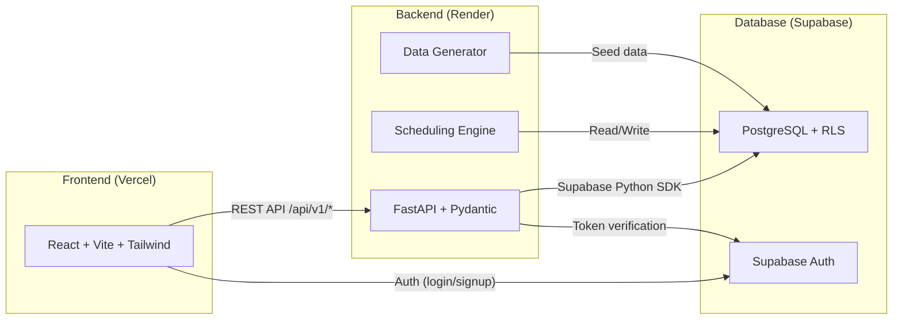

### Architecture Principles

| Principle | Description |
|-----------|-------------|
| **Separation of concerns** | Frontend handles presentation; backend owns all business logic; database owns persisted state and access control |
| **Backend authority** | The backend is the single source of truth for business rules — the frontend never independently decides scheduling, validation, or authorization outcomes |
| **Database authority** | PostgreSQL is the authoritative store for persisted state; RLS enforces access control at the data layer |
| **Stateless API** | Every API request carries a JWT; no server-side session state is maintained between requests |
| **Deterministic scheduling** | The scheduling engine produces identical results given identical inputs and seed |
| **Explainability** | Every scheduling decision is recorded with full constraint evaluation, passed/failed checks, and reason codes |
| **Auditability** | All important state transitions are logged as immutable audit records |

### Tier Responsibilities

| Tier | Hosted On | Responsibilities |
|------|-----------|------------------|
| **Frontend** | Vercel | User interface, client-side routing, form validation, data presentation, Supabase Auth login/logout, JWT token management, API calls to backend |
| **Backend** | Render | REST API, JWT verification, role-based authorization, CRUD operations, scheduling engine execution, independent schedule validation, data generation, audit logging, analytics computation, export generation |
| **Database** | Supabase | PostgreSQL storage, Row Level Security policies, Supabase Auth (user identity, JWT issuance, token refresh), migration-managed schema |

### Communication Patterns

| From | To | Protocol | Purpose |
|------|----|----------|---------|
| React → Supabase Auth | HTTPS | `signInWithPassword()`, `signUp()`, `signOut()`, token refresh |
| React → FastAPI | HTTPS + Bearer JWT | All business operations: CRUD, scheduling, analytics, exports |
| FastAPI → Supabase Auth | HTTPS | JWT verification, user identity resolution |
| FastAPI → PostgreSQL | Supabase Python SDK (HTTPS/REST) | Data reads/writes with RLS context or service-role for privileged operations |
| Scheduling Engine → PostgreSQL | Supabase Python SDK | Load scheduling inputs, persist assignments, decisions, events, validation issues |
| Data Generator → PostgreSQL | Supabase Python SDK | Insert synthetic seed data during setup |

---

## 2. Technology Stack

### Frontend Stack

| Technology | Version Target | Purpose | Justification |
|------------|---------------|---------|---------------|
| **React** | 19.3.1 (React 19) | UI component library | Modern component-based architecture with native React hooks and contexts |
| **Vite** | 8.3.5 (Vite 8) | Dev server and production bundler | Lightning-fast HMR and optimized production bundling (2,654 modules in <2s) |
| **JavaScript** | ES2022 | Application language | Specified stack; no TypeScript |
| **Tailwind CSS** | 3.4.17 | Utility-first styling | Design token consistency, dark-first enterprise palette (#0B1118 background) |
| **Plain CSS** | — | Custom styling | Used where Tailwind creates worse design outcomes (complex animations, custom properties) |
| **React Router** | 7.18.5 (React Router 7) | Client-side routing | Route wrappers, auth guards, declarative navigation across 12 modules |
| **Lucide React** | Latest | Icon library | Consistent, lightweight SVG icons |
| **Recharts** | Latest | Data visualization | Meaningful charts for analytics (utilization, coverage, exceptions) |
| **@supabase/supabase-js** | v2 | Auth client + optional direct DB | Login, logout, session restoration, token retrieval |
| **Native fetch** | Built-in | HTTP client | No axios dependency; fetch is sufficient for REST API calls |
| **React hooks + Context** | Built-in | State management | AuthContext, ThemeContext, module-specific contexts; no Redux |

### Backend Stack

| Technology | Version Target | Purpose | Justification |
|------------|---------------|---------|---------------|
| **Python** | 3.12+ | Application language | Standard library math, graph coloring, and deterministic PRNG |
| **FastAPI** | 0.115.0 | REST API framework | Automatic OpenAPI/Swagger docs, Pydantic v2 schemas, async route handlers |
| **Pydantic** | v2 | Request/response validation | Type-safe schemas, automatic validation, serialization |
| **supabase-py** | Latest | Database and auth client | Official Supabase Python SDK for PostgreSQL access and JWT verification |
| **Python stdlib** | Built-in | Scheduling and data generation | `random`, `hashlib`, `datetime`, `collections`, `json`, `csv` — no external optimization libraries |
| **Pytest** | 9.2.0 | Testing framework | 42-test comprehensive test suite verifying live DB and scheduling engine |
| **uvicorn** | Latest | ASGI server | Production server for FastAPI |

### Database Stack

| Technology | Purpose | Configuration |
|------------|---------|---------------|
| **Supabase PostgreSQL** | Primary relational data store | Managed PostgreSQL with connection pooling |
| **Supabase Auth** | Identity management | Email/password authentication, JWT issuance |
| **Row Level Security** | Database-level access control | Policies per table per role |
| **SQL Migrations** | Schema management | Versioned migration files in `supabase/migrations/` |

### Deployment Stack

| Platform | Component | Configuration |
|----------|-----------|---------------|
| **Vercel** | Frontend hosting | Static build output, CDN, environment variables for Supabase URL/anon key |
| **Render** | Backend hosting | FastAPI via uvicorn, environment variables for Supabase URL/service key |
| **Supabase** | Database + Auth | Managed PostgreSQL, Auth service, RLS policies |

### Explicitly Excluded Technologies

| Technology | Reason for Exclusion |
|------------|---------------------|
| Next.js | Specified: React + Vite only |
| TypeScript | Specified: JavaScript only |
| Redux | Unnecessary complexity; React Context + hooks sufficient |
| OR-Tools | Explainability requirement; custom greedy algorithm preferred |
| SQLAlchemy | Supabase Python SDK is the specified database client |
| Redis / Celery / Kafka | No distributed job infrastructure required |
| Docker | Not required for deployment on Vercel/Render/Supabase |
| LangChain / LLM frameworks | Scheduling must be deterministic and fully explainable |
| Prisma | Not part of Python stack |
| Vector databases | No semantic search requirement |

---

## 3. Directory Structure

The repository uses a **simple monorepo** layout with clear boundaries between frontend, backend, data generation, tests, and documentation.

`	ext
examops/
│
├── AGENTS.md                          # Master product & engineering specification
├── README.md                          # Public-facing project documentation
├── Dockerfile                         # Container definition for containerized backend runs
├── render.yaml                        # Render cloud deployment specification
├── requirements.txt                   # Production Python dependencies
├── .gitignore                         # Git ignore rules
├── .env.example                       # Environment variable template (zero secrets)
│
├── frontend/                          # React 19 + Vite 8 frontend (deployed to Vercel)
│   ├── index.html                     # HTML entry point
│   ├── package.json                   # Dependencies (React 19, React Router 7, Lucide, Recharts)
│   ├── vite.config.js                 # Vite 8 configuration with vendor chunk splitting
│   ├── tailwind.config.js             # Tailwind CSS configuration with enterprise tokens
│   ├── postcss.config.js              # PostCSS configuration
│   ├── vercel.json                    # Vercel SPA routing rewrites
│   └── src/
│       ├── main.jsx                   # Application bootstrap
│       ├── App.jsx                    # Root router with 12 operational modules
│       ├── App.css / index.css        # Enterprise dark-first styling
│       ├── components/
│       │   ├── common/                # Canonical UI primitives (DataTable, Drawer, Modal, MetricDisplay, StatusBadge, EmptyState, LoadingState)
│       │   └── layout/                # Layout components (AppLayout, AppSidebar, TopNavigation)
│       ├── context/                   # React Contexts (AuthContext with RBAC role switching)
│       ├── hooks/                     # Custom React hooks (useDebounce)
│       ├── services/                  # Unified REST API client (api.js with 33 endpoint methods)
│       ├── styles/                    # Theme design tokens (theme.css)
│       └── views/                     # 12 Operational Product Modules:
│           ├── OverviewDashboard.jsx        # Module 01: High-level KPI monitoring & operational state
│           ├── SchedulingWorkspace.jsx      # Module 02: Visual timetable & solver execution center
│           ├── ExamManagement.jsx           # Module 03: Exam directory, requirements & priorities
│           ├── StudentManagement.jsx        # Module 04: Student cohort & timetable viewer
│           ├── CourseManagement.jsx         # Module 05: Course directory & active enrollments
│           ├── RoomManagement.jsx           # Module 06: Facilities, capacities & closures
│           ├── InvigilatorManagement.jsx    # Module 07: Staff availability & workload quotas
│           ├── AccommodationManagement.jsx  # Module 08: Student accommodations & clinical notes
│           ├── ExceptionCenter.jsx          # Module 09: Unassigned exam triage & reason codes
│           ├── AnalyticsReports.jsx         # Module 10: Utilization metrics & CSV/JSON export
│           ├── AuditActivity.jsx            # Module 11: Tamper-evident audit & event ledger
│           └── Administration.jsx           # Module 12: Academic periods & institution config
│
├── backend/                           # FastAPI backend (deployed to Render)
│   ├── main.py                        # FastAPI application, CORS, router registrations, /health
│   ├── config.py                      # Pydantic Settings, environment loader, DB pool config
│   ├── auth.py                        # JWT verification, RBAC role resolution, profile caching
│   ├── database.py                    # ThreadedConnectionPool, context managers, execute_query
│   ├── models/
│   │   └── schemas.py                 # Pydantic v2 request/response validation schemas
│   ├── routes/                        # 11 Domain Route Controllers:
│   │   ├── accommodation_routes.py    # /api/accommodations & clinical notes
│   │   ├── analytics_routes.py        # /api/analytics & reconciliation KPIs
│   │   ├── audit_routes.py            # /api/audit/logs
│   │   ├── auth_routes.py             # /api/auth/me, /profiles, /dev-switch-role
│   │   ├── course_routes.py           # /api/courses
│   │   ├── exam_routes.py             # /api/exams
│   │   ├── export_routes.py           # /api/export/runs/{id}/csv and /json
│   │   ├── invigilator_routes.py      # /api/invigilators
│   │   ├── room_routes.py             # /api/rooms
│   │   ├── scheduling_routes.py       # /api/scheduling/runs (execute, approve, publish)
│   │   └── student_routes.py          # /api/students
│   ├── scheduler/                     # Pure Python Scheduling Engine (0 black-box libraries):
│   │   ├── engine.py                  # SchedulingEngine orchestrator & multi-pass improvement
│   │   ├── conflict_graph.py          # ConflictGraph & Most-Constrained-First ordering
│   │   ├── candidate_generator.py     # CandidateSlot generator across academic calendar
│   │   ├── room_allocator.py          # Seven Room-Splitting Invariants allocator
│   │   ├── invigilator_allocator.py   # Invigilator staffing with daily/weekly limits
│   │   ├── constraints.py             # ConstraintChecker for hard and soft rules
│   │   ├── models.py                  # Dataclasses: ExamModel, RoomModel, InvigilatorModel
│   │   ├── schedule_validator.py      # Independent ScheduleValidator certifying 0 violations
│   │   └── scoring.py                 # CandidateSlotScorer evaluating penalty weights
│   ├── services/                      # Domain Business Logic Layer:
│   │   ├── accommodation_service.py   # Clinical notes privacy masking & extra time math
│   │   ├── analytics_service.py       # KPI computation & seat reconciliation
│   │   ├── audit_service.py           # Tamper-evident logging to audit_logs & schedule_events
│   │   ├── course_service.py          # Course & enrollment queries
│   │   ├── distributed_lock.py        # PostgreSQL 64-bit advisory locking (pg_try_advisory_lock)
│   │   ├── export_service.py          # CSV & JSON timetable export generators
│   │   ├── invigilator_service.py     # Workload aggregation & availability checks
│   │   ├── room_service.py            # Capacity effective dating & closure inspection
│   │   ├── scheduling_service.py      # Snapshot freezing, run execution & atomic publication
│   │   └── student_service.py         # Student records & personalized schedule views
│   └── tests/                         # Pytest Database & Integrity Suites:
│       ├── test_database_integrity.py     # Row counts, regex patterns, immutability triggers
│       ├── test_duplicate_detection.py    # Uniqueness constraints on business codes & pairs
│       ├── test_rbac_integrity.py         # Authentication & role-based route guards
│       ├── test_referential_integrity.py  # 23 foreign key pairs & orphan prevention
│       └── test_scheduling_integrity.py   # Hard constraint checks on published schedules
│
├── generator/                         # Standalone Synthetic Data Generator (Seed 20261022)
│   ├── config.py                      # Master parameters: 5,000 students, 300 exams, 100 rooms, 200 invigilators
│   ├── generate.py                    # Deterministic procedural generation engine
│   ├── exporters.py                   # Canonical JSON/CSV serialization & SHA-256 calculation
│   └── negative_scenarios.py          # Anomaly injector producing 5 mandatory negative test fixtures
│
├── data/                              # Synthetic Data Outputs & Ground Truth
│   ├── csv/                           # 17 Relational CSV exports (students.csv, exams.csv, etc.)
│   ├── json/                          # 17 Canonical JSON exports
│   ├── sql/
│   │   └── seed_data.sql              # Bulk PostgreSQL INSERT statements
│   ├── ground_truth.csv               # Isolated ground truth fixture catalog
│   ├── ground_truth.json              # Structured expected constraint failure attributes
│   └── manifest.json                  # Cryptographic SHA-256 checksum manifest
│
├── scripts/                           # Operational, Verification & Diagnostic Utilities:
│   ├── test_scheduler.py              # Standalone scheduling engine test (negative scenarios, baseline)
│   ├── test_synthetic_data.py         # 2-run reproducibility & referential integrity test
│   ├── analyze_conflict_graph.py      # Mathematical conflict graph density & degree analyzer
│   ├── inspect_scheduling_details.py  # Detailed run assignment & decision telemetry dumper
│   ├── apply_cloud_migrations.py      # Sequential Supabase migration applicator
│   ├── apply_and_test_database.py     # Cloud schema deployment & database health check
│   ├── load_cloud_baseline.py         # Cloud dataset streaming loader
│   ├── browser_acceptance_eight_modules.js # Headless browser DOM & routing validator
│   └── database/
│       ├── audit_database.py          # PostgreSQL catalog constraint & index auditor
│       ├── detect_duplicates.py       # Duplicate identifier detection utility
│       ├── validate_examops_rules.py  # Institutional staffing ratio & duration validator
│       └── validate_relationships.py  # Database referential integrity validator
│
├── supabase/
│   └── migrations/                    # 5 Authoritative PostgreSQL Schema Migrations:
│       ├── 001_core_master_and_security.sql   # Core master tables, immutability triggers, helper functions
│       ├── 002_scheduling_engine.sql          # Scheduling runs, snapshots, assignments, decisions
│       ├── 003_rls_and_policies.sql           # Row Level Security policies & clinical notes protection
│       ├── 004_performance_indexes.sql       # Composite B-tree indexes for high-throughput queries
│       └── 005_cleanup_redundant_indexes.sql  # Pruning of redundant prefix indexes
│
├── tests/                             # Root Integration & Concurrency Test Suites:
│   ├── test_backend_api.py            # 9 FastAPI endpoint integration tests
│   ├── test_distributed_concurrency.py # 5 PostgreSQL advisory locking & multi-process isolation tests
│   └── test_role_revocation.py        # 7 RBAC downgrade & <= 5-second TTL cache tests
│
└── docs/                              # Consolidated Project Documentation:
    ├── source/                        # Authoritative YottaFlex Source Documents:
    │   ├── problem_statement.md
    │   ├── candidate_faq.pdf
    │   ├── submission_guidelines.pdf
    │   └── requirements_original.md
    ├── ai_prompt_history.md           # Transparent AI prompt history & tool disclosure log
    ├── ai_prompts/                    # Full-text archive of original engineering prompts
    ├── requirements.md                # Decomposed requirements register
    ├── requirements_traceability.md   # Requirements-to-code traceability matrix
    ├── architecture.md                # System architecture & ADRs (this document)
    ├── data_dictionary.md             # Complete 24-entity field catalog
    ├── erd.md                         # Entity-relationship diagrams & cardinalities
    ├── business_rules.md              # Hard & soft scheduling constraints
    ├── assumptions.md                 # Configurable academic policy assumptions
    ├── permissions.md                 # RBAC matrix & role permissions
    ├── scheduling_algorithm.md        # LDF + Greedy algorithm design & invariants
    ├── security.md                    # Defense-in-depth security, RLS & JWT auth
    ├── design_system.md               # Dark-first design tokens, layout & typography
    ├── ui_ux_specification.md         # UI/UX interaction standards
    ├── testing.md                     # Pytest 42-test contract & reproducibility verification
    ├── validation_report.md           # Schema, RLS, trigger & constraint validation evidence
    ├── evaluation.md                  # Empirical latencies, concurrency & solver benchmarks
    ├── source_manifest.md             # Data provenance & generator reproducibility manifest
    ├── known_issues_and_limitations.md # Graph density saturation & operational limits
    ├── candidate_interview_defense.md # Technical interview talking points & architectural defense
    ├── technical_risks.md             # Technical risk register & mitigations
    ├── implementation_plan.md         # Phased implementation roadmap
    └── screenshots/                   # High-resolution desktop showcase captures
`

---

## 4. Authentication Flow

ExamOps uses **Supabase Auth** for identity management with **JWT-based sessions**. The frontend handles login/logout through the Supabase JS client, and every backend API call includes the JWT for server-side verification.

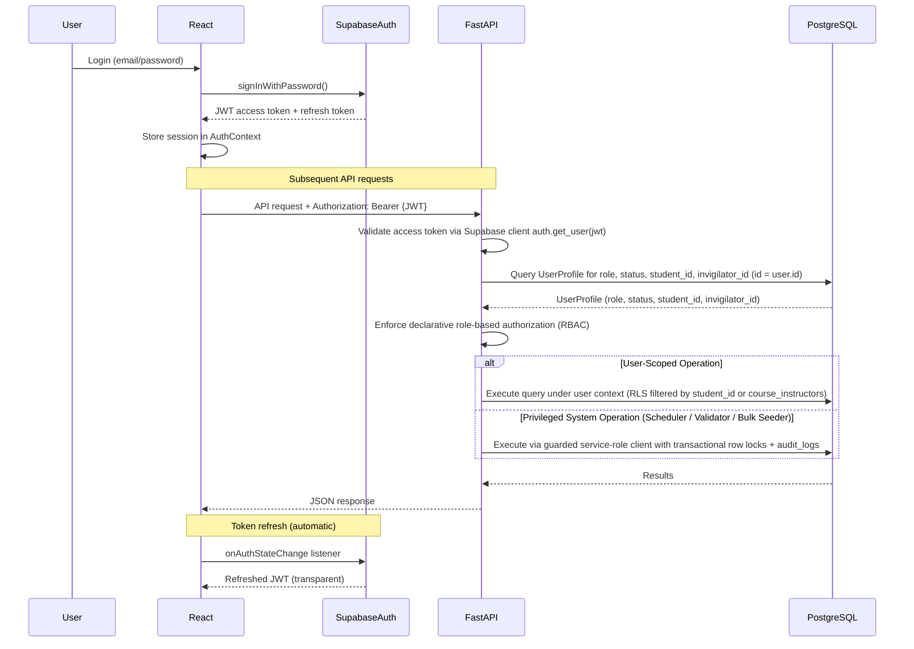

### Authentication Details

| Aspect | Implementation |
|--------|---------------|
| **Identity provider** | Supabase Auth (email/password) |
| **Token format** | JWT (JSON Web Token) |
| **Token storage** | Managed by Supabase JS client (browser storage) |
| **Token lifetime** | Configurable via Supabase dashboard (default: 1 hour access, 1 week refresh) |
| **Token validation** | Server-side validation via `supabase.auth.get_user(jwt)` (no HS256 assumption); optional cached asymmetric JWKS |
| **Session restoration** | On page load, AuthContext calls `supabase.auth.getSession()` to restore existing session |
| **Logout** | `supabase.auth.signOut()` clears all tokens; React Router redirects to login |
| **Immutable identity mapping** | Backend maps verified `user.id` to `UserProfile`: `student_id` for learners, `invigilator_id` for invigilators, `course_instructors` for faculty |
| **Protected routes** | React Router wrapper checks AuthContext; redirects unauthenticated users to `/login` |

### Token Verification Flow (Backend Detail)

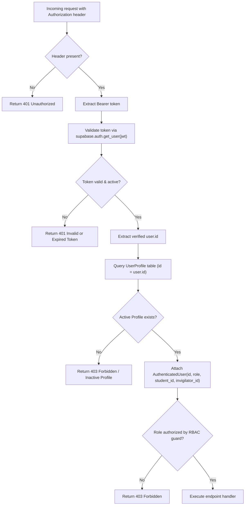

---

## 5. Scheduling Execution Flow

The scheduling engine is the core business logic of ExamOps. It runs as a synchronous operation within the FastAPI backend (benchmarked for 300 exams to confirm feasibility within Render request limits).

### 5.1 Scheduling Run Lifecycle

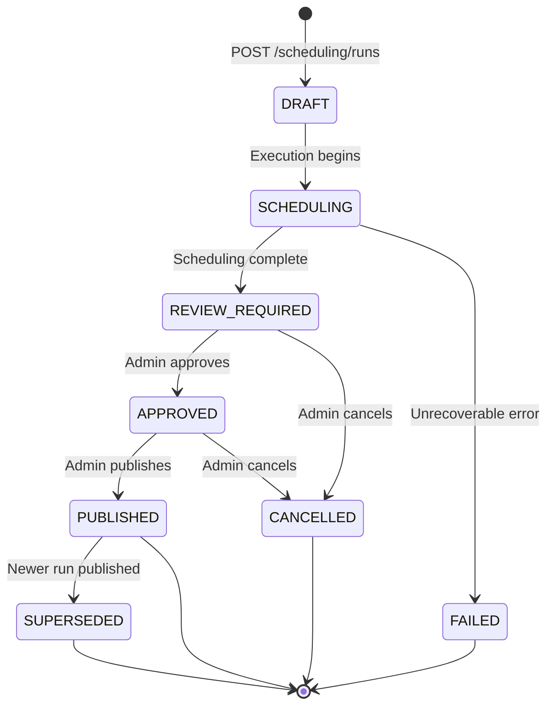

### 5.2 Complete Scheduling Sequence

```mermaid
sequenceDiagram
    participant Admin as Academic Admin
    participant React as Frontend
    participant API as FastAPI
    participant Service as SchedulingService
    participant Engine as Scheduling Engine
    participant Validator as Schedule Validator
    participant DB as PostgreSQL

    Admin->>React: Click "Create Scheduling Run"
    React->>API: POST /api/v1/scheduling/runs
    API->>API: Verify JWT + ACADEMIC_ADMINISTRATOR role

    Note over API,DB: Phase 1: Run Initialization & Input Freezing
    API->>Service: create_scheduling_run()
    Service->>DB: Insert SchedulingRun (status=DRAFT)
    DB-->>Service: run_id
    Service->>DB: Snapshot eligible participations → run_exam_students
    Service->>DB: Capture frozen input state (calendar, rooms, capacities, invigilators) → input_snapshot JSONB
    Service->>DB: Compute canonical SHA-256 digest of frozen inputs
    Service-->>API: Run created

    Note over API,Engine: Phase 2: Concurrent-Safe Scheduling Execution
    API->>Service: execute_scheduling_run(run_id)
    Service->>DB: BEGIN TRANSACTION & SELECT id FROM scheduling_runs WHERE id = run_id FOR UPDATE
    Note over Service,DB: Prevents duplicate concurrent executions of the same run
    Service->>DB: Update status → SCHEDULING
    Service->>Engine: run(scheduling_inputs)

    Note over Engine: Step 1: Load Inputs
    Engine->>DB: Load exams, students, rooms, invigilators
    Engine->>DB: Load requirements, accommodations, availability
    Engine->>Engine: Validate source data relationships

    Note over Engine: Step 2: Build Conflict Graph
    Engine->>Engine: Map student → exams
    Engine->>Engine: Create exam-exam edges where shared students exist
    Engine->>Engine: Calculate conflict degree per exam

    Note over Engine: Step 3: Priority Ordering
    Engine->>Engine: Sort exams by conflict degree, enrollment, restrictiveness, compatible rooms, ID

    Note over Engine: Step 4: Greedy Assignment Loop
    loop For each exam in priority order
        Engine->>Engine: Generate candidate time slots
        loop For each candidate time
            Engine->>Engine: Check student conflicts
            Engine->>Engine: Discover compatible rooms
            Engine->>Engine: Allocate students to rooms (accommodation-first)
            Engine->>Engine: Check room capacity
            Engine->>Engine: Assign invigilators
            Engine->>Engine: validate_candidate() → pass/fail
            alt Candidate valid
                Engine->>Engine: Score candidate
            end
        end
        alt Best valid candidate found
            Engine->>DB: Insert ScheduleAssignment
            Engine->>DB: Insert AssignmentStudent records (enforces UNIQUE run_exam_student_id)
            Engine->>DB: Insert AssignmentInvigilator records
            Engine->>DB: Insert SchedulingDecision (ASSIGNED)
            Engine->>DB: Insert ScheduleEvent
        else No valid candidate
            Engine->>DB: Insert SchedulingDecision (UNASSIGNED + reason codes)
        end
    end

    Note over Engine: Step 5: Bounded Improvement Pass
    Engine->>Engine: Revisit unassigned exams with alternative times/rooms
    Engine->>DB: Record any additional assignments or decisions

    Engine-->>Service: SchedulingResult summary

    Note over Service,Validator: Phase 3: Independent Validation
    Service->>Validator: validate_complete_schedule(run_id)
    Validator->>DB: Reload all assignments independently
    Validator->>Validator: Check student overlaps
    Validator->>Validator: Check room capacity
    Validator->>Validator: Check room availability
    Validator->>Validator: Check equipment requirements
    Validator->>Validator: Check accommodation compliance
    Validator->>Validator: Check invigilator availability
    Validator->>Validator: Check invigilator overlaps
    Validator->>Validator: Check staffing ratios
    Validator->>Validator: Reconcile enrollment counts & allocation uniqueness
    Validator->>DB: Insert ValidationIssue records (if any)
    Validator-->>Service: ValidationResult

    Service->>DB: Update status → REVIEW_REQUIRED
    Service->>DB: Record scheduling metrics
    Service-->>API: Scheduling complete
    API-->>React: Run result summary

    Note over Admin,DB: Phase 4: Review & Approval
    Admin->>React: Review assignments, decisions, validation
    Admin->>React: Click "Approve"
    React->>API: POST /api/v1/scheduling/runs/{run_id}/approve
    API->>API: Verify no hard-constraint violations
    API->>DB: Update status → APPROVED
    API->>DB: Insert AuditLog entry

    Note over Admin,DB: Phase 5: Atomic Publication Transaction
    Admin->>React: Click "Publish"
    React->>API: POST /api/v1/scheduling/runs/{run_id}/publish
    API->>DB: BEGIN TRANSACTION
    API->>DB: SELECT id FROM academic_periods WHERE id = period_id FOR UPDATE (Pessimistic Period Lock)
    API->>DB: SELECT id FROM scheduling_runs WHERE academic_period_id = period_id AND status = 'PUBLISHED' FOR UPDATE
    API->>DB: UPDATE scheduling_runs SET status = 'SUPERSEDED' WHERE academic_period_id = period_id AND status = 'PUBLISHED'
    API->>DB: UPDATE scheduling_runs SET status = 'PUBLISHED' WHERE id = run_id (Guaranteed by uq_published_run_per_period)
    API->>DB: Insert ScheduleEvent & AuditLog entry
    API->>DB: COMMIT TRANSACTION
    API-->>React: Published confirmation
```

### 5.3 Key Scheduling Decisions

| Decision Point | Logic |
|---------------|-------|
| **Exam ordering** | Most-constrained-first: highest conflict degree → largest enrollment → most restrictive requirements → fewest compatible rooms → stable ID |
| **Candidate generation** | Generate start times from academic date range × operating hours at configured slot granularity, filtered by exam duration |
| **Student conflict check** | `overlap = candidate_start < existing_end AND existing_start < candidate_end` |
| **Room allocation** | Students sorted by accommodation restrictiveness (most restrictive first); rooms sorted by best-fit capacity; sequential allocation until all students placed |
| **Invigilator assignment** | Required count from `ceil(students_in_room / max_students_per_invigilator)`; assigned from available pool without overlap |
| **Candidate validation** | Central `validate_candidate()` returns structured result with `is_valid`, `passed_constraints`, `failed_constraints`, `reason_codes` |
| **Candidate scoring** | Deterministic tuple: fewer rooms → lower waste capacity → lower invigilator impact → preferred time → stable room ID |
| **Unassigned exams** | Every unassigned exam gets one or more reason codes from actual candidate evaluations, never from timeout |

---

## 6. Data Flow Architecture

### 6.1 Data Generation Flow

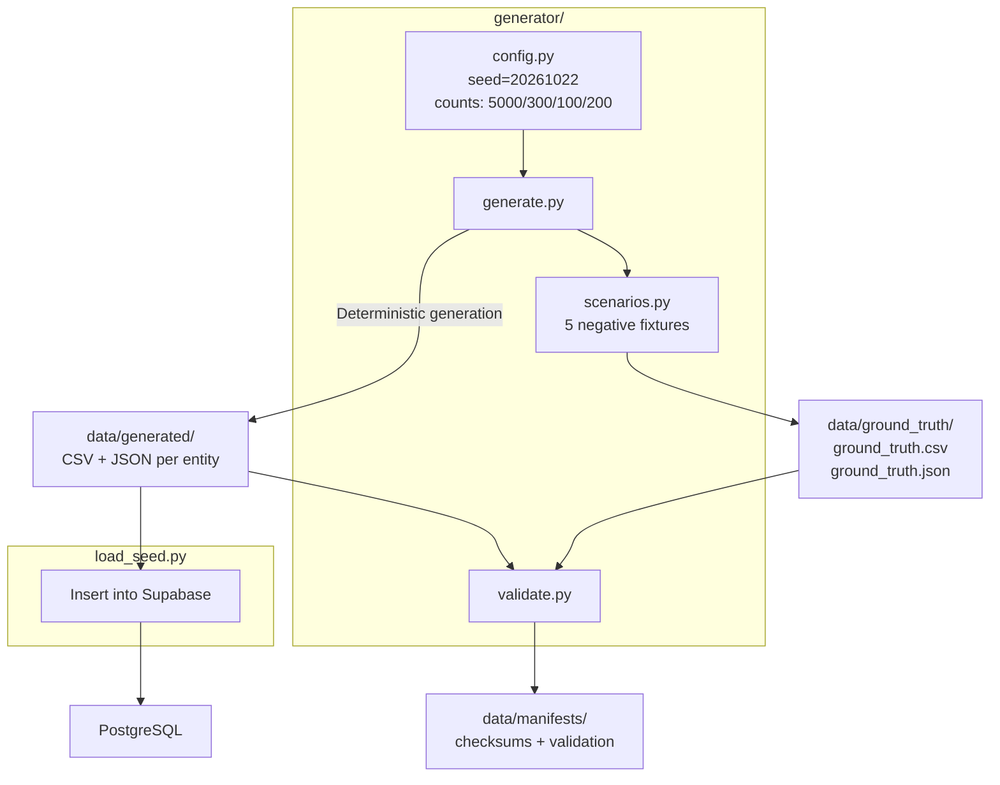

### 6.2 Operational Data Flow

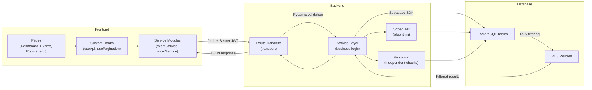

### 6.3 Domain-Specific Data Flows

| Domain | Write Path | Read Path |
|--------|-----------|-----------|
| **Students** | Admin creates via `POST /students` → service validates → insert into `students` | Frontend calls `GET /students` → service queries with pagination/filters → RLS filters by role |
| **Courses** | Admin creates via `POST /courses` → validate → insert into `courses` | All authenticated users can read courses |
| **Enrollments** | Admin creates via `POST /enrollments` → validate student + course exist → insert | Learners see own enrollments; admins see all |
| **Exams** | Admin creates via `POST /exams` → validate course exists → insert exam + requirements | All authenticated users can read exams |
| **Rooms** | Admin creates via `POST /rooms` → insert room + capacity + equipment + availability | Read via `GET /rooms` with utilization computed server-side |
| **Invigilators** | Admin creates via `POST /invigilators` → insert profile + availability records | Read with workload and assignment history |
| **Accommodations** | Admin creates via `POST /accommodations` → validate student exists → insert | Learner sees own; admin/support sees relevant; sensitive details restricted |
| **Scheduling** | Admin triggers run → engine writes assignments, decisions, events, validation issues | Read via run endpoints; decisions include full constraint evaluation |
| **Exceptions** | Engine creates automatically from unassigned exams / validation failures | Admin views and records resolution actions |
| **Audit** | Backend writes automatically on state transitions | Platform admin reads audit log |

---

## 7. API Layer Design

### 7.1 API Structure

| Aspect | Convention |
|--------|-----------|
| **Base prefix** | `/api/v1` |
| **Content type** | `application/json` |
| **Authentication** | Bearer JWT on every protected endpoint |
| **Authorization** | Role resolved from `UserProfile` table, never from request body |
| **Pagination** | Query params: `page`, `page_size` (default 20, max 100) |
| **Filtering** | Query params per entity (e.g., `?status=SCHEDULED&course_id=CRS-000042`) |
| **Sorting** | Query param: `sort_by`, `sort_order` (asc/desc) |
| **Error format** | `{ "detail": "message", "code": "ERROR_CODE" }` |
| **Status codes** | 200 OK, 201 Created, 400 Bad Request, 401 Unauthorized, 403 Forbidden, 404 Not Found, 409 Conflict, 422 Validation Error, 500 Internal Error |

### 7.2 Layer Separation

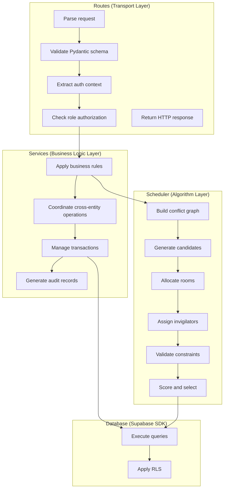

**Rules:**
- Route handlers handle HTTP concerns only (parsing, status codes, response formatting)
- Business logic lives in service modules (validation, orchestration, audit)
- Scheduling algorithm is isolated in `scheduler/` (no HTTP awareness)
- Database access goes through Supabase SDK (no raw SQL in routes)

### 7.3 Complete Endpoint Catalog

| Method | Endpoint | Purpose | Required Role |
|--------|----------|---------|--------------|
| `GET` | `/api/v1/me` | Current user profile + role | Any authenticated |
| `GET` | `/api/v1/students` | List students (paginated, filtered) | ACADEMIC_ADMINISTRATOR, SUPPORT_STAFF |
| `GET` | `/api/v1/students/{id}` | Student detail | ACADEMIC_ADMINISTRATOR, SUPPORT_STAFF, own LEARNER |
| `POST` | `/api/v1/students` | Create student | ACADEMIC_ADMINISTRATOR |
| `PATCH` | `/api/v1/students/{id}` | Update student | ACADEMIC_ADMINISTRATOR |
| `GET` | `/api/v1/courses` | List courses | Any authenticated |
| `POST` | `/api/v1/courses` | Create course | ACADEMIC_ADMINISTRATOR |
| `GET` | `/api/v1/enrollments` | List enrollments | ACADEMIC_ADMINISTRATOR, own LEARNER |
| `POST` | `/api/v1/enrollments` | Create enrollment | ACADEMIC_ADMINISTRATOR |
| `GET` | `/api/v1/exams` | List exams | Any authenticated |
| `GET` | `/api/v1/exams/{id}` | Exam detail | Any authenticated |
| `POST` | `/api/v1/exams` | Create exam | ACADEMIC_ADMINISTRATOR |
| `PATCH` | `/api/v1/exams/{id}` | Update exam | ACADEMIC_ADMINISTRATOR |
| `GET` | `/api/v1/rooms` | List rooms | ACADEMIC_ADMINISTRATOR, SUPPORT_STAFF |
| `GET` | `/api/v1/rooms/{id}` | Room detail | ACADEMIC_ADMINISTRATOR, SUPPORT_STAFF |
| `POST` | `/api/v1/rooms` | Create room | ACADEMIC_ADMINISTRATOR |
| `PATCH` | `/api/v1/rooms/{id}` | Update room | ACADEMIC_ADMINISTRATOR |
| `GET` | `/api/v1/invigilators` | List invigilators | ACADEMIC_ADMINISTRATOR |
| `POST` | `/api/v1/invigilators` | Create invigilator | ACADEMIC_ADMINISTRATOR |
| `GET` | `/api/v1/accommodations` | List accommodations | ACADEMIC_ADMINISTRATOR, SUPPORT_STAFF (limited) |
| `POST` | `/api/v1/accommodations` | Create accommodation | ACADEMIC_ADMINISTRATOR |
| `POST` | `/api/v1/scheduling/runs` | Create scheduling run | ACADEMIC_ADMINISTRATOR |
| `GET` | `/api/v1/scheduling/runs` | List scheduling runs | ACADEMIC_ADMINISTRATOR |
| `GET` | `/api/v1/scheduling/runs/{id}` | Run detail + metrics | ACADEMIC_ADMINISTRATOR |
| `GET` | `/api/v1/scheduling/runs/{id}/assignments` | Run assignments | ACADEMIC_ADMINISTRATOR, LEARNER (own) |
| `GET` | `/api/v1/scheduling/runs/{id}/decisions` | Scheduling decisions | ACADEMIC_ADMINISTRATOR |
| `POST` | `/api/v1/scheduling/runs/{id}/validate` | Re-validate run | ACADEMIC_ADMINISTRATOR |
| `POST` | `/api/v1/scheduling/runs/{id}/approve` | Approve run | ACADEMIC_ADMINISTRATOR |
| `POST` | `/api/v1/scheduling/runs/{id}/publish` | Publish run | ACADEMIC_ADMINISTRATOR |
| `GET` | `/api/v1/exceptions` | List exceptions | ACADEMIC_ADMINISTRATOR |
| `GET` | `/api/v1/exceptions/{id}` | Exception detail | ACADEMIC_ADMINISTRATOR |
| `POST` | `/api/v1/exceptions/{id}/resolve` | Record resolution | ACADEMIC_ADMINISTRATOR |
| `GET` | `/api/v1/analytics/overview` | Dashboard metrics | ACADEMIC_ADMINISTRATOR |
| `GET` | `/api/v1/analytics/utilization` | Resource utilization | ACADEMIC_ADMINISTRATOR |
| `GET` | `/api/v1/analytics/exceptions` | Exception analytics | ACADEMIC_ADMINISTRATOR |
| `GET` | `/api/v1/audit` | Audit log | PLATFORM_ADMINISTRATOR |

---

## 8. Frontend Architecture

### 8.1 Application Layout

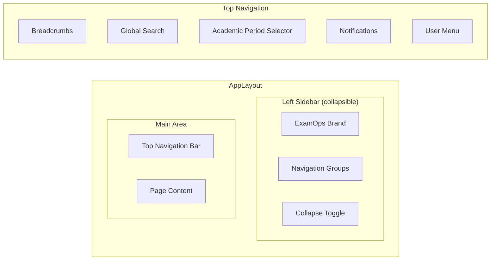

### 8.2 Routing Architecture

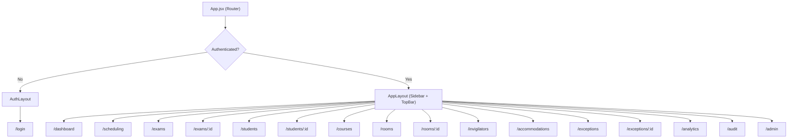

### 8.3 State Management

| Context | Purpose | Scope |
|---------|---------|-------|
| **AuthContext** | User session, JWT, role, login/logout methods | Global |
| **ThemeContext** | Design tokens, sidebar collapse state | Global |
| **NotificationContext** | Toast queue, success/error/info notifications | Global |

**Data fetching pattern:**
- Custom hooks (`useApi`) wrap native `fetch` with automatic JWT injection
- Page-level components fetch data on mount via hooks
- Loading, error, and empty states handled consistently via shared components
- No global data cache (each page fetches fresh data)

### 8.4 Component Hierarchy

```
AppLayout
├── AppSidebar
│   ├── BrandLogo
│   ├── NavigationGroup
│   │   └── NavigationItem (active state, icon)
│   └── CollapseToggle
├── TopNavigation
│   ├── Breadcrumbs
│   ├── SearchInput
│   ├── AcademicPeriodSelector
│   ├── NotificationBell
│   └── UserMenu
└── PageContent
    ├── PageHeader (title, description, actions)
    ├── FilterBar (search, filters, sort)
    ├── DataTable (columns, rows, pagination, sorting)
    ├── DetailDrawer / DetailPanel
    ├── Modal / ConfirmationDialog
    └── Page-specific components
        ├── Calendar (scheduling workspace)
        ├── Timeline (scheduling workspace)
        ├── MetricDisplay (dashboard)
        ├── ChartContainer (analytics)
        └── ExceptionInvestigation (exception center)
```

### 8.5 Reusable Component System

| Category | Components |
|----------|-----------|
| **Layout** | AppSidebar, TopNavigation, PageHeader, Breadcrumbs |
| **Forms** | Button, Input, Select, SearchInput, DateInput, Textarea |
| **Data Display** | DataTable, FilterBar, Pagination, StatusBadge, MetricDisplay |
| **Feedback** | Toast, LoadingState, ErrorState, EmptyState, ConfirmationDialog |
| **Overlays** | Modal, Drawer |
| **Navigation** | Tabs |
| **Visualization** | ChartContainer (wraps Recharts), Calendar, Timeline |

---

## 9. Security Architecture

> **Full security documentation is in [security.md](security.md).**

### Security Overview

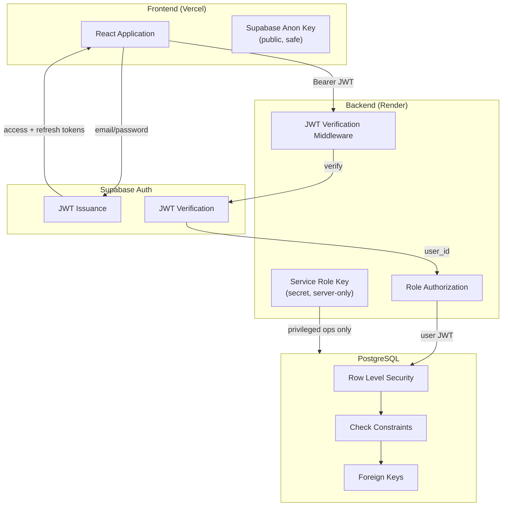

### Security Layers

| Layer | Mechanism | What It Protects |
|-------|-----------|-----------------|
| **Identity** | Supabase Auth (email/password, JWT) | Who the user is |
| **API Authentication** | JWT verification on every endpoint | Unauthenticated access |
| **API Authorization** | Role lookup from UserProfile table | Unauthorized operations |
| **Database Access** | Row Level Security policies | Cross-user data access |
| **Data Integrity** | FK constraints, check constraints, unique constraints | Invalid state |
| **Audit Trail** | Immutable AuditLog records | Accountability |
| **Secret Management** | Environment variables; service key on backend only | Credential exposure |

---

## 10. Deployment Architecture

### 10.1 Deployment Topology

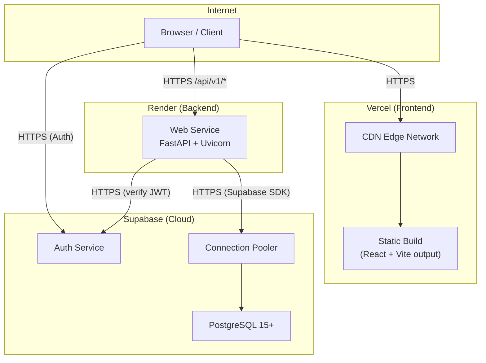

### 10.2 Environment Variables

| Variable | Platform | Purpose | Secret? |
|----------|----------|---------|---------|
| `VITE_SUPABASE_URL` | Vercel | Supabase project URL | No |
| `VITE_SUPABASE_ANON_KEY` | Vercel | Supabase anonymous/public key | No (public by design) |
| `VITE_API_BASE_URL` | Vercel | Backend API URL on Render | No |
| `SUPABASE_URL` | Render | Supabase project URL | No |
| `SUPABASE_SERVICE_ROLE_KEY` | Render | Supabase service role key | **Yes** |
| `SUPABASE_JWT_SECRET` | Render | JWT verification secret | **Yes** |
| `ALLOWED_ORIGINS` | Render | CORS allowed origins (Vercel URL) | No |

> [!CAUTION]
> The `SUPABASE_SERVICE_ROLE_KEY` bypasses RLS and must **never** be exposed in frontend code, client-side bundles, or public repositories. It is restricted to the Render backend environment.

### 10.3 Build & Deploy Pipeline

| Platform | Build Command | Output | Trigger |
|----------|--------------|--------|---------|
| **Vercel** | `cd frontend && npm install && npm run build` | `frontend/dist/` (static files) | Git push to `main` |
| **Render** | `cd backend && pip install -r requirements.txt` | Uvicorn process | Git push to `main` |
| **Supabase** | `supabase db push` (or manual migration via dashboard) | Schema changes applied | Manual / CLI |

### 10.4 CORS Configuration

```python
# backend/main.py
app.add_middleware(
    CORSMiddleware,
    allow_origins=[os.getenv("ALLOWED_ORIGINS", "http://localhost:5173")],
    allow_credentials=True,
    allow_methods=["GET", "POST", "PATCH", "DELETE", "OPTIONS"],
    allow_headers=["Authorization", "Content-Type"],
)
```

### 10.5 Health Check

| Endpoint | Purpose |
|----------|---------|
| `GET /health` | Backend health check (used by Render) — returns `{"status": "healthy"}` |
| `GET /api/v1/me` | Authenticated health check (verifies JWT + DB connectivity) |

---

## Appendix A: Key Architectural Decisions

| Decision | Choice | Rationale |
|----------|--------|-----------|
| **Synchronous scheduling** | Run scheduling synchronously within an API request | 300 exams with greedy algorithm should complete within Render's request timeout; avoids distributed job infrastructure complexity |
| **No ORM** | Use Supabase Python SDK directly | Specified stack; keeps data access explicit and aligned with Supabase RLS model |
| **No global state manager** | React Context + hooks | Application state is page-scoped; no cross-page cache required; simplifies reasoning about data freshness |
| **Monorepo** | Single repository with `frontend/`, `backend/`, `generator/` | Simplifies development workflow, deployment configuration, and repository submission |
| **JWT-based auth** | Supabase Auth with JWT tokens | Stateless API design; no server-side session storage; built-in token refresh |
| **RLS as defense-in-depth** | Row Level Security on all sensitive tables | Even if backend authorization has a bug, the database prevents unauthorized data access |
| **Deterministic scheduling** | Fixed seed, deterministic sort, no randomized selection | Reproducibility requirement; identical inputs must produce identical outputs |
| **Independent validation** | Separate `validate_complete_schedule()` function | Scheduler's own success flag is not proof; an independent checker reloads and reverifies all constraints |
| **Service-role key isolation** | Only on Render, never in frontend | Prevents RLS bypass from client; privileged operations audited |

---

## Appendix B: Cross-References

| Topic | Document |
|-------|----------|
| Security details | [security.md](security.md) |
| Entity-relationship model | [erd.md](erd.md) |
| Field-level data dictionary | [data_dictionary.md](data_dictionary.md) |
| Scheduling algorithm | [scheduling_algorithm.md](scheduling_algorithm.md) |
| Business rules & defaults | [business_rules.md](business_rules.md) |
| API endpoint reference | [FastAPI Interactive Swagger Docs](http://localhost:8000/docs) |
| Design system | [design_system.md](design_system.md) |
| Requirements register | [requirements.md](requirements.md) |
| Test strategy | [testing.md](testing.md) |
| Deployment guide | [render.yaml](../render.yaml) & [README.md](../README.md#7-backend-installation--startup) |
| Role-permission mapping | [permissions.md](permissions.md) |

---

## 11. Architectural Decision Records (ADRs)

### `DEC-001`: Topological Schema Migration Order
- **Context:** `user_profiles` is referenced by `course_instructors` (`instructor_profile_id`), `accommodation_notes` (`approved_by`), `scheduling_runs` (`created_by`), `validation_issues` (`resolved_by`), and `audit_logs` (`user_id`).
- **Decision:** Define and create `user_profiles` in foundational core migration alongside reference master data (`academic_periods`, `students`, `invigilators`), before `courses` and downstream operational tables.
- **Consequence:** Zero forward foreign key references or alter table patching needed during migration replay.

### `DEC-002`: Composite Integrity for Student Room Allocation
- **Context:** Students are snapshotted in `run_exam_students` and assigned to rooms in `assignment_students`. Simple foreign keys could allow assigning a snapshot from Run A into a room assignment belonging to Run B.
- **Decision:** Include `(scheduling_run_id, exam_id)` in `assignment_students` and enforce composite foreign keys to both `schedule_assignments(id, scheduling_run_id, exam_id, room_id)` and `run_exam_students(id, scheduling_run_id, exam_id, student_id)`.
- **Consequence:** PostgreSQL database engine guarantees that cross-run and cross-exam allocations are structurally impossible.

### `DEC-003`: Non-Recursive RLS Functions for User Profiles
- **Context:** Evaluating `user_profiles` RLS using subqueries on `user_profiles` causes infinite recursion errors in PostgreSQL.
- **Decision:** Create `SECURITY DEFINER` helper functions (`get_auth_role()`, `get_auth_student_id()`, `get_auth_invigilator_id()`) with strict `search_path = public` to read current user role and linkage without re-triggering RLS. Enforce role column immutability with a `BEFORE UPDATE` trigger.
- **Consequence:** Fast, non-recursive RLS policy checks and ironclad role self-escalation protection.

### `DEC-004`: Serialized Schedule Publication with Academic Period Row Locking
- **Context:** Concurrent publication requests could attempt to publish conflicting schedules simultaneously.
- **Decision:** Publications acquire an exclusive row lock on `academic_periods` (`SELECT ... FOR UPDATE`), check existing published runs, atomically update previous published runs to `SUPERSEDED`, and set target run to `PUBLISHED`, backed by a partial unique index `(academic_period_id) WHERE (status = 'PUBLISHED')`.
- **Consequence:** Guaranteed linearizable schedule publication with zero race conditions.

### `DEC-005`: Role Aliasing in Dependency-Injected Authentication
- **Context:** Frontend client conventions and problem documentation refer to user roles as `STUDENT`, `EXAM_OFFICER`, and `SUPER_ADMIN`, whereas the PostgreSQL database enum constraint uses `LEARNER`, `ACADEMIC_ADMINISTRATOR`, and `PLATFORM_ADMINISTRATOR`.
- **Decision:** Maintain a bidirectional `ROLE_ALIASES` mapping in `backend/auth.py`. Route handlers and dependency checkers accept both external and database-canonical forms transparently.
- **Consequence:** Full backward and forward compatibility between API consumers, UI forms, and PostgreSQL RLS constraints.

### `DEC-006`: Chunked Bulk Insert Optimization for High-Volume Seatings
- **Context:** Persisting an institutional schedule run produces 25,000+ student room seatings and hundreds of invigilator staffings. Executing individual `INSERT` queries took 35-40 seconds.
- **Decision:** Implement `psycopg2.extras.execute_values` with chunk sizes of 1,000 to 2,000 rows across `run_exam_students`, `schedule_assignments`, `assignment_students`, and `scheduling_decisions`.
- **Consequence:** Full run persistence latency reduced from ~40s to <1.0s while preserving all composite foreign key guarantees.
