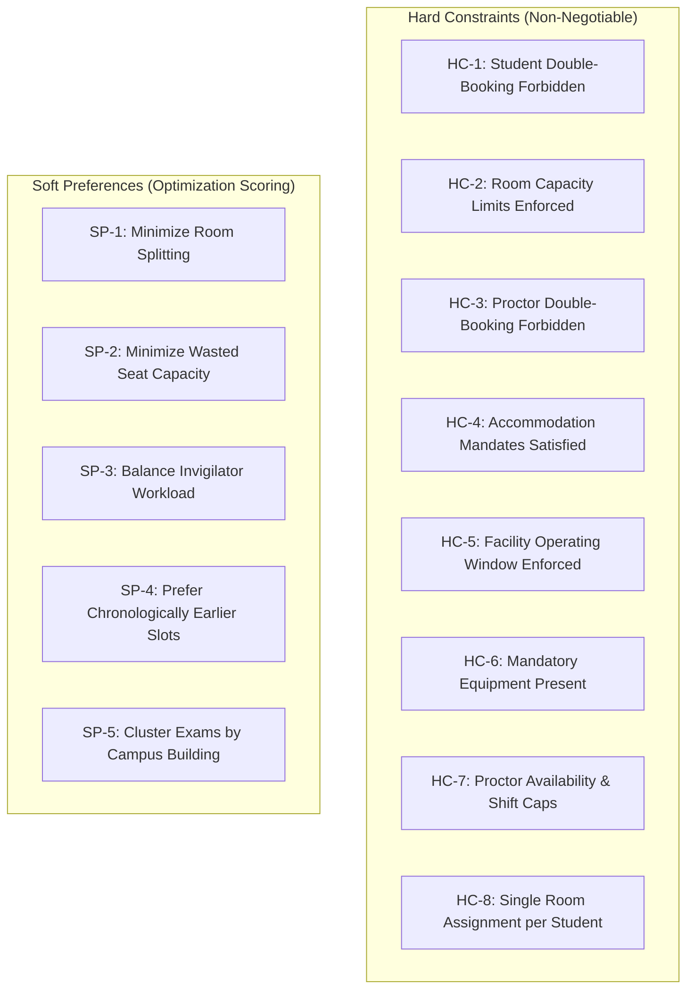

# ExamOps — Business Rules Register & Operational Contracts

> **Version:** 1.0.0  
> **Product:** ExamOps — Examination Operations & Intelligent Scheduling Platform  
> **Status:** Discovery / Authoritative Contract  
> **Last Updated:** 2026-11-01  
> **Authoritative Sources:** problem_statement.md, candidate_faq.pdf, submission_guidelines.pdf, AGENTS.md

---

## 1. Principles of Business Rule Governance

1. **Separation of Source Rules from Configurable Policy:**
   - **Explicit Source Requirements (`BR-SRC-*`):** Derived verbatim from the YottaFlex problem statement and recruitment documents. These are non-negotiable.
   - **Configurable Institutional Policy (`BR-CFG-*`):** Academic operational parameters (e.g. shift caps, proctor ratios, slot granularity) where institutional policy varies. These are implemented with documented, sensible defaults that can be adjusted in administrative configuration.
2. **Deterministic & Explainable:** Every rule must be programmatic, testable, and provide deterministic results given identical inputs.

---

## 2. Explicit Source Requirements (`BR-SRC`)

These rules are mandated by the authoritative project specification and cannot be bypassed.

| Rule ID | Name | Source Reference | Statement | Enforcement Level |
|---|---|---|---|---|
| `BR-SRC-001` | Zero Hard Constraint Violations | problem_statement.md §Validation Rules | No hard constraint may be violated in any confirmed examination assignment. | HARD (Engine & DB) |
| `BR-SRC-002` | Unscheduled Exam Explanations | problem_statement.md §Business Workflow | Every unscheduled examination must have one or more documented standard reason codes. | HARD (Engine) |
| `BR-SRC-003` | Resource Usage Reconciliation | problem_statement.md §Validation Rules | Room and invigilator capacity and assignment minutes must reconcile with totals across all assigned exams. | HARD (Validator) |
| `BR-SRC-004` | Consistent Accommodation Enforcement | problem_statement.md §Validation Rules | All student accommodations (time extensions, accessible rooms, quiet rooms) must be enforced consistently without exception. | HARD (Engine & Validator) |
| `BR-SRC-005` | Master Data Precedence | problem_statement.md §Business Workflow | Master data (`Student`, `Course`, `Room`, `Invigilator`) must be generated before dependent transaction/assignment records. | HARD (Generator & DB) |
| `BR-SRC-006` | Historical State Preservation | problem_statement.md §Business Workflow | Important operational state changes must be persisted as explicit records/events; history must never be blindly overwritten. | HARD (Architecture) |
| `BR-SRC-007` | Rule-Derived Outcomes | problem_statement.md §Business Workflow | Scheduling outcomes, metrics, and ground-truth labels must derive from documented business rules, not random generation. | HARD (Generator & Engine) |
| `BR-SRC-008` | Ground Truth Isolation | problem_statement.md §Synthetic Data §Step 7 | Ground-truth labels and expected anomaly records must be stored separately and never leaked into operational inputs. | HARD (Generator) |
| `BR-SRC-009` | Deterministic Identifiers | problem_statement.md §ID Conventions | Identifiers must follow standard zero-padded conventions (`STU-000001`, `EXAM-2026-000001`, etc.) and remain immutable. | HARD (System-wide) |
| `BR-SRC-010` | Referential Integrity | problem_statement.md §Entities | All child and junction records must reference valid, existing parent primary keys. No orphan records allowed. | HARD (Database Foreign Keys) |
| `BR-SRC-011` | Fixed Seed Reproducibility | problem_statement.md §Volume | Synthetic data generation must reproduce identical records across runs using fixed seed `20261022`. | HARD (Generator) |
| `BR-SRC-012` | Computed Derived Values | problem_statement.md §Synthetic Data §Step 6 | Enrollment totals, conflict counts, utilization metrics, and scheduling outcomes must be computed from source rows. | HARD (Backend API) |

---

## 3. Configurable Institutional Assumptions (`BR-CFG`)

These settings represent standard academic scheduling parameters. They are populated with sensible demo defaults and exposed in institutional configuration.

| Rule ID | Setting Name | Default Value | Unit | Rationale | Configurable |
|---|---|---|---|---|---|
| `BR-CFG-001` | Institution Timezone | `UTC` | Timezone | Avoids ambiguity in synthetic datasets and distributed deployments. | Yes |
| `BR-CFG-002` | Examination Window Dates | `2026-06-15` to `2026-06-30` | Date Range | Provides a realistic two-week examination period for 300 exams. | Yes |
| `BR-CFG-003` | Daily Operating Hours | `08:00` to `18:00` | Time Range | Standard university operational hours for examination administration. | Yes |
| `BR-CFG-004` | Time Slot Granularity | `30` | Minutes | Balances scheduling flexibility with candidate search space. | Yes |
| `BR-CFG-005` | Student Exam Buffer | `0` | Minutes | Back-to-back exams are permitted unless institutional policy enforces rest periods. | Yes |
| `BR-CFG-006` | Max Students per Invigilator | `30` | Students / Proctor | Typical higher-education proctoring ratio for standard lecture rooms. | Yes |
| `BR-CFG-007` | Max Invigilator Hours / Day | `8.0` | Hours | Fair labor standards preventing proctor cognitive fatigue. | Yes |
| `BR-CFG-008` | Max Invigilator Hours / Week | `25.0` | Hours | Institutional cap for part-time/academic staff invigilation workload. | Yes |
| `BR-CFG-009` | Extended Time Calculation | Absolute minutes preferred over % | Logic Rule | If both set, explicit minutes take precedence; percentage uses ceiling rounding. | Yes |
| `BR-CFG-010` | Room Occupation Policy | Max student duration in room | Logic Rule | Rooms and proctors remain reserved until the last accommodated student finishes. | Yes |
| `BR-CFG-011` | Approval Authority | `ACADEMIC_ADMINISTRATOR` or `PLATFORM_ADMINISTRATOR` | Roles | Ensures formal administrative signoff before schedule publication. | Yes |
| `BR-CFG-012` | Bounded Improvement Max Retries | `3` | Passes | Balances schedule completeness with deterministic runtime bounds. | Yes |
| `BR-CFG-013` | Weekend Scheduling | Exclude Sundays; Saturdays enabled | Logic Rule | Standard institutional practice during compressed final exam periods. | Yes |
| `BR-CFG-014` | Target Academic Courses | `80` | Courses | Yields realistic course sizes across 5,000 students and 300 exams (~3.75 exams/course). | Yes |
| `BR-CFG-015` | Average Student Course Load | `4.2` | Courses / Student | Typical full-time undergraduate term enrollment load. | Yes |
| `BR-CFG-016` | Accommodation Prevalence | `8.0%` | % of Students | Aligns with university accessibility services averages (5-10%). | Yes |
| `BR-CFG-017` | Facility Closure Rate | `5.0%` | % of Rooms | Injects realistic maintenance closures to test boundary constraints. | Yes |

---

## 4. Scheduling Constraint Rules

### 4.1 Hard Constraints (Evaluated by `validate_candidate` and `validate_complete_schedule`)
1. **HC-1 (Student Temporal Non-Overlap):** A student cannot be scheduled for two examinations whose effective duration windows overlap.
2. **HC-2 (Room Capacity Ceiling):** The number of students seated in a room for an examination assignment cannot exceed that room's effective `exam_capacity` on that date.
3. **HC-3 (Proctor Temporal Non-Overlap):** An invigilator cannot be assigned to more than one exam room during overlapping duty windows.
4. **HC-4 (Accommodation Enforcement):**
   - Students requiring `ACCESSIBLE_ROOM` must be assigned to rooms with `is_accessible = TRUE`.
   - Students requiring `LOW_DISTRACTION` must be placed in quiet rooms with designated low-distraction capacity.
   - Students with `EXTENDED_TIME` must receive their calculated extended duration.
5. **HC-5 (Operating Hours & Maintenance):** Exam assignments must fall entirely within room operating windows and have zero overlap with `CLOSED` or `MAINTENANCE` periods.
6. **HC-6 (Mandatory Hardware):** If an examination requires specialized equipment (e.g. computer terminals, lab benches), the assigned room must possess operational equipment matching the requirement.
7. **HC-7 (Proctor Qualifications & Workload):** Proctors must be marked `ACTIVE`, have open availability, and not exceed daily (8h) or weekly (25h) shift caps.
8. **HC-8 (Student Assignment Uniqueness):** In any given examination, each enrolled student must be assigned to exactly one physical room.

### 4.2 Soft Preferences (Evaluated during candidate scoring)
1. **SP-1 (Compact Allocations):** Favor single-room assignments over split-room assignments.
2. **SP-2 (Seat Efficiency):** Minimize unused capacity ($S_{\text{wasted}} = \text{Capacity} - \text{Students}$) to preserve large venues for large exams.
3. **SP-3 (Workload Equity):** Distribute invigilation hours proportionally among active staff.
4. **SP-4 (Chronological Front-Loading):** Schedule exams earlier in the exam period to maximize buffer time for rescheduling emergencies.
5. **SP-5 (Building Proximity):** Group exams within the same academic department into adjacent rooms/buildings.

---

## 5. Lifecycle State Machines & Transition Rules

### 5.1 SchedulingRun Lifecycle

#### Allowed State Transitions:
- `DRAFT -> SCHEDULING`: Triggered when administrator submits scheduling run request.
- `SCHEDULING -> REVIEW_REQUIRED`: Engine finishes; candidate assignments and decisions recorded.
- `SCHEDULING -> FAILED`: Unexpected execution error or resource exhaustion.
- `REVIEW_REQUIRED -> APPROVED`: Only permitted if `validate_complete_schedule()` returns zero `CRITICAL` issues AND actor has `ACADEMIC_ADMINISTRATOR` or `PLATFORM_ADMINISTRATOR` role.
- `REVIEW_REQUIRED -> CANCELLED`: Administrator rejects the draft schedule.
- `APPROVED -> PUBLISHED`: Makes schedule visible to Instructors and Learners.
- `PUBLISHED -> SUPERSEDED`: Occurs automatically when another run for the same academic period is published.

### 5.2 ScheduleAssignment Lifecycle
- `CONFIRMED`: Default state created by engine. Indicates valid assignment.
- `REJECTED`: Assignment marked invalid during validation or manual triage.
- `SUPERSEDED`: Inherited when parent `SchedulingRun` transitions to `SUPERSEDED` or `CANCELLED`.

### 5.3 ValidationIssue Lifecycle
- `OPEN`: Automatically recorded by engine or validator.
- `ACKNOWLEDGED`: Administrator has reviewed the diagnostic issue.
- `RESOLVED`: Underlying source data corrected and re-evaluated.
- `WONT_FIX`: Administrator explicitly accepts a non-critical warning.
