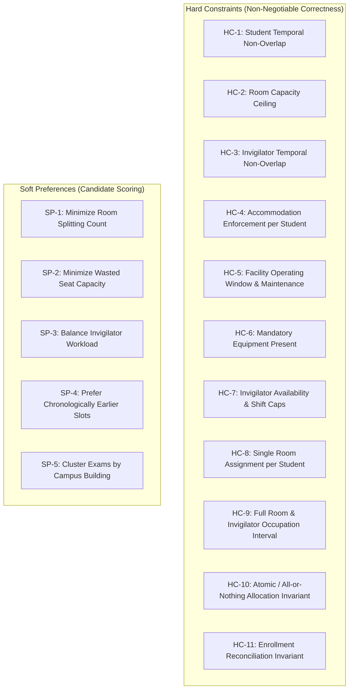
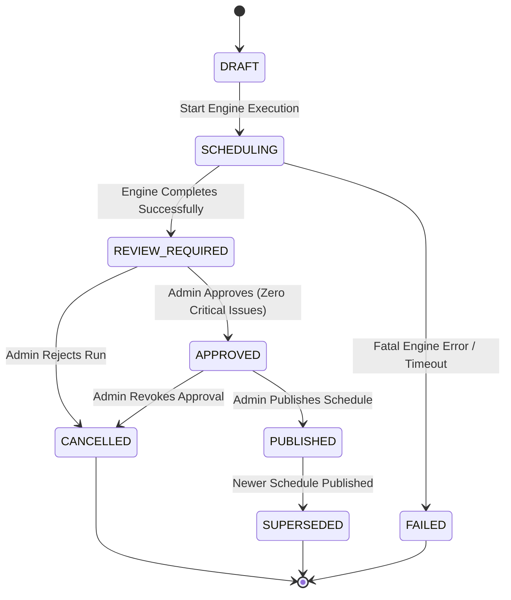

# ExamOps — Business Rules Register & Operational Contracts

> **Version:** 1.1.0  
> **Product:** ExamOps — Examination Operations & Intelligent Scheduling Platform  
> **Status:** Architecture Review / Authoritative Contract  
> **Last Updated:** 2026-11-01  
> **Authoritative Sources:** problem_statement.md, candidate_faq.pdf, submission_guidelines.pdf, AGENTS.md

---

## 1. Principles of Business Rule Governance

1. **Separation of Source Requirements from Configurable Policy:**
   - **Explicit Source Requirements (`BR-SRC-*`):** Mandated verbatim by the authoritative YottaFlex problem statement and recruitment documentation. These are non-negotiable hard rules.
   - **Configurable Institutional Policy (`BR-CFG-*`):** Institutional scheduling parameters (e.g. invigilator ratios, shift limits, slot granularity, operating hours). These are defined with documented, sensible **configurable demonstration defaults** that an institution can modify without altering core scheduling code.
2. **Deterministic & Explainable:** Every rule must be programmatic, testable, and produce deterministic results given identical inputs and configuration.
3. **No Unverified Legal or Standard Claims:** Configurable parameters are designated as institutional policy options, never mischaracterized as statutory mandates or universal industry benchmarks.

---

## 2. Explicit Source Requirements (`BR-SRC`)

These rules are mandated by the authoritative project specification and cannot be bypassed.

| Rule ID | Name | Source Reference | Statement | Enforcement Level |
|---|---|---|---|---|
| `BR-SRC-001` | Zero Hard Constraint Violations | problem_statement.md §Validation Rules | No hard constraint may be violated in any confirmed examination assignment. | HARD (Engine & DB) |
| `BR-SRC-002` | Unscheduled Exam Explanations | problem_statement.md §Business Workflow | Every unscheduled examination must have one or more documented standard reason codes. | HARD (Engine) |
| `BR-SRC-003` | Resource Usage Reconciliation | problem_statement.md §Validation Rules | Room and invigilator capacity and assignment minutes must reconcile with totals across all assigned exams. Total student seating must equal eligible enrollment. | HARD (Validator) |
| `BR-SRC-004` | Consistent Accommodation Enforcement | problem_statement.md §Validation Rules | All student accommodations (time extensions, accessible rooms, quiet rooms) must be enforced consistently without exception for each individual student. | HARD (Engine & Validator) |
| `BR-SRC-005` | Master Data Precedence | problem_statement.md §Business Workflow | Master data (`Student`, `Course`, `Room`, `Invigilator`) must be generated before dependent transaction/assignment records. | HARD (Generator & DB) |
| `BR-SRC-006` | Historical State Preservation | problem_statement.md §Business Workflow | Important operational state changes must be persisted as explicit records/events; history must never be overwritten. | HARD (Architecture) |
| `BR-SRC-007` | Rule-Derived Outcomes | problem_statement.md §Business Workflow | Scheduling outcomes, metrics, and ground-truth labels must derive from documented business rules, not random generation. | HARD (Generator & Engine) |
| `BR-SRC-008` | Ground Truth Isolation | problem_statement.md §Synthetic Data §Step 7 | Ground-truth labels and expected anomaly records must be stored separately and never leaked into operational inputs. | HARD (Generator) |
| `BR-SRC-009` | Deterministic Identifiers | problem_statement.md §ID Conventions | Identifiers must follow standard zero-padded conventions (`STU-000001`, `EXAM-2026-000001`, etc.) and remain immutable. | HARD (System-wide) |
| `BR-SRC-010` | Referential Integrity | problem_statement.md §Entities | All child and junction records must reference valid, existing parent primary keys. No orphan records allowed. | HARD (Database Foreign Keys) |
| `BR-SRC-011` | Fixed Seed Reproducibility | problem_statement.md §Volume | Synthetic data generation must reproduce identical records across runs using fixed seed `20261022`. | HARD (Generator) |
| `BR-SRC-012` | Computed Derived Values | problem_statement.md §Synthetic Data §Step 6 | Enrollment totals, conflict counts, utilization metrics, and scheduling outcomes must be computed from source rows. | HARD (Backend API) |
| `BR-SRC-013` | Single Source of Truth for Duration | Candidate Review Gate 0.2 §9 | Base exam duration is stored exclusively in `exams.duration_minutes`. `exam_requirements` never duplicates duration. | HARD (Schema & Engine) |
| `BR-SRC-014` | Historical Data Preservation | Candidate Review Gate 0.2 §4 | Ordinary DELETE on historical runs, assignments, snapshots, and decisions is prohibited. Records are preserved via `RESTRICT` foreign keys and lifecycle states (`CANCELLED`, `SUPERSEDED`). | HARD (Database Engine) |
| `BR-SRC-015` | Concurrency & Atomic Publication | Candidate Review Gate 0.2 §6 | At most one schedule may be `PUBLISHED` per academic period (enforced by partial unique index). Run executions acquire row locks `FOR UPDATE`. | HARD (Database Engine) |

---

## 3. Configurable Institutional Demonstration Defaults (`BR-CFG`)

These settings represent institutional operational parameters. They are populated with configurable demonstration defaults and exposed through system configuration.

| Rule ID | Setting Name | Configurable Demonstration Default | Unit | Operational Rationale | Configurable |
|---|---|---|---|---|---|
| `BR-CFG-001` | Institutional Scheduling Timezone | `Asia/Kolkata` (IST, UTC+05:30) | Timezone | Aligns calendar schedules with demonstration campus local operations. Database stores UTC; local time applies to operating hours and availability. | Yes |
| `BR-CFG-002` | Examination Window Dates | `2026-12-01` to `2026-12-14` | Date Range | Future synthetic window after November 1, 2026. Exactly 14 inclusive calendar days ($14 - 1 + 1 = 14$ days; 12 active exam days excluding Sundays). Never hardcoded. | Yes |
| `BR-CFG-003` | Daily Operating Hours | `08:00` to `18:00` local time | Time Range | 10-hour daily operational window for scheduling evaluations (08:00 IST = 02:30 UTC; 18:00 IST = 12:30 UTC). | Yes |
| `BR-CFG-004` | Time Slot Granularity | `30` | Minutes | Incremental step for candidate slot generation. Balances placement resolution with evaluation speed. | Yes |
| `BR-CFG-005` | Student Exam Buffer | `0` | Minutes | Clean adjacent handoffs permitted ($T_1.\text{end} \le T_2.\text{start}$). Institutions may configure a rest/travel buffer (e.g. 30m). | Yes |
| `BR-CFG-006` | Student-to-Invigilator Ratio | `30` | Students / Invigilator | Staffing heuristic: 1 invigilator per 30 students seated in a room ($\lceil S / 30 \rceil$). | Yes |
| `BR-CFG-007` | Minimum Invigilators per Room | `1` | Invigilators / Room | Baseline venue supervision rule: no active examination room may be unstaffed. | Yes |
| `BR-CFG-008` | Max Invigilator Hours / Day | `8.0` | Hours / Day | Institutional workload cap preventing invigilator cognitive fatigue. | Yes |
| `BR-CFG-009` | Max Invigilator Hours / Week | `25.0` | Hours / Week | Weekly workload cap for invigilation staff across a rolling 7-day period. | Yes |
| `BR-CFG-010` | Extended Time Precedence | Explicit minutes preferred over % | Logic Rule | When both explicit extra minutes and percentage extension exist, explicit minutes take precedence. | Yes |
| `BR-CFG-011` | Extra Time Rounding | Ceiling to nearest integer minute | Logic Rule | Percentage extensions rounded up via `math.ceil` to ensure full accommodation compliance. | Yes |
| `BR-CFG-012` | Room Occupation Duration | Max student duration in room | Logic Rule | Venue and invigilators remain reserved until the longest-accommodated student in that room completes. | Yes |
| `BR-CFG-013` | Low-Distraction Room Capacity | `15` | Max Students | Maximum cohort size permitted in a quiet/low-distraction examination venue. | Yes |
| `BR-CFG-014` | Approval Authority | `ACADEMIC_ADMINISTRATOR` or `PLATFORM_ADMINISTRATOR` | Roles | Enterprise security rule: requires formal administrative signoff before schedule publication. | Yes |
| `BR-CFG-015` | Bounded Improvement Max Passes | `3` | Passes | Maximum retry iterations for attempting to place unassigned exams without displacing confirmed assignments. | Yes |
| `BR-CFG-016` | Weekend Scheduling Policy | Saturdays enabled; Sundays closed | Logic Rule | Demonstration operational calendar allowing Saturday sessions and reserving Sundays. | Yes |
| `BR-CFG-017` | Target Academic Courses | `80` | Courses | Master data distribution setting yielding realistic course enrollments across 5,000 students and 300 exams. | Yes |
| `BR-CFG-018` | Average Student Course Load | `4.2` | Courses / Student | Synthetic enrollment density setting producing realistic student conflict graph edges. | Yes |
| `BR-CFG-019` | Accommodation Prevalence Rate | `8.0%` | % of Students | Synthetic demographic generation parameter for disability and accessibility profiles. | Yes |
| `BR-CFG-020` | Facility Maintenance Rate | `5.0%` | % of Rooms | Scheduled maintenance closure rate across campus rooms to trigger Negative Scenario 5. | Yes |

---

## 4. Scheduling Constraint Rules & Room-Splitting Validation

### 4.1 Hard Constraints (Evaluated by `validate_candidate()` and `validate_complete_schedule()`)

1. **HC-1 (Student Temporal Non-Overlap):** A student cannot be scheduled for two examinations whose effective time windows overlap ($T_{A}.\text{start} < T_{B}.\text{end} \land T_{B}.\text{start} < T_{A}.\text{end}$).
2. **HC-2 (Room Capacity Ceiling):** The number of students seated in a room for an examination assignment cannot exceed that room's effective `exam_capacity` on that date.
3. **HC-3 (Invigilator Temporal Non-Overlap):** An invigilator cannot be assigned to more than one examination room during overlapping duty windows.
4. **HC-4 (Individual Accommodation Enforcement):**
   - Students requiring `ACCESSIBLE_ROOM` must be assigned to rooms with `is_accessible = TRUE`.
   - Students requiring `LOW_DISTRACTION` must be placed in venues designated for low distraction with capacity $\le 15$.
   - Students requiring `EXTENDED_TIME` must receive their individually computed extended duration.
5. **HC-5 (Operating Hours & Maintenance):** Exam assignments must fall entirely within room operating windows (08:00 to 18:00 local time) and have zero overlap with `CLOSED` or `MAINTENANCE` periods.
6. **HC-6 (Mandatory Hardware):** If an examination requires specialized equipment (e.g. computer terminals, laboratory benches), the assigned room must possess operational equipment matching the requirement.
7. **HC-7 (Invigilator Availability & Workload Caps):** Invigilators must be marked `ACTIVE`, have open availability in `availabilities`, and not exceed daily (8.0h) or weekly (25.0h) workload caps.
8. **HC-8 (Student Allocation Uniqueness & Completeness):** For every eligible student-exam pair in `run_exam_students`:
   - If the exam is unassigned: **zero** allocations exist.
   - If the exam is confirmed: **exactly one** allocation exists in `assignment_students` (enforced at DB level by `run_exam_student_id UNIQUE`).
   - A student can **never** have more than one room allocation for the same examination across split rooms.
   - No partial examination may ever be confirmed.
9. **HC-9 (Full Occupation Interval Reservation):** Every room and its assigned invigilators are reserved for the full occupation duration of the longest student assigned to that room:
   $$\text{room\_end\_time} = T_{\text{start}} + \max_{s \in \text{students}(R)} (\text{effective\_duration}(s))$$
10. **HC-10 (Atomic / All-or-Nothing Allocation Invariant):** Partial allocations can never become confirmed examinations. If an examination has 80 students and only 75 can be placed, or if 1 split room cannot be staffed with an invigilator, the entire candidate allocation is aborted and rolled back.
11. **HC-11 (Enrollment Reconciliation Invariant):** The sum of students assigned across all rooms for an examination must equal the total eligible student enrollment for that examination snapshot:
    $$\sum_{R \in \text{AllocatedRooms}(E)} |\text{students}(R)| = |\text{EligibleEnrollment}(E)|$$

### 4.2 Soft Preferences (Evaluated during candidate scoring)

Candidates that pass all hard constraints are scored deterministically:
1. **SP-1 (Compact Allocations):** Minimize the number of split rooms ($N_{\text{rooms}}$). Single-room allocations are preferred.
2. **SP-2 (Seat Efficiency):** Minimize wasted seat capacity ($S_{\text{wasted}} = \sum (\text{exam\_capacity} - |\text{students}|)$) to conserve large venues for larger upcoming exams.
3. **SP-3 (Workload Equity):** Distribute invigilation hours proportionally among available active staff.
4. **SP-4 (Chronological Front-Loading):** Prefer earlier calendar slots to leave buffer days at the end of the session for unforeseen contingencies.
5. **SP-5 (Building Proximity):** Group examinations within the same academic department into adjacent rooms or buildings.

---

## 5. Lifecycle State Machines & Transition Rules

### 5.1 SchedulingRun Lifecycle

#### Allowed State Transitions:
- `DRAFT -> SCHEDULING`: Triggered when an authorized administrator initiates a scheduling run.
- `SCHEDULING -> REVIEW_REQUIRED`: Engine finishes; candidate assignments, unassigned exams, and decisions are recorded.
- `SCHEDULING -> FAILED`: Execution aborted due to unhandled fatal error or timeout.
- `REVIEW_REQUIRED -> APPROVED`: Only permitted if `validate_complete_schedule()` returns zero `CRITICAL` issues AND the user holds `ACADEMIC_ADMINISTRATOR` or `PLATFORM_ADMINISTRATOR` role.
- `REVIEW_REQUIRED -> CANCELLED`: Administrator rejects the draft schedule.
- `APPROVED -> PUBLISHED`: Makes schedule visible to Instructors and Learners.
- `PUBLISHED -> SUPERSEDED`: Occurs automatically when another run for the same academic period transitions to `PUBLISHED`.

### 5.2 ScheduleAssignment Lifecycle
- `CONFIRMED`: Valid assignment generated by engine and committed.
- `REJECTED`: Assignment marked invalid during validation triage.
- `SUPERSEDED`: Inherited when parent `SchedulingRun` transitions to `SUPERSEDED` or `CANCELLED`.

### 5.3 ValidationIssue Lifecycle
- `OPEN`: Automatically recorded by engine or independent validator.
- `ACKNOWLEDGED`: Administrator has reviewed the diagnostic issue.
- `RESOLVED`: Underlying source data corrected and re-evaluated through the scheduler.
- `WONT_FIX`: Administrator explicitly accepts a non-critical informational warning.
