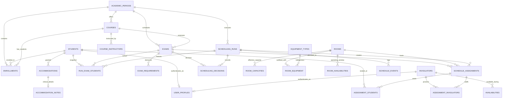

# ExamOps Database Entity Relationship Map & Cardinality Matrix

**Audit Date**: 2026-11-02  
**Target Environment**: Supabase Managed PostgreSQL 17.11  
**Project Reference**: `ndlysanfeowexvtlvhxd`  

---

## 1. Relational Cardinality & Dependency Matrix

The ExamOps relational architecture enforces academic integrity through normalized relational models, composite foreign keys, and explicit referential constraints.



---

## 2. Table-by-Table Cardinality & Foreign Key Registry

| Child Table | Foreign Key Column | Parent Table | Parent Key | Cardinality | On Delete Action | Integrity Purpose |
| :--- | :--- | :--- | :--- | :--- | :--- | :--- |
| `courses` | `academic_period_id` | `academic_periods` | `id` | N:1 | `RESTRICT` | Course offering bound to valid period |
| `course_instructors` | `course_id` | `courses` | `id` | N:1 | `RESTRICT` | Instructor course assignment |
| `course_instructors` | `instructor_profile_id` | `user_profiles` | `id` | N:1 | `RESTRICT` | Instructor profile authentication linkage |
| `enrollments` | `student_id` | `students` | `id` | N:1 | `RESTRICT` | Student enrollment record |
| `enrollments` | `course_id` | `courses` | `id` | N:1 | `RESTRICT` | Course enrollment record |
| `enrollments` | `academic_period_id` | `academic_periods` | `id` | N:1 | `RESTRICT` | Term enrollment isolation |
| `exams` | `course_id` | `courses` | `id` | N:1 | `RESTRICT` | Course examination ownership |
| `exams` | `academic_period_id` | `academic_periods` | `id` | N:1 | `RESTRICT` | Term exam period isolation |
| `exam_requirements` | `exam_id` | `exams` | `id` | N:1 | `CASCADE` | Mandatory equipment/facility requirements |
| `room_capacities` | `room_id` | `rooms` | `id` | N:1 | `RESTRICT` | Effective-dated capacity envelope |
| `room_equipment` | `room_id` | `rooms` | `id` | N:1 | `RESTRICT` | Physical room equipment instance |
| `room_equipment` | `equipment_type_id` | `equipment_types` | `id` | N:1 | `RESTRICT` | Equipment catalog classification |
| `room_availabilities` | `room_id` | `rooms` | `id` | N:1 | `RESTRICT` | Operating hours and maintenance closures |
| `availabilities` | `invigilator_id` | `invigilators` | `id` | N:1 | `RESTRICT` | Working hours and availability windows |
| `accommodations` | `student_id` | `students` | `id` | N:1 | `RESTRICT` | Approved student accommodations |
| `accommodation_notes`| `accommodation_id` | `accommodations` | `id` | 1:1 | `CASCADE` | Medical & clinical notes (isolated RLS) |
| `accommodation_notes`| `approved_by` | `user_profiles` | `id` | N:1 | `RESTRICT` | Approving disability officer linkage |
| `user_profiles` | `student_id` | `students` | `id` | 1:1 | `RESTRICT` | Learner portal account linkage |
| `user_profiles` | `invigilator_id` | `invigilators` | `id` | 1:1 | `RESTRICT` | Faculty/Proctor portal account linkage |
| `scheduling_runs` | `academic_period_id` | `academic_periods` | `id` | N:1 | `RESTRICT` | Academic term context |
| `scheduling_runs` | `created_by` | `user_profiles` | `id` | N:1 | `SET NULL` | Administrator execution provenance |
| `schedule_assignments`| `scheduling_run_id` | `scheduling_runs` | `id` | N:1 | `RESTRICT` | Execution run container |
| `schedule_assignments`| `exam_id` | `exams` | `id` | N:1 | `RESTRICT` | Assigned examination |
| `schedule_assignments`| `room_id` | `rooms` | `id` | N:1 | `RESTRICT` | Allocated physical facility |
| `run_exam_students` | `scheduling_run_id` | `scheduling_runs` | `id` | N:1 | `RESTRICT` | Run input snapshot container |
| `run_exam_students` | `exam_id` | `exams` | `id` | N:1 | `RESTRICT` | Snapshot exam reference |
| `run_exam_students` | `student_id` | `students` | `id` | N:1 | `RESTRICT` | Snapshot student participant reference |
| `assignment_students` | `assignment_id` | `schedule_assignments` | `id` | N:1 | `RESTRICT` | Host assignment block |
| `assignment_students` | `run_exam_student_id`| `run_exam_students`| `id` | 1:1 | `RESTRICT` | Individual frozen participant seat |
| `assignment_invigilators`| `assignment_id` | `schedule_assignments` | `id` | N:1 | `RESTRICT` | Host assignment block |
| `assignment_invigilators`| `invigilator_id` | `invigilators` | `id` | N:1 | `RESTRICT` | Assigned proctor |
| `scheduling_decisions`| `scheduling_run_id` | `scheduling_runs` | `id` | N:1 | `RESTRICT` | Run decision provenance |
| `scheduling_decisions`| `exam_id` | `exams` | `id` | N:1 | `RESTRICT` | Evaluated examination |
| `schedule_events` | `scheduling_run_id` | `scheduling_runs` | `id` | N:1 | `RESTRICT` | State change event trail |
| `validation_issues` | `scheduling_run_id` | `scheduling_runs` | `id` | N:1 | `RESTRICT` | Diagnostic exception log |
| `audit_logs` | `user_id` | `user_profiles` | `id` | N:1 | `SET NULL` | User action accountability |

---

## 3. Composite Integrity Constraints & Invariants

ExamOps establishes composite relational integrity to prevent room-assignment desynchronization across multi-room examinations:

### 3.1 Composite Foreign Key 1: Assignment-Room Coherence
```sql
CONSTRAINT fk_asgn_sa_composite FOREIGN KEY (assignment_id, scheduling_run_id, exam_id, room_id)
    REFERENCES schedule_assignments(id, scheduling_run_id, exam_id, room_id) ON DELETE RESTRICT
```
- **Guarantee**: An `assignment_students` seat record cannot point to an `assignment_id` belonging to a different `scheduling_run_id`, `exam_id`, or `room_id`.

### 3.2 Composite Foreign Key 2: Participant-Cohort Coherence
```sql
CONSTRAINT fk_asgn_res_composite FOREIGN KEY (run_exam_student_id, scheduling_run_id, exam_id, student_id)
    REFERENCES run_exam_students(id, scheduling_run_id, exam_id, student_id) ON DELETE RESTRICT
```
- **Guarantee**: A student can only be seated into an examination if they exist in the frozen snapshot `run_exam_students` for that exact examination and scheduling run.

