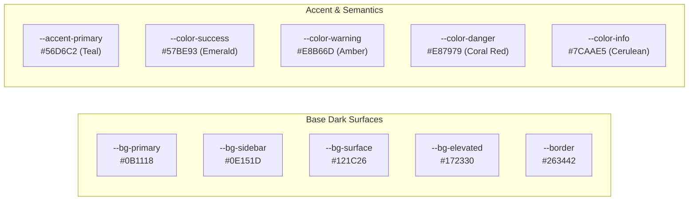
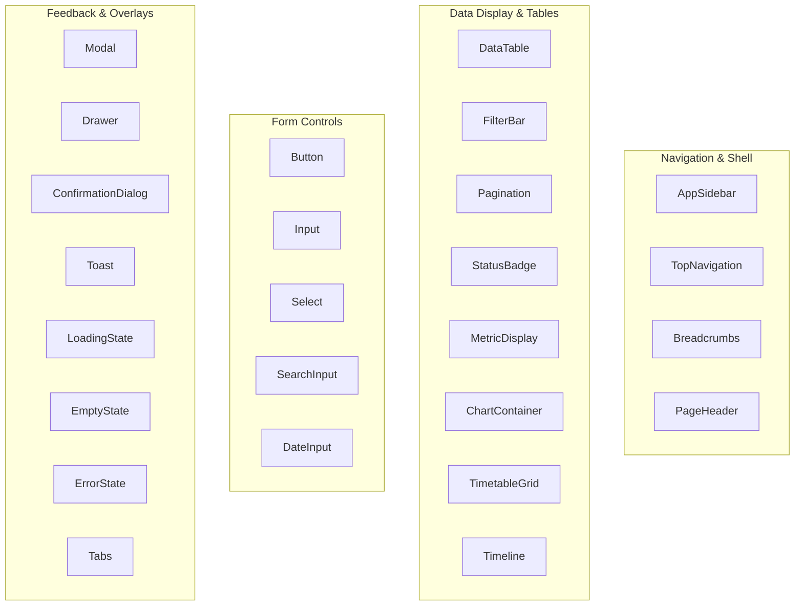

# ExamOps — Design System & Visual Identity Specification

> **Version:** 1.0.0  
> **Product:** ExamOps — Examination Operations & Intelligent Scheduling Platform  
> **Interface Paradigm:** Premium Dark-First Enterprise Operations System  
> **Last Updated:** 2026-11-01  
> **Authoritative Sources:** AGENTS.md §04, §05

---

## 1. Product Identity & Brand Direction

### 1.1 Brand Foundation
- **Product Name:** ExamOps
- **Full Title:** Examination Operations & Intelligent Scheduling Platform
- **Tagline:** *"Plan Smarter. Schedule Precisely. Operate With Confidence."*
- **Brand Character:** Professional, reliable, organized, transparent, technically rigorous, enterprise-grade.
- **Visual Reference Benchmarks:** Linear, Stripe Dashboard, Vercel console, modern mission-control operations platforms. Avoid generic AI-generated template aesthetics, garish neon colors, or decorative floating glassmorphism.

---

## 2. Color System & Design Tokens

The palette is engineered specifically for extended operational focus, high data density, and clear status differentiation in high-stress scheduling environments.



### 2.1 CSS Custom Properties & WCAG Contrast Ratios

| Design Token | Hex Code | Semantic Role | Contrast vs `#0B1118` | WCAG AA / AAA |
|---|---|---|---|---|
| `--bg-primary` | `#0B1118` | Main page background | — | Base |
| `--bg-sidebar` | `#0E151D` | Navigation sidebar background | 1.1:1 | Structural surface |
| `--bg-surface` | `#121C26` | Card, table, panel surfaces | 1.3:1 | Component surface |
| `--bg-elevated` | `#172330` | Modals, drawers, dropdowns | 1.6:1 | Floating surface |
| `--border` | `#263442` | Dividers, table borders, input outlines | 2.1:1 | Structural boundary |
| `--border-focus` | `#56D6C2` | Active keyboard focus rings | 9.8:1 | Pass AAA |
| `--text-primary` | `#E8EEF5` | Headings, primary values, active labels | 14.3:1 | Pass AAA (Normal text) |
| `--text-secondary` | `#9AAABA` | Supporting labels, table headers, metadata | 8.1:1 | Pass AAA (Normal text) |
| `--text-muted` | `#67788A` | Disabled states, timestamps | 4.8:1 | Pass AA (Normal text) |
| `--accent-primary` | `#56D6C2` | Primary buttons, active tabs, links | 9.8:1 | Pass AAA (Large/UI) |
| `--color-success` | `#57BE93` | Confirmed assignments, passed validation | 8.3:1 | Pass AAA |
| `--color-warning` | `#E8B66D` | Review required, non-critical warnings | 9.5:1 | Pass AAA |
| `--color-danger` | `#E87979` | Hard constraint failures, critical issues | 7.2:1 | Pass AA |
| `--color-info` | `#7CAAE5` | Draft schedules, neutral informational badges | 8.0:1 | Pass AAA |

---

## 3. Typography System

The typography uses **Inter** (clean, neutral, highly legible at small sizes) with strict tabular figures for numerical data.

```css
@import url('https://fonts.googleapis.com/css2?family=Inter:wght@400;500;600;700&family=JetBrains+Mono:wght@400;500&display=swap');

:root {
  --font-sans: 'Inter', system-ui, -apple-system, BlinkMacSystemFont, 'Segoe UI', Roboto, sans-serif;
  --font-mono: 'JetBrains Mono', ui-monospace, SFMono-Regular, Menlo, Monaco, Consolas, monospace;
}
```

### 3.1 Type Scale Hierarchy

| Style Level | Font Family | Size / Line-Height | Weight | Tracking | Usage Context |
|---|---|---|---|---|---|
| Page Header (`H1`) | Inter | `24px / 32px` | 600 (SemiBold) | `-0.02em` | Main page title (one per view) |
| Section Header (`H2`) | Inter | `18px / 26px` | 600 (SemiBold) | `-0.01em` | Panel titles, table headers |
| Card Title (`H3`) | Inter | `15px / 22px` | 600 (SemiBold) | `0em` | Widget headings, modal titles |
| Subheading (`H4`) | Inter | `13px / 18px` | 600 (SemiBold) | `0.01em` | Filter group titles, form sections |
| Body Text | Inter | `14px / 20px` | 400 (Regular) | `0em` | General content, descriptive text |
| Body Small | Inter | `12px / 16px` | 400 (Regular) | `0.01em` | Field helper text, timestamps |
| Table Data | Inter | `13px / 18px` | 400 / 500 | `0em` | Table rows (with `tabular-nums`) |
| Metric Display | Inter | `32px / 40px` | 700 (Bold) | `-0.03em` | Primary KPI counters (with `tabular-nums`) |
| Monospace / Code | JetBrains Mono | `12px / 18px` | 400 / 500 | `0em` | IDs (`STU-000001`, `ASN-*`), hash digests |

---

## 4. Spacing, Elevation & Radius Tokens

### 4.1 Spacing Scale (4px Grid)
- `space-1`: `4px`
- `space-2`: `8px`
- `space-3`: `12px`
- `space-4`: `16px`
- `space-5`: `20px`
- `space-6`: `24px`
- `space-8`: `32px`
- `space-10`: `40px`
- `space-12`: `48px`
- `space-16`: `64px`

### 4.2 Border Radii
- `radius-sm`: `4px` (Inputs, filter tags, small badges)
- `radius-md`: `6px` (Standard buttons, cards, table wrappers)
- `radius-lg`: `8px` (Modals, slide-over detail drawers, floating dropdowns)
- `radius-full`: `9999px` (Pills, avatar circles, notification badges)

### 4.3 Restrained Shadows (Dark Mode Elevation)
- `shadow-sm`: `0 1px 2px rgba(0, 0, 0, 0.35)`
- `shadow-md`: `0 4px 12px rgba(0, 0, 0, 0.45)`
- `shadow-lg`: `0 12px 32px rgba(0, 0, 0, 0.65)` (Modals and drawers)

---

## 5. Reusable Component Specifications (25 Components)

Every UI element is composed from the following standard library (`frontend/src/components/`):



### Component Highlights:
- **`DataTable`:** High-density, virtualized or paginated rendering with sticky headers, sortable columns, row selection, and keyboard navigation.
- **`StatusBadge`:** Semantic color-coded pill with optional leading status dot for fast visual parsing.
- **`Drawer`:** Slide-over detail panel for inspecting algorithm decisions and candidate rejections without leaving the timetable view.
- **`TimetableGrid`:** Matrix view mapping room facilities (rows) against continuous time slots (columns) with drag-to-inspect assignments.
- **`MetricDisplay`:** KPI card featuring bold tabular numbers, trend indicators, and subtitle context.

---

## 6. Status Badge Semantic Mapping

| State / Concept | Variant | Background | Border | Text Color | Icon |
|---|---|---|---|---|---|
| `CONFIRMED` / `ACTIVE` / `PASSED` | Success | `rgba(87, 190, 147, 0.12)` | `#57BE93` | `#57BE93` | `CheckCircle2` |
| `DRAFT` / `INFO` / `READY` | Info | `rgba(124, 170, 229, 0.12)` | `#7CAAE5` | `#7CAAE5` | `Clock` |
| `REVIEW_REQUIRED` / `WARNING` | Warning | `rgba(232, 182, 109, 0.12)` | `#E8B66D` | `#E8B66D` | `AlertTriangle` |
| `FAILED` / `REJECTED` / `CRITICAL` | Danger | `rgba(232, 121, 121, 0.12)` | `#E87979` | `#E87979` | `XCircle` |
| `CANCELLED` / `SUPERSEDED` / `INACTIVE`| Muted | `rgba(154, 170, 186, 0.10)` | `#67788A` | `#9AAABA` | `Archive` |

---

## 7. Responsive Layout Grid & Shell Architecture

Desktop is the primary operational experience for ExamOps:
- **Sidebar Width:** Expanded `260px`, collapsed `68px`.
- **Top Navigation Bar:** Height `56px`, sticky at top.
- **Main View Area:** Fluid width with minimum width `1024px` for complex timetable operations.
- **Responsive Breakpoints:**
  - `lg`: $\ge 1024\text{px}$ (Full multi-column operational command center).
  - `md`: $768\text{px} - 1023\text{px}$ (Collapsed sidebar, stackable metric cards).
  - `sm`: $< 768\text{px}$ (Mobile view: drawer navigation, card lists instead of complex timetable grid).
