# ExamOps — Entity-Relationship Diagram

> **Document**: Entity-Relationship Diagram & Relational Model Reference  
> **Version**: 1.2.0  
> **Product**: ExamOps — Examination Operations & Intelligent Scheduling Platform  
> **Last Updated**: 2026-11-01  
> **Authoritative Sources**: problem_statement.md, candidate_faq.pdf, submission_guidelines.pdf, AGENTS.md

---

## Table of Contents

1. [Full ERD Mermaid Diagram](#1-full-erd-mermaid-diagram)
2. [Cardinality Documentation](#2-cardinality-documentation)
3. [Domain Model Groups](#3-domain-model-groups)
4. [Key Constraints Table](#4-key-constraints-table)
5. [Deletion Rules Matrix](#5-deletion-rules-matrix)

---

## 1. Full ERD Mermaid Diagram

The diagram below represents the complete normalized relational model of ExamOps, including explicit identity mappings (`CourseInstructor`, `student_id`, `invigilator_id`), sensitive data segregation (`AccommodationNote`), frozen input snapshots, and single-room student allocation guarantees (`run_exam_student_id UNIQUE`).

```mermaid
erDiagram
    AcademicPeriod {
        uuid id PK
        text code UK "e.g. TERM-2026-02"
        text name "e.g. Fall 2026 Final Exams"
        date start_date "Period start"
        date end_date "Period end"
        date exam_start_date "Exam window start (2026-12-01)"
        date exam_end_date "Exam window end (2026-12-14)"
        boolean is_active "Current period flag"
        timestamptz created_at
    }

    Student {
        uuid id PK
        text student_code UK "STU-000001"
        text first_name
        text last_name
        text email UK
        date date_of_birth
        text program
        int year_of_study "1-6"
        text status "ACTIVE | INACTIVE | GRADUATED | SUSPENDED"
        timestamptz created_at
        timestamptz updated_at
    }

    Course {
        uuid id PK
        text course_code UK "CRS-000001"
        text name
        text department
        int credits "1-12"
        uuid academic_period_id FK
        text status "ACTIVE | ARCHIVED"
        timestamptz created_at
        timestamptz updated_at
    }

    CourseInstructor {
        uuid id PK
        uuid course_id FK
        uuid instructor_profile_id FK
        text role "PRIMARY_INSTRUCTOR | CO_INSTRUCTOR | TEACHING_ASSISTANT"
        timestamptz assigned_at
    }

    Enrollment {
        uuid id PK
        text enrollment_code UK "ENR-000001"
        uuid student_id FK
        uuid course_id FK
        uuid academic_period_id FK
        text status "ACTIVE | WITHDRAWN | COMPLETED"
        timestamptz created_at
        timestamptz updated_at
    }

    Exam {
        uuid id PK
        text exam_code UK "EXAM-2026-000001"
        uuid course_id FK
        uuid academic_period_id FK
        text title
        text exam_type "FINAL | MIDTERM | SUPPLEMENTARY"
        int duration_minutes "SOLE source of duration"
        int priority "1-5"
        text status "DRAFT | READY | SCHEDULED | CONFIRMED | PUBLISHED | CANCELLED"
        timestamptz created_at
        timestamptz updated_at
    }

    ExamRequirement {
        uuid id PK
        text requirement_code UK "REQ-000001"
        uuid exam_id FK
        text requirement_type "REQUIRED_EQUIPMENT | ROOM_FEATURE | ROOM_CAPACITY_MIN"
        text value
        text unit
        boolean is_mandatory "true | false"
        timestamptz created_at
    }

    Room {
        uuid id PK
        text room_code UK "ROOM-000001"
        text name
        text building
        int floor
        boolean is_accessible
        text status "AVAILABLE | MAINTENANCE | CLOSED"
        timestamptz created_at
        timestamptz updated_at
    }

    RoomCapacity {
        uuid id PK
        text capacity_code UK "CAP-000001"
        uuid room_id FK
        int standard_capacity
        int exam_capacity
        date effective_start
        date effective_end
        timestamptz created_at
    }

    EquipmentType {
        uuid id PK
        text code UK "e.g. PROJECTOR"
        text name
        text category "AV | COMPUTING | LABORATORY | ACCESSIBILITY"
        timestamptz created_at
    }

    RoomEquipment {
        uuid id PK
        uuid room_id FK
        uuid equipment_type_id FK
        int quantity "gte 1"
        text status "OPERATIONAL | DEFECTIVE | REMOVED"
        timestamptz created_at
    }

    Invigilator {
        uuid id PK
        text invigilator_code UK "INV-000001"
        text first_name
        text last_name
        text email UK
        text department
        numeric max_hours_per_day "e.g. 8.0"
        numeric max_hours_per_week "e.g. 25.0"
        text status "ACTIVE | ON_LEAVE | INACTIVE"
        timestamptz created_at
        timestamptz updated_at
    }

    Availability {
        uuid id PK
        text availability_code UK "AVL-000001"
        uuid invigilator_id FK
        int day_of_week "Nullable (0=Mon 6=Sun)"
        date specific_date "Nullable (for single-day exception)"
        time start_time
        time end_time
        text availability_type "AVAILABLE | UNAVAILABLE"
        date effective_start
        date effective_end
        timestamptz created_at
    }

    RoomAvailability {
        uuid id PK
        uuid room_id FK
        int day_of_week "Nullable (0=Mon 6=Sun)"
        date specific_date "Nullable (for single-day closure)"
        time start_time
        time end_time
        text availability_type "AVAILABLE | CLOSED | MAINTENANCE"
        date effective_start
        date effective_end
        text reason
        timestamptz created_at
    }

    Accommodation {
        uuid id PK
        text accommodation_code UK "ACO-000001"
        uuid student_id FK
        text accommodation_type "EXTENDED_TIME | ACCESSIBLE_ROOM | LOW_DISTRACTION | SPECIAL_EQUIPMENT"
        int extra_time_minutes
        numeric extra_time_percentage
        text required_room_feature
        text required_equipment
        boolean is_active
        date effective_start
        date effective_end
        timestamptz created_at
        timestamptz updated_at
    }

    AccommodationNote {
        uuid id PK
        uuid accommodation_id UK, FK
        text clinical_notes "Confidential clinical data"
        uuid approved_by FK
        text documentation_url
        timestamptz created_at
        timestamptz updated_at
    }

    SchedulingRun {
        uuid id PK
        text run_code UK "RUN-000001"
        uuid academic_period_id FK
        uuid created_by FK
        text algorithm_version
        bigint seed "20261022"
        jsonb input_snapshot "Complete frozen input state"
        char input_snapshot_hash "SHA-256 canonical hash"
        jsonb settings_snapshot
        text status "DRAFT | SCHEDULING | REVIEW_REQUIRED | APPROVED | PUBLISHED | CANCELLED | SUPERSEDED"
        int total_exams
        int scheduled_count
        int unassigned_count
        timestamptz started_at
        timestamptz completed_at
        timestamptz created_at
        timestamptz updated_at
    }

    ScheduleAssignment {
        uuid id PK
        text assignment_code "ASN-EXAM-YYYY-000001-ROOM-000001"
        uuid scheduling_run_id FK
        uuid exam_id FK
        uuid room_id FK
        timestamptz start_time
        timestamptz end_time
        text status "CONFIRMED | REJECTED | SUPERSEDED"
        timestamptz created_at
    }

    RunExamStudent {
        uuid id PK
        uuid scheduling_run_id FK
        uuid exam_id FK
        uuid student_id FK
        int base_duration_minutes
        int extra_duration_minutes
        int effective_duration_minutes
        boolean has_accommodation
        jsonb accommodation_details
        timestamptz created_at
    }

    AssignmentStudent {
        uuid id PK
        uuid assignment_id FK
        uuid run_exam_student_id UK, FK "Enforces single room per student per exam"
        uuid scheduling_run_id FK "Composite consistency"
        uuid exam_id FK "Composite consistency"
        uuid student_id FK
        uuid room_id FK
        int effective_duration_minutes
        timestamptz created_at
    }

    AssignmentInvigilator {
        uuid id PK
        uuid assignment_id FK
        uuid invigilator_id FK
        text role "PRIMARY | SECONDARY | RELIEF"
        timestamptz created_at
    }

    SchedulingDecision {
        uuid id PK
        uuid scheduling_run_id FK
        uuid exam_id FK
        int decision_order
        boolean is_assigned
        text_array reason_codes
        jsonb selected_candidate
        jsonb candidate_details
        timestamptz created_at
    }

    ScheduleEvent {
        uuid id PK
        uuid scheduling_run_id FK
        text entity_type
        text entity_id
        text event_type
        jsonb previous_state
        jsonb new_state
        timestamptz created_at
    }

    ValidationIssue {
        uuid id PK
        uuid scheduling_run_id FK
        uuid exam_id FK
        uuid assignment_id FK
        text issue_type
        text severity "CRITICAL | WARNING | INFO"
        text description
        text resolution_status "OPEN | ACKNOWLEDGED | RESOLVED | WONT_FIX"
        uuid resolved_by FK
        timestamptz resolved_at
        timestamptz created_at
    }

    UserProfile {
        uuid id PK
        text email UK
        text display_name
        text role "LEARNER | INSTRUCTOR | ACADEMIC_ADMINISTRATOR | SUPPORT_STAFF | PLATFORM_ADMINISTRATOR"
        uuid student_id UK, FK "Nullable explicit link for Learners"
        uuid invigilator_id UK, FK "Nullable explicit link for Invigilators"
        text status "ACTIVE | INACTIVE | SUSPENDED"
        timestamptz created_at
        timestamptz updated_at
    }

    AuditLog {
        uuid id PK
        uuid user_id FK
        text user_role
        text action
        text entity_type
        text entity_id
        jsonb previous_state
        jsonb new_state
        text result "SUCCESS | FAILURE | DENIED"
        inet ip_address
        timestamptz created_at
    }

    %% ── Relationships ──

    AcademicPeriod ||--o{ Course : "partitions"
    AcademicPeriod ||--o{ Enrollment : "spans"
    AcademicPeriod ||--o{ Exam : "schedules"
    AcademicPeriod ||--o{ SchedulingRun : "executes"

    Student ||--o{ Enrollment : "registers"
    Student ||--o{ Accommodation : "receives"
    Student ||--o{ RunExamStudent : "snapshot"
    Student ||--o{ AssignmentStudent : "seated"

    Course ||--o{ CourseInstructor : "taught by"
    UserProfile ||--o{ CourseInstructor : "instructs"
    Course ||--o{ Enrollment : "enrolled"
    Course ||--o{ Exam : "evaluated by"

    Exam ||--o{ ExamRequirement : "requires"
    Exam ||--o{ ScheduleAssignment : "allocated to"
    Exam ||--o{ RunExamStudent : "snapshot"
    Exam ||--o{ SchedulingDecision : "audits"
    Exam ||--o{ ValidationIssue : "flags"

    Room ||--o{ RoomCapacity : "calibrated"
    Room ||--o{ RoomEquipment : "contains"
    Room ||--o{ RoomAvailability : "operates"
    Room ||--o{ ScheduleAssignment : "hosts"
    Room ||--o{ AssignmentStudent : "seats"

    EquipmentType ||--o{ RoomEquipment : "catalogs"

    Invigilator ||--o{ Availability : "available"
    Invigilator ||--o{ AssignmentInvigilator : "staffs"

    Accommodation ||--|| AccommodationNote : "confidential detail"

    SchedulingRun ||--o{ ScheduleAssignment : "produces"
    SchedulingRun ||--o{ RunExamStudent : "freezes"
    SchedulingRun ||--o{ SchedulingDecision : "logs"
    SchedulingRun ||--o{ ValidationIssue : "diagnoses"
    SchedulingRun ||--o{ ScheduleEvent : "tracks"

    ScheduleAssignment ||--o{ AssignmentStudent : "places"
    ScheduleAssignment ||--o{ AssignmentInvigilator : "assigns"

    RunExamStudent ||--o| AssignmentStudent : "at most one room"

    UserProfile ||--o| Student : "identity mapping"
    UserProfile ||--o| Invigilator : "identity mapping"
    UserProfile ||--o{ AuditLog : "initiates"
    UserProfile ||--o{ SchedulingRun : "triggers"
```

---

## 2. Cardinality Documentation

### 2.1 One-to-One Relationships (1 : 1)
1. `Accommodation` $\to$ `AccommodationNote`: 1:1. Clinical notes strictly segregated into dedicated restricted table.
2. `RunExamStudent` $\to$ `AssignmentStudent`: 1:0..1. Each frozen student-exam snapshot row can be seated in **at most one room assignment** across the entire scheduling run (`run_exam_student_id UNIQUE`).
3. `UserProfile` $\to$ `Student`: 1:0..1. A user profile with `LEARNER` role links to exactly one student record (`student_id UNIQUE`).
4. `UserProfile` $\to$ `Invigilator`: 1:0..1. A user profile with invigilator duties links to exactly one invigilator record (`invigilator_id UNIQUE`).

### 2.2 Many-to-Many Relationships (M : N via Bridge Tables)
1. `Student` $\times$ `Course` $\to$ `Enrollment`
2. `Course` $\times$ `UserProfile` (Instructor) $\to$ `CourseInstructor`
3. `Room` $\times$ `EquipmentType` $\to$ `RoomEquipment`
4. `Exam` $\times$ `Room` $\to$ `ScheduleAssignment` (scoped per `scheduling_run_id`)
5. `ScheduleAssignment` $\times$ `RunExamStudent` $\to$ `AssignmentStudent`
6. `ScheduleAssignment` $\times$ `Invigilator` $\to$ `AssignmentInvigilator`

---

## 3. Domain Model Groups

1. **Master Reference Domain:** `AcademicPeriod`, `Student`, `Course`, `CourseInstructor`
2. **Enrollment Domain:** `Enrollment`
3. **Examination Domain:** `Exam`, `ExamRequirement`
4. **Physical Resource Domain:** `Room`, `RoomCapacity`, `EquipmentType`, `RoomEquipment`, `RoomAvailability`
5. **Personnel Domain:** `Invigilator`, `Availability`
6. **Accommodation Domain:** `Accommodation`, `AccommodationNote`
7. **Scheduling & Snapshot Domain:** `SchedulingRun`, `RunExamStudent`, `ScheduleAssignment`, `AssignmentStudent`, `AssignmentInvigilator`, `SchedulingDecision`
8. **Governance & Platform Domain:** `ValidationIssue`, `ScheduleEvent`, `UserProfile`, `AuditLog`

---

## 4. Key Constraints Table

### 4.1 Unique Constraints

| Entity | Constraint Name | Column(s) | Operational Purpose |
|---|---|---|---|
| `AcademicPeriod` | `uq_ap_code` | `code` | Unique institutional term code. |
| `Student` | `uq_student_code` | `student_code` | Deterministic `STU-NNNNNN` identifier. |
| `Student` | `uq_student_email` | `email` | Primary student email. |
| `Course` | `uq_course_code` | `course_code` | Canonical `CRS-NNNNNN` identifier. |
| `Course` | `uq_course_period` | `id, academic_period_id` | Composite target for enrollment FK. |
| `CourseInstructor` | `uq_course_instructor` | `course_id, instructor_profile_id` | Prevents duplicate course assignment. |
| `Enrollment` | `uq_enrollment_code` | `enrollment_code` | Canonical `ENR-NNNNNN` identifier. |
| `Enrollment` | `uq_enr_student_course` | `student_id, course_id, academic_period_id` | Unique student registration per term. |
| `Exam` | `uq_exam_code` | `exam_code` | Canonical `EXAM-YYYY-NNNNNN` identifier. |
| `ExamRequirement` | `uq_req_code` | `requirement_code` | Canonical `REQ-NNNNNN` identifier. |
| `Room` | `uq_room_code` | `room_code` | Canonical `ROOM-NNNNNN` identifier. |
| `RoomCapacity` | `uq_capacity_code` | `capacity_code` | Canonical `CAP-NNNNNN` identifier. |
| `EquipmentType` | `uq_eq_code` | `code` | Hardware catalog identifier. |
| `RoomEquipment` | `uq_room_equipment` | `room_id, equipment_type_id` | One inventory record per room-hardware pair. |
| `Invigilator` | `uq_inv_code` | `invigilator_code` | Canonical `INV-NNNNNN` identifier. |
| `Invigilator` | `uq_inv_email` | `email` | Unique invigilator email. |
| `Availability` | `uq_avail_code` | `availability_code` | Canonical `AVL-NNNNNN` identifier. |
| `Accommodation` | `uq_acco_code` | `accommodation_code` | Canonical `ACO-NNNNNN` identifier. |
| `AccommodationNote` | `uq_acco_note_id` | `accommodation_id` | Strict 1:1 confidential notes relationship. |
| `SchedulingRun` | `uq_run_code` | `run_code` | Canonical `RUN-YYYYMMDD-NNNN` identifier. |
| `ScheduleAssignment`| `uq_run_assignment_code` | `scheduling_run_id, assignment_code` | Unique assignment per run; allows reuse across runs. |
| `ScheduleAssignment`| `uq_sa_composite` | `id, scheduling_run_id, exam_id, room_id` | Target for composite assignment integrity constraint. |
| `RunExamStudent` | `uq_res_run_exam_student` | `scheduling_run_id, exam_id, student_id` | Exactly one snapshot per student-exam per run. |
| `RunExamStudent` | `uq_res_composite` | `id, scheduling_run_id, exam_id, student_id` | Target for composite student snapshot integrity constraint. |
| `AssignmentStudent` | `uq_asgn_run_student` | `run_exam_student_id` | **Crucial:** Guarantees student seated in at most 1 room. |
| `AssignmentStudent` | `uq_asgn_student` | `assignment_id, student_id` | Prevents duplicate seating in same room assignment. |
| `AssignmentStudent` | `fk_asgn_sa_composite` | `assignment_id, scheduling_run_id, exam_id, room_id` | Enforces FK to exact assignment's run, exam, and room. |
| `AssignmentStudent` | `fk_asgn_res_composite`| `run_exam_student_id, scheduling_run_id, exam_id, student_id` | Enforces FK to exact snapshot's run, exam, and student. |
| `AssignmentInvigilator`|`uq_asgn_inv` | `assignment_id, invigilator_id` | Prevents duplicate invigilator assignment to same room. |
| `UserProfile` | `uq_user_profile_email` | `email` | Unique profile email. |
| `UserProfile` | `uq_user_student_id` | `student_id` | Exactly one profile per student. |
| `UserProfile` | `uq_user_invigilator_id` | `invigilator_id` | Exactly one profile per invigilator. |

---

## 5. Deletion Rules Matrix (Historical Preservation Mandate)

All historical operational records use **`ON DELETE RESTRICT`**. Deleting a parent entity while child execution, decision, snapshot, or assignment records exist is strictly blocked at the database engine level.

| Parent Entity | Child Entity | Foreign Key Column | On Delete Rule | Historical Preservation Rationale |
|---|---|---|---|---|
| `academic_periods` | `courses` | `academic_period_id` | **RESTRICT** | Cannot drop an academic period with registered courses. |
| `academic_periods` | `enrollments` | `academic_period_id` | **RESTRICT** | Enrollment records are permanent academic history. |
| `academic_periods` | `exams` | `academic_period_id` | **RESTRICT** | Exams must be cancelled via lifecycle status, not hard-deleted. |
| `academic_periods` | `scheduling_runs` | `academic_period_id` | **RESTRICT** | Cannot delete an academic period with historical scheduling runs. |
| `students` | `enrollments` | `student_id` | **RESTRICT** | Permanent student academic record. |
| `students` | `accommodations` | `student_id` | **RESTRICT** | Historical disability arrangements must be retained. |
| `courses` | `course_instructors` | `course_id` | **RESTRICT** | Historical faculty teaching records must be retained. |
| `courses` | `enrollments` | `course_id` | **RESTRICT** | Cannot drop course with enrolled students. |
| `courses` | `exams` | `course_id` | **RESTRICT** | Cannot drop course with associated examinations. |
| `exams` | `exam_requirements` | `exam_id` | **CASCADE** | Draft exam requirements cascade on draft exam cleanup. |
| `rooms` | `room_capacities` | `room_id` | **RESTRICT** | Historical capacity audits must remain verifiable. |
| `rooms` | `room_equipment` | `room_id` | **RESTRICT** | Fixed asset inventory tracking. |
| `equipment_types` | `room_equipment` | `equipment_type_id` | **RESTRICT** | Cannot delete equipment definition while provisioned. |
| `rooms` | `room_availabilities` | `room_id` | **RESTRICT** | Room operating and maintenance logs must be preserved. |
| `invigilators` | `availabilities` | `invigilator_id` | **RESTRICT** | Historical staff availability records preserved. |
| `accommodations` | `accommodation_notes` | `accommodation_id` | **CASCADE** | Confidential notes cascade if accommodation is expunged. |
| `scheduling_runs` | `schedule_assignments` | `scheduling_run_id` | **RESTRICT** | **Historical run preservation:** Run cannot be deleted. Transition to `CANCELLED` instead. |
| `scheduling_runs` | `run_exam_students` | `scheduling_run_id` | **RESTRICT** | **Frozen input snapshot:** Participation baseline must never be lost. |
| `scheduling_runs` | `scheduling_decisions`| `scheduling_run_id` | **RESTRICT** | **Algorithmic explainability:** Evaluation logs cannot be deleted. |
| `scheduling_runs` | `validation_issues` | `scheduling_run_id` | **RESTRICT** | Diagnostic audit records must remain intact. |
| `scheduling_runs` | `schedule_events` | `scheduling_run_id` | **RESTRICT** | Immutable state transition event log. |
| `schedule_assignments` | `assignment_students` | `assignment_id` | **RESTRICT** | Student seating records cannot be silently dropped. |
| `schedule_assignments` | `assignment_invigilators`| `assignment_id` | **RESTRICT** | Invigilator staffing records cannot be silently dropped. |
| `run_exam_students` | `assignment_students` | `run_exam_student_id` | **RESTRICT** | Snapshot row cannot be deleted while assigned to a room. |
| `user_profiles` | `audit_logs` | `user_id` | **SET NULL** | Audit record survives user deletion. |
| `user_profiles` | `scheduling_runs` | `created_by` | **SET NULL** | Run record survives administrator deletion. |
