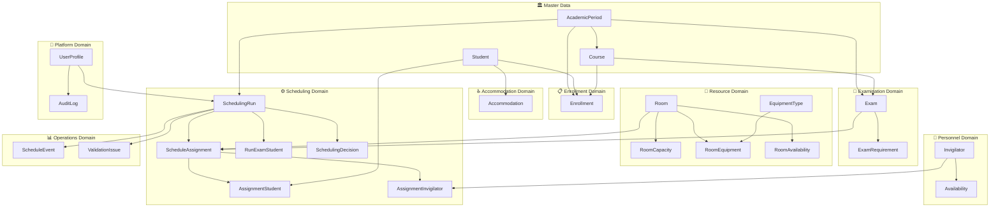

# ExamOps — Entity-Relationship Diagram

> **Document**: Entity-Relationship Diagram & Relational Model Reference
> **Version**: 1.0.0
> **Product**: ExamOps — Examination Operations & Intelligent Scheduling Platform
> **Last Updated**: 2026-11-01

---

## Table of Contents

1. [Full ERD Mermaid Diagram](#1-full-erd-mermaid-diagram)
2. [Cardinality Documentation](#2-cardinality-documentation)
3. [Domain Model Groups](#3-domain-model-groups)
4. [Key Constraints Table](#4-key-constraints-table)
5. [Deletion Rules](#5-deletion-rules)

---

## 1. Full ERD Mermaid Diagram

The following diagram represents every entity in the ExamOps data model together with its attributes and all inter-entity relationships. Entities are organised into logical clusters that mirror the domain groups described in [Section 3](#3-domain-model-groups).

> [!NOTE]

```mermaid
erDiagram
    AcademicPeriod {
        uuid id PK
        text code UK "e.g. AP-000001"
        text name "e.g. Fall 2026"
        date start_date "Period start"
        date end_date "Period end"
        date exam_start_date "Exam window start"
        date exam_end_date "Exam window end"
        boolean is_active "Current period flag"
        timestamptz created_at
        timestamptz updated_at
    }

    Student {
        uuid id PK
        text student_code UK "STU-000001"
        text first_name
        text last_name
        text email UK
        date date_of_birth
        text program
        int year_of_study "1-6"
        text status "active | inactive | graduated | suspended"
        timestamptz created_at
        timestamptz updated_at
    }

    Course {
        uuid id PK
        text course_code UK "CRS-000001"
        text name
        text department
        int credits "1-12"
        uuid academic_period_id FK
        text status "active | inactive"
        timestamptz created_at
        timestamptz updated_at
    }

    Enrollment {
        uuid id PK
        text enrollment_code UK "ENR-000001"
        uuid student_id FK
        uuid course_id FK
        uuid academic_period_id FK
        text status "enrolled | withdrawn | completed"
        timestamptz created_at
        timestamptz updated_at
    }

    Exam {
        uuid id PK
        text exam_code UK "EXAM-2026-000001"
        uuid course_id FK
        text title
        text exam_type "final | midterm | supplemental | quiz"
        int duration_minutes "30-360"
        int priority "1-10"
        text status "draft | scheduled | confirmed | published | cancelled"
        uuid academic_period_id FK
        timestamptz created_at
        timestamptz updated_at
    }

    ExamRequirement {
        uuid id PK
        text requirement_code UK "REQ-000001"
        uuid exam_id FK
        text requirement_type "DURATION_MINUTES | REQUIRED_EQUIPMENT | ROOM_FEATURE"
        text value
        text unit
        boolean is_mandatory "true | false"
        timestamptz created_at
    }

    Room {
        uuid id PK
        text room_code UK "ROOM-000001"
        text name
        text building
        int floor
        boolean is_accessible
        text status "active | maintenance | decommissioned"
        timestamptz created_at
        timestamptz updated_at
    }

    RoomCapacity {
        uuid id PK
        text capacity_code UK "CAP-000001"
        uuid room_id FK
        int standard_capacity
        int exam_capacity
        date effective_start
        date effective_end
        timestamptz created_at
    }

    EquipmentType {
        uuid id PK
        text code UK "e.g. PROJECTOR"
        text name
        text category "AV | computing | accessibility | furniture"
        text description
        timestamptz created_at
    }

    RoomEquipment {
        uuid id PK
        uuid room_id FK
        uuid equipment_type_id FK
        int quantity "gte 1"
        timestamptz created_at
    }

    Invigilator {
        uuid id PK
        text invigilator_code UK "INV-000001"
        text first_name
        text last_name
        text email UK
        text department
        numeric max_hours_per_day "e.g. 8.0"
        text status "active | inactive | on_leave"
        timestamptz created_at
        timestamptz updated_at
    }

    Availability {
        uuid id PK
        text availability_code UK "AVL-000001"
        uuid invigilator_id FK
        int day_of_week "0=Mon 6=Sun"
        time start_time
        time end_time
        text availability_type "available | unavailable | preferred"
        date effective_start
        date effective_end
        timestamptz created_at
    }

    RoomAvailability {
        uuid id PK
        uuid room_id FK
        int day_of_week "0=Mon 6=Sun"
        time start_time
        time end_time
        text availability_type "open | closed | restricted"
        date effective_start
        date effective_end
        timestamptz created_at
    }

    Accommodation {
        uuid id PK
        text accommodation_code UK "ACO-000001"
        uuid student_id FK
        text accommodation_type "extra_time | accessible_room | low_distraction | special_equipment | other"
        int extra_time_minutes
        text required_room_feature
        boolean is_active
        date effective_start
        date effective_end
        text notes
        timestamptz created_at
        timestamptz updated_at
    }

    SchedulingRun {
        uuid id PK
        text run_code UK "RUN-000001"
        uuid academic_period_id FK
        uuid created_by FK "UserProfile"
        text algorithm_version
        int seed
        text status "pending | running | completed | failed | approved | published"
        int total_exams
        int scheduled_count
        int unassigned_count
        jsonb configuration
        timestamptz started_at
        timestamptz completed_at
        timestamptz created_at
        timestamptz updated_at
    }

    ScheduleAssignment {
        uuid id PK
        text assignment_code "ASN-EXAM-2026-000001-ROOM-000001"
        uuid scheduling_run_id FK
        uuid exam_id FK
        uuid room_id FK
        timestamptz start_time
        timestamptz end_time
        int allocated_capacity
        text status "tentative | confirmed | cancelled"
        timestamptz created_at
        timestamptz updated_at
    }

    AssignmentStudent {
        uuid id PK
        uuid assignment_id FK
        uuid student_id FK
        uuid room_id FK
        int effective_duration_minutes
        boolean has_accommodation
        timestamptz created_at
    }

    AssignmentInvigilator {
        uuid id PK
        uuid assignment_id FK
        uuid invigilator_id FK
        text role "lead | support"
        timestamptz created_at
    }

    RunExamStudent {
        uuid id PK
        uuid scheduling_run_id FK
        uuid exam_id FK
        uuid student_id FK
        int effective_duration_minutes
        boolean has_accommodation
        text accommodation_details
        timestamptz created_at
    }

    SchedulingDecision {
        uuid id PK
        uuid scheduling_run_id FK
        uuid exam_id FK
        int decision_order
        boolean is_assigned
        text reason_code
        text explanation
        jsonb candidate_details
        jsonb constraints_evaluated
        timestamptz created_at
    }

    ScheduleEvent {
        uuid id PK
        uuid scheduling_run_id FK
        text entity_type
        uuid entity_id
        text event_type
        text description
        jsonb previous_state
        jsonb new_state
        timestamptz created_at
    }

    ValidationIssue {
        uuid id PK
        uuid scheduling_run_id FK
        uuid exam_id FK
        uuid assignment_id FK
        text issue_type
        text severity "error | warning | info"
        text description
        text resolution_status "open | acknowledged | resolved | waived"
        text resolution_notes
        uuid resolved_by FK
        timestamptz resolved_at
        timestamptz created_at
        timestamptz updated_at
    }

    UserProfile {
        uuid id PK
        text email UK
        text display_name
        text role "platform_admin | academic_admin | instructor | support_staff"
        text status "active | inactive | suspended"
        timestamptz created_at
        timestamptz updated_at
    }

    AuditLog {
        uuid id PK
        uuid user_id FK
        text action "create | update | delete | approve | publish | schedule"
        text entity_type
        uuid entity_id
        text entity_code
        jsonb previous_state
        jsonb new_state
        text result "success | failure"
        text ip_address
        timestamptz created_at
    }

    %% ── Relationships ──

    AcademicPeriod ||--o{ Course : "has"
    AcademicPeriod ||--o{ Enrollment : "covers"
    AcademicPeriod ||--o{ Exam : "contains"
    AcademicPeriod ||--o{ SchedulingRun : "triggers"

    Student ||--o{ Enrollment : "enrolls in"
    Student ||--o{ Accommodation : "receives"
    Student ||--o{ AssignmentStudent : "assigned to"
    Student ||--o{ RunExamStudent : "snapshot"

    Course ||--o{ Enrollment : "has"
    Course ||--o{ Exam : "has"

    Exam ||--o{ ExamRequirement : "requires"
    Exam ||--o{ ScheduleAssignment : "assigned"
    Exam ||--o{ SchedulingDecision : "decided"
    Exam ||--o{ RunExamStudent : "snapshot"
    Exam ||--o{ ValidationIssue : "flagged"

    Room ||--o{ RoomCapacity : "has capacity"
    Room ||--o{ RoomEquipment : "equipped with"
    Room ||--o{ RoomAvailability : "available during"
    Room ||--o{ ScheduleAssignment : "hosts"
    Room ||--o{ AssignmentStudent : "seats"

    EquipmentType ||--o{ RoomEquipment : "installed in"

    Invigilator ||--o{ Availability : "has"
    Invigilator ||--o{ AssignmentInvigilator : "assigned to"

    SchedulingRun ||--o{ ScheduleAssignment : "contains"
    SchedulingRun ||--o{ SchedulingDecision : "records"
    SchedulingRun ||--o{ RunExamStudent : "snapshots"
    SchedulingRun ||--o{ ScheduleEvent : "logs"
    SchedulingRun ||--o{ ValidationIssue : "produces"

    ScheduleAssignment ||--o{ AssignmentStudent : "allocates"
    ScheduleAssignment ||--o{ AssignmentInvigilator : "staffed by"
    ScheduleAssignment ||--o{ ValidationIssue : "validated"

    UserProfile ||--o{ AuditLog : "performed"
    UserProfile ||--o{ SchedulingRun : "created by"
    UserProfile ||--o{ ValidationIssue : "resolved by"
```

> Internal primary keys are database-generated UUIDs (`uuid`). Human-readable codes (e.g. `STU-000001`, `EXAM-2026-000001`) are stored as unique `text` columns and used in all API responses, UI displays, and cross-entity reference strings such as the assignment code `ASN-<exam-code>-<room-code>`.

---

## 2. Cardinality Documentation

Every relationship in the data model is documented below. **Direct** relationships connect two domain entities with a simple foreign key. **Bridge** (join-table) relationships realise many-to-many associations.

### 2.1 Direct Relationships (1 : N)

| # | From Entity | To Entity | Cardinality | FK Column | Notes |
|---|---|---|---|---|---|
| 1 | `AcademicPeriod` | `Course` | 1 : N | `course.academic_period_id` | Every course belongs to exactly one academic period. |
| 2 | `AcademicPeriod` | `Enrollment` | 1 : N | `enrollment.academic_period_id` | Enrollment is period-scoped for auditability. |
| 3 | `AcademicPeriod` | `Exam` | 1 : N | `exam.academic_period_id` | Exams belong to the period in which they are administered. |
| 4 | `AcademicPeriod` | `SchedulingRun` | 1 : N | `scheduling_run.academic_period_id` | A run operates within a single period. |
| 5 | `Student` | `Enrollment` | 1 : N | `enrollment.student_id` | A student may enrol in many courses. |
| 6 | `Student` | `Accommodation` | 1 : N | `accommodation.student_id` | A student may hold multiple accommodation types. |
| 7 | `Course` | `Enrollment` | 1 : N | `enrollment.course_id` | A course has many enrolled students. |
| 8 | `Course` | `Exam` | 1 : N | `exam.course_id` | One course may have multiple examinations (midterm, final, etc.). |
| 9 | `Exam` | `ExamRequirement` | 1 : N | `exam_requirement.exam_id` | Each exam may specify multiple requirements (duration, equipment, room features). |
| 10 | `Room` | `RoomCapacity` | 1 : N | `room_capacity.room_id` | Effective-dated capacity records; the relevant row is resolved by exam date. |
| 11 | `Room` | `RoomAvailability` | 1 : N | `room_availability.room_id` | Operating hours and closure windows per room. |
| 12 | `Invigilator` | `Availability` | 1 : N | `availability.invigilator_id` | Weekly availability windows with effective date ranges. |
| 13 | `EquipmentType` | `RoomEquipment` | 1 : N | `room_equipment.equipment_type_id` | Equipment catalogue reference. |
| 14 | `SchedulingRun` | `ScheduleAssignment` | 1 : N | `schedule_assignment.scheduling_run_id` | All assignments belong to exactly one run. |
| 15 | `SchedulingRun` | `SchedulingDecision` | 1 : N | `scheduling_decision.scheduling_run_id` | Every decision log entry is run-scoped. |
| 16 | `SchedulingRun` | `RunExamStudent` | 1 : N | `run_exam_student.scheduling_run_id` | Frozen participation snapshot. |
| 17 | `SchedulingRun` | `ScheduleEvent` | 1 : N | `schedule_event.scheduling_run_id` | State-transition event log. |
| 18 | `SchedulingRun` | `ValidationIssue` | 1 : N | `validation_issue.scheduling_run_id` | Issues discovered during or after the run. |
| 19 | `Exam` | `ScheduleAssignment` | 1 : N | `schedule_assignment.exam_id` | An exam may appear in multiple runs (different assignment per run). |
| 20 | `Room` | `ScheduleAssignment` | 1 : N | `schedule_assignment.room_id` | A room may host many assignments across runs and time slots. |
| 21 | `Exam` | `SchedulingDecision` | 1 : N | `scheduling_decision.exam_id` | Multiple candidate evaluations per exam. |
| 22 | `Exam` | `RunExamStudent` | 1 : N | `run_exam_student.exam_id` | Snapshot of eligible students per exam. |
| 23 | `Exam` | `ValidationIssue` | 1 : N | `validation_issue.exam_id` | Issues linked to a specific exam. |
| 24 | `ScheduleAssignment` | `ValidationIssue` | 1 : N | `validation_issue.assignment_id` | Issues linked to a specific assignment (nullable). |
| 25 | `UserProfile` | `AuditLog` | 1 : N | `audit_log.user_id` | Every auditable action references the acting user. |
| 26 | `UserProfile` | `SchedulingRun` | 1 : N | `scheduling_run.created_by` | The user who initiated the run. |
| 27 | `UserProfile` | `ValidationIssue` | 1 : N | `validation_issue.resolved_by` | The user who resolved/waived the issue (nullable). |

### 2.2 Many-to-Many Relationships (M : N via Bridge Table)

| # | From Entity | To Entity | Cardinality | Bridge Table | Bridge FK 1 | Bridge FK 2 | Notes |
|---|---|---|---|---|---|---|---|
| 1 | `Student` | `Course` | M : N | `Enrollment` | `student_id` | `course_id` | Core enrolment relationship; status-tracked. |
| 2 | `Room` | `EquipmentType` | M : N | `RoomEquipment` | `room_id` | `equipment_type_id` | Rooms have equipment; equipment types appear in many rooms. |
| 3 | `Exam` | `Room` | M : N | `ScheduleAssignment` | `exam_id` | `room_id` | Scoped per `scheduling_run_id`; an exam may be assigned to different rooms across runs. |
| 4 | `ScheduleAssignment` | `Student` | M : N | `AssignmentStudent` | `assignment_id` | `student_id` | Allocates students to specific rooms within a multi-room assignment; tracks effective duration. |
| 5 | `ScheduleAssignment` | `Invigilator` | M : N | `AssignmentInvigilator` | `assignment_id` | `invigilator_id` | Staffing with role (lead / support). |
| 6 | `SchedulingRun` × `Exam` | `Student` | M : N | `RunExamStudent` | (`scheduling_run_id`, `exam_id`) | `student_id` | Frozen participation snapshot — immutable after run creation. |

---

## 3. Domain Model Groups

The 24 entities are organised into eight logical domains. Each domain has a clear responsibility boundary that maps to a product module and a set of API endpoints.

### Domain Descriptions

| Domain | Entities | Responsibility |
|---|---|---|
| **Master Data** | `AcademicPeriod`, `Student`, `Course` | Core reference data that other domains depend on. Rarely changes within a period. |
| **Enrollment** | `Enrollment` | Tracks student-course membership. Provides the participation basis for examination scheduling. |
| **Examination** | `Exam`, `ExamRequirement` | Defines what must be scheduled — the examination catalogue with duration, equipment, and feature requirements. |
| **Resource** | `Room`, `RoomCapacity`, `RoomEquipment`, `EquipmentType`, `RoomAvailability` | Physical spaces, their capacities (effective-dated), installed equipment, and operating windows. |
| **Personnel** | `Invigilator`, `Availability` | People who supervise examinations, along with their weekly availability windows. |
| **Accommodation** | `Accommodation` | Student accessibility and special-needs records. Drives duration adjustments and room-feature requirements during scheduling. |
| **Scheduling** | `SchedulingRun`, `ScheduleAssignment`, `AssignmentStudent`, `AssignmentInvigilator`, `RunExamStudent`, `SchedulingDecision` | The algorithmic heart of ExamOps. Runs produce assignments, student allocations, invigilator staffing, frozen participation snapshots, and decision logs. |
| **Operations** | `ScheduleEvent`, `ValidationIssue` | Operational observability — state-change events and constraint-violation issues produced during or after a scheduling run. |
| **Platform** | `UserProfile`, `AuditLog` | Authentication, authorisation, and a tamper-evident audit trail for all significant user actions. |

---

## 4. Key Constraints Table

### 4.1 Unique Constraints

| Entity | Constraint Name | Column(s) | Purpose |
|---|---|---|---|
| `AcademicPeriod` | `uq_academic_period_code` | `code` | Human-readable period identifier. |
| `Student` | `uq_student_code` | `student_code` | `STU-NNNNNN` public ID. |
| `Student` | `uq_student_email` | `email` | One account per email. |
| `Course` | `uq_course_code` | `course_code` | `CRS-NNNNNN` public ID. |
| `Enrollment` | `uq_enrollment_code` | `enrollment_code` | `ENR-NNNNNN` public ID. |
| `Enrollment` | `uq_enrollment_student_course_period` | `student_id`, `course_id`, `academic_period_id` | A student can enrol in a course only once per period. |
| `Exam` | `uq_exam_code` | `exam_code` | `EXAM-YYYY-NNNNNN` public ID. |
| `ExamRequirement` | `uq_requirement_code` | `requirement_code` | `REQ-NNNNNN` public ID. |
| `Room` | `uq_room_code` | `room_code` | `ROOM-NNNNNN` public ID. |
| `RoomCapacity` | `uq_capacity_code` | `capacity_code` | `CAP-NNNNNN` public ID. |
| `EquipmentType` | `uq_equipment_type_code` | `code` | Equipment catalogue key. |
| `RoomEquipment` | `uq_room_equipment` | `room_id`, `equipment_type_id` | One row per room-equipment pair. |
| `Invigilator` | `uq_invigilator_code` | `invigilator_code` | `INV-NNNNNN` public ID. |
| `Invigilator` | `uq_invigilator_email` | `email` | One account per email. |
| `Availability` | `uq_availability_code` | `availability_code` | `AVL-NNNNNN` public ID. |
| `Accommodation` | `uq_accommodation_code` | `accommodation_code` | `ACO-NNNNNN` public ID. |
| `SchedulingRun` | `uq_run_code` | `run_code` | `RUN-NNNNNN` public ID. |
| `ScheduleAssignment` | `uq_assignment_run_code` | `scheduling_run_id`, `assignment_code` | Assignment code unique within a run. |
| `UserProfile` | `uq_user_email` | `email` | One profile per authenticated identity. |

### 4.2 Check Constraints

| Entity | Constraint Name | Expression | Purpose |
|---|---|---|---|
| `Student` | `chk_student_status` | `status IN ('active','inactive','graduated','suspended')` | Enumerated lifecycle states. |
| `Student` | `chk_student_year` | `year_of_study BETWEEN 1 AND 6` | Valid year range. |
| `Course` | `chk_course_credits` | `credits BETWEEN 1 AND 12` | Reasonable credit range. |
| `Course` | `chk_course_status` | `status IN ('active','inactive')` | Course lifecycle. |
| `Enrollment` | `chk_enrollment_status` | `status IN ('enrolled','withdrawn','completed')` | Enrollment lifecycle. |
| `Exam` | `chk_exam_duration` | `duration_minutes BETWEEN 30 AND 360` | Exams are 30 min to 6 hours. |
| `Exam` | `chk_exam_priority` | `priority BETWEEN 1 AND 10` | Priority scale. |
| `Exam` | `chk_exam_status` | `status IN ('draft','scheduled','confirmed','published','cancelled')` | Exam lifecycle. |
| `Exam` | `chk_exam_type` | `exam_type IN ('final','midterm','supplemental','quiz')` | Allowed exam types. |
| `ExamRequirement` | `chk_requirement_type` | `requirement_type IN ('DURATION_MINUTES','REQUIRED_EQUIPMENT','ROOM_FEATURE','OTHER')` | Known requirement categories. |
| `Room` | `chk_room_status` | `status IN ('active','maintenance','decommissioned')` | Room lifecycle. |
| `RoomCapacity` | `chk_capacity_positive` | `standard_capacity > 0 AND exam_capacity > 0` | Capacities must be positive. |
| `RoomCapacity` | `chk_capacity_exam_lte_standard` | `exam_capacity <= standard_capacity` | Exam capacity ≤ standard (wider spacing). |
| `RoomCapacity` | `chk_capacity_dates` | `effective_start <= effective_end OR effective_end IS NULL` | Valid date range. |
| `RoomEquipment` | `chk_equipment_quantity` | `quantity >= 1` | At least one unit. |
| `Invigilator` | `chk_invigilator_status` | `status IN ('active','inactive','on_leave')` | Personnel lifecycle. |
| `Invigilator` | `chk_max_hours` | `max_hours_per_day > 0 AND max_hours_per_day <= 12` | Reasonable daily cap. |
| `Availability` | `chk_availability_dow` | `day_of_week BETWEEN 0 AND 6` | 0 = Monday … 6 = Sunday. |
| `Availability` | `chk_availability_time` | `start_time < end_time` | Start before end. |
| `Availability` | `chk_availability_type` | `availability_type IN ('available','unavailable','preferred')` | Known types. |
| `RoomAvailability` | `chk_room_avail_dow` | `day_of_week BETWEEN 0 AND 6` | Day-of-week range. |
| `RoomAvailability` | `chk_room_avail_time` | `start_time < end_time` | Start before end. |
| `RoomAvailability` | `chk_room_avail_type` | `availability_type IN ('open','closed','restricted')` | Operating status. |
| `Accommodation` | `chk_accommodation_type` | `accommodation_type IN ('extra_time','accessible_room','low_distraction','special_equipment','other')` | Known accommodation categories. |
| `Accommodation` | `chk_accommodation_dates` | `effective_start <= effective_end OR effective_end IS NULL` | Valid date range. |
| `Accommodation` | `chk_extra_time_positive` | `extra_time_minutes IS NULL OR extra_time_minutes > 0` | Extra time must be positive when set. |
| `SchedulingRun` | `chk_run_status` | `status IN ('pending','running','completed','failed','approved','published')` | Run lifecycle. |
| `SchedulingRun` | `chk_run_counts` | `scheduled_count >= 0 AND unassigned_count >= 0` | Non-negative counts. |
| `ScheduleAssignment` | `chk_assignment_times` | `start_time < end_time` | Assignment must have positive duration. |
| `ScheduleAssignment` | `chk_assignment_status` | `status IN ('tentative','confirmed','cancelled')` | Assignment lifecycle. |
| `ScheduleAssignment` | `chk_allocated_capacity` | `allocated_capacity > 0` | At least one seat allocated. |
| `AssignmentStudent` | `chk_effective_duration` | `effective_duration_minutes > 0` | Positive duration. |
| `AssignmentInvigilator` | `chk_invigilator_role` | `role IN ('lead','support')` | Known roles. |
| `RunExamStudent` | `chk_run_student_duration` | `effective_duration_minutes > 0` | Positive duration. |
| `SchedulingDecision` | `chk_decision_order` | `decision_order >= 1` | 1-indexed ordering. |
| `ValidationIssue` | `chk_issue_severity` | `severity IN ('error','warning','info')` | Severity levels. |
| `ValidationIssue` | `chk_issue_resolution` | `resolution_status IN ('open','acknowledged','resolved','waived')` | Resolution lifecycle. |
| `UserProfile` | `chk_user_role` | `role IN ('platform_admin','academic_admin','instructor','support_staff')` | RBAC roles. |
| `UserProfile` | `chk_user_status` | `status IN ('active','inactive','suspended')` | Account lifecycle. |
| `AuditLog` | `chk_audit_action` | `action IN ('create','update','delete','approve','publish','schedule','login','logout')` | Known action types. |
| `AuditLog` | `chk_audit_result` | `result IN ('success','failure')` | Binary outcome. |

### 4.3 Important Indexes

| Entity | Index Name | Column(s) | Type | Purpose |
|---|---|---|---|---|
| `Enrollment` | `idx_enrollment_student` | `student_id` | B-tree | Fast student → courses lookup. |
| `Enrollment` | `idx_enrollment_course` | `course_id` | B-tree | Fast course → students lookup. |
| `Enrollment` | `idx_enrollment_period` | `academic_period_id` | B-tree | Period-scoped queries. |
| `Exam` | `idx_exam_course` | `course_id` | B-tree | Course → exams lookup. |
| `Exam` | `idx_exam_period` | `academic_period_id` | B-tree | Period-scoped exam listing. |
| `Exam` | `idx_exam_status` | `status` | B-tree | Filter by lifecycle state. |
| `ExamRequirement` | `idx_requirement_exam` | `exam_id` | B-tree | Exam → requirements lookup. |
| `RoomCapacity` | `idx_capacity_room` | `room_id` | B-tree | Room → capacity lookup. |
| `RoomCapacity` | `idx_capacity_effective` | `room_id`, `effective_start`, `effective_end` | B-tree | Date-range capacity resolution. |
| `RoomEquipment` | `idx_room_equipment_room` | `room_id` | B-tree | Room → equipment lookup. |
| `RoomAvailability` | `idx_room_avail_room` | `room_id` | B-tree | Room → availability lookup. |
| `Availability` | `idx_availability_invigilator` | `invigilator_id` | B-tree | Invigilator → windows lookup. |
| `Accommodation` | `idx_accommodation_student` | `student_id` | B-tree | Student → accommodations lookup. |
| `Accommodation` | `idx_accommodation_active` | `student_id`, `is_active` | B-tree (partial: `is_active = true`) | Fast active-accommodation filter. |
| `ScheduleAssignment` | `idx_assignment_run` | `scheduling_run_id` | B-tree | Run → assignments listing. |
| `ScheduleAssignment` | `idx_assignment_exam` | `exam_id` | B-tree | Exam assignment history. |
| `ScheduleAssignment` | `idx_assignment_room` | `room_id` | B-tree | Room usage lookup. |
| `ScheduleAssignment` | `idx_assignment_time` | `scheduling_run_id`, `start_time`, `end_time` | B-tree | Time-window overlap detection. |
| `AssignmentStudent` | `idx_asgn_student_assignment` | `assignment_id` | B-tree | Assignment → students. |
| `AssignmentStudent` | `idx_asgn_student_student` | `student_id` | B-tree | Student → assignments (conflict check). |
| `AssignmentInvigilator` | `idx_asgn_inv_assignment` | `assignment_id` | B-tree | Assignment → invigilators. |
| `AssignmentInvigilator` | `idx_asgn_inv_invigilator` | `invigilator_id` | B-tree | Invigilator → assignments (double-book check). |
| `RunExamStudent` | `idx_res_run_exam` | `scheduling_run_id`, `exam_id` | B-tree | Snapshot retrieval per run and exam. |
| `SchedulingDecision` | `idx_decision_run_exam` | `scheduling_run_id`, `exam_id` | B-tree | Decision log retrieval. |
| `ValidationIssue` | `idx_issue_run` | `scheduling_run_id` | B-tree | Run → issues listing. |
| `ValidationIssue` | `idx_issue_status` | `resolution_status` | B-tree | Open issue dashboard query. |
| `AuditLog` | `idx_audit_user` | `user_id` | B-tree | User activity trail. |
| `AuditLog` | `idx_audit_entity` | `entity_type`, `entity_id` | B-tree | Entity change history. |
| `AuditLog` | `idx_audit_created` | `created_at` | B-tree (DESC) | Reverse-chronological listing. |

---

## 5. Deletion Rules

Deletion rules are designed to protect **data integrity** and **audit trail completeness**. In a production examination management system, most deletions are **soft** (status change) rather than physical. The rules below govern what happens at the database level when a `DELETE` statement is issued against a parent row.

> [!IMPORTANT]
> The general philosophy is **RESTRICT by default**. Operational data (scheduling runs, assignments, audit logs) must never be silently cascaded away. Master data deletion is blocked while dependent records exist. The application layer enforces soft-delete patterns; hard deletes are reserved for administrative cleanup of draft or test data.

### 5.1 Deletion Rule Matrix

| Parent Entity | Child Entity | FK Column | On Delete | Rationale |
|---|---|---|---|---|
| `AcademicPeriod` | `Course` | `academic_period_id` | **RESTRICT** | Cannot remove a period that has courses. Archive instead. |
| `AcademicPeriod` | `Enrollment` | `academic_period_id` | **RESTRICT** | Enrollment records are academic records. |
| `AcademicPeriod` | `Exam` | `academic_period_id` | **RESTRICT** | Exams must be explicitly removed or cancelled first. |
| `AcademicPeriod` | `SchedulingRun` | `academic_period_id` | **RESTRICT** | Historical runs must be preserved. |
| `Student` | `Enrollment` | `student_id` | **RESTRICT** | Enrolled students cannot be deleted; withdraw first. |
| `Student` | `Accommodation` | `student_id` | **RESTRICT** | Accommodation records are compliance documents. |
| `Student` | `AssignmentStudent` | `student_id` | **RESTRICT** | Assignment history must remain intact. |
| `Student` | `RunExamStudent` | `student_id` | **RESTRICT** | Snapshot is immutable. |
| `Course` | `Enrollment` | `course_id` | **RESTRICT** | Cannot delete a course with enrolments. |
| `Course` | `Exam` | `course_id` | **RESTRICT** | Cannot delete a course with exams. |
| `Exam` | `ExamRequirement` | `exam_id` | **CASCADE** | Requirements are owned by the exam; removing an exam removes its requirements. Only allowed when exam is in `draft` status (enforced by application). |
| `Exam` | `ScheduleAssignment` | `exam_id` | **RESTRICT** | Cannot delete an exam that has been scheduled. Cancel first. |
| `Exam` | `SchedulingDecision` | `exam_id` | **RESTRICT** | Decision history is protected. |
| `Exam` | `RunExamStudent` | `exam_id` | **RESTRICT** | Snapshot is immutable. |
| `Exam` | `ValidationIssue` | `exam_id` | **RESTRICT** | Issues are operational records. |
| `Room` | `RoomCapacity` | `room_id` | **CASCADE** | Capacity records are fully owned by the room. Deleting a room (only when `decommissioned` and no assignments) removes its capacity history. |
| `Room` | `RoomEquipment` | `room_id` | **CASCADE** | Equipment installation records are room-owned. |
| `Room` | `RoomAvailability` | `room_id` | **CASCADE** | Availability windows are room-owned. |
| `Room` | `ScheduleAssignment` | `room_id` | **RESTRICT** | Cannot delete a room used in an assignment. |
| `Room` | `AssignmentStudent` | `room_id` | **RESTRICT** | Student-room allocation is protected. |
| `EquipmentType` | `RoomEquipment` | `equipment_type_id` | **RESTRICT** | Cannot delete an equipment type in use. |
| `Invigilator` | `Availability` | `invigilator_id` | **CASCADE** | Availability windows are invigilator-owned. |
| `Invigilator` | `AssignmentInvigilator` | `invigilator_id` | **RESTRICT** | Cannot delete an invigilator with assignment history. |
| `SchedulingRun` | `ScheduleAssignment` | `scheduling_run_id` | **CASCADE** | Deleting a `pending` or `failed` run cascades to its (incomplete) assignments. Application blocks deletion of `completed`/`approved`/`published` runs. |
| `SchedulingRun` | `SchedulingDecision` | `scheduling_run_id` | **CASCADE** | Decision logs cascade with run deletion (draft cleanup only). |
| `SchedulingRun` | `RunExamStudent` | `scheduling_run_id` | **CASCADE** | Snapshot cascades with run deletion (draft cleanup only). |
| `SchedulingRun` | `ScheduleEvent` | `scheduling_run_id` | **CASCADE** | Event logs cascade with run deletion (draft cleanup only). |
| `SchedulingRun` | `ValidationIssue` | `scheduling_run_id` | **CASCADE** | Issues cascade with run deletion (draft cleanup only). |
| `ScheduleAssignment` | `AssignmentStudent` | `assignment_id` | **CASCADE** | Student allocations are owned by the assignment. |
| `ScheduleAssignment` | `AssignmentInvigilator` | `assignment_id` | **CASCADE** | Invigilator staffing is owned by the assignment. |
| `ScheduleAssignment` | `ValidationIssue` | `assignment_id` | **SET NULL** | Issue retains run-level context even if the specific assignment is removed. |
| `UserProfile` | `AuditLog` | `user_id` | **RESTRICT** | Audit trail must never be orphaned. Users are deactivated, not deleted. |
| `UserProfile` | `SchedulingRun` | `created_by` | **RESTRICT** | Run provenance must be preserved. |
| `UserProfile` | `ValidationIssue` | `resolved_by` | **SET NULL** | If a user is somehow removed, the resolution record persists but loses the resolver link. |

### 5.2 Cascade Summary

```mermaid
flowchart LR
    subgraph CASCADE["CASCADE — Parent owns child lifecycle"]
        E1["Exam → ExamRequirement"]
        R1["Room → RoomCapacity"]
        R2["Room → RoomEquipment"]
        R3["Room → RoomAvailability"]
        I1["Invigilator → Availability"]
        SR1["SchedulingRun → ScheduleAssignment"]
        SR2["SchedulingRun → SchedulingDecision"]
        SR3["SchedulingRun → RunExamStudent"]
        SR4["SchedulingRun → ScheduleEvent"]
        SR5["SchedulingRun → ValidationIssue"]
        SA1["ScheduleAssignment → AssignmentStudent"]
        SA2["ScheduleAssignment → AssignmentInvigilator"]
    end

    subgraph RESTRICT["RESTRICT — Deletion blocked"]
        AP1["AcademicPeriod → Course"]
        AP2["AcademicPeriod → Enrollment"]
        AP3["AcademicPeriod → Exam"]
        AP4["AcademicPeriod → SchedulingRun"]
        S1["Student → Enrollment"]
        S2["Student → Accommodation"]
        S3["Student → AssignmentStudent"]
        S4["Student → RunExamStudent"]
        C1["Course → Enrollment"]
        C2["Course → Exam"]
        EX1["Exam → ScheduleAssignment"]
        EX2["Exam → SchedulingDecision"]
        EX3["Exam → ValidationIssue"]
        RM1["Room → ScheduleAssignment"]
        RM2["Room → AssignmentStudent"]
        ET1["EquipmentType → RoomEquipment"]
        IV1["Invigilator → AssignmentInvigilator"]
        UP1["UserProfile → AuditLog"]
        UP2["UserProfile → SchedulingRun"]
    end

    subgraph SETNULL["SET NULL — Preserve child, clear FK"]
        SA3["ScheduleAssignment → ValidationIssue"]
        UP3["UserProfile → ValidationIssue"]
    end
```

### 5.3 Application-Level Soft Delete Policy

> [!TIP]
> Physical deletion is the exception, not the rule. The standard pattern is to transition the entity to a terminal status.

| Entity | Soft-Delete Mechanism | Terminal Status | Physical Delete Allowed? |
|---|---|---|---|
| `Student` | Status → `inactive` or `suspended` | `graduated`, `suspended` | No — academic records. |
| `Course` | Status → `inactive` | `inactive` | No — while enrolments or exams exist. |
| `Enrollment` | Status → `withdrawn` | `withdrawn`, `completed` | No — academic record. |
| `Exam` | Status → `cancelled` | `cancelled` | Only in `draft` status with no run references. |
| `Room` | Status → `decommissioned` | `decommissioned` | Only when no assignment references. |
| `Invigilator` | Status → `inactive` / `on_leave` | `inactive` | Only when no assignment references. |
| `SchedulingRun` | Status → `failed` | `failed` | Only `pending` or `failed` runs (cleanup). |
| `ScheduleAssignment` | Status → `cancelled` | `cancelled` | Only via run cascade (draft cleanup). |
| `UserProfile` | Status → `inactive` / `suspended` | `inactive`, `suspended` | No — audit trail dependency. |
| `AuditLog` | — | — | **Never** — immutable audit trail. |

---

> **Cross-references**: [Data Dictionary](./data_dictionary.md) · [Database Migrations](../backend/migrations/) · [Business Rules](./business_rules.md) · [Scheduling Algorithm](./scheduling_algorithm.md)
