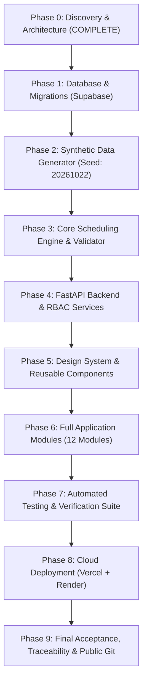

# ExamOps — Definitive Master Implementation Roadmap

> **Version:** 1.0.0  
> **Product:** ExamOps — Examination Operations & Intelligent Scheduling Platform  
> **Execution Strategy:** Phase-Gated Engineering with Verification Gates  
> **Last Updated:** 2026-11-01  
> **Authoritative Sources:** AGENTS.md §23, §24, §25

---

## 1. Phased Implementation Overview

The complete project lifecycle is partitioned into **10 structured phases**. Work proceeds sequentially from data foundation to algorithmic core, backend services, design system, full frontend application, automated verification, and public deployment.

---

## 2. Phase-by-Phase Execution Plan

### Phase 0: Discovery Mode & Source Contract [COMPLETED]
- **Objective:** Exhaustively extract requirements from all three source documents; formalize architectural contracts, data dictionary, algorithm design, design system, and risk register.
- **Key Deliverables:**
  - `docs/source/requirements_original.md`
  - `docs/requirements.md`
  - `docs/requirements_traceability.md`
  - `docs/business_rules.md`
  - `docs/assumptions.md`
  - `docs/data_dictionary.md`
  - `docs/erd.md`
  - `docs/scheduling_algorithm.md`
  - `docs/architecture.md`
  - `docs/security.md`
  - `docs/permissions.md`
  - `docs/design_system.md`
  - `docs/ui_ux_specification.md`
  - `docs/testing.md`
  - `docs/technical_risks.md`
  - `docs/implementation_plan.md`
- **Gate Signoff:** All discovery documents committed; candidate approval obtained.

---

### Phase 1: Database Schema & SQL Migrations
- **Objective:** Author production-ready PostgreSQL migrations for all 24 entities with primary keys, foreign keys, check constraints, composite uniqueness, and Row Level Security (RLS) policies.
- **Tasks:**
  1. Author `supabase/migrations/001_initial_schema.sql` (Tables, constraints, foreign keys, triggers).
  2. Author `supabase/migrations/002_rls_policies.sql` (Role-based access control policies for all 5 roles).
  3. Author `supabase/migrations/003_indexes.sql` (Performance B-tree indexes for foreign keys, overlaps, and audits).
  4. Test schema execution against local or remote Supabase PostgreSQL instance.
- **Verification Gate:** SQL schema applies cleanly without warnings; all foreign keys, uniqueness constraints, and RLS policies active.

---

### Phase 2: Synthetic Data Engineering
- **Objective:** Build a standalone, deterministic Python data generator implementing all 10 synthetic generation steps.
- **Tasks:**
  1. Author `generator/config.py`: Parameterized counts (5,000 students, 300 exams, 100 rooms, 200 invigilators), fixed seed `20261022`, realistic distributions.
  2. Author `generator/generate.py`: Strict 15-step topological generation sequence. Supports `--profile {starter,full}`.
  3. Author `generator/scenarios.py`: Separate negative scenario fixtures for all 5 mandatory failure cases.
  4. Author `generator/validate.py`: Data integrity audit (counts, FK resolution, enum validity, date ordering).
  5. Author `generator/load_seed.py`: Exports datasets to CSV, JSON, and unified `seed.sql`.
  6. Execute reproducibility test: Regenerate twice with seed `20261022` and assert bitwise SHA-256 equivalence across sorted rows.
- **Verification Gate:** Exactly 5,000 students, 300 exams, 100 rooms, 200 invigilators generated. Zero dangling foreign keys. Reproducibility test passes. Ground-truth files isolated.

---

### Phase 3: Scheduling Engine & Independent Validator
- **Objective:** Implement the deterministic, explainable Python scheduling algorithm and full-schedule validator.
- **Tasks:**
  1. Author `backend/scheduler/conflict_graph.py`: Inverted student index and adjacency list constructor.
  2. Author `backend/scheduler/candidate_generator.py`: Continuous time-window generator with 30-min granularity.
  3. Author `backend/scheduler/room_allocator.py`: Multi-room student partitioning (best-fit) with accommodation tiering.
  4. Author `backend/scheduler/invigilator_allocator.py`: Staffing allocator checking availability, shift caps, and double-booking.
  5. Author `backend/scheduler/constraints.py`: Central `validate_candidate()` function returning structured results.
  6. Author `backend/scheduler/scoring.py`: Deterministic score tuple minimizing room counts and wasted seats.
  7. Author `backend/scheduler/engine.py`: Sequential greedy loop + 3-pass bounded improvement pass.
  8. Author `backend/validation/schedule_validation.py`: Independent `validate_complete_schedule()` sweep.
- **Verification Gate:** Unit tests in `tests/test_scheduler.py` pass. Five negative scenarios in `tests/test_edge_cases.py` are 100% detected and rejected with standard reason codes. Full 300-exam schedule runs in under 15 seconds with zero hard constraint violations.

---

### Phase 4: FastAPI Backend & API Layer
- **Objective:** Build robust REST API service layer with JWT verification, role resolution, and comprehensive endpoints.
- **Tasks:**
  1. Author `backend/config.py`: Environment configuration and settings schemas.
  2. Author `backend/auth.py`: Bearer JWT token verification and server-side profile role resolution.
  3. Author `backend/database.py`: Supabase Python SDK client integration.
  4. Author route controllers in `backend/routes/`:
     - `auth.py` (`/api/v1/me`)
     - `students.py`, `courses.py`, `enrollments.py`
     - `exams.py`, `rooms.py`, `invigilators.py`, `accommodations.py`
     - `scheduling.py` (`/runs`, `/assignments`, `/decisions`, `/validate`, `/approve`, `/publish`)
     - `exceptions.py`, `analytics.py`, `audit.py`
  5. Author `backend/services/`: Business services for scheduling, reporting, and exception triage.
  6. Author `backend/main.py`: FastAPI app factory, CORS configuration, exception handlers.
- **Verification Gate:** OpenAPI documentation at `/docs` verified; all routes return correct HTTP status codes; unauthorized requests receive 401/403.

---

### Phase 5: Design System & Reusable Components
- **Objective:** Configure React + Vite + Tailwind CSS shell and build the full 25-component library in accordance with the design system.
- **Tasks:**
  1. Initialize `frontend/` with Vite, React 18, Tailwind CSS, Lucide React, Recharts, React Router.
  2. Configure Tailwind with custom dark-first design tokens (`#0B1118`, `#121C26`, `#56D6C2`, etc.) and Inter typography.
  3. Author layout components: `AppSidebar`, `TopNavigation`, `Breadcrumbs`, `PageHeader`.
  4. Author data display: `DataTable`, `FilterBar`, `Pagination`, `StatusBadge`, `MetricDisplay`, `ChartContainer`.
  5. Author operational widgets: `TimetableGrid`, `Timeline`, `Drawer`, `Modal`, `ConfirmationDialog`.
  6. Author form controls: `Button`, `Input`, `Select`, `SearchInput`, `DateInput`.
  7. Author state feedback: `LoadingState`, `EmptyState`, `ErrorState`, `Toast`.
- **Verification Gate:** Component story/demo view renders all components with proper dark-mode contrast and zero visual defects.

---

### Phase 6: Application Modules Implementation
- **Objective:** Build and integrate all 12 operational modules with the backend APIs.
- **Tasks:**
  1. Module 1: Overview Dashboard (`/dashboard`)
  2. Module 2: Scheduling Workspace (`/scheduling`) — The 3-panel command center
  3. Module 3: Examination Management (`/exams`)
  4. Module 4: Student Management (`/students`)
  5. Module 5: Course & Enrollment Management (`/courses`)
  6. Module 6: Room Management (`/rooms`)
  7. Module 7: Invigilator Management (`/invigilators`)
  8. Module 8: Accommodation Management (`/accommodations`)
  9. Module 9: Exception Center (`/exceptions`)
  10. Module 10: Analytics & Reports (`/analytics`)
  11. Module 11: Audit & Activity (`/audit`)
  12. Module 12: Administration (`/admin`)
- **Verification Gate:** Full end-to-end user journey works: login -> inspect exams -> trigger scheduling run -> inspect decision telemetry in drawer -> review unassigned reasons -> validate -> approve -> publish -> view student timetable.

---

### Phase 7: Automated Testing & Quality Audit
- **Objective:** Execute exhaustive automated test suites across all domains.
- **Tasks:**
  1. Execute `pytest tests/test_generator.py` (Baseline volume & IDs).
  2. Execute `pytest tests/test_relationships.py` (Foreign keys & cardinalities).
  3. Execute `pytest tests/test_constraints.py` (Hard constraint enforcement).
  4. Execute `pytest tests/test_scheduler.py` (Engine correctness & scoring).
  5. Execute `pytest tests/test_edge_cases.py` (All 5 negative scenarios).
  6. Execute `pytest tests/test_api.py` (Auth, RBAC, endpoints).
  7. Execute `pytest tests/test_reproducibility.py` (Dual generation checksum parity).
- **Verification Gate:** 100% test pass rate. Zero hard constraint violations in confirmed assignments.

---

### Phase 8: Cloud Deployment
- **Objective:** Deploy production application to free-tier cloud infrastructure.
- **Tasks:**
  1. Database: Initialize Supabase PostgreSQL project; apply migrations; seed initial demo data.
  2. Backend: Deploy FastAPI application to Render; configure environment variables.
  3. Frontend: Deploy React SPA to Vercel; configure API proxy and production environment variables.
  4. Verify live production integration, CORS, authentication, and end-to-end scheduling.
- **Verification Gate:** Live hosted URL accessible; demo login works; scheduling run completes successfully on cloud.

---

### Phase 9: Final Acceptance & Public Repository Preparation
- **Objective:** Package the repository for public GitHub evaluation under the recruitment guidelines.
- **Tasks:**
  1. Author root `README.md` with product overview, architecture diagram, setup instructions, and evaluation walkthrough.
  2. Author `docs/interview_guide.md` with technical Q&A explaining core engineering choices.
  3. Author `docs/source_manifest.md` documenting synthetic data provenance and seed.
  4. Complete `docs/ai_prompt_history.md` recording all LLM prompts per recruitment guidelines.
  5. Update `docs/requirements_traceability.md` to `VERIFIED` status with objective test evidence.
  6. Scan Git history for accidental secrets or confidential data.
  7. Push to public GitHub repository within the 72-hour window.
- **Verification Gate:** Candidate reviews and accepts final submission repository.
