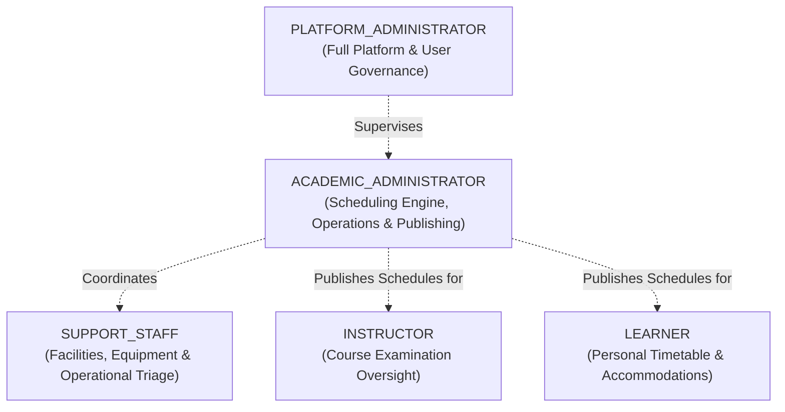

# ExamOps — Role-Based Access Control (RBAC) & Permissions Contract

> **Version:** 1.0.0  
> **Product:** ExamOps — Examination Operations & Intelligent Scheduling Platform  
> **Security Domain:** Authentication, Authorization & Row Level Security (RLS)  
> **Last Updated:** 2026-11-01  
> **Authoritative Sources:** problem_statement.md, AGENTS.md §13-14

---

## 1. Enterprise Role Taxonomy

ExamOps defines five explicit, mutually exclusive system roles:



| Role Code | Role Name | System Purpose & Scope |
|---|---|---|
| `LEARNER` | Student / Candidate | View personal examination timetable, room locations, seat numbers, approved accommodations, and institutional notifications. Zero write access to operations. |
| `INSTRUCTOR` | Academic Faculty | View examinations, syllabi, enrollments, and confirmed schedules for courses they instruct. Submit exam requirements (duration, equipment). |
| `ACADEMIC_ADMINISTRATOR` | Operations Officer | Primary operational actor: manages exams, rooms, invigilators; triggers scheduling runs; inspects candidate decisions; resolves exceptions; approves and publishes final schedules. |
| `SUPPORT_STAFF` | Facilities & Disability Services | Manage room facilities, hardware inventory, disability room setups, and on-the-day operational issue triage. Access to sensitive accommodation medical details is masked. |
| `PLATFORM_ADMINISTRATOR` | System Administrator | Platform governance: user provisioning, role assignments, system-wide configuration, audit log inspection, and database migration telemetry. |

---

## 2. Comprehensive Entity CRUD Permissions Matrix

### Legend:
- `C`: Create
- `R`: Read (Full table / across all records)
- `R_OWN`: Read Own records only (filtered by authenticated user ID or student ID)
- `R_PUB`: Read Published records only (visible only when schedule is `PUBLISHED`)
- `R_DEPT`: Read Department-scoped records only
- `U`: Update
- `U_OWN`: Update Own records only
- `D`: Delete / Deactivate
- `—`: No Access (Blocked by API and RLS)

| Entity / Table | LEARNER | INSTRUCTOR | SUPPORT_STAFF | ACADEMIC_ADMIN | PLATFORM_ADMIN | Notes |
|---|---|---|---|---|---|---|
| `students` | `R_OWN` | `R_DEPT` | `R` | `CRUD` | `CRUD` | Student directory with PII protections |
| `courses` | `R` | `R` | `R` | `CRUD` | `CRUD` | Master course catalog |
| `course_instructors` | `R` | `R_OWN` | `R` | `CRUD` | `CRUD` | Faculty course teaching assignments |
| `enrollments` | `R_OWN` | `R_DEPT` | `R` | `CRUD` | `CRUD` | Student registrations |
| `exams` | `R_PUB` | `R_DEPT` | `R` | `CRUD` | `CRUD` | Unscheduled drafts hidden from learners |
| `exam_requirements` | `—` | `CR_DEPT` | `R` | `CRUD` | `CRUD` | Hardware & duration specifications |
| `rooms` | `R_PUB` | `R` | `CRUD` | `CRUD` | `CRUD` | Physical facilities directory |
| `room_capacities` | `—` | `R` | `CRUD` | `CRUD` | `CRUD` | Seating limits and effective dates |
| `equipment_types` | `—` | `R` | `CRUD` | `CRUD` | `CRUD` | Hardware catalog |
| `room_equipment` | `—` | `R` | `CRUD` | `CRUD` | `CRUD` | Physical inventory assignments |
| `invigilators` | `—` | `R_DEPT` | `R` | `CRUD` | `CRUD` | Invigilator staffing directory |
| `availabilities` | `—` | `—` | `R` | `CRUD` | `CRUD` | Invigilator work shift windows |
| `room_availabilities` | `—` | `R` | `CRUD` | `CRUD` | `CRUD` | Operating hours and maintenance closures |
| `accommodations` | `R_OWN` | `—` | `R_MASKED` | `CRUD` | `CRUD` | Strict disability privacy: notes masked for staff |
| `accommodation_notes` | `—` | `—` | `—` | `CRUD` | `CRUD` | Highly confidential clinical medical notes |
| `academic_periods` | `R` | `R` | `R` | `CRUD` | `CRUD` | Semester calendars |
| `scheduling_runs` | `R_PUB` | `R_PUB` | `R` | `CRUD` | `CRUD` | Draft runs restricted to staff & admins |
| `schedule_assignments`| `R_OWN_PUB`| `R_PUB` | `R` | `CRUD` | `CRUD` | Learners see only their published assignments |
| `assignment_students` | `R_OWN_PUB`| `R_DEPT_PUB`| `R` | `CRUD` | `CRUD` | Individual seat mappings |
| `assignment_invigilators`| `—` | `—` | `R` | `CRUD` | `CRUD` | Invigilator duty schedules |
| `run_exam_students` | `—` | `—` | `—` | `R` | `R` | Immutable frozen snapshots |
| `scheduling_decisions`| `—` | `—` | `—` | `R` | `R` | Telemetry logs (Read-only) |
| `validation_issues` | `—` | `—` | `R` | `CRUD` | `CRUD` | Diagnostic exception logs |
| `schedule_events` | `—` | `—` | `R` | `R` | `R` | Immutable operational event trail |
| `user_profiles` | `R_OWN` | `R_OWN` | `R_OWN` | `R` | `CRUD` | User management |
| `audit_logs` | `—` | `—` | `—` | `R` | `R` | Immutable security audit trail |

---

## 3. Operational Action Permissions Matrix

| Operational Action | API Endpoint | LEARNER | INSTRUCTOR | SUPPORT_STAFF | ACADEMIC_ADMIN | PLATFORM_ADMIN |
|---|---|---|---|---|---|---|
| Trigger Scheduling Run | `POST /api/v1/scheduling/runs` | ✗ | ✗ | ✗ | **Permitted** | **Permitted** |
| Inspect Algorithm Decisions | `GET /api/v1/scheduling/runs/{id}/decisions` | ✗ | ✗ | ✗ | **Permitted** | **Permitted** |
| Run Full Schedule Validation | `POST /api/v1/scheduling/runs/{id}/validate` | ✗ | ✗ | ✗ | **Permitted** | **Permitted** |
| Approve Scheduling Run | `POST /api/v1/scheduling/runs/{id}/approve` | ✗ | ✗ | ✗ | **Permitted** | **Permitted** |
| Publish Scheduling Run | `POST /api/v1/scheduling/runs/{id}/publish` | ✗ | ✗ | ✗ | **Permitted** | **Permitted** |
| Cancel Scheduling Run | `POST /api/v1/scheduling/runs/{id}/cancel` | ✗ | ✗ | ✗ | **Permitted** | **Permitted** |
| Resolve Validation Exception | `POST /api/v1/exceptions/{id}/resolve` | ✗ | ✗ | ✗ | **Permitted** | **Permitted** |
| Export Analytics & Datasets | `GET /api/v1/analytics/export` | ✗ | ✗ | ✗ | **Permitted** | **Permitted** |
| Manage System Users & Roles | `POST /api/v1/admin/users` | ✗ | ✗ | ✗ | ✗ | **Permitted** |
| Modify Institutional Config | `PATCH /api/v1/admin/config` | ✗ | ✗ | ✗ | ✗ | **Permitted** |
| View Security Audit Logs | `GET /api/v1/audit` | ✗ | ✗ | ✗ | **Permitted** | **Permitted** |

---

## 4. Supabase PostgreSQL Row Level Security (RLS) Architecture

To guarantee defense-in-depth, security is not merely enforced in FastAPI route decorators; **every table in Supabase PostgreSQL has RLS enabled**.

### 4.1 Role Identification Helper Function
The database resolves the executing user's role from their Supabase JWT claim:

```sql
CREATE OR REPLACE FUNCTION auth.get_user_role()
RETURNS VARCHAR AS $$
  SELECT role FROM public.user_profiles WHERE id = auth.uid();
$$ LANGUAGE sql STABLE SECURITY DEFINER;
```

### 4.2 Representative RLS Policies

#### 1. Student Privacy (`students` table):
```sql
ALTER TABLE students ENABLE ROW LEVEL SECURITY;

-- Learners can only view their own profile
CREATE POLICY "Learner reads own student record"
ON students FOR SELECT
TO authenticated
USING (
  auth.get_user_role() = 'LEARNER' 
  AND email = (SELECT email FROM auth.users WHERE id = auth.uid())
);

-- Staff and Admins can view all students
CREATE POLICY "Staff and Admins read all students"
ON students FOR SELECT
TO authenticated
USING (
  auth.get_user_role() IN ('SUPPORT_STAFF', 'ACADEMIC_ADMINISTRATOR', 'PLATFORM_ADMINISTRATOR')
);

-- Only Admins can create or update students
CREATE POLICY "Admins manage students"
ON students FOR ALL
TO authenticated
USING (auth.get_user_role() IN ('ACADEMIC_ADMINISTRATOR', 'PLATFORM_ADMINISTRATOR'))
WITH CHECK (auth.get_user_role() IN ('ACADEMIC_ADMINISTRATOR', 'PLATFORM_ADMINISTRATOR'));
```

#### 2. Published Timetable Protection (`schedule_assignments` table):
```sql
ALTER TABLE schedule_assignments ENABLE ROW LEVEL SECURITY;

-- Learners only see assignments in PUBLISHED runs for which they are enrolled
CREATE POLICY "Learners view own published assignments"
ON schedule_assignments FOR SELECT
TO authenticated
USING (
  auth.get_user_role() = 'LEARNER'
  AND EXISTS (
    SELECT 1 FROM scheduling_runs r
    WHERE r.id = schedule_assignments.scheduling_run_id
    AND r.status = 'PUBLISHED'
  )
  AND EXISTS (
    SELECT 1 FROM assignment_students ast
    JOIN students s ON s.id = ast.student_id
    WHERE ast.assignment_id = schedule_assignments.id
    AND s.email = (SELECT email FROM auth.users WHERE id = auth.uid())
  )
);

-- Admins and Staff view all assignments
CREATE POLICY "Staff and Admins view all assignments"
ON schedule_assignments FOR SELECT
TO authenticated
USING (
  auth.get_user_role() IN ('SUPPORT_STAFF', 'ACADEMIC_ADMINISTRATOR', 'PLATFORM_ADMINISTRATOR')
);
```

#### 3. Accommodation Confidentiality (`accommodations` table):
```sql
ALTER TABLE accommodations ENABLE ROW LEVEL SECURITY;

-- Learners can view their own accommodations
CREATE POLICY "Learners view own accommodations"
ON accommodations FOR SELECT
TO authenticated
USING (
  auth.get_user_role() = 'LEARNER'
  AND student_id = (SELECT s.id FROM students s WHERE s.email = (SELECT email FROM auth.users WHERE id = auth.uid()))
);

-- Academic and Platform Admins can manage accommodations
CREATE POLICY "Admins manage accommodations"
ON accommodations FOR ALL
TO authenticated
USING (auth.get_user_role() IN ('ACADEMIC_ADMINISTRATOR', 'PLATFORM_ADMINISTRATOR'))
WITH CHECK (auth.get_user_role() IN ('ACADEMIC_ADMINISTRATOR', 'PLATFORM_ADMINISTRATOR'));
```

