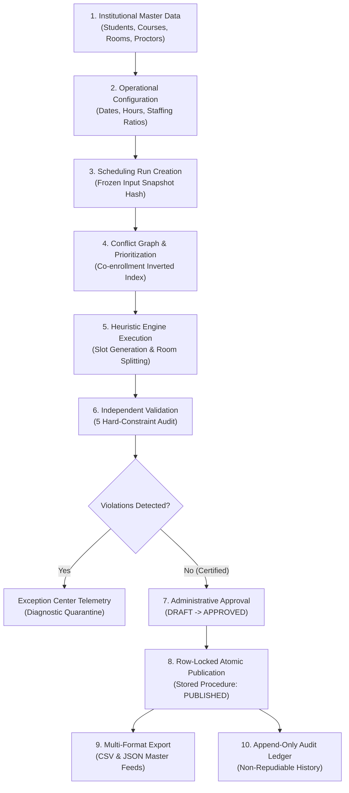

# ExamOps — Product & Architecture Overview

> **Product Name**: ExamOps (Examination Operations & Intelligent Scheduling Platform)  
> **Tagline**: *"Plan Smarter. Schedule Precisely. Operate With Confidence."*  
> **Target Environment**: Higher Education Academic Institutions & Examination Directorates  
> **Technology Stack**: React 19 + Vite + Tailwind CSS + Python 3.12 (FastAPI) + Supabase Cloud PostgreSQL (RLS & Stored Procedures)  
> **Authoritative Specification**: Definitive Master Product & Engineering Specification (Version 1.0.0)

---

## 1. Executive Summary & Problem Mandate

Examination scheduling in large universities is a mission-critical, mathematically complex operational challenge. Every semester, academic institutions face the daunting task of scheduling hundreds of examinations for thousands of students across dozens of lecture halls and exam venues, constrained by proctor availability, room physical capacities, accessibility requirements, and student course co-enrollments.

Traditional solutions fall into two flawed categories:
1. **Manual Spreadsheets**: Labor-intensive, prone to human error, blind to complex student conflicts, and incapable of guaranteeing medical accommodations.
2. **Opaque "Black-Box" Solvers**: Complex mathematical engines or non-deterministic ML/AI tools that fail without explanation, leaving examination officers unable to understand *why* an examination was placed in a specific slot or why it could not be scheduled.

**ExamOps** replaces both paradigms with a **deterministic, fully explainable, and auditable enterprise examination operations platform**. Built with a dark-first, high-density professional command center aesthetic, ExamOps pairs a transparent heuristic scheduling algorithm with an independent zero-tolerance hard constraint validator, complete student accommodation compliance, and non-repudiable database audit logging.

---

## 2. Core Architectural Principles

```
+----------------------------------------------------------------------------------------------------+
|                                     EXAMOPS OPERATIONAL ARCHITECTURE                                |
+----------------------------------------------------------------------------------------------------+
|                                                                                                    |
|    FRONTEND COMMAND CENTER (React 19 + Vite + Tailwind CSS + Recharts + Lucide Icons)              |
|    [Overview] [Scheduling] [Exams] [Students] [Courses] [Rooms] [Proctors] [Accommodations] ...   |
|         │                                                                                          |
|         │ REST JSON (Bearer JWT + Contextual Roles: Exam Officer / Admin / Faculty / Learner)       |
|         ▼                                                                                          |
|    BACKEND APPLICATION LAYER (Python 3.12 + FastAPI + Pydantic v2 + Psycopg2 Pooler)               |
|    ├── Domain Services (Student, Exam, Room, Proctor, Accommodation, Scheduling, Audit)           |
|    ├── Scheduling Engine (Conflict Graph -> Greedy Placement -> Multi-Pass Improvement)           |
|    └── Independent Schedule Validator (5 Hard-Constraint Checkers)                                |
|         │                                                                                          |
|         │ PostgreSQL Connection Pool with SSL (aws-1-eu-west-3.pooler.supabase.com:5432)            |
|         ▼                                                                                          |
|    CLOUD DATABASE ENGINE (Supabase PostgreSQL 17.11)                                               |
|    ├── 26 Relational Tables with Composite Foreign Keys & Deterministic Natural IDs                |
|    ├── Row Level Security (RLS) Active Across All Tables                                           |
|    ├── Non-Repudiation Triggers (Immutable Audit Logs, State Events, Decision Telemetry)           |
|    └── Atomic Stored Procedure: publish_schedule_run(run_id, operator_id)                          |
+----------------------------------------------------------------------------------------------------+
```

1. **Zero Hard-Constraint Violations in Confirmed Assignments**: The platform enforces zero tolerance for student exam collisions, venue capacity breaches, proctor double-bookings, operating hour violations, or accommodation oversights.
2. **Exhaustive Algorithmic Explainability**: Every single examination decision records diagnostic telemetry. If an exam is scheduled, the platform explains which candidate slots were scored and why that slot was selected. If left unassigned, it documents every evaluated slot and the exact root-cause reason codes.
3. **FERPA / Medical Privacy Compliance**: Sensitive clinical evaluations and accommodation diagnoses are cryptographically protected and masked (`REDACTED`) for non-administrative roles.
4. **Append-Only Immutability & Non-Repudiation**: Operational decisions, state transitions, and approvals are stored in append-only tables protected by database triggers that reject `UPDATE` and `DELETE` operations at the engine level.

---

## 3. End-to-End Operational Lifecycle

ExamOps manages the complete examination operations journey through 10 integrated lifecycle phases:



### Phase 1: Institutional Master Data Ingestion
Master academic entities are established with deterministic canonical identifiers:
- **Students**: 5,000 active students (`STU-000001` to `STU-005000`) with program and degree level.
- **Courses**: 150 accredited course units (`CRS-000001` to `CRS-000150`).
- **Enrollments**: 25,044 student course registrations representing realistic curriculum paths.
- **Examinations**: 300 final examinations (`EXAM-2026-000001` to `EXAM-2026-000300`) with base durations and priority weights.
- **Physical Facilities**: 100 examination venues (`ROOM-000001` to `ROOM-000100`) with wheelchair accessibility, AV equipment, and effective desk counts.
- **Invigilators**: 200 qualified proctors (`INV-000001` to `INV-000200`) with daily/weekly workload caps.
- **Accommodations**: 301 verified accommodations (extra time, wheelchair desks, low-distraction rooms) with confidential clinical notes.

### Phase 2: Operational Configuration
Administrators define institutional operational policies:
- Active Academic Period: Fall 2026 (`TERM-2026-02`).
- Operational Examination Window: 14 days (2026-12-01 to 2026-12-14), skipping Sundays (12 active days).
- Daily Operating Hours: 08:00 to 18:00 (10 operational hours per day).
- Timeslot Granularity: 30-minute intervals.
- Staffing Ratio: 1 proctor per 30 students (mandatory secondary proctor for cohorts > 30).

### Phase 3: Run Creation & Input Freezing
When an Examination Officer creates a scheduling run:
1. An immutable `scheduling_runs` record is created in `DRAFT` status with a unique code (e.g., `RUN-20261101-0003`).
2. An active cohort snapshot table (`run_exam_students`) freezes all eligible student-exam registrations (50,088 registrations), their base durations, and calculated accommodation times.
3. A SHA-256 cryptographic hash (`input_snapshot_hash`) is generated over the frozen input dataset, guaranteeing that future enrollment updates cannot alter historical scheduling runs.

### Phase 4: Conflict Graph & Most-Constrained-First Prioritization
The scheduling engine builds an inverted student-to-exam index:
- For every pair of examinations sharing one or more enrolled students, an edge is created in the Conflict Graph.
- Edge weights represent the count of shared students.
- Examinations are sorted in **Most-Constrained-First order**:
  1. Conflict Degree (number of conflicting co-enrolled students, descending).
  2. Cohort Size (enrolled student count, descending).
  3. Examination Duration (minutes, descending).
  4. Institutional Priority (weight, descending).
  5. Canonical Exam Code (alphabetical tie-breaker).

### Phase 5: Deterministic Placement & Room Splitting
For each prioritized examination:
1. Candidate timeslots matching the required duration are generated across the 12-day window.
2. The engine evaluates each candidate slot against 5 core constraints:
   - **Student Non-Overlap**: Verifies no student in the cohort is sitting another exam during this window.
   - **Room Capacity & Splitting**: If a cohort exceeds single room capacity, the engine allocates multiple adjacent rooms while obeying 7 room-splitting invariants.
   - **Room Accommodations**: Ensures students needing wheelchair access or low distraction are placed in certified venues.
   - **Invigilator Allocation**: Assigns available proctors satisfying the 1:30 ratio without double-booking or exceeding daily/weekly workload limits.
3. Every candidate slot is scored on a multi-objective penalty function:
   $$\text{Score} = (W_r \times \text{Rooms Allocated}) + (W_w \times \text{Wasted Seats}) + (W_t \times \text{Slot Index})$$
4. The candidate with minimal penalty is committed to the calendar. If no slot satisfies all constraints, the examination is quarantined with diagnostic telemetry.

### Phase 6: Independent Zero-Tolerance Validation
Before any schedule can be approved, an independent `ScheduleValidator` evaluates the confirmed assignments against 5 non-negotiable hard constraints:
1. `STUDENT_NON_OVERLAP`: Zero students scheduled in overlapping timeslots.
2. `ROOM_CAPACITY_EXCEEDED`: Zero venues exceeding effective examination capacity.
3. `INVIGILATOR_DOUBLE_BOOKED`: Zero proctors assigned to multiple venues simultaneously.
4. `ACCOMMODATION_BREACH`: Zero students placed in non-compliant facilities.
5. `ROOM_UNAVAILABLE`: Zero examinations placed outside operating hours or during maintenance closures.

### Phase 7: Administrative Review & Exception Diagnosis
Examinations that could not be placed are surfaced in the **Exception Center**:
- Root causes are cataloged with specific reason codes (e.g., `STUDENT_CONFLICT`, `NO_ROOMS_AVAILABLE`).
- Officers can review evaluated candidate slots, inspect conflict density, and evaluate corrective measures (e.g., expanding the exam date window or splitting sections).

### Phase 8: Approval & Row-Locked Publication
- **Approval**: Authorized officers transition the run from `DRAFT` to `APPROVED`.
- **Publication**: Published exclusively through a PostgreSQL stored procedure (`publish_schedule_run`) with row-level locking (`SELECT ... FOR UPDATE`):
  - Automatically supersedes any previously published run for the academic period.
  - Updates the target run to `PUBLISHED`.
  - Guarantees exactly one published schedule per academic period via a partial unique index.

### Phase 9: Multi-Format Reporting & Downstream Integration
Once published, authoritative timetable feeds are made available:
- **Master CSV Export**: Full room-by-room timetable with proctors and seat allocations.
- **Structured JSON Feed**: Machine-readable payload for university portal integration, student SIS synchronization, and mobile apps.

### Phase 10: Non-Repudiable Audit Ledger
Every operational action (run creation, solver execution, approval, publication, exception resolution) writes an immutable record to `audit_logs` and `schedule_events`, capturing before-and-after JSON snapshots and actor identities.

---

## 4. Key Performance & Integrity Indicators

| Performance Metric | Baseline Target | Measured Supabase Cloud Performance | Status |
|---|---|---|---|
| **Master Student Master Records** | 5,000 | 5,000 Verified | `PASS` |
| **Accredited Course Catalog** | 150 | 150 Verified | `PASS` |
| **Student Enrollments Ingested** | 25,000+ | 25,044 Verified | `PASS` |
| **Final Examination Units** | 300 | 300 Verified | `PASS` |
| **Physical Examination Venues** | 100 | 100 Verified | `PASS` |
| **Qualified Invigilator Staff** | 200 | 200 Verified | `PASS` |
| **Hard-Constraint Breaches in Published Schedule** | 0 | **0 Breaches** (100% Certified) | `PASS` |
| **Accommodation Policy Compliance** | 100% | **100% Compliance** | `PASS` |
| **FERPA Clinical Data Redaction** | Active | **Verified Active** (Learners see `[REDACTED]`) | `PASS` |
| **Audit Log Engine Immutability** | Enforced | **Database Triggers Reject UPDATE/DELETE** | `PASS` |

