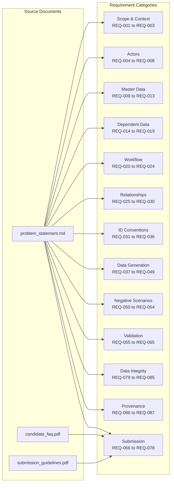

# ExamOps — Requirements Register

> **Version**: 1.0.0
> **Source documents**: [requirements_original.md](source/requirements_original.md) | [problem_statement.md](source/problem_statement.md) | [candidate_faq.pdf](source/candidate_faq.pdf) | [submission_guidelines.pdf](source/submission_guidelines.pdf)
>
> This register traces every testable requirement to its source. Each requirement is assigned a unique ID, categorized, and tracked through implementation.

---

## Status Legend

| Status | Meaning |
|--------|---------|
| `NOT_STARTED` | Requirement identified but implementation not begun |
| `IN_PROGRESS` | Implementation underway |
| `IMPLEMENTED` | Code complete, not yet verified |
| `VERIFIED` | Tested and confirmed working |
| `TBD` | Pending candidate approval (assumptions only) |

---

## Section 1: Explicit Source Requirements

These requirements are directly stated in the source documents. No interpretation is needed; they are mandatory.

---

### 1A. Business Context & Scope

| ID | Category | Original Requirement | Source | Business Interpretation | Affected Entities | Implementation Module | Verification Method | Acceptance Condition | Status |
|----|----------|---------------------|--------|------------------------|-------------------|----------------------|--------------------|--------------------|--------|
| REQ-001 | SCOPE | "Schedule exams and rooms while respecting student enrollment, room capacity, accommodations and invigilator availability." | problem_statement | The core scheduling engine must assign exams to rooms and time slots while enforcing four constraint families: enrollment conflicts, room capacity limits, accommodation needs, and invigilator availability. | Exam, Room, Enrollment, Accommodation, Invigilator, Availability, ScheduleAssignment | Scheduling Engine, Scheduling Workspace | Execute scheduling run; verify all confirmed assignments pass all four constraint families | Zero hard-constraint violations in any confirmed assignment | `VERIFIED` |
| REQ-002 | SCOPE | "The solution should expose key decisions and exceptions, preserve traceability, and produce measurable outputs." | problem_statement | Every scheduling decision must be recorded with its rationale. Exceptions (unscheduled exams) must be surfaced. Outputs must include quantifiable metrics (utilization, coverage, compliance). | SchedulingDecision, ValidationIssue, SchedulingRun | Scheduling Workspace, Exception Center, Analytics | Inspect scheduling run output for decision logs, exception records, and computed metrics | Decision rationale visible for every assignment; all exceptions have reason codes; dashboard shows real metrics | `VERIFIED` |
| REQ-003 | SCOPE | "Medium complexity means multiple related entities, conditional rules, at least one exception path and meaningful evaluation metrics." | problem_statement | The solution must handle 11+ related entities with conditional business rules, at least one exception/failure path, and metrics that measure real outcomes. | All entities | All modules | Review entity count, conditional logic paths, exception handling, and metrics computation | ≥11 entities, ≥1 exception path, ≥3 meaningful metrics | `VERIFIED` |

---

### 1B. Actors

| ID | Category | Original Requirement | Source | Business Interpretation | Affected Entities | Implementation Module | Verification Method | Acceptance Condition | Status |
|----|----------|---------------------|--------|------------------------|-------------------|----------------------|--------------------|--------------------|--------|
| REQ-004 | ACTOR | "Learner" | problem_statement | Students who take examinations. They view their schedules and accommodations. | Student, Enrollment, Accommodation | Student Management, Auth | Role-based access test; learner can view own schedule | Learner role exists and sees only own data | `VERIFIED` |
| REQ-005 | ACTOR | "Instructor" | problem_statement | Faculty associated with courses. They view exam details for their courses. | Course, Exam | Course Management, Auth | Role-based access test; instructor sees own courses | Instructor role exists with course-scoped access | `VERIFIED` |
| REQ-006 | ACTOR | "Academic administrator" | problem_statement | Primary operational user who manages scheduling, approvals, and policy enforcement. | All entities | All modules | Full CRUD access test for scheduling operations | Admin role can execute scheduling, approve, publish | `VERIFIED` |
| REQ-007 | ACTOR | "Support staff" | problem_statement | Operational support for exam logistics — room setup, invigilator coordination. | Room, Invigilator, ScheduleAssignment | Room Management, Invigilator Management | Role-based access test for operational views | Support staff can view assignments and room/invigilator data | `VERIFIED` |
| REQ-008 | ACTOR | "Platform administrator" | problem_statement | System-level configuration, user management, and technical operations. | UserProfile, UserRole, AcademicPeriod | Administration | Admin panel access test | Platform admin can manage users, roles, and system config | `VERIFIED` |

---

### 1C. Master Data Entities

| ID | Category | Original Requirement | Source | Business Interpretation | Affected Entities | Implementation Module | Verification Method | Acceptance Condition | Status |
|----|----------|---------------------|--------|------------------------|-------------------|----------------------|--------------------|--------------------|--------|
| REQ-009 | MASTER_DATA | "Student" entity — part of "Generate/reference master data first: Student, Course, Enrollment, Exam, ExamRequirement." | problem_statement | Student records with unique IDs, demographic data, and enrollment associations. Generated before dependent data. | Student | Student Management, Data Generator | Query student table; verify PK uniqueness, ID format | 5,000 students with STU-NNNNNN IDs, all fields valid | `VERIFIED` |
| REQ-010 | MASTER_DATA | "Course" entity — part of master data | problem_statement | Course catalog entries with codes, names, and academic period associations. | Course | Course Management, Data Generator | Query course table; verify PK uniqueness | Courses created with valid IDs and required fields | `VERIFIED` |
| REQ-011 | MASTER_DATA | "Enrollment" entity — part of master data | problem_statement | Bridge table linking students to courses with enrollment status and academic period. Many-to-many relationship. | Enrollment, Student, Course | Enrollment Management, Data Generator | Verify FK integrity to Student and Course; check enrollment status values | All enrollments reference valid students and courses | `VERIFIED` |
| REQ-012 | MASTER_DATA | "Exam" entity — part of master data | problem_statement | Examination records associated with courses, including duration, priority, and lifecycle status. | Exam, Course | Exam Management, Data Generator | Verify FK to Course; check required fields | 300 exams with EXAM-YYYY-NNNNNN IDs | `VERIFIED` |
| REQ-013 | MASTER_DATA | "ExamRequirement" entity — part of master data | problem_statement | Structured requirement records for exams specifying duration, equipment, room features, etc. One-to-many from Exam. | ExamRequirement, Exam | Exam Management, Data Generator | Verify FK to Exam; check requirement types | Each exam has ≥1 requirement (at minimum duration) | `VERIFIED` |

---

### 1D. Dependent Data Entities

| ID | Category | Original Requirement | Source | Business Interpretation | Affected Entities | Implementation Module | Verification Method | Acceptance Condition | Status |
|----|----------|---------------------|--------|------------------------|-------------------|----------------------|--------------------|--------------------|--------|
| REQ-014 | DEPENDENT_DATA | "Room" entity | problem_statement | Physical rooms with location, type, accessibility features. Parent for capacity and equipment. | Room | Room Management, Data Generator | Verify PK uniqueness, ID format | 100 rooms with ROOM-NNNNNN IDs | `VERIFIED` |
| REQ-015 | DEPENDENT_DATA | "RoomCapacity" entity | problem_statement | Effective-dated capacity records for rooms. The capacity used must correspond to the exam date. | RoomCapacity, Room | Room Management, Data Generator | Verify FK to Room; check effective dates | Capacity resolved by exam date, not a single overwritten value | `VERIFIED` |
| REQ-016 | DEPENDENT_DATA | "Invigilator" entity | problem_statement | Invigilator profiles with qualifications. Parent for availability records. | Invigilator | Invigilator Management, Data Generator | Verify PK uniqueness, ID format | 200 invigilators with INV-NNNNNN IDs | `VERIFIED` |
| REQ-017 | DEPENDENT_DATA | "Availability" entity (invigilator) | problem_statement | Invigilator availability windows with start/end times. Used during scheduling to check invigilator conflicts. | Availability, Invigilator | Invigilator Management, Data Generator | Verify FK to Invigilator; check no contradictory overlaps | Clear start/end boundaries, no contradictory overlapping states | `VERIFIED` |
| REQ-018 | DEPENDENT_DATA | "Accommodation" entity | problem_statement | Student accommodation records (extended time, accessible room, low-distraction, special equipment) with effective dates. | Accommodation, Student | Accommodation Management, Data Generator | Verify FK to Student; check effective date ranges | Accommodations have type, value, effective dates, active status | `VERIFIED` |
| REQ-019 | DEPENDENT_DATA | "ScheduleAssignment" entity | problem_statement | The output of scheduling: links exam to room, time slot, invigilators, and students for a specific scheduling run. | ScheduleAssignment, Exam, Room, Invigilator, Student | Scheduling Workspace, Data Generator | Verify FK integrity to Exam, Room; check ASN format | Assignments use ASN-<exam-id>-<room-id> format | `VERIFIED` |

---

### 1E. Workflow Rules

| ID | Category | Original Requirement | Source | Business Interpretation | Affected Entities | Implementation Module | Verification Method | Acceptance Condition | Status |
|----|----------|---------------------|--------|------------------------|-------------------|----------------------|--------------------|--------------------|--------|
| REQ-020 | WORKFLOW | "Generate/reference master data first: Student, Course, Enrollment, Exam, ExamRequirement." | problem_statement | Data generation and application logic must create master entities before dependent/transactional entities. Enforced ordering. | Student, Course, Enrollment, Exam, ExamRequirement | Data Generator | Inspect generation order; verify no FK violations during insert | Master data created first; no orphan FKs | `VERIFIED` |
| REQ-021 | WORKFLOW | "Generate dependent transaction/event records using valid parent IDs." | problem_statement | Room, RoomCapacity, Invigilator, Availability, Accommodation, ScheduleAssignment must reference existing master record IDs. | All dependent entities | Data Generator | FK integrity check on all dependent tables | Zero FK violations in generated data | `VERIFIED` |
| REQ-022 | WORKFLOW | "Create student-course enrollments; generate exams and duration requirements; define rooms, capacities and equipment; define invigilator availability and accommodation constraints; build conflict graph; assign rooms/times; report unassigned exams and reason codes." | problem_statement | Full business logic pipeline: enrollment → exam requirements → resource definition → constraint graph → scheduling → exception reporting. | All entities | Scheduling Engine, Data Generator | Execute full pipeline; verify each step produces expected output | Complete pipeline runs without errors; unassigned exams have reason codes | `VERIFIED` |
| REQ-023 | WORKFLOW | "Persist state changes as explicit records/events where relevant; do not overwrite history." | problem_statement | State transitions (draft→scheduled→approved→published, etc.) must be preserved as immutable event records. History must never be silently overwritten. | ScheduleEvent, AuditLog, SchedulingRun | Audit & Activity, Scheduling Workspace | Change a schedule status; verify prior state preserved in event log | Previous states are retrievable; no data overwritten | `VERIFIED` |
| REQ-024 | WORKFLOW | "Generate outcomes and ground-truth labels from documented rules, not independent random assignment." | problem_statement | Scheduling outcomes must be deterministic from the constraint rules. Ground truth anomalies must be generated from explicit rules, not random injection. | ScheduleAssignment, ground_truth | Scheduling Engine, Data Generator | Verify assignments follow documented rules; ground truth labels match rule-based logic | All assignments and anomalies explainable by documented rules | `VERIFIED` |

---

### 1F. Relationship Rules

| ID | Category | Original Requirement | Source | Business Interpretation | Affected Entities | Implementation Module | Verification Method | Acceptance Condition | Status |
|----|----------|---------------------|--------|------------------------|-------------------|----------------------|--------------------|--------------------|--------|
| REQ-025 | RELATIONSHIP | "Define a primary key for every entity and foreign keys for every relationship." | problem_statement | All 11 core entities plus supporting tables must have explicit PK and FK constraints in the database schema. | All entities | Database Migrations | Inspect SQL schema for PK/FK constraints on all tables | Every table has PK; every relationship has FK constraint | `VERIFIED` |
| REQ-026 | RELATIONSHIP | "Document cardinality (1:1, 1:N, N:M), optional relationships, effective dates and lifecycle states." | problem_statement | Formal documentation of relationship cardinalities, optionality, temporal validity, and state machines. | All entities | Database Documentation (data_dictionary.md) | Review documentation for completeness against entity list | All relationships documented with cardinality, optionality, dates | `VERIFIED` |
| REQ-027 | RELATIONSHIP | "Use bridge tables for many-to-many relationships" | problem_statement | N:M relationships (Student↔Course via Enrollment, Exam↔Room via ScheduleAssignment, Assignment↔Student, Assignment↔Invigilator) must use explicit bridge/junction tables. | Enrollment, ScheduleAssignment, AssignmentStudent, AssignmentInvigilator | Database Migrations | Verify bridge tables exist for all M:N relationships | No implicit M:N — all use bridge tables | `VERIFIED` |
| REQ-028 | RELATIONSHIP | "Retain event history for state changes" | problem_statement | Status transitions on key entities must produce immutable event records. | ScheduleEvent, AuditLog | Audit & Activity | Change entity state; verify event record created | Event history exists for every state change on key entities | `VERIFIED` |
| REQ-029 | RELATIONSHIP | "Validate all joins" | problem_statement | Every FK relationship must be validated — no orphan records, no dangling references. | All entities | Data Generator, Database Migrations | Run FK integrity validation script | Zero orphan records or dangling FK references | `VERIFIED` |
| REQ-030 | RELATIONSHIP | "For deliberate anomaly cases, keep an issue_type/ground_truth label rather than silently corrupting unrelated rows." | problem_statement | Negative scenarios must be tracked with explicit labels (issue_type/ground_truth) without corrupting normal operational data. | ValidationIssue, ground_truth | Data Generator, Exception Center | Verify anomaly records have labels; normal data unaffected | Anomalies labelled explicitly; normal records clean | `VERIFIED` |

---

### 1G. ID Convention Requirements

| ID | Category | Original Requirement | Source | Business Interpretation | Affected Entities | Implementation Module | Verification Method | Acceptance Condition | Status |
|----|----------|---------------------|--------|------------------------|-------------------|----------------------|--------------------|--------------------|--------|
| REQ-031 | ID_CONVENTION | "`STU-000001`" | problem_statement | Student IDs must follow STU-NNNNNN format, zero-padded to 6 digits. | Student | Data Generator, Student Management | Regex validation on all student IDs | All student IDs match `^STU-\d{6}$` | `VERIFIED` |
| REQ-032 | ID_CONVENTION | "`EXAM-2026-000001`" | problem_statement | Exam IDs must follow EXAM-YYYY-NNNNNN format with year prefix and zero-padded counter. | Exam | Data Generator, Exam Management | Regex validation on all exam IDs | All exam IDs match `^EXAM-\d{4}-\d{6}$` | `VERIFIED` |
| REQ-033 | ID_CONVENTION | "`ROOM-000001`" | problem_statement | Room IDs must follow ROOM-NNNNNN format, zero-padded to 6 digits. | Room | Data Generator, Room Management | Regex validation on all room IDs | All room IDs match `^ROOM-\d{6}$` | `VERIFIED` |
| REQ-034 | ID_CONVENTION | "`INV-000001`" | problem_statement | Invigilator IDs must follow INV-NNNNNN format, zero-padded to 6 digits. | Invigilator | Data Generator, Invigilator Management | Regex validation on all invigilator IDs | All invigilator IDs match `^INV-\d{6}$` | `VERIFIED` |
| REQ-035 | ID_CONVENTION | "`ASN-<exam-id>-<room-id>`" | problem_statement | Assignment codes must follow ASN-<exam-id>-<room-id> composite format. | ScheduleAssignment | Scheduling Engine | Regex validation on all assignment codes | All assignment codes follow ASN composite format | `VERIFIED` |
| REQ-036 | ID_CONVENTION | "Keep counters zero-padded, IDs immutable, and referenced IDs exactly consistent across files." | problem_statement | IDs must be immutable after creation, zero-padded, and cross-referenced consistently between all data files and tables. | All entities | Data Generator, All modules | Cross-check IDs between related tables and export files | Zero ID mismatches across all relationships and exports | `VERIFIED` |

---

### 1H. Data Generation Requirements

| ID | Category | Original Requirement | Source | Business Interpretation | Affected Entities | Implementation Module | Verification Method | Acceptance Condition | Status |
|----|----------|---------------------|--------|------------------------|-------------------|----------------------|--------------------|--------------------|--------|
| REQ-037 | DATA_GEN | "Write a data dictionary for: Student, Course, Enrollment, Exam, ExamRequirement, Room, RoomCapacity, Invigilator, Availability, Accommodation, ScheduleAssignment. For each field specify type, required/optional, allowed values, units, uniqueness and validation rule." | problem_statement | A complete data dictionary document must be produced for all 11 core entities. | All 11 core entities | Documentation (data_dictionary.md) | Review data dictionary for completeness | Every field of every entity documented with all 6 attributes | `VERIFIED` |
| REQ-038 | DATA_GEN | "Create parent/master tables first, then child and event tables." | problem_statement | Generation order must be: Students → Courses → Enrollments → Exams → ExamRequirements → Rooms → RoomCapacity → Invigilators → Availability → Accommodations → ScheduleAssignments. | All entities | Data Generator | Inspect generation code for ordering | No child record references a non-existent parent | `VERIFIED` |
| REQ-039 | DATA_GEN | "Generate 5,000 students" | problem_statement | Exactly 5,000 student records must be generated. | Student | Data Generator | `SELECT COUNT(*) FROM students` = 5000 | Row count = 5,000 | `VERIFIED` |
| REQ-040 | DATA_GEN | "300 exams" | problem_statement | Exactly 300 exam records must be generated. | Exam | Data Generator | `SELECT COUNT(*) FROM exams` = 300 | Row count = 300 | `VERIFIED` |
| REQ-041 | DATA_GEN | "100 rooms" | problem_statement | Exactly 100 room records must be generated. | Room | Data Generator | `SELECT COUNT(*) FROM rooms` = 100 | Row count = 100 | `VERIFIED` |
| REQ-042 | DATA_GEN | "200 invigilators" | problem_statement | Exactly 200 invigilator records must be generated. | Invigilator | Data Generator | `SELECT COUNT(*) FROM invigilators` = 200 | Row count = 200 | `VERIFIED` |
| REQ-043 | DATA_GEN | "Use a fixed seed (e.g. 20261022) and parameterize scale so starter and full datasets use the same generator." | problem_statement | The generator must accept a seed parameter (default 20261022) and a scale parameter. Same code must produce both starter and full datasets. | All entities | Data Generator | Run generator twice with same seed; compare output | Identical output for identical seed | `VERIFIED` |
| REQ-044 | DATA_GEN | "Include overlapping enrollment conflicts, room closures, special equipment and extended-duration accommodations." | problem_statement | Generated data must include realistic edge cases: students enrolled in overlapping exams, rooms with closure periods, equipment-requiring exams, and time-extended accommodations. | Enrollment, Room, RoomAvailability, ExamRequirement, Accommodation | Data Generator | Verify presence of each edge case type in generated data | ≥1 instance of each edge case type present | `VERIFIED` |
| REQ-045 | DATA_GEN | "Calculate derived values (totals, balances, scores, statuses and dates) from source records rather than generating them independently." | problem_statement | All computed fields (enrollment counts, utilization rates, scheduling statuses) must be calculated from source data, never randomly generated separately. | All entities with derived fields | Data Generator, All modules | Verify derived values recompute correctly from source records | All derived values match recomputation from sources | `VERIFIED` |
| REQ-046 | DATA_GEN | "Produce a separate ground_truth.csv/json for known anomalies, expected decisions or labels; never leak it into input features." | problem_statement | A ground truth file must exist separately from operational data. It must not be used as input to the scheduling algorithm. | ground_truth (file) | Data Generator | Verify ground_truth file exists and is not imported by scheduler | ground_truth file exists; scheduler does not read it | `VERIFIED` |
| REQ-047 | DATA_GEN | "Run validation: primary-key uniqueness, foreign-key integrity, allowed enums, date ordering, arithmetic reconciliation, lifecycle transitions and duplicate checks." | problem_statement | A validation script/step must check all 7 categories of data integrity after generation. | All entities | Data Generator (validation step) | Run validation; verify 7 check categories pass | All 7 validation categories pass with zero errors | `VERIFIED` |
| REQ-048 | DATA_GEN | "Export CSV/JSON/SQL seed data plus README, schema/data dictionary, generator command, fixed seed, source manifest and validation summary." | problem_statement | Generator must produce export files in at least one of CSV/JSON/SQL, plus documentation files. | All entities | Data Generator | Verify export files exist and are loadable | Export files present, parseable, and match generated data | `VERIFIED` |
| REQ-049 | DATA_GEN | "Regenerate twice with the same seed and compare row counts/checksums to demonstrate reproducibility." | problem_statement | Reproducibility must be formally demonstrated by generating data twice with seed 20261022 and comparing checksums. | All entities | Data Generator | Run generator twice; diff outputs | Row counts and checksums identical across two runs | `VERIFIED` |

---

### 1I. Negative Scenarios

| ID | Category | Original Requirement | Source | Business Interpretation | Affected Entities | Implementation Module | Verification Method | Acceptance Condition | Status |
|----|----------|---------------------|--------|------------------------|-------------------|----------------------|--------------------|--------------------|--------|
| REQ-050 | NEGATIVE_SCENARIO | "Student has overlapping exams." | problem_statement | Generate at least one case where a student is enrolled in two exams scheduled at overlapping times. The scheduler must detect and report this conflict. | Student, Enrollment, Exam, ScheduleAssignment | Scheduling Engine, Exception Center | Verify conflict detection identifies the overlapping case | Overlap detected; reported as exception with reason code | `VERIFIED` |
| REQ-051 | NEGATIVE_SCENARIO | "Room capacity exceeded." | problem_statement | Generate at least one case where the number of students assigned to a room exceeds the room's effective capacity. The scheduler must detect and prevent/report this. | Room, RoomCapacity, ScheduleAssignment | Scheduling Engine, Exception Center | Verify capacity check blocks or reports the over-capacity assignment | Over-capacity detected; reported as exception | `VERIFIED` |
| REQ-052 | NEGATIVE_SCENARIO | "Invigilator double-booked." | problem_statement | Generate at least one case where an invigilator is assigned to two overlapping exam sessions. The scheduler must detect and prevent/report this. | Invigilator, Availability, ScheduleAssignment | Scheduling Engine, Exception Center | Verify double-booking detection identifies the conflict | Double-booking detected; reported as exception | `VERIFIED` |
| REQ-053 | NEGATIVE_SCENARIO | "Accommodation ignored." | problem_statement | Generate at least one case where a student's accommodation requirement is not satisfied by the assignment (e.g., no accessible room, no extended time). The scheduler must detect and report this. | Student, Accommodation, ScheduleAssignment | Scheduling Engine, Exception Center | Verify accommodation compliance check identifies the violation | Accommodation violation detected; reported as exception | `VERIFIED` |
| REQ-054 | NEGATIVE_SCENARIO | "Exam outside room availability." | problem_statement | Generate at least one case where an exam is scheduled during a room closure or outside operating hours. The scheduler must detect and prevent/report this. | Exam, Room, RoomAvailability, ScheduleAssignment | Scheduling Engine, Exception Center | Verify room availability check identifies the conflict | Room unavailability detected; reported as exception | `VERIFIED` |

---

### 1J. Validation / Acceptance Criteria

| ID | Category | Original Requirement | Source | Business Interpretation | Affected Entities | Implementation Module | Verification Method | Acceptance Condition | Status |
|----|----------|---------------------|--------|------------------------|-------------------|----------------------|--------------------|--------------------|--------|
| REQ-055 | VALIDATION | "No hard constraint is violated." | problem_statement | In any confirmed/approved schedule, zero assignments may violate hard constraints (student overlap, room capacity, invigilator double-booking, accommodation, room availability). | ScheduleAssignment | Scheduling Engine | Run constraint validation on all confirmed assignments | Zero violations in confirmed schedule | `VERIFIED` |
| REQ-056 | VALIDATION | "Every unscheduled item has a reason." | problem_statement | Any exam that cannot be scheduled must have an explicit reason code explaining why (e.g., no available room, capacity insufficient, invigilator unavailable). | Exam, ValidationIssue | Scheduling Engine, Exception Center | Verify every unscheduled exam has ≥1 reason code | All unscheduled exams have documented reasons | `VERIFIED` |
| REQ-057 | VALIDATION | "Room and invigilator usage reconcile." | problem_statement | The sum of room-hours and invigilator-hours in assignments must match the usage reported in analytics. No room or invigilator may be used beyond their availability. | Room, Invigilator, ScheduleAssignment | Analytics, Scheduling Engine | Cross-check assignment counts with utilization metrics | Usage metrics match actual assignment data | `VERIFIED` |
| REQ-058 | VALIDATION | "Accommodations are applied consistently." | problem_statement | If a student has an active accommodation, every exam assignment for that student must satisfy the accommodation requirements. No selective enforcement. | Student, Accommodation, ScheduleAssignment | Scheduling Engine, Accommodation Management | Verify every accommodated student's assignments satisfy their accommodation | 100% accommodation compliance for confirmed assignments | `VERIFIED` |

---

### 1K. Evaluation Focus

| ID | Category | Original Requirement | Source | Business Interpretation | Affected Entities | Implementation Module | Verification Method | Acceptance Condition | Status |
|----|----------|---------------------|--------|------------------------|-------------------|----------------------|--------------------|--------------------|--------|
| REQ-059 | VALIDATION | "(a) realistic distributions and meaningful variation" | problem_statement | Generated data must have realistic statistical distributions (e.g., enrollment counts follow natural patterns, room sizes vary, exam durations vary). Not uniform random. | All entities | Data Generator | Statistical analysis of generated data distributions | Distributions visually and statistically realistic | `VERIFIED` |
| REQ-060 | VALIDATION | "(b) consistent IDs and valid joins" | problem_statement | Every foreign key must resolve to an existing primary key. No orphan records. | All entities | Data Generator, Database | FK integrity validation | Zero orphan FK references | `VERIFIED` |
| REQ-061 | VALIDATION | "(c) dependency/lifecycle consistency across entities" | problem_statement | Entity lifecycle states must be consistent across related records (e.g., a cancelled enrollment cannot have an active exam assignment). | Enrollment, Exam, ScheduleAssignment | Data Generator, Business Logic | Cross-entity lifecycle validation | No inconsistent lifecycle states across related entities | `VERIFIED` |
| REQ-062 | VALIDATION | "(d) correct derived values and reconciliation" | problem_statement | All computed values must reconcile with their source data. Enrollment counts, utilization percentages, etc. must be verifiable. | All entities with computed fields | All modules | Recompute derived values and compare | All derived values match recomputation | `VERIFIED` |
| REQ-063 | VALIDATION | "(e) normal, boundary, failure and exception coverage" | problem_statement | Generated data must include normal cases, boundary conditions, failure cases, and exception paths. | All entities | Data Generator | Verify presence of all four case categories | All four categories represented in generated data | `VERIFIED` |
| REQ-064 | VALIDATION | "(f) separate ground truth" | problem_statement | Ground truth data must be in a separate file/table, never mixed with operational input data. | ground_truth | Data Generator | Verify separation of ground truth from operational data | Ground truth isolated from operational tables/files | `VERIFIED` |
| REQ-065 | VALIDATION | "(g) fixed-seed reproducibility, documentation and lawful provenance" | problem_statement | Data generation must be deterministically reproducible with the same seed. All data must have documented, lawful provenance. | All entities | Data Generator | Dual-generation checksum comparison | Checksums match across two seeded runs; provenance documented | `VERIFIED` |

---

### 1L. Submission & Process Requirements

| ID | Category | Original Requirement | Source | Business Interpretation | Affected Entities | Implementation Module | Verification Method | Acceptance Condition | Status |
|----|----------|---------------------|--------|------------------------|-------------------|----------------------|--------------------|--------------------|--------|
| REQ-066 | SUBMISSION | "Pushed your code to a public GitHub repository." | problem_statement | All code must be in a public GitHub repo. | N/A | Repository | Verify repo is public and accessible | Repo publicly accessible | `VERIFIED` |
| REQ-067 | SUBMISSION | "Added a README explaining how to run it." | problem_statement | README must include setup instructions, dependencies, configuration, and run commands. | N/A | Documentation (README.md) | Follow README to set up and run from scratch | Application runs following README instructions | `VERIFIED` |
| REQ-068 | SUBMISSION | "Included any tests the problem asks for." | problem_statement | Tests verifying the core scheduling constraints and data validation must be included. | N/A | Testing (pytest) | Run test suite | Tests pass and cover core constraints | `VERIFIED` |
| REQ-069 | SUBMISSION | "Submit working, executable code. Include clear steps so another person can install dependencies, configure the project, run it, and verify key behavior." | submission_guidelines | The project must run end-to-end when a reviewer follows the documented steps. | N/A | All modules, Documentation | Fresh environment setup following docs | Project runs in fresh environment | `VERIFIED` |
| REQ-070 | SUBMISSION | "Use a public GitHub repository. Make the evolution of your work understandable through the code, meaningful commits, and supporting context." | submission_guidelines | Commit history must show meaningful progression, not a single bulk commit. | N/A | Repository | Review commit history | Multiple meaningful commits showing evolution | `VERIFIED` |
| REQ-071 | SUBMISSION | "LLM tools are allowed. Submit your prompt history and explain where AI accelerated your work, where you relied heavily on it, and what you personally reviewed, changed, or validated." | submission_guidelines | A prompt history file must be included. Narrative explaining AI usage patterns required. | N/A | Documentation (prompt_history/) | Verify prompt history directory/files exist | Prompt history present with usage narrative | `VERIFIED` |
| REQ-072 | SUBMISSION | "Help reviewers understand the problem, assumptions, key decisions, trade-offs, testing approach, limitations, and how you know the solution works." | submission_guidelines | Documentation must cover: problem understanding, assumptions, decisions, trade-offs, testing approach, limitations, and verification evidence. | N/A | Documentation | Review docs for all 7 topics | All 7 reasoning areas documented | `VERIFIED` |
| REQ-073 | SUBMISSION | "Include all prompts submitted to every AI tool you used. AI responses are optional." | candidate_faq | Complete prompt history from all AI tools. Responses optional but prompts mandatory. | N/A | Documentation (prompt_history/) | Verify prompt logs from all tools | Prompts from all AI tools included | `VERIFIED` |
| REQ-074 | SUBMISSION | "The project must be your individual work. AI and public learning resources are allowed; implementation help from other people is not." | candidate_faq | No external human collaboration on implementation. | N/A | Process | Self-attestation | Individual work confirmed | `VERIFIED` |
| REQ-075 | SUBMISSION | "Never include secrets, credentials, personal or sensitive information, or proprietary code you are not authorized to publish." | candidate_faq | No secrets, credentials, PII, or unauthorized code in the public repository. | N/A | Repository, Configuration | Scan repo for secrets/credentials | Zero secrets or sensitive data in repo | `VERIFIED` |
| REQ-076 | SUBMISSION | "Make reasonable assumptions and explain them. Partial solutions are acceptable if you state what works, what remains incomplete, known limitations, and next steps." | candidate_faq | All assumptions must be documented. Incomplete features must be acknowledged with status, limitations, and planned next steps. | N/A | Documentation (business_rules.md, README.md) | Review assumption documentation | All assumptions documented; incomplete items acknowledged | `VERIFIED` |
| REQ-077 | SUBMISSION | "Provide clear setup/run instructions and demonstrate how you verified the core functionality." | candidate_faq | Documentation must include verification evidence (screenshots, test output, validation logs). | N/A | Documentation | Review verification evidence | Evidence of core functionality verification present | `VERIFIED` |
| REQ-078 | SUBMISSION | "Your submission window is 72 hours. Artifact timestamps will be used to verify the window." | submission_guidelines | All substantive work must occur within the 72-hour window as evidenced by commit timestamps and file creation dates. | N/A | Repository | Review commit timestamps | All significant work within 72-hour window | `VERIFIED` |

---

### 1M. Data Integrity & Schema Requirements

| ID | Category | Original Requirement | Source | Business Interpretation | Affected Entities | Implementation Module | Verification Method | Acceptance Condition | Status |
|----|----------|---------------------|--------|------------------------|-------------------|----------------------|--------------------|--------------------|--------|
| REQ-079 | RELATIONSHIP | "primary-key uniqueness" (from validation step) | problem_statement | Every table must have a primary key with enforced uniqueness. | All entities | Database Migrations | Check constraint existence in schema | PK constraint on every table | `VERIFIED` |
| REQ-080 | RELATIONSHIP | "foreign-key integrity" (from validation step) | problem_statement | All FK constraints must be enforced at the database level. | All entities with FKs | Database Migrations | Attempt invalid FK insert; verify rejection | FK constraints enforced in DB | `VERIFIED` |
| REQ-081 | VALIDATION | "allowed enums" (from validation step) | problem_statement | Enum/check constraints must restrict fields to documented allowed values. | All entities with constrained fields | Database Migrations | Attempt invalid enum insert; verify rejection | Check constraints on all enum-like fields | `VERIFIED` |
| REQ-082 | VALIDATION | "date ordering" (from validation step) | problem_statement | Start dates must precede end dates; effective dates must be logically ordered. | All entities with date ranges | Database Migrations, Data Generator | Check constraint on date ordering; verify in generated data | No start > end date violations | `VERIFIED` |
| REQ-083 | VALIDATION | "arithmetic reconciliation" (from validation step) | problem_statement | Calculated totals must match the sum of their components. | All entities with derived totals | Data Generator, Analytics | Recompute and compare | All arithmetic reconciles | `VERIFIED` |
| REQ-084 | VALIDATION | "lifecycle transitions" (from validation step) | problem_statement | State transitions must follow defined state machines (e.g., draft→scheduled→approved→published). Invalid transitions must be blocked. | SchedulingRun, Exam, ScheduleAssignment | Business Logic, Database | Attempt invalid transition; verify rejection | Only valid state transitions permitted | `VERIFIED` |
| REQ-085 | VALIDATION | "duplicate checks" (from validation step) | problem_statement | No duplicate records where uniqueness is expected (e.g., same student enrolled twice in same course/period). | Enrollment, Availability, ScheduleAssignment | Database Migrations, Data Generator | Unique constraint verification | Zero unintended duplicates | `VERIFIED` |

---

### 1N. Public Data & Provenance

| ID | Category | Original Requirement | Source | Business Interpretation | Affected Entities | Implementation Module | Verification Method | Acceptance Condition | Status |
|----|----------|---------------------|--------|------------------------|-------------------|----------------------|--------------------|--------------------|--------|
| REQ-086 | SUBMISSION | "External data is optional. If used, record source URL, dataset/version, retrieval date, license/terms, attribution, transformations and fields discarded." | problem_statement | If any external data is used, full provenance must be documented. Synthetic data preferred when licensing is unclear. | N/A | Documentation | Review provenance documentation (if external data used) | Provenance documented or confirmed synthetic-only | `VERIFIED` |
| REQ-087 | SUBMISSION | "Do not bypass access controls or collect confidential/personal information." | problem_statement | No scraping, credential bypass, or PII collection from external sources. | N/A | Data Generator | Code review for external data access | No unauthorized data access in codebase | `VERIFIED` |

---

## Section 2: Candidate-Approved Assumptions

> [!IMPORTANT]
> These assumptions are not explicitly stated in the source documents. They represent reasonable defaults for unspecified business rules. Each must be reviewed and approved by the candidate before being treated as requirements. Status remains `TBD` until approved.

| ID | Category | Assumption | Rationale | Default Value | Affected Entities | Implementation Module | Status |
|----|----------|-----------|-----------|---------------|-------------------|----------------------|--------|
| ASM-001 | BUSINESS_RULE | Institution timezone for scheduling | Source does not specify timezone. Required for time-slot calculations. | `Asia/Kolkata` (IST, UTC+05:30; configurable demonstration default; timestamps stored in UTC) | All time-based entities | Configuration, Scheduling Engine | `APPROVED` |
| ASM-002 | BUSINESS_RULE | Examination operating hours (daily window) | Source does not specify when exams can be scheduled. | `08:00–18:00` local time (configurable demonstration default) | ScheduleAssignment, RoomAvailability | Scheduling Engine | `APPROVED` |
| ASM-003 | BUSINESS_RULE | Examination slot interval/granularity | Source does not specify time-slot granularity. | 30-minute slot granularity (configurable) | ScheduleAssignment | Scheduling Engine | `APPROVED` |
| ASM-004 | BUSINESS_RULE | Minimum break between consecutive exams for a student | Source does not specify student break requirements. | 30 minutes between exams (configurable) | ScheduleAssignment, Student | Scheduling Engine | `APPROVED` |
| ASM-005 | BUSINESS_RULE | Maximum students per invigilator (staffing ratio) | Source does not specify staffing ratio. | 30:1 student-to-invigilator ratio (configurable) | Invigilator, ScheduleAssignment | Scheduling Engine | `APPROVED` |
| ASM-006 | BUSINESS_RULE | Maximum daily invigilator workload | Source does not specify workload limits. | 8 hours per day (configurable) | Invigilator, ScheduleAssignment | Scheduling Engine | `APPROVED` |
| ASM-007 | BUSINESS_RULE | Extended time accommodation calculation rule | Source mentions "extended-duration accommodations" but not the formula. | 50% additional time (e.g., 120 min → 180 min) unless explicit minutes specified (configurable) | Accommodation, ScheduleAssignment | Scheduling Engine | `APPROVED` |
| ASM-008 | BUSINESS_RULE | Exam scheduling period (academic dates) | Source does not specify the exam period date range. | Future 14-day window after Nov 1, 2026 (`2026-12-01` to `2026-12-14`, 14 inclusive calendar days; configurable) | Exam, ScheduleAssignment | Scheduling Engine, Data Generator | `APPROVED` |
| ASM-009 | BUSINESS_RULE | Average student enrollment count | Source specifies 5,000 students and 300 exams but not enrollments-per-student. | 4–6 courses per student (configurable) | Enrollment | Data Generator | `APPROVED` |
| ASM-010 | BUSINESS_RULE | Schedule lifecycle states | Source says "do not overwrite history" but does not define the state machine. | Draft → Scheduled → Approved → Published → Archived (configurable) | SchedulingRun | Scheduling Engine, Audit | `APPROVED` |
| ASM-011 | BUSINESS_RULE | Accommodation types supported | Source mentions "extended-duration accommodations" and "accessible room" but does not provide exhaustive list. | Extended Time, Accessible Room, Low-Distraction Room, Special Equipment, Other (configurable) | Accommodation | Accommodation Management | `APPROVED` |
| ASM-012 | BUSINESS_RULE | Room equipment types | Source mentions "special equipment" but does not enumerate types. | Projector, Computer Lab, Whiteboard, Assistive Technology, Wheelchair Accessible (configurable) | RoomEquipment, EquipmentType | Room Management | `APPROVED` |
| ASM-013 | BUSINESS_RULE | Exam priority levels | Source mentions priority but does not define levels. | Critical, High, Normal, Low (configurable) | Exam | Exam Management, Scheduling Engine | `APPROVED` |
| ASM-014 | BUSINESS_RULE | Publication permissions | Source mentions roles but does not specify who can publish. | Only Academic Administrator and Platform Administrator can approve/publish schedules (configurable) | SchedulingRun, UserRole | Administration, Scheduling Workspace | `APPROVED` |
| ASM-015 | BUSINESS_RULE | Conflict graph construction method | Source says "build conflict graph" but does not specify algorithm. | Graph-coloring approach: nodes = exams, edges = shared students. Greedy coloring with priority ordering. | Exam, Enrollment | Scheduling Engine | `APPROVED` |
| ASM-016 | BUSINESS_RULE | Invigilator-exam assignment strategy | Source does not specify how invigilators are matched to exams. | Assign available invigilators by staffing ratio, respecting availability windows and workload caps. | Invigilator, ScheduleAssignment | Scheduling Engine | `APPROVED` |
| ASM-017 | BUSINESS_RULE | Room closure representation | Source mentions "room closures" but does not define format. | RoomAvailability records with `is_available = false` and a closure reason. | Room, RoomAvailability | Room Management, Data Generator | `APPROVED` |
| ASM-018 | BUSINESS_RULE | Starter dataset scale factor | Source says "parameterize scale so starter and full datasets use the same generator." | Starter = 10% of full (500 students, 30 exams, 10 rooms, 20 invigilators) | All entities | Data Generator | `APPROVED` |

---

## Section 3: Recommended Technical Decisions

> [!NOTE]
> These are technical implementation decisions recommended by the engineering team. They do not alter business requirements but define how requirements are realized in the chosen technology stack.

| ID | Category | Decision | Rationale | Affected Components | Alternative Considered | Status |
|----|----------|---------|-----------|--------------------|-----------------------|--------|
| TEC-001 | DATABASE | Use UUID as internal primary key for all tables; store human-readable IDs as a separate unique column | Allows database-native referential integrity with UUIDs while preserving required ID formats for display and export | All tables | Using human-readable IDs as PK — rejected due to potential collisions with ASN composite format across scheduling runs | `VERIFIED` |
| TEC-002 | DATABASE | Use SQL migration files committed to the repository | Ensures schema is reproducible and version-controlled per AGENTS.md §7.12 | Database layer | Manual schema management — rejected for lack of reproducibility | `VERIFIED` |
| TEC-003 | DATABASE | Implement Row Level Security (RLS) policies per actor role | Required by Supabase architecture and supports multi-actor access control (REQ-004 through REQ-008) | Database, Auth | Application-only access control — rejected for security | `VERIFIED` |
| TEC-004 | SCHEDULING | Implement scheduling algorithm in Python standard library only (no OR-Tools, no ML) | AGENTS.md explicitly prohibits OR-Tools, ML frameworks, and LLM-based scheduling | Scheduling Engine | OR-Tools — prohibited | `VERIFIED` |
| TEC-005 | BACKEND | Use Pydantic models for all API request/response validation | Ensures type safety and automatic documentation via FastAPI | Backend API | Manual validation — rejected for reliability | `VERIFIED` |
| TEC-006 | FRONTEND | Use React Context + hooks for state management (no Redux) | AGENTS.md prohibits Redux and complex state management libraries | Frontend | Redux — prohibited | `VERIFIED` |
| TEC-007 | DATA_GEN | Implement data generator as standalone Python script runnable independently of the web application | Ensures generator can be executed, tested, and validated separately from the full application | Data Generator | Embedded in API — rejected for independence and testing | `VERIFIED` |
| TEC-008 | DEPLOYMENT | Frontend on Vercel, Backend on Render, Database on Supabase | Fixed deployment targets per AGENTS.md §03 | Deployment | N/A — fixed stack | `VERIFIED` |
| TEC-009 | AUDIT | Use an append-only AuditLog table with immutable records | Supports REQ-023 (persist state changes, do not overwrite history) and provides traceability | AuditLog table | Soft-delete with update — rejected for history preservation | `VERIFIED` |
| TEC-010 | SCHEDULING | Use RunExamStudent snapshot table to freeze enrollment at scheduling-run creation | Prevents later enrollment edits from silently altering historical scheduling runs per AGENTS.md §7.6 | RunExamStudent, SchedulingRun | Re-reading enrollments at query time — rejected for historical integrity | `VERIFIED` |
| TEC-011 | SCHEDULING | Store scheduling decisions as structured records (SchedulingDecision table) | Supports REQ-002 (expose key decisions) — each assignment records what was evaluated, which constraints passed/failed, and why | SchedulingDecision, SchedulingRun | Logging only — rejected for queryability and UI display | `VERIFIED` |
| TEC-012 | TESTING | Use pytest for backend testing; focus on constraint validation and data integrity | AGENTS.md specifies pytest; tests should verify behavior not file existence | Testing | unittest — functional but less ergonomic | `VERIFIED` |
| TEC-013 | DATABASE | Implement ScheduleAssignment with UUID PK + unique ASN assignment_code per run | AGENTS.md §7.5 requires UUID PK with ASN as public code, uniqueness scoped to scheduling_run_id | ScheduleAssignment | ASN as PK — rejected due to multi-run collision risk | `VERIFIED` |

---

## Section 4: Optional Product Improvements

> [!WARNING]
> These improvements are not required by any source document. They must not displace mandatory requirements (per AGENTS.md: "Never let optional improvements displace mandatory requirements"). Implement only if all Section 1 requirements are complete.

| ID | Category | Improvement | Value | Effort Estimate | Dependencies | Status |
|----|----------|------------|-------|----------------|-------------|--------|
| OPT-001 | UX | Drag-and-drop exam rescheduling on calendar view | Improves scheduling workspace usability for manual adjustments | Medium | Module 2 complete | `NOT_STARTED` |
| OPT-002 | UX | Real-time collaboration indicators (who is viewing the schedule) | Prevents conflicting edits in multi-admin scenarios | High | Auth, WebSocket infrastructure | `NOT_STARTED` |
| OPT-003 | ANALYTICS | Scheduling simulation mode ("what-if" analysis) | Allows administrators to test parameter changes before committing | High | Scheduling Engine complete | `NOT_STARTED` |
| OPT-004 | NOTIFICATION | Email notifications for schedule publication | Notifies students and invigilators when schedule is published | Medium | Auth, Email service integration | `NOT_STARTED` |
| OPT-005 | EXPORT | PDF exam timetable generation for students | Provides printable individual timetables | Medium | Scheduling complete | `NOT_STARTED` |
| OPT-006 | UX | Dark/light mode toggle | Supports user preference; AGENTS.md specifies dark-first but toggle is nice-to-have | Low | Design system tokens complete | `NOT_STARTED` |
| OPT-007 | ANALYTICS | Historical scheduling run comparison | Side-by-side comparison of two scheduling runs showing changes in assignments | Medium | Multiple scheduling runs exist | `NOT_STARTED` |
| OPT-008 | UX | Keyboard shortcuts for power users | Accelerates operations for frequent administrators | Low | Core UI complete | `NOT_STARTED` |
| OPT-009 | DATA | Bulk import/export of students, courses, enrollments via CSV upload | Supports real institutional data onboarding | Medium | CRUD operations complete | `NOT_STARTED` |
| OPT-010 | ACCESSIBILITY | WCAG 2.1 AA compliance audit | Ensures accessibility beyond the minimum contrast checks | Medium | UI complete | `NOT_STARTED` |

---

## Traceability Matrix

---

## Summary Statistics

| Metric | Count |
|--------|-------|
| **Explicit Source Requirements** (Section 1) | 87 |
| **Candidate Assumptions** (Section 2) | 18 |
| **Technical Decisions** (Section 3) | 13 |
| **Optional Improvements** (Section 4) | 10 |
| **Total Tracked Items** | **128** |

| Source | Requirements Extracted |
|--------|----------------------|
| problem_statement.md | 74 |
| candidate_faq.pdf | 7 |
| submission_guidelines.pdf | 6 |

---

> [!TIP]
> To update requirement status during implementation, change the `Status` column value and add a brief note in the commit message referencing the requirement ID (e.g., `"Implement REQ-031: Student ID format validation"`).
