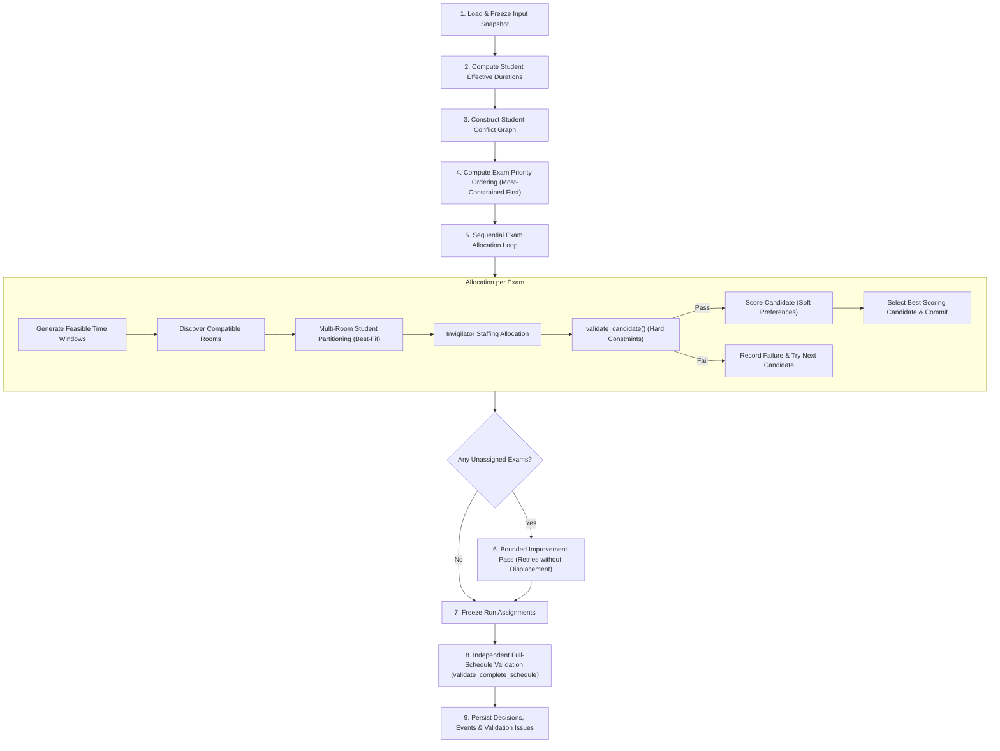
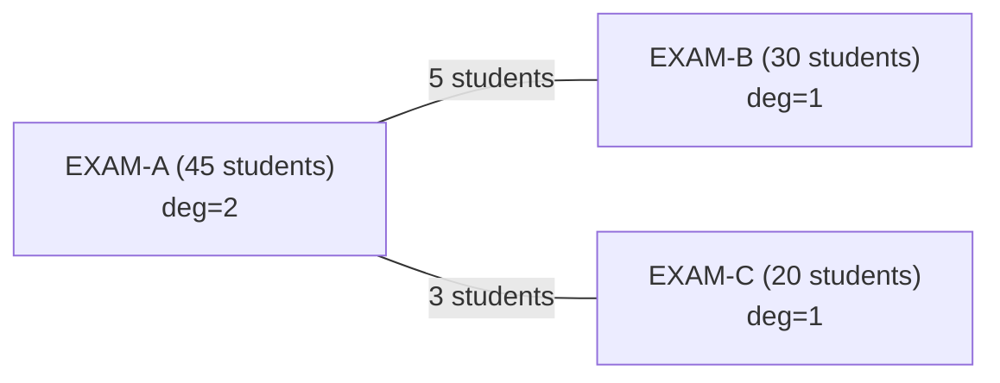
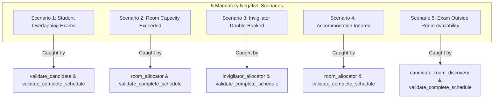
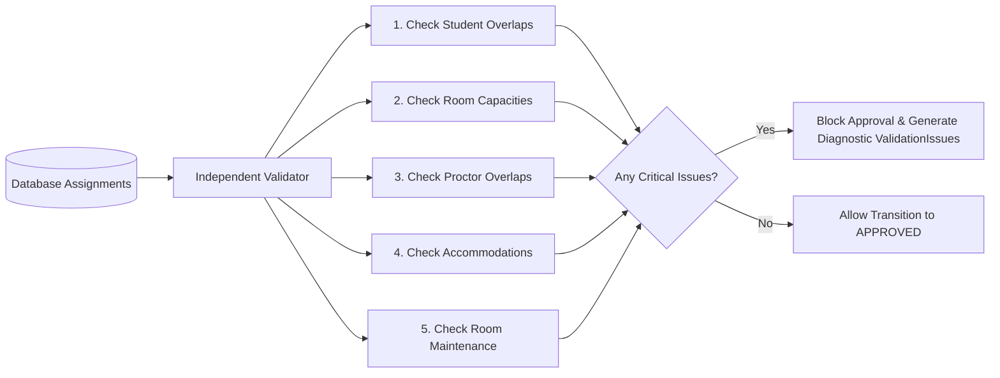

# ExamOps — Scheduling Engine Technical Specification & Business Logic

> **Version:** 1.0.0  
> **Product:** ExamOps — Examination Operations & Intelligent Scheduling Platform  
> **Module:** Core Scheduling Engine (`backend/scheduler/`)  
> **Last Updated:** 2026-11-01  
> **Authoritative Sources:** problem_statement.md, AGENTS.md

---

## 1. Algorithm Philosophy & Overview

ExamOps employs a **deterministic, most-constrained-first greedy heuristic with candidate scoring and a bounded improvement pass**.



### Design Principles & Honest Engineering Claims
- **No Black-Box Solvers:** In strict adherence to project mandates, the engine does not use external constraint solvers (such as Google OR-Tools, Z3), LLM-based scheduling, or reinforcement learning. The entire engine is implemented in Python's standard library.
- **Explainable Decisions:** Every attempt, candidate evaluation, constraint check, and rejection reason is explicitly captured in a `SchedulingDecision` log.
- **Greedy Characteristics:** A greedy algorithm executes in $O(E \cdot T \cdot R)$ time and is guaranteed to terminate deterministically. However, greedy heuristics do **not** guarantee mathematical optimality; a greedy decision made for an early high-priority exam could theoretically prevent a lower-priority exam from finding a slot. To mitigate this without unbounded back-tracking, a **bounded improvement pass** re-evaluates unassigned exams over expanded candidate windows.
- **Hard Constraints vs. Soft Preferences:** Hard constraints (e.g. no student double-booking, room capacity limits) are strictly non-negotiable and evaluated during `validate_candidate()`. Soft preferences (e.g. room compactness, minimizing split rooms, workload balance) are evaluated only on candidates that have passed all hard checks.

---

## 2. Input Preparation & Frozen Participation Snapshot

To guarantee data integrity and auditability, a scheduling run never reads directly from dynamic operational tables during execution:

1. **Academic Period Validation:** Confirm the target `academic_period_id` has valid dates and active status.
2. **Resolve Eligible Enrollments:** Filter `enrollments` WHERE `status = 'ACTIVE'` AND `academic_period_id = target_period`.
3. **Capture Snapshot (`RunExamStudent`):**
   - For every eligible `(exam, student)` pair, calculate the `base_duration_minutes` from `exams.duration_minutes`.
   - Inspect active student accommodations from `accommodations` WHERE `student_id = student.id` AND `is_active = TRUE` AND `effective_start <= exam_date <= COALESCE(effective_end, '9999-12-31')`.
   - Compute `extra_duration_minutes` and `effective_duration_minutes`.
   - Store the complete snapshot in `run_exam_students` with an input state SHA-256 hash.
4. **Load Resources:**
   - Active rooms with effective capacities on the examination dates.
   - Operating hours and closure blackouts from `room_availabilities`.
   - Active invigilators with shift windows and availability from `availabilities`.
   - Institutional configuration snapshot (slot granularity, student-to-proctor ratios).

---

## 3. Student Examination Duration Calculation

Every student assigned to an examination has an individualized effective duration:

$$\text{effective\_duration} = \text{base\_duration} + \text{extra\_duration}$$

### Accommodation Duration Policy:
```python
def compute_student_duration(exam_base_minutes: int, accommodations: list[Accommodation]) -> tuple[int, int]:
    extra_minutes = 0
    for acc in accommodations:
        if acc.accommodation_type == "EXTENDED_TIME" and acc.is_active:
            if acc.extra_time_minutes is not None:
                # Explicit minutes take precedence
                extra_minutes = max(extra_minutes, acc.extra_time_minutes)
            elif acc.extra_time_percentage is not None:
                # Percentage calculation with ceiling rounding policy
                pct_extra = math.ceil(exam_base_minutes * (acc.extra_time_percentage / 100.0))
                extra_minutes = max(extra_minutes, pct_extra)
    return exam_base_minutes, extra_minutes
```

---

## 4. Conflict Graph Construction

Two examinations conflict if and only if they share at least one eligible student. This is the classic vertex coloring problem foundation.

### High-Performance Construction Algorithm:
Instead of comparing all pairs of exams ($O(E^2 \cdot S)$), we build an inverted student-to-exams index in $O(S \cdot E_{\text{per\_student}})$:

```python
# 1. Build inverted index: student_id -> list of exam_ids
student_exam_map = collections.defaultdict(set)
for record in snapshot_records:
    student_exam_map[record.student_id].add(record.exam_id)

# 2. Build conflict graph adjacency list and edge weights
conflict_graph = collections.defaultdict(set)
shared_students = collections.defaultdict(int)

for student_id, enrolled_exams in student_exam_map.items():
    if len(enrolled_exams) > 1:
        for exam_a, exam_b in itertools.combinations(enrolled_exams, 2):
            pair = tuple(sorted([exam_a, exam_b]))
            conflict_graph[exam_a].add(exam_b)
            conflict_graph[exam_b].add(exam_a)
            shared_students[pair] += 1
```

For each exam node $v$:
- **Conflict Degree:** $\operatorname{deg}(v) = |\text{conflict\_graph}[v]|$
- **Total Shared Enrollments:** $\sum_{u \in \text{neighbors}(v)} \text{shared\_students}[(u, v)]$
- **Eligible Enrollment Count:** $|S_v|$

---

## 5. Exam Ordering (Priority Heuristic)

Exams are scheduled one at a time. The most constrained examinations must be scheduled earliest in the sequence when the scheduling matrix has maximum free room and time capacity.

The priority ordering is a deterministic lexicographical sort on the following tuple:

$$\operatorname{Priority}(v) = \left( -\operatorname{deg}(v),\; -|S_v|,\; -\operatorname{Restrictions}(v),\; +\operatorname{CompatibleRooms}(v),\; \text{exam\_code} \right)$$

1. **Highest Conflict Degree ($-\operatorname{deg}(v)$):** Exams that share students with many other exams are hardest to place without causing cascading student clashes.
2. **Largest Eligible Enrollment ($-|S_v|$):** Large exams require large auditoriums or multiple split rooms, which quickly exhaust physical facilities.
3. **Requirement Restrictiveness ($-\operatorname{Restrictions}(v)$):** Mandatory lab equipment, computer workstations, or accessibility requirements severely restrict eligible rooms.
4. **Fewest Compatible Rooms ($+\operatorname{CompatibleRooms}(v)$):** An exam that can only fit in 2 specialized rooms must be placed before an exam that can fit in 30 general classrooms.
5. **Stable Tie-Breaking ($\text{exam\_code}$):** Guarantees 100% deterministic reproducibility across identical inputs.

---

## 6. Candidate Time Generation

For each exam, feasible candidate time windows are generated across the institution's examination calendar:

```python
def generate_candidate_times(
    exam_start_date: date,
    exam_end_date: date,
    operating_start: time,  # e.g., 08:00
    operating_end: time,    # e.g., 18:00
    slot_granularity_minutes: int, # default 30 min
    exam_max_duration_minutes: int # base + max student accommodation
) -> Iterator[TimeWindow]:
    current_date = exam_start_date
    while current_date <= exam_end_date:
        # Exclude Sunday (or weekends per institutional policy)
        if current_date.weekday() != 6: 
            current_time = datetime.combine(current_date, operating_start)
            day_limit = datetime.combine(current_date, operating_end)
            
            while current_time + timedelta(minutes=exam_max_duration_minutes) <= day_limit:
                yield TimeWindow(
                    start=current_time,
                    end=current_time + timedelta(minutes=exam_max_duration_minutes)
                )
                current_time += timedelta(minutes=slot_granularity_minutes)
        current_date += timedelta(days=1)
```

**Interval Semantics:** All temporal comparisons adhere strictly to **start-inclusive, end-exclusive** interval arithmetic:

$$\text{Overlap}(A, B) \iff (A_{\text{start}} < B_{\text{end}}) \land (B_{\text{start}} < A_{\text{end}})$$

---

## 7. Multi-Room Partitioning (Room Allocation & Splitting)

When an exam has more enrolled students than can fit in a single room, or when students have distinct accommodation needs (e.g., wheelchair access, low distraction), the exam is partitioned across multiple rooms.

### Partitioning Workflow:
1. **Student Grouping by Restrictiveness:**
   - **Tier 1 (High Isolation):** Students requiring `LOW_DISTRACTION` environments (must be placed in rooms specifically designated for quiet administration, cap max 15-20).
   - **Tier 2 (Physical Accessibility):** Students requiring `ACCESSIBLE_ROOM` (must be placed in buildings with elevators, ground floor, or verified wheelchair accessibility).
   - **Tier 3 (Equipment Specific):** Students requiring special computers or assistive technology.
   - **Tier 4 (Standard Seating):** All other students.
2. **Compatible Room Filtering:**
   For a candidate time $[T_{\text{start}}, T_{\text{end}}]$, a room $R$ is eligible for Tier $k$ if:
   - $R$ is open and available in `room_availabilities` for the entire interval.
   - $R$ has no maintenance closures.
   - $R$ is not booked by any confirmed assignment overlapping $[T_{\text{start}}, T_{\text{end}}]$.
   - $R$ satisfies all equipment requirements of the exam.
   - $R$ satisfies all physical features required by Tier $k$.
   - $R$'s effective `exam_capacity` on the target date is $\ge 1$.
3. **Best-Fit Room Selection:**
   - Sort eligible rooms by capacity descending.
   - Fill rooms to capacity until all students in the tier are placed.
   - If total capacity across all available compatible rooms is insufficient, the candidate time fails with `NO_ROOM_CAPACITY`.
4. **Room Occupation Calculation:**
   For each room $R$ assigned to the exam:
   $$\text{room\_end\_time} = T_{\text{start}} + \max_{s \in \text{students}(R)} (\text{effective\_duration}(s))$$
   The room is reserved from $T_{\text{start}}$ to $\text{room\_end\_time}$.

---

## 8. Invigilator Staffing Allocation

Institutional policy requires qualified proctoring coverage for every room where an exam is in progress.

### Staffing Ratio Policy:
$$\text{Proctors Required}(R) = \max\left(1, \left\lceil \frac{|\text{students}(R)|}{\text{max\_students\_per\_invigilator}} \right\rceil\right)$$
*(Demo default: 1 proctor per 30 students).*

### Proctor Assignment Checks:
For each required proctor slot:
1. Proctors must have `status = 'ACTIVE'`.
2. Proctor must have an `AVL` record marking them `AVAILABLE` covering the entire room occupation window $[T_{\text{start}}, \text{room\_end\_time}]$.
3. Proctor must have zero confirmed overlapping assignments.
4. Proctor's daily assigned hours (including this candidate) must not exceed `max_hours_per_day` (default 8.0 hours).
5. Proctor's weekly assigned hours must not exceed `max_hours_per_week` (default 25.0 hours).

If insufficient proctors are available, the candidate time fails with `NO_INVIGILATOR_AVAILABLE`.

---

## 9. Central Candidate Validation Function (`validate_candidate()`)

Candidate validation strictly decouples correctness checks from candidate scoring:

```python
def validate_candidate(
    candidate: CandidatePlan,
    state: SchedulingState
) -> ValidationResult:
    # 1. Student Conflict Validation
    for student_id in candidate.all_students:
        for existing in state.get_student_assignments(student_id):
            if candidate.start < existing.end and existing.start < candidate.end:
                return ValidationResult(
                    is_valid=False,
                    failed_constraints=["STUDENT_OVERLAP"],
                    reason_codes=["NO_CONFLICT_FREE_TIME_SLOT"],
                    failed_resource="STUDENT",
                    failed_resource_id=student_id
                )

    # 2. Room Availability & Maintenance Checks
    for room_alloc in candidate.room_allocations:
        room = room_alloc.room
        if not state.is_room_available(room.id, candidate.start, room_alloc.end_time):
            return ValidationResult(
                is_valid=False,
                failed_constraints=["ROOM_UNAVAILABLE"],
                reason_codes=["ROOM_UNAVAILABLE"],
                failed_resource="ROOM",
                failed_resource_id=room.room_code
            )

        # 3. Room Capacity Check
        effective_cap = state.get_effective_capacity(room.id, candidate.start.date())
        if len(room_alloc.students) > effective_cap:
            return ValidationResult(
                is_valid=False,
                failed_constraints=["ROOM_CAPACITY_EXCEEDED"],
                reason_codes=["NO_ROOM_CAPACITY"],
                failed_resource="ROOM",
                failed_resource_id=room.room_code
            )

        # 4. Mandatory Equipment & Accommodation Checks
        for req in candidate.exam_requirements:
            if req.is_mandatory and not state.room_has_equipment(room.id, req.value):
                return ValidationResult(
                    is_valid=False,
                    failed_constraints=["REQUIRED_EQUIPMENT_MISSING"],
                    reason_codes=["REQUIRED_EQUIPMENT_MISSING"],
                    failed_resource="ROOM",
                    failed_resource_id=room.room_code
                )

        for student in room_alloc.students:
            for acc in student.accommodations:
                if acc.required_room_feature and not state.room_has_feature(room.id, acc.required_room_feature):
                    return ValidationResult(
                        is_valid=False,
                        failed_constraints=["ACCOMMODATION_UNSUPPORTED"],
                        reason_codes=["ACCOMMODATION_UNSUPPORTED"],
                        failed_resource="STUDENT",
                        failed_resource_id=student.student_code
                    )

    # 5. Invigilator Staffing Checks
    for room_alloc in candidate.room_allocations:
        needed = calculate_needed_invigilators(len(room_alloc.students))
        assigned = room_alloc.assigned_invigilators
        if len(assigned) < needed:
            return ValidationResult(
                is_valid=False,
                failed_constraints=["INSUFFICIENT_INVIGILATORS"],
                reason_codes=["NO_INVIGILATOR_AVAILABLE"],
                failed_resource="INVIGILATOR"
            )
        for inv in assigned:
            if state.invigilator_has_overlap(inv.id, candidate.start, room_alloc.end_time):
                return ValidationResult(
                    is_valid=False,
                    failed_constraints=["INVIGILATOR_DOUBLE_BOOKED"],
                    reason_codes=["NO_INVIGILATOR_AVAILABLE"],
                    failed_resource="INVIGILATOR",
                    failed_resource_id=inv.invigilator_code
                )

    return ValidationResult(
        is_valid=True,
        passed_constraints=[
            "STUDENT_NO_OVERLAP",
            "ROOM_AVAILABLE",
            "ROOM_CAPACITY_RESPECTED",
            "EQUIPMENT_SATISFIED",
            "ACCOMMODATION_SATISFIED",
            "INVIGILATOR_STAFFING_MET"
        ]
    )
```

---

## 10. Deterministic Candidate Scoring

When multiple candidate times and room combinations pass `validate_candidate()`, the winning candidate is chosen by minimizing the following tuple:

$$\operatorname{Score} = (N_{\text{rooms}},\; S_{\text{wasted}},\; W_{\text{inv}},\; C_{\text{resource}},\; T_{\text{chronological}},\; R_{\text{code}})$$

| Priority | Dimension | Objective | Rationale |
|---|---|---|---|
| 1 | Room Count ($N_{\text{rooms}}$) | Minimize | Keeping exams in single rooms minimizes coordination overhead and student confusion. |
| 2 | Wasted Seats ($S_{\text{wasted}}$) | Minimize | $\sum (\text{capacity} - \text{students})$; preserves large auditoriums for larger upcoming exams. |
| 3 | Invigilator Workload Impact ($W_{\text{inv}}$) | Minimize | Balances proctoring shifts evenly across available staff. |
| 4 | Resource Continuity ($C_{\text{resource}}$) | Minimize | Clusters exams in the same building to reduce campus transit. |
| 5 | Chronological Slot ($T_{\text{chronological}}$) | Minimize | Schedules exams earlier in the exam period, leaving buffer days for makeups. |
| 6 | Room Code Identifier ($R_{\text{code}}$) | Minimize | Lexicographical string tie-breaker for 100% deterministic reproducibility. |

---

## 11. WORKED EXAMPLE 1: Three-Examination Scheduling Walkthrough

Let us trace the complete execution of the scheduling engine on three interrelated examinations.

### Setup Data:
- **Academic Period:** June 15, 2026 to June 17, 2026 (Exam window 08:00 - 18:00, 30-min slots).
- **Proctor Ratio:** 1:30.
- **Examinations:**
  - `EXAM-A` (`EXAM-2026-000001`): 120 minutes base duration, 45 students. Enrolled students share courses with Exam B and Exam C.
  - `EXAM-B` (`EXAM-2026-000002`): 90 minutes base duration, 30 students. Shares 5 students with Exam A.
  - `EXAM-C` (`EXAM-2026-000003`): 60 minutes base duration, 20 students. Shares 3 students with Exam A. No shared students with Exam B.
- **Available Facilities:**
  - `ROOM-000001` ($R_1$): Capacity 50, equipped with digital projector. Available 08:00 - 18:00.
  - `ROOM-000002` ($R_2$): Capacity 35, accessible. Available 08:00 - 18:00.
  - `ROOM-000003` ($R_3$): Capacity 25, general. Available 08:00 - 18:00.
- **Available Invigilators:**
  - `INV-000001` ($I_1$): Available 08:00 - 17:00, max 8h/day.
  - `INV-000002` ($I_2$): Available 08:00 - 17:00, max 8h/day.
  - `INV-000003` ($I_3$): Available 08:00 - 17:00, max 8h/day.

---

### Step 1: Conflict Graph Construction
- Shared students:
  - $(A, B) = 5$ students
  - $(A, C) = 3$ students
  - $(B, C) = 0$ students
- Graph Degrees:
  - $\operatorname{deg}(A) = 2$ (conflicts with B and C)
  - $\operatorname{deg}(B) = 1$ (conflicts with A)
  - $\operatorname{deg}(C) = 1$ (conflicts with A)



---

### Step 2: Priority Ordering (Most-Constrained First)
Sorting by $(-\operatorname{deg}, -|S|, \text{code})$:
1. **1st: `EXAM-A`** ($\operatorname{deg}=2, |S|=45$)
2. **2nd: `EXAM-B`** ($\operatorname{deg}=1, |S|=30$)
3. **3rd: `EXAM-C`** ($\operatorname{deg}=1, |S|=20$)

---

### Step 3: Scheduling `EXAM-A`
- **Candidate Time 1:** 2026-06-15 08:00 - 10:00 (120 minutes).
- **Candidate Room Discovery:**
  - Room $R_1$ (Capacity 50): $50 \ge 45$. Fits all students in 1 room! Wasted seats = $50 - 45 = 5$.
  - Room $R_2$ (Capacity 35): Cannot fit alone ($35 < 45$); would require splitting.
- **Proctoring Needs:**
  - Students = 45. $\lceil 45 / 30 \rceil = 2$ invigilators required.
  - Assign $I_1$ and $I_2$ for 08:00 - 10:00 (both free, available).
- **`validate_candidate()`:**
  - Student overlap: None (first exam).
  - Room availability: $R_1$ open.
  - Capacity: $45 \le 50$.
  - Proctors: 2 assigned, no overlaps.
  - **Result: VALID.**
- **Commit:**
  - Assignment: `ASN-EXAM-2026-000001-ROOM-000001`
  - Period: 2026-06-15 08:00 - 10:00.
  - Room: $R_1$. Students: 45. Proctors: $I_1, I_2$.

---

### Step 4: Scheduling `EXAM-B`
- **Candidate Time 1:** 2026-06-15 08:00 - 09:30.
  - **`validate_candidate()`:**
    - Checks 5 shared students who are enrolled in `EXAM-A`.
    - `EXAM-A` runs 08:00 - 10:00.
    - Overlap condition: $08:00 < 10:00 \land 08:00 < 09:30 \implies \mathbf{TRUE}$.
    - **Result: INVALID (Constraint `STUDENT_OVERLAP` failed). Candidate Rejected!**
- **Candidate Time 2:** 2026-06-15 08:30 - 10:00.
  - Overlaps `EXAM-A` $\implies \mathbf{REJECTED}$.
- **Candidate Time 3:** 2026-06-15 09:00 - 10:30.
  - Overlaps `EXAM-A` $\implies \mathbf{REJECTED}$.
- **Candidate Time 4:** 2026-06-15 09:30 - 11:00.
  - Overlaps `EXAM-A` $\implies \mathbf{REJECTED}$.
- **Candidate Time 5:** 2026-06-15 10:00 - 11:30.
  - Student overlap check: `EXAM-A` ends at 10:00. Candidate starts at 10:00.
  - Overlap condition: $10:00 < 10:00 \implies \mathbf{FALSE}$ (Clean adjacent handoff!).
  - Room discovery:
    - $R_1$ is free from 10:00 onwards. Capacity 50. Wasted = 20.
    - $R_2$ is free. Capacity 35. Fits 30 students! Wasted = $35 - 30 = 5$.
  - Scoring prefers $R_2$ because $S_{\text{wasted}} = 5 < 20$.
  - Proctors: $\lceil 30 / 30 \rceil = 1$ proctor needed.
  - Assign $I_3$ (free 08:00-17:00).
  - **Result: VALID.**
- **Commit:**
  - Assignment: `ASN-EXAM-2026-000002-ROOM-000002`
  - Period: 2026-06-15 10:00 - 11:30.
  - Room: $R_2$. Students: 30. Proctor: $I_3$.

---

### Step 5: Scheduling `EXAM-C`
- **Candidate Time 1:** 2026-06-15 08:00 - 09:00.
  - Checks 3 students shared with `EXAM-A`. Overlaps `EXAM-A` (08:00-10:00) $\implies \mathbf{REJECTED}$.
- **Candidate Time 2:** 2026-06-15 10:00 - 11:00.
  - Student check:
    - Shared with `EXAM-A`: `EXAM-A` ended at 10:00 $\implies$ No overlap!
    - Shared with `EXAM-B`: 0 shared students!
  - Room discovery:
    - $R_2$ is busy with `EXAM-B` (10:00 - 11:30).
    - $R_1$ is free (Capacity 50).
    - $R_3$ is free (Capacity 25). Fits 20 students! Wasted = $25 - 20 = 5$.
  - Best fit: $R_3$.
  - Proctors: $\lceil 20 / 30 \rceil = 1$ proctor needed.
  - Proctors $I_1$ and $I_2$ finished `EXAM-A` at 10:00. Assign $I_1$.
  - **Result: VALID.**
- **Commit:**
  - Assignment: `ASN-EXAM-2026-000003-ROOM-000003`
  - Period: 2026-06-15 10:00 - 11:00.
  - Room: $R_3$. Students: 20. Proctor: $I_1$.

---

### Schedule Outcome Summary

| Exam Code | Enrolled | Time Window | Room | Allocated | Proctor(s) | Status |
|---|---|---|---|---|---|---|
| `EXAM-2026-000001` | 45 | Jun 15 08:00 - 10:00 | `ROOM-000001` | 45 | $I_1, I_2$ | **CONFIRMED** |
| `EXAM-2026-000002` | 30 | Jun 15 10:00 - 11:30 | `ROOM-000002` | 30 | $I_3$ | **CONFIRMED** |
| `EXAM-2026-000003` | 20 | Jun 15 10:00 - 11:00 | `ROOM-000003` | 20 | $I_1$ | **CONFIRMED** |

**Zero hard constraints violated. 100% completion.**

---

## 12. WORKED EXAMPLE 2: Room-Splitting with Diverse Accommodations

Let us trace how the engine handles a large exam with diverse accommodations requiring multi-room splitting.

### Setup Data:
- **Exam:** `EXAM-2026-000004` (Computer Systems Architecture).
- **Base Duration:** 90 minutes.
- **Total Enrollment:** 80 students.
- **Accommodation Requirements:**
  - **Group 1 (Low Distraction):** 3 students require `LOW_DISTRACTION` quiet rooms. Base duration 90 min.
  - **Group 2 (Mobility + Extended Time):** 5 students require `ACCESSIBLE_ROOM` (wheelchair access) AND `EXTENDED_TIME` (+30 minutes). Effective duration = $90 + 30 = 120$ minutes.
  - **Group 3 (Standard):** 72 students with no special accommodations. Effective duration = 90 minutes.
- **Available Facilities at Candidate Start (June 16, 09:00):**
  - `ROOM-000001` ($R_1$): Capacity 50, standard hall, accessible = False.
  - `ROOM-000002` ($R_2$): Capacity 35, standard hall, accessible = False.
  - `ROOM-000004` ($R_4$): Capacity 20, accessible = True.
  - `ROOM-000005` ($R_5$): Capacity 15, designated low-distraction quiet room.

---

### Step 1: Student Partitioning by Restrictiveness Tier
The 80 students are partitioned into 3 isolated candidate cohorts:
1. **Tier 1 (Low Distraction):** Students $\{S_1, S_2, S_3\}$ (Count = 3).
2. **Tier 2 (Accessible + Extra Time):** Students $\{S_4, S_5, S_6, S_7, S_8\}$ (Count = 5).
3. **Tier 3 (Standard):** Students $\{S_9, \dots, S_{80}\}$ (Count = 72).

---

### Step 2: Cohort Room Allocation

#### Allocating Tier 1 (Low Distraction - 3 students)
- Compatible facilities: Must have `feature = 'LOW_DISTRACTION'`.
- Only $R_5$ qualifies.
- Capacity of $R_5$ is 15. $15 \ge 3 \implies \mathbf{Fits}$.
- Assigned: 3 students to $R_5$.
- Room occupation window: 09:00 to $09:00 + 90\text{min} =$ **09:00 - 10:30**.
- Proctor required: $\lceil 3 / 30 \rceil = 1$ proctor ($I_4$).

#### Allocating Tier 2 (Accessible & Extended - 5 students)
- Compatible facilities: Must have `is_accessible = TRUE`.
- $R_4$ qualifies (Capacity 20).
- Capacity check: $20 \ge 5 \implies \mathbf{Fits}$.
- Assigned: 5 students to $R_4$.
- Room occupation window: Student effective duration is 120 minutes.
  - Window = 09:00 to $09:00 + 120\text{min} =$ **09:00 - 11:00**.
- Notice: **$R_4$ is occupied 30 minutes longer than the other rooms!** The engine keeps $R_4$ and its proctor reserved until 11:00.
- Proctor required: $\lceil 5 / 30 \rceil = 1$ proctor ($I_5$) reserved until 11:00.

#### Allocating Tier 3 (Standard - 72 students)
- Remaining available standard rooms: $R_1$ (Capacity 50) and $R_2$ (Capacity 35).
- Combined capacity: $50 + 35 = 85 \ge 72 \implies \mathbf{Fits}$.
- Sub-allocation:
  - Fill largest room first: Assign 50 students to $R_1$. Wasted seats = 0.
  - Remaining standard students: $72 - 50 = 22$ students.
  - Assign 22 students to $R_2$. Wasted seats = $35 - 22 = 13$.
- Room occupation windows:
  - $R_1$: 09:00 - 10:30 (90 min). Proctors: $\lceil 50 / 30 \rceil = 2$ proctors ($I_6, I_7$).
  - $R_2$: 09:00 - 10:30 (90 min). Proctors: $\lceil 22 / 30 \rceil = 1$ proctor ($I_8$).

---

### Step 3: Resulting Split Schedule Assignments

```mermaid
gantt
    title Exam Splitting Timeline for EXAM-2026-000004
    dateFormat HH:mm
    axisFormat %H:%M
    section R5 (Low-Distraction)
    3 Students (09:00 - 10:30) :a1, 09:00, 90m
    section R4 (Accessible + Ext)
    5 Students (09:00 - 11:00) :crit, a2, 09:00, 120m
    section R1 (Standard Split 1)
    50 Students (09:00 - 10:30) :a3, 09:00, 90m
    section R2 (Standard Split 2)
    22 Students (09:00 - 10:30) :a4, 09:00, 90m
```

Four distinct `ScheduleAssignment` records are committed under a single parent exam:
1. `ASN-EXAM-2026-000004-ROOM-000005`: Room $R_5$, 3 students, 09:00 - 10:30, Proctor $I_4$.
2. `ASN-EXAM-2026-000004-ROOM-000004`: Room $R_4$, 5 students, 09:00 - 11:00, Proctor $I_5$.
3. `ASN-EXAM-2026-000004-ROOM-000001`: Room $R_1$, 50 students, 09:00 - 10:30, Proctors $I_6, I_7$.
4. `ASN-EXAM-2026-000004-ROOM-000002`: Room $R_2$, 22 students, 09:00 - 10:30, Proctor $I_8$.

**Total: 80 students, 4 rooms, 5 proctors, zero accommodation infractions.**

---

## 13. WORKED EXAMPLE 3: Detection of All Five Required Negative Scenarios

The specification mandates automated detection and rejection of five negative scenarios. Below is the precise mechanical detection logic for each:



---

### Negative Scenario 1: Student Has Overlapping Exams

#### Fault Injection:
Student `STU-000042` is enrolled in both `EXAM-2026-000010` (scheduled June 16, 09:00 - 11:00) and `EXAM-2026-000011`. A candidate time for `EXAM-2026-000011` is evaluated for June 16, 10:00 - 12:00.

#### Scheduler Detection Mechanism:
1. `validate_candidate()` iterates over all enrolled students in `EXAM-2026-000011`.
2. For `STU-000042`, it queries existing confirmed assignments in `state.student_timeline['STU-000042']`.
3. Finds active window: $[09:00, 11:00]$. Candidate window: $[10:00, 12:00]$.
4. Evaluates overlap condition:
   $$\text{candidate.start} < \text{existing.end} \land \text{existing.start} < \text{candidate.end}$$
   $$10:00 < 11:00 \;(\mathbf{True}) \land 09:00 < 12:00 \;(\mathbf{True}) \implies \mathbf{OVERLAP\ DETECTED}$$
5. **Action:** Candidate is rejected. `failed_constraints.append("STUDENT_OVERLAP")`.
6. If all candidate slots for `EXAM-2026-000011` conflict with enrolled student schedules, the exam is left unassigned with reason code:
   $$\mathbf{NO\_CONFLICT\_FREE\_TIME\_SLOT}$$
7. **Validator Defense:** `validate_complete_schedule()` loads all student assignments from the database. For each student, it sorts intervals chronologically and asserts $\text{interval}_i.\text{end} \le \text{interval}_{i+1}.\text{start}$. If violated, it creates a `ValidationIssue` with severity `CRITICAL` and blocks publication.

---

### Negative Scenario 2: Room Capacity Exceeded

#### Fault Injection:
`ROOM-000015` has an effective exam capacity of 40 seats. An assignment attempt places 48 students in `ROOM-000015`.

#### Scheduler Detection Mechanism:
1. During `room_allocator.allocate_students()`, the engine queries:
   $$\text{cap} = \text{get\_effective\_capacity}(\text{'ROOM-000015'},\; \text{exam\_date})$$
2. Before allocating student batch:
   $$\text{assigned\_count} = 48 > \text{cap}\,(40) \implies \mathbf{CAPACITY\ BREACH}$$
3. **Action:** Candidate allocation fails. `failed_constraints.append("ROOM_CAPACITY_EXCEEDED")`.
4. Reason code returned:
   $$\mathbf{NO\_ROOM\_CAPACITY}$$
5. **Validator Defense:** `validate_complete_schedule()` executes:
   ```sql
   SELECT a.id, a.room_id, count(s.student_id) as enrolled_count, c.exam_capacity
   FROM schedule_assignments a
   JOIN assignment_students s ON s.assignment_id = a.id
   JOIN room_capacities c ON c.room_id = a.room_id 
     AND a.start_time::date >= c.effective_start 
     AND (c.effective_end IS NULL OR a.start_time::date <= c.effective_end)
   GROUP BY a.id, a.room_id, c.exam_capacity
   HAVING count(s.student_id) > c.exam_capacity;
   ```
   If any rows return, approval is permanently blocked.

---

### Negative Scenario 3: Invigilator Double-Booked

#### Fault Injection:
Invigilator `INV-000005` is assigned to proctor `EXAM-2026-000020` in Hall A from 13:00 to 15:00. The scheduler attempts to assign `INV-000005` to proctor `EXAM-2026-000021` in Hall B from 14:00 to 16:00.

#### Scheduler Detection Mechanism:
1. In `invigilator_allocator.assign_proctors()`, candidate proctor timeline is checked:
   $$\text{candidate\_window} = [14:00, 16:00]$$
   $$\text{existing\_window} = [13:00, 15:00]$$
2. Overlap check:
   $$14:00 < 15:00 \;(\mathbf{True}) \land 13:00 < 16:00 \;(\mathbf{True}) \implies \mathbf{DOUBLE\ BOOKING}$$
3. **Action:** `INV-000005` is rejected for this slot.
4. If no alternative qualified proctors have free hours, the candidate time fails with reason code:
   $$\mathbf{NO\_INVIGILATOR\_AVAILABLE}$$
5. **Validator Defense:** `validate_complete_schedule()` runs pairwise interval overlap detection on all `assignment_invigilators` per proctor. Double booking produces a `CRITICAL` issue.

---

### Negative Scenario 4: Student Accommodation Ignored

#### Fault Injection:
Student `STU-000108` has an approved accommodation requiring `required_room_feature = 'WHEELCHAIR_ACCESS'`. The candidate room `ROOM-000008` has `is_accessible = FALSE` (3rd floor, stairs only).

#### Scheduler Detection Mechanism:
1. In `room_allocator`, students requiring accommodations are segregated into Tier 2.
2. Candidate rooms are filtered by feature matching:
   $$\text{room.is\_accessible} == \mathbf{False} \implies \text{Filter\ Out}$$
3. If an invalid assignment is force-evaluated, `validate_candidate()` executes:
   ```python
   if acc.required_room_feature == "WHEELCHAIR_ACCESS" and not room.is_accessible:
       return ValidationResult(is_valid=False, reason_codes=["ACCOMMODATION_UNSUPPORTED"])
   ```
4. Reason code returned:
   $$\mathbf{ACCOMMODATION\_UNSUPPORTED}$$
5. **Validator Defense:** Independent validator verifies that every student seated in a room has all accommodation room features satisfied.

---

### Negative Scenario 5: Exam Outside Room Availability

#### Fault Injection:
`ROOM-000022` has a maintenance closure recorded in `room_availabilities` from June 17, 12:00 to 18:00 (`availability_type = 'MAINTENANCE'`). A candidate assignment is attempted on June 17 from 13:00 to 15:00.

#### Scheduler Detection Mechanism:
1. In `candidate_room_discovery`, the engine queries room operating intervals for the target date.
2. Checks if candidate window $[13:00, 15:00]$ is entirely enclosed within an `AVAILABLE` window:
   $$\exists\, W_{\text{avail}} \text{ s.t. } W_{\text{avail}}.\text{start} \le 13:00 \land 15:00 \le W_{\text{avail}}.\text{end}$$
3. Checks if candidate window overlaps any `CLOSED` or `MAINTENANCE` record:
   $$13:00 < 18:00 \land 12:00 < 15:00 \implies \mathbf{CLOSURE\ CONFLICT}$$
4. **Action:** Room is disqualified. If no other rooms are open, candidate fails with:
   $$\mathbf{ROOM\_UNAVAILABLE}$$
5. **Validator Defense:** Validator verifies every confirmed assignment against active room maintenance records.

---

## 14. Bounded Improvement Pass

After the sequential greedy pass, a subset of exams may remain unassigned due to resource contention or student conflicts.

### Improvement Algorithm:
```python
def bounded_improvement_pass(
    unassigned_exams: list[Exam],
    state: SchedulingState,
    max_retries: int = 3
) -> None:
    for retry_iteration in range(max_retries):
        if not unassigned_exams:
            break
            
        unassigned_exams.sort(key=lambda e: (len(state.get_eligible_students(e.id)), e.exam_code))
        
        still_unassigned = []
        for exam in unassigned_exams:
            # Re-generate candidates with relaxed time preference order
            candidates = generate_all_candidates_unordered(exam, state)
            
            best_candidate = None
            best_score = None
            
            for candidate in candidates:
                # STRICT RULE: No displacement of confirmed assignments
                res = validate_candidate(candidate, state)
                if res.is_valid:
                    score = score_candidate(candidate, state)
                    if best_score is None or score < best_score:
                        best_candidate = candidate
                        best_score = score
            
            if best_candidate:
                # Commit new assignment
                state.commit_assignment(best_candidate, iteration=retry_iteration+1)
                record_improvement_decision(exam, best_candidate, retry_iteration+1)
            else:
                still_unassigned.append(exam)
                
        unassigned_exams = still_unassigned
```

### Invariants:
1. **Zero Displacement:** The improvement pass never evicts or alters an already committed exam.
2. **Identical Validation:** Any candidate scheduled during the improvement pass must pass 100% of the same hard constraints in `validate_candidate()`.
3. **Audit Trace:** Every assignment committed during the improvement pass is tagged with `retry_iteration > 0`.

---

## 15. Standard Reason Codes Reference Table

When an exam cannot be scheduled, the engine attaches one or more standardized reason codes derived strictly from candidate evaluation telemetry:

| Reason Code | Category | Exact Trigger Condition |
|---|---|---|
| `NO_CONFLICT_FREE_TIME_SLOT` | Student Schedule | Every evaluated time window conflicts with another confirmed exam of an enrolled student. |
| `NO_ROOM_CAPACITY` | Physical Resource | No single room or valid multi-room combination has enough seats to hold enrolled students. |
| `ROOM_UNAVAILABLE` | Physical Resource | All candidate rooms are closed, under maintenance, or outside institutional operating hours. |
| `REQUIRED_EQUIPMENT_MISSING` | Facility Spec | No available room contains mandatory hardware (e.g. lab workstations, digital projectors). |
| `ACCOMMODATION_UNSUPPORTED` | Accessibility | No available room satisfies student accessibility requirements (e.g. wheelchair access, low distraction). |
| `NO_INVIGILATOR_AVAILABLE` | Personnel | Insufficient proctors available without violating shift hours, rest breaks, or double-booking. |
| `INSUFFICIENT_RESOURCE_CAPACITY` | Compound | Compound bottleneck where time, room, and proctoring constraints cannot simultaneously be satisfied. |
| `INVALID_SOURCE_DATA` | Master Data | Exam has zero enrolled students, invalid course references, or circular dependencies. |

---

## 16. Independent Full-Schedule Validation (`validate_complete_schedule()`)

The engine never trusts internal algorithm memory or success flags as proof of correctness. Before any schedule can transition to `APPROVED` or `PUBLISHED`, an independent validator reloads raw records directly from the database and runs a complete verification sweep:



### Check Suite:
1. **Student Double-Booking:** Query pairwise assignment overlaps across all enrolled students.
2. **Student Completeness:** Assert that every enrolled student in a scheduled exam is assigned to exactly one room.
3. **Room Over-Allocation:** Verify total seated students per room assignment $\le$ effective `exam_capacity` on that date.
4. **Room Temporal Overlap:** Assert that no two distinct exams share the same room at overlapping times.
5. **Room Operating Availability:** Verify all assignments fall within open hours and do not touch maintenance closures.
6. **Mandatory Equipment Compliance:** Verify each assigned room contains all mandatory equipment required by the exam.
7. **Accommodation Compliance:** Verify that students with physical accommodations are placed in rooms with verified matching features.
8. **Proctor Over-Allocation:** Verify no proctor has overlapping duty intervals.
9. **Proctor Staffing Ratios:** Verify room proctor count meets or exceeds the required institutional ratio.
10. **Proctor Shift Caps:** Verify proctor daily and weekly total duty hours do not exceed statutory maximums.

---

## 17. Algorithm Complexity & Performance Profile

### Asymptotic Complexity:
- **Conflict Graph Construction:** $O(S \cdot K^2)$ where $S = 5{,}000$ students, $K \le 6$ courses/student $\approx 90{,}000$ operations.
- **Priority Queue Sorting:** $O(E \log E)$ where $E = 300$ exams $\approx 2{,}500$ operations.
- **Candidate Exploration:** $E \times T \times R$ where $T \approx 100$ candidate slots, $R \approx 100$ rooms.
- **Worst-Case Operations:** $300 \times 100 \times 100 \approx 3 \times 10^6$ operations.
- **Wall-Clock Target:** On standard Python 3.12 without C-extensions, the full 300-exam schedule executes in **under 15 seconds**.
