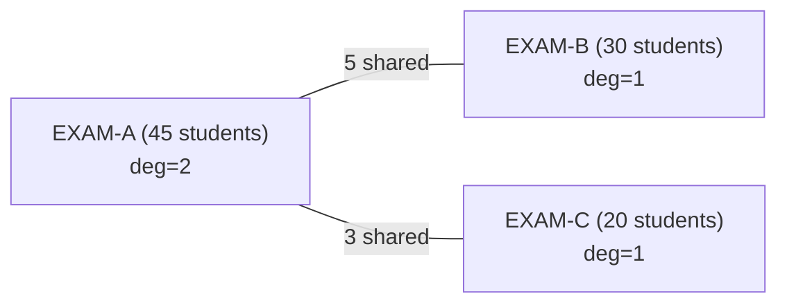
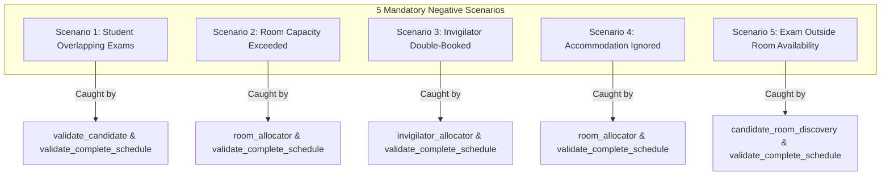
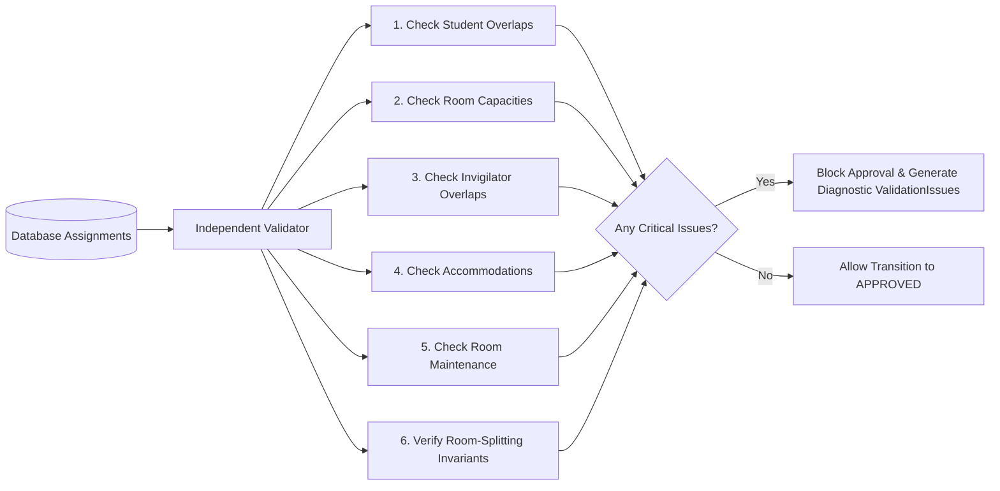

# ExamOps — Scheduling Engine Technical Specification & Business Logic

> **Version:** 1.1.0  
> **Product:** ExamOps — Examination Operations & Intelligent Scheduling Platform  
> **Module:** Core Scheduling Engine (`backend/scheduler/`)  
> **Last Updated:** 2026-11-01  
> **Authoritative Sources:** problem_statement.md, candidate_faq.pdf, submission_guidelines.pdf, AGENTS.md

---

## 1. Algorithm Philosophy & Overview

ExamOps employs a **deterministic, most-constrained-first greedy heuristic with candidate scoring and a bounded improvement pass**.


### Design Principles & Engineering Truths
- **No Black-Box Solvers:** Adhering strictly to project specifications, the engine avoids external solvers (such as Google OR-Tools, Z3), LLM-based scheduling, or non-deterministic metaheuristics. The engine is implemented entirely in the Python standard library.
- **Explainable Decisions:** Every evaluation step, candidate exploration, constraint verification, and rejection reason is explicitly captured in a `SchedulingDecision` record.
- **Heuristic Characterization (No Optimality Claims):** The scheduling problem is an NP-hard graph coloring and multi-dimensional bin-packing hybrid. A deterministic greedy heuristic executes in polynomial time $O(E \cdot T \cdot R)$ and guarantees deterministic reproducibility. **The engine produces a valid assignment with zero hard-constraint violations; it does NOT claim global mathematical optimality.** Early greedy choices may preclude alternative arrangements that could fit more exams in difficult problem instances. To mitigate this within strict computational bounds, a **bounded improvement pass** re-evaluates unassigned examinations over expanded search windows without displacing confirmed assignments.
- **Strict Decoupling of Correctness and Scoring:** Hard constraints (e.g. no student double-booking, room capacity limits) are strictly non-negotiable and evaluated during `validate_candidate()`. Soft preferences (e.g. room compactness, minimizing split rooms, workload balance) are evaluated only on candidates that have passed all hard checks.

---

## 2. Input Preparation & Frozen Participation Snapshot

To guarantee data integrity and auditability, a scheduling run never reads directly from dynamic operational tables during execution:

1. **Academic Period Resolution:** Confirm the target `academic_period_id` has valid dates and active status. Dates are configurable demonstration defaults (e.g. `2026-12-01` to `2026-12-14`, representing 14 inclusive calendar days).
2. **Resolve Eligible Enrollments:** Filter `enrollments` WHERE `status = 'ACTIVE'` AND `academic_period_id = target_period`.
3. **Capture Frozen Snapshot (`RunExamStudent`):**
   - For every eligible `(exam, student)` pair, calculate `base_duration_minutes` from `exams.duration_minutes`.
   - Inspect active student accommodations from `accommodations` WHERE `student_id = student.id` AND `is_active = TRUE` AND `effective_start <= exam_date <= COALESCE(effective_end, '9999-12-31')`.
   - Compute `extra_duration_minutes` and `effective_duration_minutes`.
   - Store the complete snapshot in `run_exam_students` with an input state SHA-256 hash.
4. **Load Institutional Resources:**
   - Active rooms with effective capacities on the examination dates.
   - Operating hours and closure blackouts from `room_availabilities`.
   - Active invigilators with shift windows and availability from `availabilities`.
   - Institutional configuration snapshot (institutional timezone `Asia/Kolkata`, slot granularity 30 min, student-to-invigilator ratio 1:30, daily shift cap 8.0h).

---

## 3. Student Examination Duration Calculation

Every student assigned to an examination has an individualized effective duration:

$$\text{effective\_duration} = \text{base\_duration} + \text{extra\_duration}$$

### Accommodation Duration Policy:
```python
def compute_student_duration(exam_base_minutes: int, accommodations: list[Accommodation]) -> tuple[int, int]:
    extra_minutes = 0
    for acc in accommodations:
        if acc.accommodation_type == "EXTENDED_TIME" and acc.is_active:
            if acc.extra_time_minutes is not None:
                # Explicit minutes take precedence (BR-CFG-010)
                extra_minutes = max(extra_minutes, acc.extra_time_minutes)
            elif acc.extra_time_percentage is not None:
                # Percentage calculation with ceiling rounding policy (BR-CFG-011)
                pct_extra = math.ceil(exam_base_minutes * (acc.extra_time_percentage / 100.0))
                extra_minutes = max(extra_minutes, pct_extra)
    return exam_base_minutes, extra_minutes
```

---

## 4. Conflict Graph Construction

Two examinations conflict if and only if they share at least one eligible student. This is the classical vertex coloring problem foundation.

### High-Performance Construction Algorithm:
Instead of comparing all pairs of exams ($O(E^2 \cdot S)$), we build an inverted student-to-exams index in $O(S \cdot E_{\text{per\_student}})$:

```python
# 1. Build inverted index: student_id -> list of exam_ids
student_exam_map = collections.defaultdict(set)
for record in snapshot_records:
    student_exam_map[record.student_id].add(record.exam_id)

# 2. Build conflict graph adjacency list and edge weights
conflict_graph = collections.defaultdict(set)
shared_students = collections.defaultdict(int)

for student_id, enrolled_exams in student_exam_map.items():
    if len(enrolled_exams) > 1:
        for exam_a, exam_b in itertools.combinations(enrolled_exams, 2):
            pair = tuple(sorted([exam_a, exam_b]))
            conflict_graph[exam_a].add(exam_b)
            conflict_graph[exam_b].add(exam_a)
            shared_students[pair] += 1
```

For each exam node $v$:
- **Conflict Degree:** $\operatorname{deg}(v) = |\text{conflict\_graph}[v]|$
- **Total Shared Enrollments:** $\sum_{u \in \text{neighbors}(v)} \text{shared\_students}[(u, v)]$
- **Eligible Enrollment Count:** $|S_v|$

---

## 5. Exam Ordering (Priority Heuristic)

Exams are scheduled sequentially. The most constrained examinations are scheduled earliest in the sequence when the scheduling matrix has maximum free room and time capacity.

The priority ordering is a deterministic lexicographical sort on the following tuple:

$$\operatorname{Priority}(v) = \left( -\operatorname{deg}(v),\; -|S_v|,\; -\operatorname{Restrictions}(v),\; +\operatorname{CompatibleRooms}(v),\; \text{exam\_code} \right)$$

1. **Highest Conflict Degree ($-\operatorname{deg}(v)$):** Exams sharing students with many other exams are most constrained.
2. **Largest Eligible Enrollment ($-|S_v|$):** Large exams require large halls or multiple split rooms, which exhaust physical capacity fastest.
3. **Requirement Restrictiveness ($-\operatorname{Restrictions}(v)$):** Mandatory lab hardware or specialized features restrict room candidates.
4. **Fewest Compatible Rooms ($+\operatorname{CompatibleRooms}(v)$):** Exams requiring specialized facilities are prioritized.
5. **Stable Deterministic Tie-Breaking ($\text{exam\_code}$):** Guarantees 100% deterministic reproducibility across runs.

---

## 6. Candidate Time Generation & Timezone Discipline

### Timezone Conversion Architecture:
1. **Storage Standard:** All timestamps in PostgreSQL are stored with timezone (`TIMESTAMPTZ`) in **UTC**.
2. **Operational Local Time:** The demonstration institutional timezone is **`Asia/Kolkata` (IST, UTC+05:30)**.
3. **Daily Windows:** Daily operating hours (e.g. 08:00 to 18:00) and room closures are defined in institutional local time.
   - 08:00 IST = 02:30 UTC
   - 18:00 IST = 12:30 UTC
4. **Candidate Time Generator:**
```python
from zoneinfo import ZoneInfo
from datetime import datetime, date, time, timedelta

def generate_candidate_times(
    exam_start_date: date,
    exam_end_date: date,
    operating_start: time,          # e.g., 08:00 local time
    operating_end: time,            # e.g., 18:00 local time
    slot_granularity_minutes: int,  # default 30 min
    exam_max_duration_minutes: int, # base + max student extra time
    tz_name: str = "Asia/Kolkata"
):
    tz = ZoneInfo(tz_name)
    current_date = exam_start_date
    while current_date <= exam_end_date:
        # Exclude Sunday (weekday 6 in Python date, where Monday=0)
        if current_date.weekday() != 6:
            local_start = datetime.combine(current_date, operating_start, tzinfo=tz)
            local_day_limit = datetime.combine(current_date, operating_end, tzinfo=tz)
            
            slot_start = local_start
            while slot_start + timedelta(minutes=exam_max_duration_minutes) <= local_day_limit:
                slot_end = slot_start + timedelta(minutes=exam_max_duration_minutes)
                # Convert to UTC for standardized storage & comparison
                yield TimeWindow(
                    local_start=slot_start,
                    local_end=slot_end,
                    utc_start=slot_start.astimezone(ZoneInfo("UTC")),
                    utc_end=slot_end.astimezone(ZoneInfo("UTC"))
                )
                slot_start += timedelta(minutes=slot_granularity_minutes)
        current_date += timedelta(days=1)
```

**Interval Semantics:** All temporal comparisons adhere strictly to **start-inclusive, end-exclusive** interval arithmetic:

$$\text{Overlap}(A, B) \iff (A_{\text{start}} < B_{\text{end}}) \land (B_{\text{start}} < A_{\text{end}})$$

---

## 7. Multi-Room Partitioning & Room-Splitting Validation

When an examination has more enrolled students than can fit in a single room, or when students have distinct accommodation requirements, the exam is partitioned across multiple rooms.

### Mandatory Room-Splitting Invariants:
1. **Single Room per Student:** Every eligible student is assigned to **exactly one room** for the examination:
   $$\bigcup_{R} \text{students}(R) = S_E \quad \text{and} \quad \text{students}(R_i) \cap \text{students}(R_j) = \emptyset \quad (\forall i \ne j)$$
2. **Individual Accommodation Enforcement:** Accommodations are evaluated per student:
   - Students requiring `LOW_DISTRACTION` are assigned to designated quiet rooms (cap $\le 15$).
   - Students requiring `ACCESSIBLE_ROOM` are assigned to rooms with `is_accessible = TRUE`.
   - Students requiring `EXTENDED_TIME` receive their calculated extra minutes.
3. **Room Capacity & Equipment Compliance:** Seated students in room $R$ cannot exceed $R$'s effective `exam_capacity` on the exam date, and $R$ must satisfy all mandatory equipment requirements.
4. **Full Occupation Interval Reservation:** Every room $R$ is reserved for its assigned students' full duration:
   $$\text{room\_end\_time}(R) = T_{\text{start}} + \max_{s \in \text{students}(R)} (\text{effective\_duration}(s))$$
5. **Staffing Duration Guarantee:** Invigilators assigned to room $R$ remain allocated for $[T_{\text{start}}, \text{room\_end\_time}(R)]$.
6. **Atomic All-or-Nothing Allocation:** Partial room allocations can **never** become confirmed assignments. If an exam requires 4 rooms and 5 invigilators, but only 3 rooms or 4 invigilators can be secured, the entire candidate allocation is rejected and rolled back immediately.
7. **Enrollment Reconciliation:** Seated student count across all assigned rooms must exactly equal eligible enrolled student count:
   $$\sum_{R} |\text{students}(R)| = |S_E|$$

### Multi-Room Partitioning Procedure:
```python
def partition_students_and_rooms(
    exam: Exam,
    candidate_start_time: datetime,
    eligible_students: list[StudentSnapshot],
    available_rooms: list[Room],
    state: SchedulingState
) -> Optional[list[RoomAllocation]]:
    # 1. Group students into accommodation tiers
    tier_low_distraction = [s for s in eligible_students if s.needs_low_distraction]
    tier_accessible = [s for s in eligible_students if s.needs_accessible_room and not s.needs_low_distraction]
    tier_standard = [s for s in eligible_students if not s.needs_low_distraction and not s.needs_accessible_room]
    
    allocations = []
    used_room_ids = set()
    
    # 2. Allocate Tier 1 (Low Distraction)
    if tier_low_distraction:
        ld_rooms = [r for r in available_rooms if r.has_feature("LOW_DISTRACTION") and r.id not in used_room_ids]
        alloc = allocate_cohort(tier_low_distraction, ld_rooms, max_cohort=15)
        if not alloc:
            return None # All-or-nothing failure
        allocations.extend(alloc)
        used_room_ids.update(a.room.id for a in alloc)
        
    # 3. Allocate Tier 2 (Accessible)
    if tier_accessible:
        acc_rooms = [r for r in available_rooms if r.is_accessible and r.id not in used_room_ids]
        alloc = allocate_cohort(tier_accessible, acc_rooms)
        if not alloc:
            return None # All-or-nothing failure
        allocations.extend(alloc)
        used_room_ids.update(a.room.id for a in alloc)
        
    # 4. Allocate Tier 3 (Standard)
    if tier_standard:
        std_rooms = [r for r in available_rooms if r.id not in used_room_ids]
        alloc = allocate_cohort(tier_standard, std_rooms)
        if not alloc:
            return None # All-or-nothing failure
        allocations.extend(alloc)
        used_room_ids.update(a.room.id for a in alloc)
        
    # 5. Final Reconciliation Verification
    total_seated = sum(len(a.students) for a in allocations)
    if total_seated != len(eligible_students):
        return None # Invariant violated; reject candidate
        
    return allocations
```

---

## 8. Invigilator Staffing Allocation

Institutional policy requires qualified invigilation coverage for every room where an examination is in progress.

### Staffing Ratio Policy:
$$\text{Invigilators Required}(R) = \max\left(1, \left\lceil \frac{|\text{students}(R)|}{\text{max\_students\_per\_invigilator}} \right\rceil\right)$$
*(Configurable demonstration default: 1 invigilator per 30 students).*

### Invigilator Allocation & Workload Checks:
For each required invigilator slot in room $R$:
1. Invigilator must have `status = 'ACTIVE'`.
2. Invigilator must have an `AVL` record marking them `AVAILABLE` covering the entire room occupation window $[T_{\text{start}}, \text{room\_end\_time}(R)]$.
3. Invigilator must have zero confirmed overlapping assignments.
4. Invigilator's daily assigned hours (including this candidate) must not exceed `max_hours_per_day` (default 8.0 hours).
5. Invigilator's weekly assigned hours must not exceed `max_hours_per_week` (default 25.0 hours).

If insufficient invigilators are available to staff all split rooms, the candidate fails atomically with reason code `NO_INVIGILATOR_AVAILABLE`.

---

## 9. Central Candidate Validation Function (`validate_candidate()`)

```python
def validate_candidate(
    candidate: CandidatePlan,
    state: SchedulingState
) -> ValidationResult:
    # 1. Student Conflict Validation
    for student_id in candidate.all_students:
        for existing in state.get_student_assignments(student_id):
            if candidate.start < existing.end and existing.start < candidate.end:
                return ValidationResult(
                    is_valid=False,
                    failed_constraints=["STUDENT_OVERLAP"],
                    reason_codes=["NO_CONFLICT_FREE_TIME_SLOT"],
                    failed_resource="STUDENT",
                    failed_resource_id=student_id
                )

    # 2. Room Availability & Maintenance Checks
    for room_alloc in candidate.room_allocations:
        room = room_alloc.room
        if not state.is_room_available(room.id, candidate.start, room_alloc.end_time):
            return ValidationResult(
                is_valid=False,
                failed_constraints=["ROOM_UNAVAILABLE"],
                reason_codes=["ROOM_UNAVAILABLE"],
                failed_resource="ROOM",
                failed_resource_id=room.room_code
            )

        # 3. Room Capacity Check
        effective_cap = state.get_effective_capacity(room.id, candidate.start.date())
        if len(room_alloc.students) > effective_cap:
            return ValidationResult(
                is_valid=False,
                failed_constraints=["ROOM_CAPACITY_EXCEEDED"],
                reason_codes=["NO_ROOM_CAPACITY"],
                failed_resource="ROOM",
                failed_resource_id=room.room_code
            )

        # 4. Mandatory Equipment & Accommodation Checks
        for req in candidate.exam_requirements:
            if req.is_mandatory and not state.room_has_equipment(room.id, req.value):
                return ValidationResult(
                    is_valid=False,
                    failed_constraints=["REQUIRED_EQUIPMENT_MISSING"],
                    reason_codes=["REQUIRED_EQUIPMENT_MISSING"],
                    failed_resource="ROOM",
                    failed_resource_id=room.room_code
                )

        for student in room_alloc.students:
            for acc in student.accommodations:
                if acc.required_room_feature and not state.room_has_feature(room.id, acc.required_room_feature):
                    return ValidationResult(
                        is_valid=False,
                        failed_constraints=["ACCOMMODATION_UNSUPPORTED"],
                        reason_codes=["ACCOMMODATION_UNSUPPORTED"],
                        failed_resource="STUDENT",
                        failed_resource_id=student.student_code
                    )

    # 5. Invigilator Staffing Checks
    for room_alloc in candidate.room_allocations:
        needed = calculate_needed_invigilators(len(room_alloc.students))
        assigned = room_alloc.assigned_invigilators
        if len(assigned) < needed:
            return ValidationResult(
                is_valid=False,
                failed_constraints=["INSUFFICIENT_INVIGILATORS"],
                reason_codes=["NO_INVIGILATOR_AVAILABLE"],
                failed_resource="INVIGILATOR"
            )
        for inv in assigned:
            if state.invigilator_has_overlap(inv.id, candidate.start, room_alloc.end_time):
                return ValidationResult(
                    is_valid=False,
                    failed_constraints=["INVIGILATOR_DOUBLE_BOOKED"],
                    reason_codes=["NO_INVIGILATOR_AVAILABLE"],
                    failed_resource="INVIGILATOR",
                    failed_resource_id=inv.invigilator_code
                )

    return ValidationResult(
        is_valid=True,
        passed_constraints=[
            "STUDENT_NO_OVERLAP",
            "ROOM_AVAILABLE",
            "ROOM_CAPACITY_RESPECTED",
            "EQUIPMENT_SATISFIED",
            "ACCOMMODATION_SATISFIED",
            "INVIGILATOR_STAFFING_MET"
        ]
    )
```

---

## 10. Deterministic Candidate Scoring

When multiple candidate slots and room combinations pass `validate_candidate()`, the selected candidate is chosen by lexicographically minimizing:

$$\operatorname{Score} = (N_{\text{rooms}},\; S_{\text{wasted}},\; W_{\text{inv}},\; C_{\text{resource}},\; T_{\text{chronological}},\; R_{\text{code}})$$

| Priority | Dimension | Objective | Operational Purpose |
|---|---|---|---|
| 1 | Room Count ($N_{\text{rooms}}$) | Minimize | Keeps cohorts unified in single rooms where feasible. |
| 2 | Wasted Seats ($S_{\text{wasted}}$) | Minimize | Preserves large auditoriums for larger upcoming exams. |
| 3 | Invigilator Workload Impact ($W_{\text{inv}}$) | Minimize | Equitably distributes proctoring duty among active personnel. |
| 4 | Resource Continuity ($C_{\text{resource}}$) | Minimize | Clusters departmental examinations in proximal physical wings. |
| 5 | Chronological Slot ($T_{\text{chronological}}$) | Minimize | Front-loads exams into earlier days, preserving makeup buffer days. |
| 6 | Room Code Identifier ($R_{\text{code}}$) | Minimize | Stable tie-breaker ensuring 100% deterministic reproducibility across runs. |

---

## 11. WORKED EXAMPLE 1: Three-Examination Scheduling Walkthrough

### Setup Data:
- **Academic Period:** `2026-12-01` to `2026-12-14` (Demonstration examination session, 14 inclusive calendar days).
- **Timezone:** `Asia/Kolkata` (IST, UTC+05:30).
- **Daily Operating Hours:** 08:00 to 18:00 IST (02:30 to 12:30 UTC).
- **Slot Granularity:** 30 minutes.
- **Invigilator Staffing Ratio:** 1:30 ($\lceil S / 30 \rceil$).
- **Examinations to Schedule:**
  - `EXAM-A` (`EXAM-2026-000001`): 120 minutes base duration, 45 students. Enrolled students share courses with Exam B and Exam C.
  - `EXAM-B` (`EXAM-2026-000002`): 90 minutes base duration, 30 students. Shares 5 students with Exam A.
  - `EXAM-C` (`EXAM-2026-000003`): 60 minutes base duration, 20 students. Shares 3 students with Exam A. Zero shared students with Exam B.
- **Available Facilities:**
  - `ROOM-000001` ($R_1$): Capacity 50, equipped with digital projector. Available 08:00 - 18:00 IST.
  - `ROOM-000002` ($R_2$): Capacity 35, wheelchair accessible. Available 08:00 - 18:00 IST.
  - `ROOM-000003` ($R_3$): Capacity 25, standard lecture hall. Available 08:00 - 18:00 IST.
- **Available Invigilators:**
  - `INV-000001` ($I_1$): Available 08:00 - 17:00 IST, max 8.0h/day.
  - `INV-000002` ($I_2$): Available 08:00 - 17:00 IST, max 8.0h/day.
  - `INV-000003` ($I_3$): Available 08:00 - 17:00 IST, max 8.0h/day.

---

### Step 1: Conflict Graph Construction
- Shared students:
  - $(A, B) = 5$ students
  - $(A, C) = 3$ students
  - $(B, C) = 0$ students
- Graph Degrees:
  - $\operatorname{deg}(A) = 2$ (conflicts with B and C)
  - $\operatorname{deg}(B) = 1$ (conflicts with A)
  - $\operatorname{deg}(C) = 1$ (conflicts with A)



---

### Step 2: Priority Ordering (Most-Constrained First)
Sorting by $(-\operatorname{deg}, -|S|, \text{code})$:
1. **1st: `EXAM-A`** ($\operatorname{deg}=2, |S|=45$)
2. **2nd: `EXAM-B`** ($\operatorname{deg}=1, |S|=30$)
3. **3rd: `EXAM-C`** ($\operatorname{deg}=1, |S|=20$)

---

### Step 3: Scheduling `EXAM-A`
- **Candidate Time 1:** 2026-12-01 08:00 - 10:00 IST (02:30 - 04:30 UTC, 120 minutes).
- **Candidate Room Discovery:**
  - $R_1$ (Capacity 50): $50 \ge 45$. Fits all students in 1 room. Wasted seats = $50 - 45 = 5$.
  - $R_2$ (Capacity 35): Cannot fit alone ($35 < 45$); would require splitting.
- **Invigilator Staffing:**
  - Students = 45. $\lceil 45 / 30 \rceil = 2$ invigilators required.
  - Assign $I_1$ and $I_2$ for 08:00 - 10:00 IST (both available, zero overlaps).
- **Validation (`validate_candidate()`):**
  - Student overlap: None (first exam).
  - Room availability: $R_1$ open and within operating hours.
  - Capacity: $45 \le 50$.
  - Invigilators: 2 assigned, within daily shift caps (2.0h / 8.0h).
  - **Verdict: VALID.**
- **Commit:**
  - Assignment: `ASN-EXAM-2026-000001-ROOM-000001`
  - Period: 2026-12-01 08:00 - 10:00 IST.
  - Room: $R_1$. Students: 45. Invigilators: $I_1, I_2$.

---

### Step 4: Scheduling `EXAM-B`
- **Candidate Time 1:** 2026-12-01 08:00 - 09:30 IST.
  - **`validate_candidate()`:** 5 shared students are enrolled in `EXAM-A` (08:00 - 10:00 IST).
  - Overlap check: $08:00 < 10:00 \land 08:00 < 09:30 \implies \mathbf{TRUE}$.
  - **Verdict: INVALID (`STUDENT_OVERLAP` failed; reason `NO_CONFLICT_FREE_TIME_SLOT`). Candidate Rejected.**
- **Candidate Times 2, 3, 4:** (08:30-10:00, 09:00-10:30, 09:30-11:00) all overlap `EXAM-A` $\implies \mathbf{REJECTED}$.
- **Candidate Time 5:** 2026-12-01 10:00 - 11:30 IST (04:30 - 06:00 UTC, 90 minutes).
  - Student overlap check: `EXAM-A` ends at 10:00. Candidate starts at 10:00.
  - Overlap condition: $10:00 < 10:00 \implies \mathbf{FALSE}$ (clean adjacent handoff).
  - Room discovery:
    - $R_1$ is free from 10:00. Capacity 50. Wasted seats = $50 - 30 = 20$.
    - $R_2$ is free. Capacity 35. Fits 30 students. Wasted seats = $35 - 30 = 5$.
  - Scoring prefers $R_2$ because $S_{\text{wasted}} = 5 < 20$.
  - Invigilators: $\lceil 30 / 30 \rceil = 1$ invigilator required.
  - Assign $I_3$ (free 08:00-17:00 IST, duty hours = 1.5h $\le$ 8.0h).
  - **Verdict: VALID.**
- **Commit:**
  - Assignment: `ASN-EXAM-2026-000002-ROOM-000002`
  - Period: 2026-12-01 10:00 - 11:30 IST.
  - Room: $R_2$. Students: 30. Invigilator: $I_3$.

---

### Step 5: Scheduling `EXAM-C`
- **Candidate Time 1:** 2026-12-01 08:00 - 09:00 IST.
  - 3 shared students with `EXAM-A` (08:00-10:00 IST) $\implies \mathbf{REJECTED}$ (`STUDENT_OVERLAP`).
- **Candidate Time 2:** 2026-12-01 10:00 - 11:00 IST (04:30 - 05:30 UTC, 60 minutes).
  - Student overlap check:
    - Shared with `EXAM-A`: `EXAM-A` concluded at 10:00 $\implies$ No overlap.
    - Shared with `EXAM-B`: 0 shared students $\implies$ No overlap.
  - Room discovery:
    - $R_2$ is occupied by `EXAM-B` (10:00 - 11:30 IST).
    - $R_1$ is free (Capacity 50, wasted seats = 30).
    - $R_3$ is free (Capacity 25, fits 20 students, wasted seats = $25 - 20 = 5$).
  - Best fit: $R_3$.
  - Invigilators: $\lceil 20 / 30 \rceil = 1$ invigilator required.
  - Invigilator $I_1$ completed `EXAM-A` at 10:00 IST. Daily hours so far: 2.0h. Adding this assignment: $2.0 + 1.0 = 3.0\text{h} \le 8.0\text{h}$. Assign $I_1$.
  - **Verdict: VALID.**
- **Commit:**
  - Assignment: `ASN-EXAM-2026-000003-ROOM-000003`
  - Period: 2026-12-01 10:00 - 11:00 IST.
  - Room: $R_3$. Students: 20. Invigilator: $I_1$.

---

### Schedule Outcome Summary

| Exam Code | Enrolled | Time Window (IST) | Room | Allocated Seats | Assigned Invigilator(s) | Status | Hard Violations |
|---|---|---|---|---|---|---|---|
| `EXAM-2026-000001` | 45 | Dec 01 08:00 - 10:00 | `ROOM-000001` | 45 | $I_1, I_2$ | **CONFIRMED** | 0 |
| `EXAM-2026-000002` | 30 | Dec 01 10:00 - 11:30 | `ROOM-000002` | 30 | $I_3$ | **CONFIRMED** | 0 |
| `EXAM-2026-000003` | 20 | Dec 01 10:00 - 11:00 | `ROOM-000003` | 20 | $I_1$ | **CONFIRMED** | 0 |

**Heuristic outcome:** 100% assignment completion, zero hard-constraint violations, exact resource reconciliation. This is an explainable, valid heuristic solution (not a mathematically proven global optimum).

---

## 12. WORKED EXAMPLE 2: Room-Splitting with Diverse Accommodations

### Setup Data:
- **Exam:** `EXAM-2026-000004` (Advanced Distributed Systems).
- **Candidate Start Time:** 2026-12-02 09:00 IST (03:30 UTC).
- **Base Duration:** 90 minutes.
- **Total Eligible Enrollment:** 80 students.
- **Accommodation Requirements:**
  - **Group 1 (Low Distraction):** 3 students require `LOW_DISTRACTION`. Base duration 90 min.
  - **Group 2 (Mobility + Extended Time):** 5 students require `ACCESSIBLE_ROOM` (wheelchair access) AND `EXTENDED_TIME` (+30 minutes). Effective duration = $90 + 30 = 120$ minutes.
  - **Group 3 (Standard):** 72 students with no accommodations. Effective duration = 90 minutes.
- **Available Facilities at Candidate Start (Dec 02, 09:00 IST):**
  - `ROOM-000001` ($R_1$): Capacity 50, standard hall, `is_accessible = FALSE`.
  - `ROOM-000002` ($R_2$): Capacity 35, standard hall, `is_accessible = FALSE`.
  - `ROOM-000004` ($R_4$): Capacity 20, `is_accessible = TRUE`.
  - `ROOM-000005` ($R_5$): Capacity 15, designated low-distraction quiet room.

---

### Step 1: Student Cohort Partitioning
The 80 enrolled students are segregated into 3 mutually exclusive cohorts:
1. **Tier 1 (Low Distraction):** Students $\{S_1, S_2, S_3\}$ (Count = 3).
2. **Tier 2 (Accessible & Extended Time):** Students $\{S_4, S_5, S_6, S_7, S_8\}$ (Count = 5).
3. **Tier 3 (Standard):** Students $\{S_9, \dots, S_{80}\}$ (Count = 72).

---

### Step 2: Cohort Room Allocation

#### Allocating Tier 1 (Low Distraction - 3 students)
- Compatible facilities: Must have feature `LOW_DISTRACTION`.
- Only $R_5$ qualifies.
- Capacity: $15 \ge 3 \implies \mathbf{Fits}$.
- Assigned: 3 students to $R_5$.
- Room occupation window: 09:00 to $09:00 + 90\text{min} =$ **09:00 - 10:30 IST**.
- Invigilators required: $\lceil 3 / 30 \rceil = 1$ invigilator ($I_4$) reserved 09:00 - 10:30 IST.

#### Allocating Tier 2 (Accessible & Extended Time - 5 students)
- Compatible facilities: Must have `is_accessible = TRUE`.
- $R_4$ qualifies (Capacity 20).
- Capacity check: $20 \ge 5 \implies \mathbf{Fits}$.
- Assigned: 5 students to $R_4$.
- Room occupation window: Student effective duration is 120 minutes ($90 + 30$).
  - Window = 09:00 to $09:00 + 120\text{min} =$ **09:00 - 11:00 IST**.
- **Crucial Invariant Check:** $R_4$ and its invigilator remain reserved for the full 120 minutes (until 11:00 IST), while the standard rooms finish at 10:30 IST.
- Invigilators required: $\lceil 5 / 30 \rceil = 1$ invigilator ($I_5$) reserved 09:00 - 11:00 IST.

#### Allocating Tier 3 (Standard - 72 students)
- Remaining available standard rooms: $R_1$ (Capacity 50) and $R_2$ (Capacity 35).
- Combined capacity: $50 + 35 = 85 \ge 72 \implies \mathbf{Fits}$.
- Best-fit allocation:
  - Fill largest room first: 50 students assigned to $R_1$. Wasted seats = $50 - 50 = 0$.
  - Remaining standard students: $72 - 50 = 22$ students.
  - 22 students assigned to $R_2$. Wasted seats = $35 - 22 = 13$.
- Room occupation windows:
  - $R_1$: 09:00 - 10:30 IST (90 min). Invigilators: $\lceil 50 / 30 \rceil = 2$ invigilators ($I_6, I_7$).
  - $R_2$: 09:00 - 10:30 IST (90 min). Invigilators: $\lceil 22 / 30 \rceil = 1$ invigilator ($I_8$).

---

### Step 3: Resulting Split Schedule Assignments & Verification Matrix

```mermaid
gantt
    title Exam Splitting Timeline for EXAM-2026-000004
    dateFormat HH:mm
    axisFormat %H:%M
    section R5 (Low-Distraction)
    3 Students (09:00 - 10:30 IST) :a1, 09:00, 90m
    section R4 (Accessible + Ext)
    5 Students (09:00 - 11:00 IST) :crit, a2, 09:00, 120m
    section R1 (Standard Split 1)
    50 Students (09:00 - 10:30 IST) :a3, 09:00, 90m
    section R2 (Standard Split 2)
    22 Students (09:00 - 10:30 IST) :a4, 09:00, 90m
```

Four distinct `ScheduleAssignment` records are committed under `EXAM-2026-000004`:
1. `ASN-EXAM-2026-000004-ROOM-000005`: Room $R_5$, 3 students, 09:00 - 10:30 IST, Invigilator $I_4$.
2. `ASN-EXAM-2026-000004-ROOM-000004`: Room $R_4$, 5 students, 09:00 - 11:00 IST, Invigilator $I_5$.
3. `ASN-EXAM-2026-000004-ROOM-000001`: Room $R_1$, 50 students, 09:00 - 10:30 IST, Invigilators $I_6, I_7$.
4. `ASN-EXAM-2026-000004-ROOM-000002`: Room $R_2$, 22 students, 09:00 - 10:30 IST, Invigilator $I_8$.

### Step 4: Mathematical Proof of Pairwise Disjoint Partitioning

A set collection $\{S_1, \dots, S_k\}$ is a mathematically valid partition of $S_E$ if and only if:
1. Every pair of room cohorts is mutually disjoint: $S_i \cap S_j = \emptyset \quad (\forall i \ne j)$.
2. The union of all subsets equals the original set: $\bigcup_{i=1}^k S_i = S_E$.
3. Every student appears with multiplicity exactly one: $\forall s \in S_E, \sum_{i=1}^k \mathbf{1}_{\{s \in S_i\}} = 1$.

#### Pairwise Intersection Verification Matrix ($\binom{4}{2} = 6$ Pairs):

| Pair Check | Cohort Set Intersection Expression | Evaluated Student Elements | Pairwise Result |
|---|---|---|---|
| $(R_5, R_4)$ | $S_{R5} \cap S_{R4}$ | $\{S_1, S_2, S_3\} \cap \{S_4, S_5, S_6, S_7, S_8\}$ | $\mathbf{\emptyset}$ (Disjoint) |
| $(R_5, R_1)$ | $S_{R5} \cap S_{R1}$ | $\{S_1, S_2, S_3\} \cap \{S_9, \dots, S_{58}\}$ | $\mathbf{\emptyset}$ (Disjoint) |
| $(R_5, R_2)$ | $S_{R5} \cap S_{R2}$ | $\{S_1, S_2, S_3\} \cap \{S_{59}, \dots, S_{80}\}$ | $\mathbf{\emptyset}$ (Disjoint) |
| $(R_4, R_1)$ | $S_{R4} \cap S_{R1}$ | $\{S_4, S_5, S_6, S_7, S_8\} \cap \{S_9, \dots, S_{58}\}$ | $\mathbf{\emptyset}$ (Disjoint) |
| $(R_4, R_2)$ | $S_{R4} \cap S_{R2}$ | $\{S_4, S_5, S_6, S_7, S_8\} \cap \{S_{59}, \dots, S_{80}\}$ | $\mathbf{\emptyset}$ (Disjoint) |
| $(R_1, R_2)$ | $S_{R1} \cap S_{R2}$ | $\{S_9, \dots, S_{58}\} \cap \{S_{59}, \dots, S_{80}\}$ | $\mathbf{\emptyset}$ (Disjoint) |

#### Partition Completeness & Multiplicity Verification:
$$\bigcup_{R \in \{R_5, R_4, R_1, R_2\}} S_R = \{S_1, \dots, S_{80}\} = S_E$$
$$|S_{R5}| + |S_{R4}| + |S_{R1}| + |S_{R2}| = 3 + 5 + 50 + 22 = 80 = |S_E|$$
$$\forall s \in S_E, \quad \sum_{R} \mathbf{1}_{\{s \in S_R\}} = 1$$

At the database engine level, this mathematical property is physically enforced by:
`run_exam_student_id UUID NOT NULL UNIQUE REFERENCES run_exam_students(id)` in `assignment_students`.

---

### Step 5: Verification of All 7 Room-Splitting Invariants:
1. **Single Room per Student:** Proven pairwise disjoint across all 6 combinations above; zero duplicate seatings.
2. **Individual Accommodations:** $R_5$ provides low distraction; $R_4$ provides wheelchair accessibility; Group 2 receives 120 min.
3. **Room Capacities Respected:** $R_5 (3 \le 15)$, $R_4 (5 \le 20)$, $R_1 (50 \le 50)$, $R_2 (22 \le 35)$.
4. **Room Full Occupation Interval:** $R_4$ is reserved until 11:00 IST; $R_1, R_2, R_5$ are reserved until 10:30 IST.
5. **Invigilator Allocation Guarantee:** $I_5$ is allocated until 11:00 IST; $I_4, I_6, I_7, I_8$ are allocated until 10:30 IST.
6. **Atomic Allocation Invariant:** All 4 room allocations and 5 invigilators succeeded simultaneously; partial allocation rolls back.
7. **Enrollment Reconciliation:** Seated total $= 3 + 5 + 50 + 22 = 80$ students vs 80 eligible students ($80 = 80$).

---

## 13. WORKED EXAMPLE 3: Mechanical Detection of All Five Negative Scenarios



### Negative Scenario 1: Student Has Overlapping Exams
- **Fault Injection:** Student `STU-000042` is enrolled in both `EXAM-2026-000010` (scheduled Dec 03, 09:00 - 11:00 IST) and `EXAM-2026-000011`. A candidate time for `EXAM-2026-000011` is evaluated for Dec 03, 10:00 - 12:00 IST.
- **Detection Mechanism:**
  $$10:00 < 11:00 \;(\mathbf{True}) \land 09:00 < 12:00 \;(\mathbf{True}) \implies \mathbf{OVERLAP\ DETECTED}$$
- **Outcome:** Candidate rejected. Failed constraint: `STUDENT_OVERLAP`. Emitted reason code: `NO_CONFLICT_FREE_TIME_SLOT`.

### Negative Scenario 2: Room Capacity Exceeded
- **Fault Injection:** `ROOM-000015` has an effective exam capacity of 40 seats. An assignment candidate places 48 students in `ROOM-000015`.
- **Detection Mechanism:**
  $$\text{assigned\_count} = 48 > \text{cap}\,(40) \implies \mathbf{CAPACITY\ BREACH}$$
- **Outcome:** Candidate allocation fails. Failed constraint: `ROOM_CAPACITY_EXCEEDED`. Emitted reason code: `NO_ROOM_CAPACITY`.

### Negative Scenario 3: Invigilator Double-Booked
- **Fault Injection:** Invigilator `INV-000005` is assigned to `EXAM-2026-000020` in Hall A from 13:00 to 15:00 IST. The scheduler attempts to assign `INV-000005` to `EXAM-2026-000021` in Hall B from 14:00 to 16:00 IST.
- **Detection Mechanism:**
  $$14:00 < 15:00 \;(\mathbf{True}) \land 13:00 < 16:00 \;(\mathbf{True}) \implies \mathbf{DOUBLE\ BOOKING}$$
- **Outcome:** Invigilator rejected for slot. If no other invigilator available, candidate fails with: `NO_INVIGILATOR_AVAILABLE`.

### Negative Scenario 4: Student Accommodation Ignored
- **Fault Injection:** Student `STU-000108` requires `required_room_feature = 'WHEELCHAIR_ACCESS'`. Candidate room `ROOM-000008` has `is_accessible = FALSE` (stair-only wing).
- **Detection Mechanism:**
  $$\text{room.is\_accessible} == \mathbf{False} \implies \text{Feature Check Fails}$$
- **Outcome:** Candidate fails. Failed constraint: `ACCOMMODATION_UNSUPPORTED`. Emitted reason code: `ACCOMMODATION_UNSUPPORTED`.

### Negative Scenario 5: Exam Outside Room Availability
- **Fault Injection:** `ROOM-000022` has a maintenance closure recorded in `room_availabilities` on Dec 04 from 12:00 to 18:00 IST (`availability_type = 'MAINTENANCE'`). A candidate assignment is attempted on Dec 04 from 13:00 to 15:00 IST.
- **Detection Mechanism:**
  $$13:00 < 18:00 \land 12:00 < 15:00 \implies \mathbf{MAINTENANCE\ COLLISION}$$
- **Outcome:** Room disqualified. Emitted reason code: `ROOM_UNAVAILABLE`.

---

## 14. Bounded Improvement Pass

After the sequential greedy pass, a subset of exams may remain unassigned due to resource contention or student conflicts.

### Improvement Algorithm:
```python
def bounded_improvement_pass(
    unassigned_exams: list[Exam],
    state: SchedulingState,
    max_retries: int = 3
) -> None:
    for retry_iteration in range(max_retries):
        if not unassigned_exams:
            break
            
        # Re-sort unassigned exams by eligible enrollment ascending (smaller exams easier to fit into remaining gaps)
        unassigned_exams.sort(key=lambda e: (len(state.get_eligible_students(e.id)), e.exam_code))
        
        still_unassigned = []
        for exam in unassigned_exams:
            # Re-generate candidates exploring alternate room combinations
            candidates = generate_all_candidates_unordered(exam, state)
            
            best_candidate = None
            best_score = None
            
            for candidate in candidates:
                # STRICT RULE: No displacement of confirmed assignments
                res = validate_candidate(candidate, state)
                if res.is_valid:
                    score = score_candidate(candidate, state)
                    if best_score is None or score < best_score:
                        best_candidate = candidate
                        best_score = score
            
            if best_candidate:
                # Commit new assignment
                state.commit_assignment(best_candidate, iteration=retry_iteration+1)
                record_improvement_decision(exam, best_candidate, retry_iteration+1)
            else:
                still_unassigned.append(exam)
                
        unassigned_exams = still_unassigned
```

### Invariants:
1. **Zero Displacement:** The improvement pass never evicts, modifies, or displaces an already committed exam.
2. **Identical Validation:** Any candidate scheduled during the improvement pass must pass 100% of the same hard constraints in `validate_candidate()`.
3. **Audit Trace:** Every assignment committed during the improvement pass is tagged with `retry_iteration > 0`.

---

## 15. Standard Reason Codes Reference Table

When an exam cannot be scheduled, the engine attaches one or more standardized reason codes derived strictly from candidate evaluation telemetry:

| Reason Code | Category | Exact Trigger Condition |
|---|---|---|
| `NO_CONFLICT_FREE_TIME_SLOT` | Student Schedule | Every evaluated time window conflicts with another confirmed exam of an enrolled student. |
| `NO_ROOM_CAPACITY` | Physical Resource | No single room or valid multi-room combination has enough seats to hold enrolled students. |
| `ROOM_UNAVAILABLE` | Physical Resource | All candidate rooms are closed, under maintenance, or outside institutional operating hours. |
| `REQUIRED_EQUIPMENT_MISSING` | Facility Spec | No available room contains mandatory hardware (e.g. lab workstations, digital projectors). |
| `ACCOMMODATION_UNSUPPORTED` | Accessibility | No available room satisfies student accessibility requirements (e.g. wheelchair access, low distraction). |
| `NO_INVIGILATOR_AVAILABLE` | Personnel | Insufficient invigilators available without violating shift hours, rest breaks, or double-booking. |
| `INSUFFICIENT_RESOURCE_CAPACITY` | Compound | Compound bottleneck where time, room, and invigilator constraints cannot simultaneously be satisfied. |
| `INVALID_SOURCE_DATA` | Master Data | Exam has zero enrolled students, invalid course references, or circular dependencies. |

---

## 16. Independent Full-Schedule Validation (`validate_complete_schedule()`)

The engine never trusts internal algorithm memory or transient success flags as proof of correctness. Before any schedule can transition to `APPROVED` or `PUBLISHED`, an independent validator reloads raw records directly from PostgreSQL and runs a complete verification sweep:



### Full Validation Suite:
1. **Student Double-Booking:** Query pairwise assignment overlaps across all enrolled students.
2. **Student Completeness:** Assert that every enrolled student in a scheduled exam is assigned to exactly one room.
3. **Room Over-Allocation:** Verify total seated students per room assignment $\le$ effective `exam_capacity` on that date.
4. **Room Temporal Overlap:** Assert that no two distinct exams share the same room at overlapping times.
5. **Room Operating Availability:** Verify all assignments fall within open hours and do not touch maintenance closures.
6. **Mandatory Equipment Compliance:** Verify each assigned room contains all mandatory equipment required by the exam.
7. **Accommodation Compliance:** Verify that students with physical accommodations are placed in rooms with verified matching features.
8. **Invigilator Over-Allocation:** Verify no invigilator has overlapping duty intervals.
9. **Invigilator Staffing Ratios:** Verify room invigilator count meets or exceeds the required institutional ratio ($\lceil S / 30 \rceil$).
10. **Invigilator Workload Caps:** Verify invigilator daily (8.0h) and weekly (25.0h) total duty hours do not exceed institutional limits.
11. **Total Student Reconciliation:** Verify $\sum |\text{students}(R)| = \text{eligible\_enrollment}$ for every confirmed exam.

---

## 17. Algorithmic Operations Analysis & Empirical Benchmarking Plan

### 17.1 Algorithmic Operations & Asymptotic Bounds
The scheduling engine executes deterministic routines in polynomial stages:

1. **Snapshot Ingestion & Duration Processing:** $O(S_{\text{snapshot}})$ linear pass over eligible student participations to compute accommodation-extended durations.
2. **Conflict Graph Construction:** $O(S \cdot K^2)$ where $S$ is student count (5,000 baseline) and $K$ is average courses per student (~4.2). The inverted index eliminates pairwise $O(E^2 \cdot S)$ checks, generating edges in $\approx 5{,}000 \times 17.6 \approx 88{,}000$ operations.
3. **Priority Ordering:** $O(E \log E)$ lexicographical sort on degree, enrollment, restrictiveness, and room count ($300 \log_2 300 \approx 2{,}500$ operations).
4. **Candidate Exploration & Multi-Room Partitioning:** For each exam $e \in E$, the engine iterates over candidate time slots $T$ (max $\approx 100$) and compatible rooms $R$ (max 100). Sorting rooms by capacity takes $O(R \log R)$. Greedy cohort partitioning operates in $O(R)$ passes per candidate slot.
5. **Bounded Improvement Pass:** Executes at most $P = 3$ passes strictly over unassigned exams ($E_{\text{unassigned}} \ll E$), maintaining identical polynomial bounds without backtracking or exponential branches.

### 17.2 Pre-Implementation Disclaimer & Empirical Benchmarking Plan
In accordance with engineering standards, **no premature runtime claims (such as guaranteed execution under 15 seconds) are asserted prior to execution on production infrastructure.** Actual wall-clock execution times, memory consumption, and solver throughput will be measured and documented during Phase 2 benchmarking using the following empirical matrix:

| Benchmark Profile | Dataset Scale | Conflict Density | Accommodation Rate | Facility Availability | Target Measurements |
|---|---|---|---|---|---|
| **BP-1: Starter Baseline** | 500 students, 30 exams, 10 rooms, 20 invigilators | Normal ($K = 4.2$) | Standard (~8%) | 100% open | Wall-clock time (s), peak RAM (MB), completion % |
| **BP-2: Full Baseline** | 5,000 students, 300 exams, 100 rooms, 200 invigilators | Normal ($K = 4.2$) | Standard (~8%) | Standard (5% closures) | Wall-clock time (s), peak RAM (MB), completion % |
| **BP-3: Sparse Conflicts** | 5,000 students, 300 exams, 100 rooms, 200 invigilators | Sparse ($K = 2.0$) | Standard (~8%) | Standard | Graph edge count, placement pass rate |
| **BP-4: Dense Conflicts** | 5,000 students, 300 exams, 100 rooms, 200 invigilators | Dense ($K = 6.0$) | Standard (~8%) | Standard | Graph clique density, retry pass rescues |
| **BP-5: High Accommodations** | 5,000 students, 300 exams, 100 rooms, 200 invigilators | Normal ($K = 4.2$) | High (20.0%) | Standard | Split-room count, quiet room exhaustion |
| **BP-6: Facility Bottleneck** | 5,000 students, 300 exams, 75 rooms, 150 invigilators | Normal ($K = 4.2$) | Standard (~8%) | Severe (25% closures) | Standard reason code distribution |

Measured results will be captured in `docs/benchmarks.md` upon test execution.
