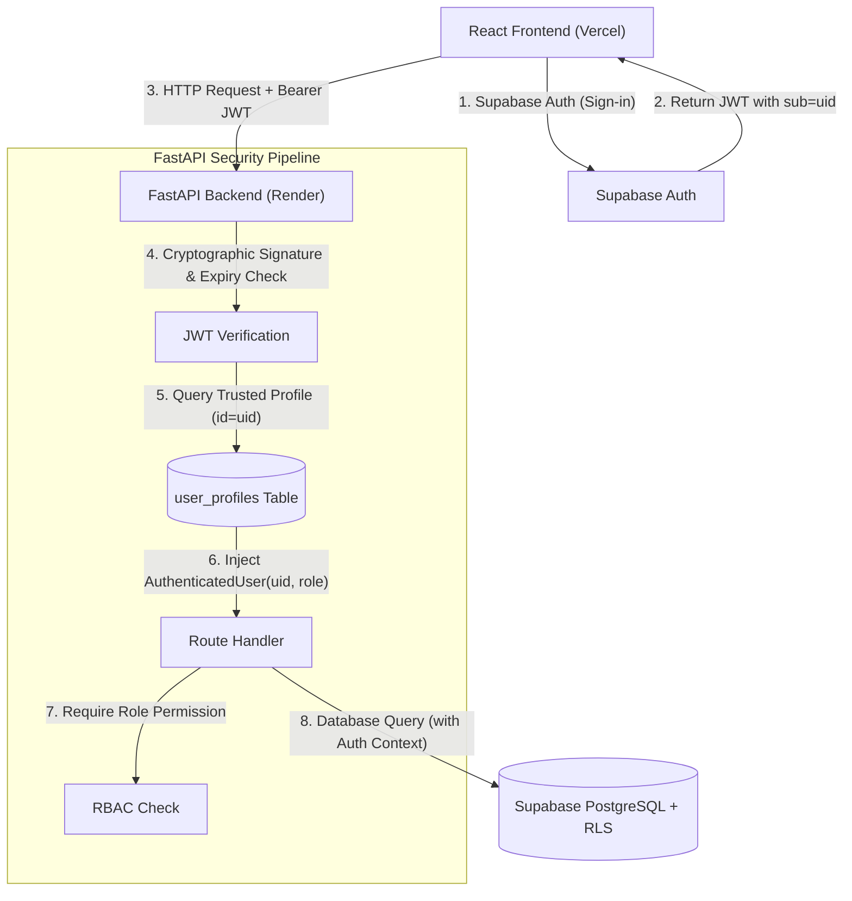
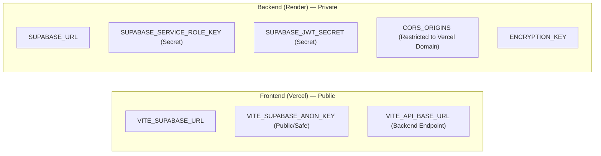

# ExamOps — Security Architecture & Data Protection Contract

> **Version:** 1.0.0  
> **Product:** ExamOps — Examination Operations & Intelligent Scheduling Platform  
> **Security Domain:** Authentication, Authorization, Privacy & Compliance  
> **Last Updated:** 2026-11-01  
> **Authoritative Sources:** problem_statement.md, AGENTS.md §13-14, §16

---

## 1. Security Architecture Principles

ExamOps is designed with **defense-in-depth**:
1. **Zero Client Trust:** The client application (React SPA) is completely untrusted. User roles, permissions, and identity claims are never accepted from HTTP request bodies or headers provided by the client.
2. **Server-Side Role Resolution:** The user's role is resolved server-side in FastAPI directly from the trusted `user_profiles` database table using the verified Supabase Auth user ID (`sub`).
3. **Database-Level Isolation (RLS):** Every PostgreSQL table has Row Level Security enabled. Even if an API endpoint were misconfigured, the database engine enforces tenant and role row filters.
4. **Strict Key Segregation:** The Supabase `service_role` key is strictly restricted to server-side environments on Render. It is never bundled or transmitted to the client.
5. **Privacy by Design:** Student accommodations, medical notes, and personally identifiable information (PII) are shielded with column-level masking and role-scoped permissions.



---

## 2. Authentication Lifecycle

### 2.1 Identity Provider (Supabase Auth)
- Identity is managed via Supabase Auth using email and password authentication.
- Upon successful authentication, Supabase issues an industry-standard **JWT access token** (valid for 1 hour) and a secure **refresh token**.
- Tokens are held securely in client-side memory and synchronized via the official `@supabase/supabase-js` client using `localStorage` for session restoration across tab refreshes.

### 2.2 FastAPI Backend Verification (`backend/auth.py`)
Every protected FastAPI endpoint uses a dependency `get_current_user`:
```python
from fastapi import Depends, HTTPException, status
from fastapi.security import HTTPBearer, HTTPAuthorizationCredentials
import jwt

security = HTTPBearer()

async def get_current_user(
    credentials: HTTPAuthorizationCredentials = Depends(security),
    db: DatabaseClient = Depends(get_db)
) -> AuthenticatedUser:
    token = credentials.credentials
    try:
        # Cryptographic verification against Supabase JWT secret
        payload = jwt.decode(
            token,
            key=settings.SUPABASE_JWT_SECRET,
            algorithms=["HS256"],
            audience="authenticated"
        )
        user_id = payload.get("sub")
        if not user_id:
            raise HTTPException(status_code=status.HTTP_401_UNAUTHORIZED, detail="Invalid token claims")
            
        # Trusted server-side role resolution from user_profiles table
        profile = await db.get_user_profile(user_id)
        if not profile or profile.status != "ACTIVE":
            raise HTTPException(status_code=status.HTTP_403_FORBIDDEN, detail="Inactive or non-existent user profile")
            
        return AuthenticatedUser(
            id=user_id,
            email=profile.email,
            role=profile.role,
            department=profile.department
        )
    except jwt.PyJWTError as e:
        raise HTTPException(status_code=status.HTTP_401_UNAUTHORIZED, detail="Invalid or expired token")
```

---

## 3. Role-Based Access Control (RBAC) Architecture

### 3.1 Role Hierarchy & Scopes
FastAPI route guards enforce minimum role thresholds using Python decorators:

```python
def require_roles(allowed_roles: list[UserRole]):
    def role_checker(current_user: AuthenticatedUser = Depends(get_current_user)):
        if current_user.role not in allowed_roles:
            raise HTTPException(
                status_code=status.HTTP_403_FORBIDDEN,
                detail=f"Operation requires one of roles: {[r.value for r in allowed_roles]}"
            )
        return current_user
    return role_checker
```

### 3.2 Endpoint Access Guard Examples:
- **Learner Schedule Access:**
  `@router.get("/me/schedule", dependencies=[Depends(require_roles([UserRole.LEARNER]))])`
- **Scheduling Run Triggering:**
  `@router.post("/runs", dependencies=[Depends(require_roles([UserRole.ACADEMIC_ADMINISTRATOR, UserRole.PLATFORM_ADMINISTRATOR]))])`
- **Schedule Publishing:**
  `@router.post("/runs/{id}/publish", dependencies=[Depends(require_roles([UserRole.ACADEMIC_ADMINISTRATOR, UserRole.PLATFORM_ADMINISTRATOR]))])`
- **System Configuration:**
  `@router.patch("/admin/config", dependencies=[Depends(require_roles([UserRole.PLATFORM_ADMINISTRATOR]))])`

---

## 4. Row Level Security (RLS) Policies

All 24 PostgreSQL tables in Supabase have `ALTER TABLE <table> ENABLE ROW LEVEL SECURITY;` executed during migration `001_initial_schema.sql`.

### 4.1 RLS Coverage by Table Domain

| Table Domain | RLS Policy Summary |
|---|---|
| `students` | Learners restricted to `auth.email() = students.email`. Instructors see enrolled students in their courses. Admins see all. |
| `accommodations` | Confidentiality enforced: Learners see own accommodations. Support staff see required room features but `notes` is masked. Only Academic and Platform Admins see clinical notes. |
| `exams` | Draft exams visible only to instructors of that course and administrators. Published exams visible to all authenticated users. |
| `schedule_assignments` | Draft/evaluating assignments visible only to staff/admins. Published assignments filtered to enrolled learners. |
| `audit_logs` | Append-only. Zero update or delete permissions for any role (including administrators). Read restricted to Platform Administrators. |
| `user_profiles` | Users can view and update their own display name. Role elevation restricted to Platform Administrators via database triggers. |

---

## 5. Secret Management & Environmental Isolation

### 5.1 Environment Variable Segregation



### 5.2 Mandatory Rules for Public Repositories:
- **Zero Secrets in Git:** `.env`, `.env.local`, and credential files are strictly ignored in `.gitignore`.
- **Placeholder Templates:** `.env.example` contains variable names with dummy placeholder values (`your-supabase-url-here`).
- **Build-Time Scanning:** Pre-commit hooks and repository verification scripts scan for API keys or JWT strings before any git push.

---

## 6. Privacy & Regulatory Compliance (FERPA / GDPR)

1. **Student PII Minimization:** The data model retains only essential academic records (`student_code`, `name`, `email`, `program`). Sensitive identifiers (Social Security Numbers, national identity cards, financial info) are completely excluded.
2. **Confidential Accommodation Data:** Student disability data is classified as sensitive health data. Accommodation records are separated from standard student demographics. The `notes` field is excluded from API serializers for unprivileged roles.
3. **Audit Log Sanitization:**
   - Passwords and auth tokens are stripped prior to writing to `audit_logs` or `schedule_events`.
   - Logging format masks email addresses in production environments (e.g. `s****@university.edu`).
4. **Historical Immutability:** Audit records and scheduling run snapshots cannot be modified or deleted through the API.

---

## 7. Automated Security Test Suite

The automated test suite (`tests/test_api.py` and `tests/test_constraints.py`) validates the security perimeter:

1. **Test Unauthenticated Rejection:** All `/api/v1/*` endpoints (except health check) return HTTP `401 Unauthorized` when called without a Bearer token.
2. **Test Role Privilege Escalation:**
   - A token with `LEARNER` role calling `POST /api/v1/scheduling/runs` returns HTTP `403 Forbidden`.
   - A token with `INSTRUCTOR` role calling `POST /api/v1/scheduling/runs/{id}/publish` returns HTTP `403 Forbidden`.
3. **Test Cross-Student Data Leakage:**
   - Student A querying `/api/v1/me/schedule` receives only their own assignments; zero assignments for Student B are returned.
4. **Test Unpublished Schedule Secrecy:**
   - Learners querying assignments for a run with `status = 'REVIEW_REQUIRED'` receive HTTP `403 Forbidden` or empty results.
5. **Test Accommodation Note Masking:**
   - Support Staff querying `/api/v1/accommodations` receive `notes: null` or masked content.
