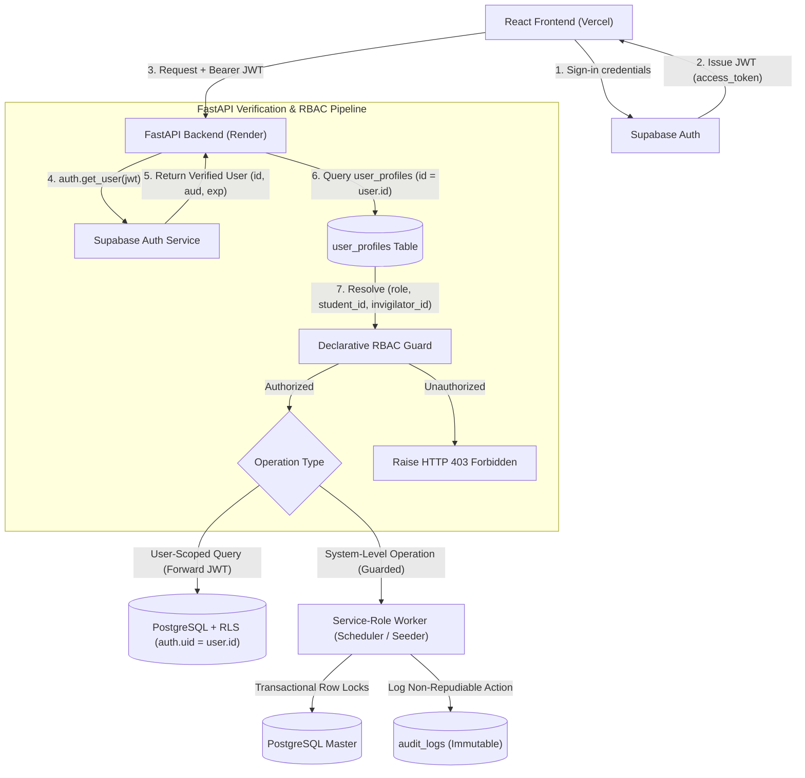

# ExamOps — Security Architecture & Data Protection Contract

> **Version:** 1.2.0  
> **Product:** ExamOps — Examination Operations & Intelligent Scheduling Platform  
> **Security Domain:** Authentication, Authorization, Sensitive Data Isolation & Governance  
> **Last Updated:** 2026-11-01  
> **Authoritative Sources:** problem_statement.md, candidate_faq.pdf, submission_guidelines.pdf, AGENTS.md §13-14, §16

---

## 1. Security Architecture Principles

ExamOps is engineered under a strict **defense-in-depth** model:
1. **Zero Client Trust:** The client SPA (React on Vercel) is completely untrusted. Claims, role headers, or authorization attributes from request bodies are never accepted as proof of privilege.
2. **Authoritative Server-Side Token Validation:** FastAPI delegates access-token validation to the official Supabase Python client (`auth.get_user(jwt)`). No project-specific symmetric secret (`HS256`) is assumed, and no custom cryptographic verification is implemented.
3. **Immutable Identity Mapping (No Email Matching):** Authorization is never derived from volatile email equality strings. Access is governed by immutable database primary/foreign keys:
   - Learners map to `students.id` via `user_profiles.student_id`.
   - Invigilators map to `invigilators.id` via `user_profiles.invigilator_id`.
   - Instructors map to courses via an explicit `course_instructors` bridge table.
4. **Structural Sensitive Data Isolation:** RLS controls row-level visibility, not column masking. Sensitive medical notes are segregated into a dedicated table (`accommodation_notes`) accessible only to authorized administrators.
5. **Dual-Path Database Access Model:**
   - User-scoped queries utilize user JWT tokens, delegating row filtering directly to PostgreSQL Row Level Security (RLS).
   - System-level operations (scheduling runs, independent schedule validation, bulk synthetic seeding) use the backend `service_role` key under strict API guardrails, transactional locks, and non-repudiable audit logging.
6. **Strict Secret Segregation:** The Supabase `service_role` key resides exclusively in backend environment variables on Render. It is never bundled into the client build.



---

## 2. Supabase JWT Authentication Lifecycle

### 2.1 Standard Server-Side Validation: `auth.get_user(jwt)`
Rather than assuming a symmetric `HS256` secret or implementing custom JWT decoding routines, FastAPI verifies access tokens directly through the official Supabase SDK:

```python
from fastapi import Depends, HTTPException, status
from fastapi.security import HTTPBearer, HTTPAuthorizationCredentials
from supabase import Client
from backend.database import get_supabase_client, DatabaseClient, get_db
from backend.models.auth import AuthenticatedUser, UserRole

security = HTTPBearer(auto_error=True)

async def get_current_user(
    credentials: HTTPAuthorizationCredentials = Depends(security),
    supabase: Client = Depends(get_supabase_client),
    db: DatabaseClient = Depends(get_db)
) -> AuthenticatedUser:
    token = credentials.credentials
    try:
        # 1. Official Supabase Auth token validation
        # Validates signature (HS256/ES256), expiration (exp), audience (authenticated), and user existence
        user_response = supabase.auth.get_user(token)
        if not user_response or not user_response.user:
            raise HTTPException(
                status_code=status.HTTP_401_UNAUTHORIZED,
                detail="Invalid or expired session token"
            )
            
        supabase_user = user_response.user
        user_id = supabase_user.id
        
        # 2. Authoritative Database Role & Identity Resolution
        profile = await db.get_user_profile(user_id)
        if not profile:
            raise HTTPException(
                status_code=status.HTTP_403_FORBIDDEN,
                detail="User authenticated in Supabase Auth but no institutional profile exists"
            )
            
        if profile.status != "ACTIVE":
            raise HTTPException(
                status_code=status.HTTP_403_FORBIDDEN,
                detail=f"User account is {profile.status}; access denied"
            )
            
        return AuthenticatedUser(
            id=user_id,
            email=profile.email,
            role=UserRole(profile.role),
            department=profile.department,
            student_id=profile.student_id,
            invigilator_id=profile.invigilator_id,
            display_name=profile.display_name
        )
        
    except Exception as e:
        raise HTTPException(
            status_code=status.HTTP_401_UNAUTHORIZED,
            detail=f"Authentication verification failed: {str(e)}"
        )
```

### 2.2 Optional Asymmetric JWKS Pipeline (Network-Free Verification)
If network latency for `auth.get_user()` is a concern under heavy load, Supabase exposes an asymmetric JSON Web Key Set at:
`https://<project-ref>.supabase.co/auth/v1/.well-known/jwks.json`

- **Mechanism:** The backend caches public keys using `jwt.PyJWKClient` (refreshed every 24 hours).
- **Verification:** Cryptographically verifies asymmetric signatures (`RS256` or `ES256`) locally without per-request network round-trips.
- **Decision:** `auth.get_user(jwt)` is the primary canonical implementation; JWKS caching is documented as a zero-network configuration option.

---

## 3. Immutable Identity Mapping & RBAC Taxonomy

Authorization is mapped through immutable primary/foreign keys across the five mandated roles:

| Role | Primary Identity Anchor | Authorization Resolution Mechanism |
|---|---|---|
| `LEARNER` | `user_profiles.student_id` $\to$ `students.id` | Scoped strictly to rows where `student_id = current_user.student_id`. Never uses email string comparisons. |
| `INSTRUCTOR` | `course_instructors` bridge | Scoped strictly to courses where `course_instructors.instructor_profile_id = current_user.id`. Can only inspect exams for assigned courses. |
| `SUPPORT_STAFF` | Functional Role | Access to rooms, physical equipment, and public accommodations (`accommodations`). Completely barred from `accommodation_notes`. |
| `ACADEMIC_ADMINISTRATOR` | Administrative Role | Full scheduling lifecycle: create runs, approve runs, publish schedules, triage validation exceptions. |
| `PLATFORM_ADMINISTRATOR` | Security Superuser | User profile management, role assignment, configuration editing, and immutable audit log review. |

### 3.1 Course-Instructor Relationship (`course_instructors`)
To prevent instructors from accessing exams outside their department or teaching assignment, instructors are explicitly linked to courses:

```sql
CREATE TABLE course_instructors (
    id UUID PRIMARY KEY DEFAULT gen_random_uuid(),
    course_id UUID NOT NULL REFERENCES courses(id) ON DELETE RESTRICT,
    instructor_profile_id UUID NOT NULL REFERENCES user_profiles(id) ON DELETE RESTRICT,
    role VARCHAR(30) NOT NULL DEFAULT 'PRIMARY_INSTRUCTOR' CHECK (role IN ('PRIMARY_INSTRUCTOR', 'TEACHING_ASSISTANT', 'CO_INSTRUCTOR')),
    assigned_at TIMESTAMPTZ NOT NULL DEFAULT NOW(),
    CONSTRAINT uq_course_instructor UNIQUE (course_id, instructor_profile_id)
);
```

### 3.2 Declarative RBAC Route Guards
```python
def require_roles(allowed_roles: list[UserRole]):
    def role_checker(current_user: AuthenticatedUser = Depends(get_current_user)):
        if current_user.role not in allowed_roles:
            raise HTTPException(
                status_code=status.HTTP_403_FORBIDDEN,
                detail=f"Operation requires one of: {[r.value for r in allowed_roles]}. "
                       f"Your role is {current_user.role.value}"
            )
        return current_user
    return role_checker
```

---

## 4. Row Level Security (RLS) & Sensitive Data Isolation

### 4.1 Structural Protection of Sensitive Accommodation Notes
Row Level Security filters whole rows, not individual table columns. To guarantee that `SUPPORT_STAFF`, `INSTRUCTORS`, and `LEARNERS` never view confidential clinical or medical disability details:

1. **`accommodations` (Public Operational Table):** Contains operational parameters needed by the scheduling engine and facilities staff:
   `accommodation_type`, `extra_time_minutes`, `extra_time_percentage`, `required_room_feature`, `required_equipment`, `effective_start`, `effective_end`, `is_active`.
2. **`accommodation_notes` (Strictly Restricted Table):** Contains confidential notes:
   ```sql
   CREATE TABLE accommodation_notes (
       id UUID PRIMARY KEY DEFAULT gen_random_uuid(),
       accommodation_id UUID NOT NULL UNIQUE REFERENCES accommodations(id) ON DELETE CASCADE,
       clinical_notes TEXT NOT NULL,
       approved_by UUID REFERENCES user_profiles(id) ON DELETE RESTRICT,
       documentation_url TEXT,
       created_at TIMESTAMPTZ NOT NULL DEFAULT NOW(),
       updated_at TIMESTAMPTZ NOT NULL DEFAULT NOW()
   );
   
   ALTER TABLE accommodation_notes ENABLE ROW LEVEL SECURITY;
   
   -- Only Academic Administrators and Platform Administrators can query clinical notes
   CREATE POLICY admin_only_accommodation_notes ON accommodation_notes
       FOR ALL
       USING (
           EXISTS (
               SELECT 1 FROM user_profiles
               WHERE user_profiles.id = auth.uid()
                 AND user_profiles.role IN ('ACADEMIC_ADMINISTRATOR', 'PLATFORM_ADMINISTRATOR')
           )
       );
   ```

### 4.2 User Profile Self-Update Restrictions
Users must **never** be permitted to alter their own application role, `student_id`, or `invigilator_id`.
```sql
-- Non-recursive SECURITY DEFINER helper functions
CREATE OR REPLACE FUNCTION public.get_auth_role()
RETURNS TEXT
LANGUAGE sql
STABLE
SECURITY DEFINER
SET search_path = public
AS $$
    SELECT role FROM public.user_profiles WHERE id = auth.uid();
$$;

CREATE OR REPLACE FUNCTION public.get_auth_student_id()
RETURNS UUID
LANGUAGE sql
STABLE
SECURITY DEFINER
SET search_path = public
AS $$
    SELECT student_id FROM public.user_profiles WHERE id = auth.uid();
$$;

CREATE OR REPLACE FUNCTION public.get_auth_invigilator_id()
RETURNS UUID
LANGUAGE sql
STABLE
SECURITY DEFINER
SET search_path = public
AS $$
    SELECT invigilator_id FROM public.user_profiles WHERE id = auth.uid();
$$;

ALTER TABLE user_profiles ENABLE ROW LEVEL SECURITY;

-- Users may view their own profile; Administrators view all (Zero RLS recursion)
CREATE POLICY profile_view ON user_profiles
    FOR SELECT
    USING (
        id = auth.uid() 
        OR public.get_auth_role() IN ('ACADEMIC_ADMINISTRATOR', 'PLATFORM_ADMINISTRATOR')
    );

-- Trigger to strictly forbid non-admin modification of role or identity foreign keys
CREATE OR REPLACE FUNCTION public.check_user_profile_immutability()
RETURNS TRIGGER AS $$
BEGIN
    IF (NEW.role IS DISTINCT FROM OLD.role OR 
        NEW.student_id IS DISTINCT FROM OLD.student_id OR 
        NEW.invigilator_id IS DISTINCT FROM OLD.invigilator_id) THEN
        IF public.get_auth_role() != 'PLATFORM_ADMINISTRATOR' AND auth.uid() IS NOT NULL THEN
            RAISE EXCEPTION 'Unauthorized: only PLATFORM_ADMINISTRATOR can modify role or identity mappings.';
        END IF;
    END IF;
    RETURN NEW;
END;
$$ LANGUAGE plpgsql SECURITY DEFINER;

CREATE TRIGGER trg_user_profile_immutability
BEFORE UPDATE ON user_profiles
FOR EACH ROW EXECUTE FUNCTION public.check_user_profile_immutability();

-- Users may update their own display_name; Platform Admins may update any profile
CREATE POLICY profile_update ON user_profiles
    FOR UPDATE
    USING (
        id = auth.uid() 
        OR public.get_auth_role() = 'PLATFORM_ADMINISTRATOR'
    );
```

### 4.3 Learner and Instructor RLS Policies
```sql
-- Learner schedule view: strictly filtered by immutable student_id
CREATE POLICY learner_schedule_assignment ON assignment_students
    FOR SELECT
    USING (
        student_id = public.get_auth_student_id()
        OR public.get_auth_role() IN ('ACADEMIC_ADMINISTRATOR', 'PLATFORM_ADMINISTRATOR')
    );

-- Instructor exam view: strictly filtered by assigned courses
CREATE POLICY instructor_exam_view ON exams
    FOR SELECT
    USING (
        status = 'PUBLISHED'
        OR course_id IN (
            SELECT course_id FROM course_instructors WHERE instructor_profile_id = auth.uid()
        )
        OR public.get_auth_role() IN ('ACADEMIC_ADMINISTRATOR', 'PLATFORM_ADMINISTRATOR')
    );
```

---

## 5. Defense of Privileged Service Operations & Concurrency Strategy

Certain administrative workloads require cross-departmental operations and bypass user-level RLS using `SUPABASE_SERVICE_ROLE_KEY`:
1. **Scheduling Engine Execution (`POST /api/v1/scheduling/runs`):** Evaluates all 5,000 students, 300 exams, 100 rooms, 200 invigilators.
2. **Independent Schedule Validation (`validate_complete_schedule()`):** Cross-institutional conflict sweeps.
3. **Atomic Schedule Publication (`POST /api/v1/scheduling/runs/{id}/publish`):** Transitions schedule state.
4. **Synthetic Data Seeder (`POST /api/v1/generator/run`):** Baseline master data population.
5. **Security Audit Logger:** Appends tamper-evident audit records.

### Concurrency Protection & Transactional Row Locks:
- **Preventing Duplicate Active Runs:**
  When scheduling starts, the backend acquires an exclusive row lock:
  ```sql
  SELECT id, status FROM scheduling_runs WHERE id = :run_id FOR UPDATE;
  ```
  Transitions `DRAFT -> SCHEDULING`. If status is already `SCHEDULING`, concurrent attempts immediately fail with HTTP 409 Conflict.
- **Guaranteeing Exactly One Published Schedule per Term:**
  A partial unique index at the PostgreSQL level enforces this invariant without race conditions:
  ```sql
  CREATE UNIQUE INDEX uq_one_published_run_per_period 
  ON scheduling_runs (academic_period_id) 
  WHERE (status = 'PUBLISHED');
  ```
- **Atomic Publication Transaction:**
  Publication runs inside an atomic transaction:
  ```sql
  BEGIN;
  -- 1. Lock the target run
  SELECT id, academic_period_id, status FROM scheduling_runs WHERE id = :run_id FOR UPDATE;
  
  -- 2. Supersede any existing published run for this period
  UPDATE scheduling_runs 
  SET status = 'SUPERSEDED', updated_at = NOW() 
  WHERE academic_period_id = :period_id AND status = 'PUBLISHED';
  
  -- 3. Publish target run
  UPDATE scheduling_runs 
  SET status = 'PUBLISHED', updated_at = NOW() 
  WHERE id = :run_id;
  
  -- 4. Record state change event and audit log
  INSERT INTO schedule_events ...;
  INSERT INTO audit_logs ...;
  COMMIT;
  ```

---

## 6. Automated RLS & Security Test Suite

The automated test suite (`tests/test_api.py` and `tests/test_constraints.py`) validates:
1. **Unauthenticated Rejection:** All endpoints (except `/health`) return `401 Unauthorized` without a valid Bearer token.
2. **Learner Data Isolation:** Learner A (`student_id = A`) querying `/api/v1/me/schedule` receives exactly their assignments; Learner B's rows return 0 records.
3. **Instructor Course Scoping:** Instructor A querying exams receives only exams for courses in `course_instructors`; querying exams for unassigned courses returns `403 Forbidden`.
4. **Support Staff Notes Barring:** Support staff querying `/api/v1/accommodations` receive room features, but direct queries to `accommodation_notes` return `403 Forbidden` / 0 rows.
5. **Self-Role Elevation Denial:** Learner attempting `PATCH /api/v1/users/me` with `{"role": "PLATFORM_ADMINISTRATOR"}` is blocked with `403 Forbidden`.
6. **Concurrent Run Lockout:** Simultaneous requests to execute the same run return `409 Conflict` on the second caller.
