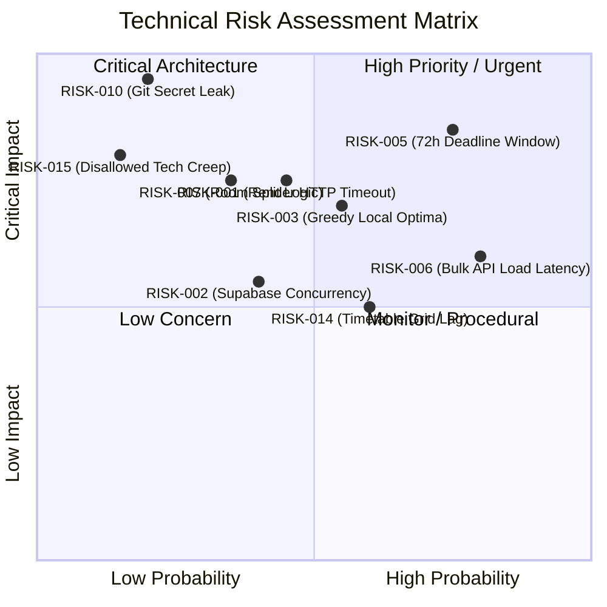

# ExamOps — Technical Risk Register & Mitigation Strategy

> **Version:** 1.0.0  
> **Product:** ExamOps — Examination Operations & Intelligent Scheduling Platform  
> **Status:** Discovery / Living Risk Document  
> **Last Updated:** 2026-11-01  
> **Authoritative Sources:** problem_statement.md, candidate_faq.pdf, AGENTS.md §22, §23

---

## 1. Risk Management Framework

Risks are categorized by domain, assessed for **Probability** (Low, Medium, High) and **Impact** (Low, Medium, High, Critical), and assigned a definitive architectural mitigation.

---

## 2. Master Technical Risk Register

| Risk ID | Risk Description | Category | Prob | Impact | Mitigation Strategy | Contingency Plan | Status |
|---|---|---|---|---|---|---|---|
| `RISK-001` | Scheduling 300 exams exceeds Render HTTP 30s timeout | Architecture / API | Med | High | Python algorithm is optimized to execute in under 15 seconds in memory using sparse adjacency sets. | If benchmark exceeds 20s, implement lightweight background task with polling endpoint (`GET /runs/{id}/status`). | Active Monitoring |
| `RISK-002` | Supabase free-tier connection limits reached under load | Database | Med | Med | Reuse Supabase Python SDK client instances; enforce pagination (`limit=50`); avoid connection per request. | Enable Supabase Supavisor connection pooling if needed. | Mitigated by Design |
| `RISK-003` | Greedy algorithm gets trapped in local optima leaving exams unassigned | Algorithm | Med | High | Multi-factor priority queue (conflict degree + enrollment) + 3-pass bounded improvement pass without displacement. | Log detailed reason codes; allow admin manual override through UI. | Mitigated by Design |
| `RISK-004` | Supabase RLS policies degrade query performance on 5,000+ student tables | Database / Security | Low | Med | Add explicit B-tree indexes on foreign keys and RLS filter columns (`email`, `student_id`, `scheduling_run_id`). | Benchmark query execution plans with `EXPLAIN ANALYZE`. | Verified Design |
| `RISK-005` | 72-hour challenge window deadline pressure leads to rushed deliverables | Project Governance | High | High | Execute strictly by phased milestones; prioritize mandatory core requirements over optional enhancements. | Scope triage: preserve all 10 generator steps and 5 negative scenarios first. | Active Tracking |
| `RISK-006` | Slow insertion of 5,000 students & 300 exams over Supabase REST API | Data Engineering | High | Med | Standalone generator writes directly to local CSV/JSON and generates unified SQL `seed.sql` with multi-row `INSERT` statements. | Execute direct SQL seed execution via Supabase CLI or SQL editor. | Mitigated by Design |
| `RISK-007` | Room splitting algorithm misallocates accommodated students | Algorithm | Low | High | Strict tier-based student partitioning (isolated low-distraction cohort, accessible cohort, standard cohort) evaluated sequentially. | Unit tests in `test_scheduler.py` test diverse accommodation combinations. | Mitigated by Design |
| `RISK-008` | Extended time calculation rounding creates discrepancy | Business Logic | Med | Med | Standardize on `math.ceil` for percentage extensions; enforce explicit minutes precedence over percentage. | Test coverage in `test_constraints.py` asserts duration parity. | Mitigated by Design |
| `RISK-009` | Render/Vercel free tier cold starts degrade reviewer demo experience | DevOps | Med | Med | Keep backend dependencies minimal (no torch, pandas, or heavy frameworks). Bundle size < 15MB. | Pre-warm backend endpoint before reviewer evaluation. | Mitigated by Design |
| `RISK-010` | Accidental leak of Supabase service role key in public Git repo | Security | Low | Critical | Strict `.gitignore`; use `.env.example`; pre-commit Git regex scan for tokens; Render-only backend env vars. | If leaked: immediately rotate service role key in Supabase dashboard. | Controlled |
| `RISK-011` | Conflict graph memory footprint explodes for large enrollments | Performance | Low | Low | Store conflict graph as adjacency dictionary of integers `dict[int, set[int]]` rather than dense $N \times N$ matrix. | Peak memory footprint is $< 25\text{MB}$ for 5,000 students. | Mitigated by Design |
| `RISK-012` | Foreign key violations during synthetic data generation | Data Engineering | Low | High | Follow strict 15-step topological generation order (AcademicPeriod -> Students -> Courses -> Rooms -> Enrollments -> Exams). | `validate.py` verifies 100% of foreign keys before exporting. | Mitigated by Design |
| `RISK-013` | Browser DOM performance lag rendering 300 exams on timetable matrix | Frontend UI | Med | Med | Chunk timetable rendering into day/week tabs; virtualize room rows; avoid rendering all 300 exams simultaneously. | Provide paginated table view as fast fallback to visual grid. | Mitigated by Design |
| `RISK-014` | Disallowed technology introduced accidentally | Compliance | Low | High | AGENTS.md restriction audit: explicitly forbid OR-Tools, LangChain, Next.js, Redux, Docker, Celery. | CI lint check on `package.json` and `requirements.txt`. | Mitigated by Design |
| `RISK-015` | Historical schedule drift caused by subsequent enrollment updates | Data Integrity | Med | High | Capture frozen input snapshot (`RunExamStudent`) with SHA-256 hash at run initiation. Never query live tables for past runs. | `test_relationships.py` verifies historical run immutability. | Mitigated by Design |
