# ExamOps — Automated Testing Contract & Verification Strategy

> **Version:** 1.0.0  
> **Product:** ExamOps — Examination Operations & Intelligent Scheduling Platform  
> **Test Framework:** Pytest 9.2 (Backend & Invariants) + Vite Build Verification (Frontend)  
> **Database:** PostgreSQL 16 (Supabase Cloud with Pooler)  
> **Authoritative Sources:** problem_statement.md, candidate_faq.pdf, submission_guidelines.pdf, AGENTS.md  
> **Status:** Implemented & Verified (42/42 Pytest Tests Passing, Seed 20261022 Reproducibility Certified)

---

## 1. Testing Philosophy & Acceptance Criteria

ExamOps enforces an unyielding engineering and operational quality contract:
1. **Behavioral Verification Over File Existence:** Tests execute live database queries, exercise FastAPI routers with authenticated test clients, simulate distributed concurrency with multiple processes, and inspect scheduling algorithm telemetry.
2. **Zero Hard Constraint Violations:** A confirmed schedule with even one student conflict, room capacity breach, double-booked invigilator, or accommodation violation is an immediate failure.
3. **100% Explainability:** Every unassigned examination produces structured, auditable reason codes (`CAPACITY_DEFICIT`, `STUDENT_CONFLICT`, `NO_INVIGILATOR_AVAILABLE`).
4. **Reproducibility Verification:** Two consecutive executions of the data generator using fixed seed `20261022` produce identical SHA-256 hashes across all canonical tables.

```mermaid
graph TD
    TestRunner["Pytest Test Runner (42 Tests)"]
    TestRunner --> Suite1["1. backend/tests/test_database_integrity.py (4 tests)"]
    TestRunner --> Suite2["2. backend/tests/test_duplicate_detection.py (2 tests)"]
    TestRunner --> Suite3["3. backend/tests/test_rbac_integrity.py (3 tests)"]
    TestRunner --> Suite4["4. backend/tests/test_referential_integrity.py (3 tests)"]
    TestRunner --> Suite5["5. backend/tests/test_scheduling_integrity.py (5 tests)"]
    TestRunner --> Suite6["6. tests/test_backend_api.py (9 tests)"]
    TestRunner --> Suite7["7. tests/test_distributed_concurrency.py (5 tests)"]
    TestRunner --> Suite8["8. tests/test_role_revocation.py (7 tests)"]
    TestRunner --> Suite9["9. scripts/test_scheduler.py (4 tests)"]
    
    ReproRunner["Separate Reproducibility Command"]
    ReproRunner --> ReproStep["python scripts/test_synthetic_data.py (Dual-run SHA-256 match)"]
```



---

## 2. Actual Committed Test Suite Architecture

The repository contains 9 test files collecting exactly 42 tests:

```text
backend/tests/
├── test_database_integrity.py       # Baseline row counts, regex code formats, NOT NULL, immutability
├── test_duplicate_detection.py       # Composite unique constraints and duplicate business codes
├── test_rbac_integrity.py            # RBAC route protection, learner boundaries, clinical note masking
├── test_referential_integrity.py     # 23 foreign key pairs, composite assignment keys, run consistency
└── test_scheduling_integrity.py      # Hard constraints on published runs (overlaps, capacity, workload)
tests/
├── test_backend_api.py               # FastAPI client tests, master data CRUD, solver run workflow, exports
├── test_distributed_concurrency.py   # Multi-process advisory locking, crash safety, 409 conflict
└── test_role_revocation.py           # Immediate role downgrade, deactivation, cache TTL, invalid JWT
scripts/
└── test_scheduler.py                 # Graph coloring heuristics, room splitting, 5 negative scenarios, solver baseline
```

---

## 3. Test Specifications by Module

### 3.1 Database Structural & Integrity Suite (`backend/tests/test_database_integrity.py`)
- **`test_baseline_entity_counts`:** Asserts exact baseline volumes in PostgreSQL: 5,000 students, 300 exams, 100 rooms, 200 invigilators, 150 courses, 25,044 enrollments, 301 accommodations, 1,200 availabilities.
- **`test_identifier_patterns`:** Asserts regex pattern compliance for canonical business codes (`^STU-[0-9]{6}$`, `^EXAM-[0-9]{4}-[0-9]{6}$`, `^ROOM-[0-9]{6}$`, `^INV-[0-9]{6}$`, etc.).
- **`test_mandatory_columns_not_null`:** Asserts zero null values in mandatory columns across all entities.
- **`test_immutability_triggers`:** Verifies PostgreSQL triggers prevent `UPDATE` or `DELETE` on append-only audit and event logs.

### 3.2 Duplicate Detection Suite (`backend/tests/test_duplicate_detection.py`)
- **`test_unique_business_codes`:** Asserts unique indices prevent duplicate codes across students, rooms, exams, and invigilators.
- **`test_unique_composite_relationships`:** Asserts uniqueness on composite relationships (`enrollments(student_id, course_id)`, `course_instructors`, `room_equipment`).

### 3.3 Role-Based Access Control Suite (`backend/tests/test_rbac_integrity.py`)
- **`test_unauthenticated_rejected`:** Asserts missing or invalid tokens return HTTP 401.
- **`test_learner_forbidden_admin_routes`:** Asserts students cannot access administrative endpoints (returns HTTP 403).
- **`test_clinical_notes_redacted_for_instructors`:** Asserts non-officer roles receive redacted clinical notes `[CONFIDENTIAL CLINICAL RECORD REDACTED]`.

### 3.4 Referential Integrity Suite (`backend/tests/test_referential_integrity.py`)
- **`test_foreign_key_referential_integrity`:** Validates 23 parent-child foreign key relationships across the database with zero orphaned child rows.
- **`test_composite_foreign_key_integrity`:** Asserts `assignment_students` foreign key alignment with `schedule_assignments`.
- **`test_scheduling_run_totals_consistency`:** Asserts `scheduled_count + unassigned_count == total_exams` across completed runs.

### 3.5 Scheduling Constraint Integrity Suite (`backend/tests/test_scheduling_integrity.py`)
- **`test_no_student_conflicts`:** Queries the published schedule to guarantee zero student exam overlaps.
- **`test_no_room_double_booking`:** Verifies zero simultaneous confirmed assignments in the same room.
- **`test_room_capacity_not_exceeded`:** Asserts seated students do not exceed room exam capacity.
- **`test_no_invigilator_double_booking`:** Asserts invigilators have zero overlapping assignments.
- **`test_unscheduled_exams_have_explanations`:** Verifies 100% of unassigned exams have documented reason codes.

### 3.6 Backend API Integration Suite (`tests/test_backend_api.py`)
- **`test_health_check`:** Verifies database connectivity and API status.
- **`test_authentication_required`:** Verifies unauthenticated calls fail.
- **`test_rbac_admin_profiles`:** Verifies administrator profile listing.
- **`test_master_data_endpoints`:** Verifies CRUD on students, courses, exams, rooms, and invigilators.
- **`test_clinical_privacy_masking`:** Asserts privacy masking between instructors and administrators.
- **`test_scheduling_run_workflow`:** Exercises full end-to-end lifecycle: Create Run $\to$ Execute Solver $\to$ Inspect Decisions $\to$ Approve $\to$ Publish.
- **`test_analytics_and_reconciliation`:** Asserts operational reconciliation and KPI computations.
- **`test_export_formats`:** Verifies CSV and JSON download streams.
- **`test_audit_logs`:** Verifies audit trail recording and access restriction.

### 3.7 Distributed Concurrency Safety Suite (`tests/test_distributed_concurrency.py`)
- **`test_distributed_advisory_lock_mutual_exclusion`:** Proves threads/processes cannot hold the same advisory lock simultaneously.
- **`test_different_runs_do_not_block_each_other`:** Verifies orthogonal runs acquire independent lock IDs.
- **`test_multi_process_advisory_lock_isolation`:** Spawns two independent OS Python processes to prove cross-process mutual exclusion.
- **`test_worker_crash_releases_advisory_lock`:** Simulates worker termination (`SIGTERM`) and proves PostgreSQL automatically frees the advisory lock.
- **`test_scheduling_routes_return_409_on_concurrent_execution`:** Verifies concurrent executions return HTTP 409 Conflict.

### 3.8 Authentication & Role Revocation Suite (`tests/test_role_revocation.py`)
- **`test_admin_to_learner_role_downgrade`:** Verifies immediate role downgrade returns HTTP 403.
- **`test_learner_promoted_to_admin`:** Verifies role promotion immediately grants access.
- **`test_account_deactivation_revokes_access`:** Asserts deactivation returns HTTP 401.
- **`test_cache_ttl_bounds_cross_worker_revocation`:** Proves multi-worker authorization cache expires within $\le 5.0$ seconds.
- **`test_expired_jwt_rejected`:** Verifies expired tokens fail authentication.
- **`test_invalid_jwt_signature_rejected`:** Verifies tampered JWT signatures are rejected.
- **`test_direct_api_access_without_authorization`:** Asserts unauthenticated mutations are systematically blocked.

### 3.9 Scheduling Engine Verification (`scripts/test_scheduler.py`)
- **`test_conflict_graph_and_prioritization`:** Verifies graph degree calculation and Most-Constrained-First priority ordering.
- **`test_room_splitting_invariants`:** Verifies all 7 room-splitting invariants (seating count, wheelchair accessibility, duration accommodation).
- **`test_five_negative_scenarios`:** Asserts detection and explicit reason codes for all 5 mandatory anomalies:
  1. *Student Overlap:* `STUDENT_NON_OVERLAP` / `STUDENT_CONFLICT`
  2. *Room Capacity Exceeded:* `CAPACITY_DEFICIT`
  3. *Invigilator Double-Booked:* `INVIGILATOR_DOUBLE_BOOKED` / `NO_INVIGILATOR_AVAILABLE`
  4. *Accommodation Ignored:* `ACCOMMODATION_BREACH` / `ACCESSIBILITY_MISMATCH`
  5. *Outside Operating Availability:* `ROOM_UNAVAILABLE` / `ROOM_CLOSED_FOR_MAINTENANCE`
- **`test_full_baseline_execution`:** Executes the full solver on 300 exams and 5,000 students and certifies zero violations.

---

## 4. Pytest Execution Command & Live Results

### Execution Command
```bash
python -m pytest backend/tests tests scripts/test_scheduler.py -v
```

### Live Terminal Execution Output
```text
============================= test session starts =============================
platform win32 -- Python 3.12.10, pytest-9.2.0, pluggy-1.7.0
cachedir: .pytest_cache
rootdir: C:\Users\USER\OneDrive\Desktop\ExamOps
plugins: anyio-4.16.0
collected 42 items

backend/tests/test_database_integrity.py::test_baseline_entity_counts PASSED [  2%]
backend/tests/test_database_integrity.py::test_identifier_patterns PASSED [  4%]
backend/tests/test_database_integrity.py::test_mandatory_columns_not_null PASSED [  7%]
backend/tests/test_database_integrity.py::test_immutability_triggers PASSED [  9%]
backend/tests/test_duplicate_detection.py::test_unique_business_codes PASSED [ 11%]
backend/tests/test_duplicate_detection.py::test_unique_composite_relationships PASSED [ 14%]
backend/tests/test_rbac_integrity.py::test_unauthenticated_rejected PASSED [ 16%]
backend/tests/test_rbac_integrity.py::test_learner_forbidden_admin_routes PASSED [ 19%]
backend/tests/test_rbac_integrity.py::test_clinical_notes_redacted_for_instructors PASSED [ 21%]
backend/tests/test_referential_integrity.py::test_foreign_key_referential_integrity PASSED [ 23%]
backend/tests/test_referential_integrity.py::test_composite_foreign_key_integrity PASSED [ 26%]
backend/tests/test_referential_integrity.py::test_scheduling_run_totals_consistency PASSED [ 28%]
backend/tests/test_scheduling_integrity.py::test_no_student_conflicts PASSED [ 30%]
backend/tests/test_scheduling_integrity.py::test_no_room_double_booking PASSED [ 33%]
backend/tests/test_scheduling_integrity.py::test_room_capacity_not_exceeded PASSED [ 35%]
backend/tests/test_scheduling_integrity.py::test_no_invigilator_double_booking PASSED [ 38%]
backend/tests/test_scheduling_integrity.py::test_unscheduled_exams_have_explanations PASSED [ 40%]
tests/test_backend_api.py::test_health_check PASSED                      [ 42%]
tests/test_backend_api.py::test_authentication_required PASSED           [ 45%]
tests/test_backend_api.py::test_rbac_admin_profiles PASSED               [ 47%]
tests/test_backend_api.py::test_master_data_endpoints PASSED             [ 50%]
tests/test_backend_api.py::test_clinical_privacy_masking PASSED          [ 52%]
tests/test_backend_api.py::test_scheduling_run_workflow PASSED           [ 54%]
tests/test_backend_api.py::test_analytics_and_reconciliation PASSED      [ 57%]
tests/test_backend_api.py::test_export_formats PASSED                    [ 59%]
tests/test_backend_api.py::test_audit_logs PASSED                        [ 61%]
tests/test_distributed_concurrency.py::test_distributed_advisory_lock_mutual_exclusion PASSED [ 64%]
tests/test_distributed_concurrency.py::test_different_runs_do_not_block_each_other PASSED [ 66%]
tests/test_distributed_concurrency.py::test_multi_process_advisory_lock_isolation PASSED [ 69%]
tests/test_distributed_concurrency.py::test_worker_crash_releases_advisory_lock PASSED [ 71%]
tests/test_distributed_concurrency.py::test_scheduling_routes_return_409_on_concurrent_execution PASSED [ 73%]
tests/test_role_revocation.py::test_admin_to_learner_role_downgrade PASSED [ 76%]
tests/test_role_revocation.py::test_learner_promoted_to_admin PASSED     [ 78%]
tests/test_role_revocation.py::test_account_deactivation_revokes_access PASSED [ 80%]
tests/test_role_revocation.py::test_cache_ttl_bounds_cross_worker_revocation PASSED [ 83%]
tests/test_role_revocation.py::test_expired_jwt_rejected PASSED          [ 85%]
tests/test_role_revocation.py::test_invalid_jwt_signature_rejected PASSED [ 88%]
tests/test_role_revocation.py::test_direct_api_access_without_authorization PASSED [ 90%]
scripts/test_scheduler.py::test_conflict_graph_and_prioritization PASSED [ 92%]
scripts/test_scheduler.py::test_room_splitting_invariants PASSED         [ 95%]
scripts/test_scheduler.py::test_five_negative_scenarios PASSED           [ 97%]
scripts/test_scheduler.py::test_full_baseline_execution PASSED           [100%]

================== 42 passed, 1 warning in 340.28s (0:05:40) ==================
```

---

## 5. Separate Synthetic Data Reproducibility Verification

Per Problem Statement Section 10 and AGENTS.md Section 09, dataset reproducibility is verified via a dedicated standalone command:

### Execution Command
```bash
python scripts/test_synthetic_data.py
```

### Verification Logic & Steps
1. **Step 1 (Deterministic Dual-Run Hashes):** Generates the dataset twice using fixed seed `20261022` and computes canonical SHA-256 hashes across all 17 output entities and ground truth fixtures. Asserts 100% hash parity.
2. **Step 2 (In-Memory Referential Integrity):** Validates all 25,044 enrollments, 300 exams, 107 requirements, 100 room capacities, 136 room equipment, 601 room availabilities, 1,200 invigilator availabilities, and 301 accommodations against parent entity IDs.
3. **Step 3 (Identifier Syntax Validation):** Validates zero malformed identifiers using regex format assertions.
4. **Step 4 (Database Safety Guard):** Checks for a local disposable PostgreSQL container (`examops-db-test`). If not active, reports Step 4 as **NOT RUN** to guarantee zero destructive table drops or mutations against live production Supabase PostgreSQL.

### Live Terminal Execution Output
```text
=== Step 1: Testing Reproducibility across Independent Runs ===
Generating ExamOps dataset: profile='full', seed=20261022
Target metrics: 5000 students, 300 exams, 100 rooms, 200 invigilators
Generating ExamOps dataset: profile='full', seed=20261022
Target metrics: 5000 students, 300 exams, 100 rooms, 200 invigilators
  ✓ academic_periods: 1 rows, SHA-256: 8d03b83421681cc2... (Reproducibility 100% MATCH)
  ✓ students: 5000 rows, SHA-256: d445237657174558... (Reproducibility 100% MATCH)
  ✓ invigilators: 200 rows, SHA-256: 5cb67fdb14e40669... (Reproducibility 100% MATCH)
  ✓ user_profiles: 45 rows, SHA-256: 9e1f69860e854fa3... (Reproducibility 100% MATCH)
  ✓ courses: 150 rows, SHA-256: 532825bb42c2c77a... (Reproducibility 100% MATCH)
  ✓ course_instructors: 150 rows, SHA-256: 4163c874fee37de6... (Reproducibility 100% MATCH)
  ✓ enrollments: 25044 rows, SHA-256: baf2ce8c46bbc343... (Reproducibility 100% MATCH)
  ✓ exams: 300 rows, SHA-256: b6e9cbee7ff41035... (Reproducibility 100% MATCH)
  ✓ exam_requirements: 107 rows, SHA-256: e17e335e144bdd01... (Reproducibility 100% MATCH)
  ✓ rooms: 100 rows, SHA-256: 920b1054dd9b1028... (Reproducibility 100% MATCH)
  ✓ room_capacities: 100 rows, SHA-256: a0996cde5a847f42... (Reproducibility 100% MATCH)
  ✓ equipment_types: 5 rows, SHA-256: d6365995902d5a76... (Reproducibility 100% MATCH)
  ✓ room_equipment: 136 rows, SHA-256: af44dcd7c7c8ab94... (Reproducibility 100% MATCH)
  ✓ room_availabilities: 601 rows, SHA-256: 30701d86c4d408a2... (Reproducibility 100% MATCH)
  ✓ availabilities: 1200 rows, SHA-256: 42216b26dff62f55... (Reproducibility 100% MATCH)
  ✓ accommodations: 301 rows, SHA-256: 21c3ec7a93fd0fb9... (Reproducibility 100% MATCH)
  ✓ accommodation_notes: 301 rows, SHA-256: 82fa16311f54cd5d... (Reproducibility 100% MATCH)
  ✓ ground_truth: 5 negative fixtures MATCH.

=== Step 2: In-Memory Referential Integrity Verification ===
  ✓ All 25044 enrollments reference valid students and courses.
  ✓ All 300 exams reference valid courses and academic periods.
  ✓ All 107 requirements reference valid exams.
  ✓ All room capacities and equipment reference valid rooms and equipment types.
  ✓ All room and invigilator availabilities reference valid parents.
  ✓ All accommodations and confidential notes reference valid parents.

=== Step 3: Identifier Format Verification ===
  ✓ All identifiers strictly conform to canonical uppercase padded syntax.

=== Step 4: Loading SQL Seed into PostgreSQL & Reconciling Counts ===
  ℹ Disposable test container 'examops-db-test' is not running.
  ℹ Per Database Safety Policy, Step 4 was NOT RUN against production Supabase.
  ✓ Steps 1–3 (Reproducibility, Referential Integrity, Deterministic IDs) VERIFIED.

All synthetic data generation, format, and reproducibility checks passed successfully!
```

---

## 6. Frontend Build Verification

The frontend build is verified through Vite's production bundling pipeline without errors or unmapped imports:

```bash
cd frontend
npm run build
```

```text
> frontend@0.0.0 build
> vite build

vite v8.3.5 building client environment for production...
transforming...
✓ 2654 modules transformed.
rendering chunks...
computing gzip size...
dist/index.html                                    1.37 kB │ gzip:   0.65 kB
dist/assets/index-BliGq4cw.css                    28.05 kB │ gzip:   6.26 kB
dist/assets/useDebounce-D2FHxRaw.js                0.27 kB │ gzip:   0.21 kB
dist/assets/rolldown-runtime-XKyaHtl9.js           0.72 kB │ gzip:   0.42 kB
dist/assets/EmptyState-zOUgNNKP.js                 1.07 kB │ gzip:   0.55 kB
dist/assets/MetricDisplay-rex4btAh.js              1.31 kB │ gzip:   0.62 kB
dist/assets/Drawer-DLVordwl.js                     1.77 kB │ gzip:   0.85 kB
dist/assets/StatusBadge-DGw_BcsF.js                2.26 kB │ gzip:   0.89 kB
dist/assets/vendor-other-wLjwYBbT.js               3.56 kB │ gzip:   1.57 kB
dist/assets/DataTable-BcJQ-0kp.js                  5.08 kB │ gzip:   1.91 kB
dist/assets/AuditActivity-4h-Uh6YT.js              7.63 kB │ gzip:   2.43 kB
dist/assets/CourseManagement-NqdnUWDL.js           7.72 kB │ gzip:   2.51 kB
dist/assets/AccommodationManagement-GECBQKSe.js    7.85 kB │ gzip:   2.64 kB
dist/assets/AnalyticsReports-C4KIIJ8N.js           8.76 kB │ gzip:   2.73 kB
dist/assets/InvigilatorManagement-BRN17kaZ.js      8.86 kB │ gzip:   2.72 kB
dist/assets/RoomManagement-Bl1XPwkj.js             9.14 kB │ gzip:   2.62 kB
dist/assets/ExamManagement-BxGi5exo.js             9.66 kB │ gzip:   2.85 kB
dist/assets/StudentManagement-C9jNccnK.js          9.68 kB │ gzip:   2.94 kB
dist/assets/ExceptionCenter-B-GTSQbA.js           10.14 kB │ gzip:   3.35 kB
dist/assets/OverviewDashboard-B-UkSA19.js         10.43 kB │ gzip:   2.50 kB
dist/assets/Administration-K8-3rhR0.js            11.41 kB │ gzip:   2.77 kB
dist/assets/SchedulingWorkspace-Q8VaYRA9.js       17.91 kB │ gzip:   4.87 kB
dist/assets/index-DmVC9p2M.js                     23.21 kB │ gzip:   7.20 kB
dist/assets/vendor-react-DdDGFXvh.js             259.24 kB │ gzip:  82.81 kB
dist/assets/vendor-charts-DmdBpsRU.js            377.47 kB │ gzip: 108.74 kB

✓ built in 1.98s
```
