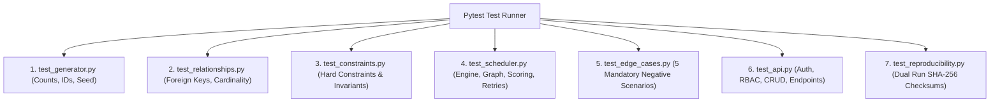

# ExamOps — Automated Testing Contract & Verification Strategy

> **Version:** 1.0.0  
> **Product:** ExamOps — Examination Operations & Intelligent Scheduling Platform  
> **Test Framework:** Pytest (Backend) + Jest/Vitest (Frontend)  
> **Last Updated:** 2026-11-01  
> **Authoritative Sources:** problem_statement.md, AGENTS.md §18, §25

---

## 1. Testing Philosophy & Acceptance Criteria

ExamOps enforces an unyielding quality contract:
1. **Behavioral Verification Over File Existence:** Tests must execute actual application code, simulate database transactions, inspect algorithm telemetry, and assert business invariants.
2. **Zero Hard Constraint Violations:** A confirmed schedule with even one student overlap, room over-capacity, or double-booked invigilator is an immediate catastrophic test failure.
3. **100% Explainability:** Every unassigned examination must produce valid standard reason codes.
4. **Reproducibility Verification:** Two consecutive executions of the data generator using seed `20261022` must produce identical SHA-256 hashes across all canonical tables.



---

## 2. Test Suite Architecture

```
tests/
├── conftest.py                  # Database fixtures, mock Supabase client, seed loaders
├── test_generator.py            # Baseline volume, ID formats, deterministic ordering
├── test_relationships.py        # Master/child relations, cascade policies, snapshot tables
├── test_constraints.py          # Hard constraint validation rules in isolation
├── test_scheduler.py            # Engine execution, conflict graph, room splitting, scoring
├── test_edge_cases.py           # The 5 mandatory negative scenario injection tests
├── test_api.py                  # FastAPI route handlers, JWT verification, RBAC guards
└── test_reproducibility.py      # Dual-generation bitwise checksum comparison
```

---

## 3. Test Specifications by Module

### 3.1 Generator Tests (`test_generator.py`)
- **`test_baseline_volume_counts`:**
  - Asserts exactly:
    - 5,000 Students
    - 300 Examinations
    - 100 Rooms
    - 200 Invigilators
- **`test_deterministic_id_conventions`:**
  - Asserts all student IDs match `^STU-[0-9]{6}$`.
  - Asserts all exam IDs match `^EXAM-[0-9]{4}-[0-9]{6}$`.
  - Asserts all room IDs match `^ROOM-[0-9]{6}$`.
  - Asserts all invigilator IDs match `^INV-[0-9]{6}$`.
- **`test_ground_truth_separation`:**
  - Asserts that `data/ground_truth/ground_truth.csv` and `ground_truth.json` exist.
  - Verifies that zero ground-truth labels exist as columns in operational input tables (`students.csv`, `exams.csv`, etc.).
- **`test_derived_value_calculation`:**
  - Asserts that student enrollment counts in `exams` match the actual count of rows in `enrollments` for that course.

---

### 3.2 Relationship & Cardinality Tests (`test_relationships.py`)
- **`test_foreign_key_integrity`:**
  - Asserts that 100% of foreign keys resolve to valid parent records across all tables.
- **`test_room_capacity_effective_dating`:**
  - Queries room capacity for an exam date and asserts that only the currently active `room_capacities` row is returned.
- **`test_frozen_snapshot_immutability`:**
  - Triggers a run; modifies a student enrollment in `enrollments`; re-queries `run_exam_students` and asserts the run snapshot remains unaltered.

---

### 3.3 The Five Mandatory Negative Scenario Tests (`test_edge_cases.py`)

Every one of the five required negative scenarios has a dedicated automated test asserting detection and rejection:

```python
# -------------------------------------------------------------
# NEGATIVE TEST 1: Student Overlapping Examination Candidate
# -------------------------------------------------------------
def test_negative_student_overlap(scheduler_engine, sample_state):
    """
    Scenario: Student STU-000001 is enrolled in Exam A (09:00-11:00).
    A candidate slot for Exam B is evaluated for 10:00-12:00.
    Expected: validate_candidate() rejects the candidate with STUDENT_OVERLAP.
    """
    exam_a = sample_state.get_exam("EXAM-2026-000001")
    exam_b = sample_state.get_exam("EXAM-2026-000002")
    student = "STU-000001"
    
    # Commit Exam A
    commit_assignment(sample_state, exam_a, start="09:00", end="11:00", students=[student])
    
    # Evaluate overlapping candidate for Exam B
    candidate = create_candidate(exam_b, start="10:00", end="12:00", students=[student])
    result = scheduler_engine.validate_candidate(candidate, sample_state)
    
    assert result.is_valid is False
    assert "STUDENT_OVERLAP" in result.failed_constraints
    assert "NO_CONFLICT_FREE_TIME_SLOT" in result.reason_codes

# -------------------------------------------------------------
# NEGATIVE TEST 2: Room Capacity Exceeded
# -------------------------------------------------------------
def test_negative_room_capacity_exceeded(scheduler_engine, sample_state):
    """
    Scenario: Room ROOM-000001 has exam capacity = 40.
    An assignment candidate assigns 45 students to ROOM-000001.
    Expected: Rejected with ROOM_CAPACITY_EXCEEDED and reason NO_ROOM_CAPACITY.
    """
    room = sample_state.get_room("ROOM-000001") # capacity 40
    exam = sample_state.get_exam("EXAM-2026-000003")
    students = [f"STU-{i:06d}" for i in range(1, 46)] # 45 students
    
    candidate = create_candidate_with_room(exam, room, students)
    result = scheduler_engine.validate_candidate(candidate, sample_state)
    
    assert result.is_valid is False
    assert "ROOM_CAPACITY_EXCEEDED" in result.failed_constraints
    assert "NO_ROOM_CAPACITY" in result.reason_codes

# -------------------------------------------------------------
# NEGATIVE TEST 3: Invigilator Double-Booked
# -------------------------------------------------------------
def test_negative_invigilator_double_booked(scheduler_engine, sample_state):
    """
    Scenario: Invigilator INV-000001 is assigned to Hall A from 09:00-11:00.
    A candidate for Hall B assigns INV-000001 from 10:00-12:00.
    Expected: Rejected with INVIGILATOR_DOUBLE_BOOKED and reason NO_INVIGILATOR_AVAILABLE.
    """
    invigilator = sample_state.get_invigilator("INV-000001")
    exam_a = sample_state.get_exam("EXAM-2026-000001")
    exam_b = sample_state.get_exam("EXAM-2026-000002")
    
    commit_assignment_with_invigilator(sample_state, exam_a, invigilator, start="09:00", end="11:00")
    
    candidate = create_candidate_with_invigilator(exam_b, invigilator, start="10:00", end="12:00")
    result = scheduler_engine.validate_candidate(candidate, sample_state)
    
    assert result.is_valid is False
    assert "INVIGILATOR_DOUBLE_BOOKED" in result.failed_constraints
    assert "NO_INVIGILATOR_AVAILABLE" in result.reason_codes

# -------------------------------------------------------------
# NEGATIVE TEST 4: Student Accommodation Ignored
# -------------------------------------------------------------
def test_negative_accommodation_ignored(scheduler_engine, sample_state):
    """
    Scenario: Student STU-000005 requires WHEELCHAIR_ACCESS.
    Candidate places student in ROOM-000003 where is_accessible = FALSE.
    Expected: Rejected with ACCOMMODATION_UNSUPPORTED.
    """
    room_inaccessible = sample_state.get_room("ROOM-000003") # is_accessible = False
    exam = sample_state.get_exam("EXAM-2026-000004")
    accommodated_student = sample_state.get_student_with_accommodation("WHEELCHAIR_ACCESS")
    
    candidate = create_candidate_with_room(exam, room_inaccessible, [accommodated_student])
    result = scheduler_engine.validate_candidate(candidate, sample_state)
    
    assert result.is_valid is False
    assert "ACCOMMODATION_UNSUPPORTED" in result.failed_constraints
    assert "ACCOMMODATION_UNSUPPORTED" in result.reason_codes

# -------------------------------------------------------------
# NEGATIVE TEST 5: Exam Outside Room Availability
# -------------------------------------------------------------
def test_negative_room_outside_availability(scheduler_engine, sample_state):
    """
    Scenario: ROOM-000004 has MAINTENANCE closure recorded on Dec 04 from 12:00-18:00 IST.
    A candidate attempts to schedule an exam from 13:00-15:00 IST in ROOM-000004.
    Expected: Rejected with ROOM_UNAVAILABLE.
    """
    room = sample_state.get_room("ROOM-000004")
    sample_state.add_room_closure(room, date="2026-12-04", start="12:00", end="18:00")
    exam = sample_state.get_exam("EXAM-2026-000005")
    
    candidate = create_candidate_at_time(exam, room, date="2026-12-04", start="13:00", end="15:00")
    result = scheduler_engine.validate_candidate(candidate, sample_state)
    
    assert result.is_valid is False
    assert "ROOM_UNAVAILABLE" in result.failed_constraints
    assert "ROOM_UNAVAILABLE" in result.reason_codes
```

---

### 3.4 Reproducibility Test (`test_reproducibility.py`)

```python
def test_dual_generation_canonical_checksums():
    """
    Generates the complete baseline dataset twice using seed 20261022.
    Asserts bitwise SHA-256 equivalence across all canonical CSV files.
    """
    run_1_hashes = generate_and_hash_dataset(seed=20261022, profile="full")
    run_2_hashes = generate_and_hash_dataset(seed=20261022, profile="full")
    
    for table_name in run_1_hashes:
        assert run_1_hashes[table_name] == run_2_hashes[table_name], (
            f"Reproducibility divergence in table {table_name}: "
            f"{run_1_hashes[table_name]} != {run_2_hashes[table_name]}"
        )
```

---

### 3.5 Security & RLS Allow/Deny Tests (`test_rls_policies.py`)

```python
def test_learner_cannot_read_peer_schedule(learner_auth_client, peer_student_id):
    """
    Verifies that a Learner querying assignment_students receives 0 rows
    for assignments belonging to other students.
    """
    response = learner_auth_client.from_("assignment_students").select("*").eq("student_id", peer_student_id).execute()
    assert len(response.data) == 0

def test_support_staff_cannot_read_clinical_notes(support_staff_auth_client):
    """
    Verifies that Support Staff are blocked from selecting rows from accommodation_notes.
    """
    response = support_staff_auth_client.from_("accommodation_notes").select("*").execute()
    assert len(response.data) == 0  # Blocked by RLS

def test_user_cannot_elevate_own_role(learner_auth_client, learner_user_id):
    """
    Verifies that an attempt by a user to alter their own role via UPDATE is blocked by RLS with check.
    """
    with pytest.raises(Exception):
        learner_auth_client.from_("user_profiles").update({"role": "PLATFORM_ADMINISTRATOR"}).eq("id", learner_user_id).execute()

def test_instructor_sees_only_assigned_courses(instructor_auth_client, unassigned_course_id):
    """
    Verifies that an Instructor cannot view exams for courses they are not assigned to via course_instructors.
    """
    response = instructor_auth_client.from_("exams").select("*").eq("course_id", unassigned_course_id).eq("status", "DRAFT").execute()
    assert len(response.data) == 0
```

---

### 3.6 Allocation Uniqueness & Historical Immutability Tests (`test_database_integrity.py`)

```python
def test_student_cannot_be_allocated_to_two_rooms_in_same_exam(db_session, run_exam_student_record, assignment_1, assignment_2):
    """
    Verifies that attempting to insert two assignment_students rows referencing
    the same run_exam_student_id violates the UNIQUE constraint.
    """
    # 1. First room allocation succeeds
    db_session.execute(
        "INSERT INTO assignment_students (assignment_id, run_exam_student_id, student_id, effective_duration_minutes, room_id) "
        "VALUES (:asgn1, :res_id, :stu_id, 90, :room1)",
        {"asgn1": assignment_1.id, "res_id": run_exam_student_record.id, "stu_id": run_exam_student_record.student_id, "room1": assignment_1.room_id}
    )
    
    # 2. Second room allocation for the same student-exam pair MUST fail
    with pytest.raises(Exception) as exc_info:
        db_session.execute(
            "INSERT INTO assignment_students (assignment_id, run_exam_student_id, student_id, effective_duration_minutes, room_id) "
            "VALUES (:asgn2, :res_id, :stu_id, 90, :room2)",
            {"asgn2": assignment_2.id, "res_id": run_exam_student_record.id, "stu_id": run_exam_student_record.student_id, "room2": assignment_2.room_id}
        )
    assert "uq_asgn_run_student" in str(exc_info.value).lower() or "unique constraint" in str(exc_info.value).lower()

def test_historical_run_hard_delete_is_blocked(db_session, run_with_assignments):
    """
    Verifies that DELETE on a scheduling_runs row with existing assignments is blocked by ON DELETE RESTRICT.
    """
    with pytest.raises(Exception) as exc_info:
        db_session.execute("DELETE FROM scheduling_runs WHERE id = :id", {"id": run_with_assignments.id})
    assert "violates foreign key constraint" in str(exc_info.value).lower()
```

---

### 3.7 Concurrency & Atomic Publication Tests (`test_concurrency.py`)

```python
def test_cannot_publish_two_schedules_for_same_period(db_session, period_id, run_1_id, run_2_id):
    """
    Verifies that the partial unique index uq_one_published_run_per_period blocks
    having two runs with status = 'PUBLISHED' for the same academic_period_id.
    """
    # 1. Publish Run 1
    db_session.execute("UPDATE scheduling_runs SET status = 'PUBLISHED' WHERE id = :id", {"id": run_1_id})
    
    # 2. Attempt to publish Run 2 without superseding Run 1 MUST fail
    with pytest.raises(Exception) as exc_info:
        db_session.execute("UPDATE scheduling_runs SET status = 'PUBLISHED' WHERE id = :id", {"id": run_2_id})
    assert "uq_one_published_run_per_period" in str(exc_info.value).lower()
```

---

## 4. Quality Gate & Acceptance Matrix

| Verification Area | Target Standard | Automated Test Command | Pass Condition |
|---|---|---|---|
| Synthetic Dataset | Exact baseline counts | `pytest tests/test_generator.py` | 100% pass; 0 count mismatches |
| Referential Integrity | Zero orphan foreign keys | `pytest tests/test_relationships.py` | 100% pass; 0 dangling FKs |
| Hard Constraints | Zero confirmed violations | `pytest tests/test_constraints.py` | 100% pass; 0 critical issues |
| Allocation Uniqueness | At most 1 room per student | `pytest tests/test_database_integrity.py` | 100% pass; unique constraint verified |
| Historical Preservation | DELETE blocked on historical runs | `pytest tests/test_database_integrity.py` | 100% pass; RESTRICT rules verified |
| Concurrency & Locks | 1 published schedule per term | `pytest tests/test_concurrency.py` | 100% pass; atomic transactions pass |
| Negative Scenarios | 5/5 detected and reason-coded | `pytest tests/test_edge_cases.py` | 100% pass; 5/5 rejected |
| Reproducibility | 100% SHA-256 match | `pytest tests/test_reproducibility.py` | Dual run hashes identical |
| API & Security | Strict RBAC & RLS deny rules | `pytest tests/test_api.py tests/test_rls_policies.py` | 100% pass; 0 auth leaks |
| Overall Coverage | $\ge 85\%$ backend test coverage | `pytest --cov=backend` | Statement coverage $\ge 85\%$ |

