# ExamOps — Comprehensive UI/UX Module Specification

> **Version:** 1.0.0  
> **Product:** ExamOps — Examination Operations & Intelligent Scheduling Platform  
> **Status:** Discovery / Functional Specification  
> **Last Updated:** 2026-11-01  
> **Authoritative Sources:** problem_statement.md, AGENTS.md §05, §06

---

## 1. Application Navigation & Information Architecture

ExamOps organizes institutional examination scheduling into **12 dedicated operational modules**:

```mermaid
graph TD
    Root["ExamOps Web App Shell"]
    Root --> M1["Module 1: Overview Dashboard"]
    Root --> M2["Module 2: Scheduling Workspace (Command Center)"]
    Root --> M3["Module 3: Examination Management"]
    Root --> M4["Module 4: Student Management"]
    Root --> M5["Module 5: Course & Enrollment Management"]
    Root --> M6["Module 6: Room Management"]
    Root --> M7["Module 7: Invigilator Management"]
    Root --> M8["Module 8: Accommodation Management"]
    Root --> M9["Module 9: Exception Center"]
    Root --> M10["Module 10: Analytics & Reports"]
    Root --> M11["Module 11: Audit & Activity"]
    Root --> M12["Module 12: Administration"]
```

---

## 2. Module Specifications

### Module 1: Overview Dashboard (`/dashboard`)
- **Purpose:** Executive command overview showing current operational health of institutional examinations.
- **Top Bar Controls:** Academic Period Selector (`TERM-2026-01`), Date Range Filter, Run Status Context (`DRAFT` vs `PUBLISHED`).
- **KPI Summary Grid (Top Row - 6 Cards):**
  1. *Scheduling Completion:* % of eligible exams fully scheduled (with progress ring).
  2. *Student Coverage:* % of student-exam pairs with confirmed seats.
  3. *Room Utilization:* Total booked room-hours / total available operating room-hours.
  4. *Seat Utilization:* Total seated student-hours / total capacity-hours.
  5. *Invigilator Utilization:* Total proctored hours / total staff available hours.
  6. *Open Exceptions:* Count of critical constraint failures requiring administrative attention.
- **Data Visualizations (Middle Row):**
  - *Daily Exam Volume:* Recharts Bar chart showing scheduled exams per date across the exam window.
  - *Capacity Distribution:* Recharts Stacked Area chart showing seat utilization across campus buildings.
  - *Exception Breakdown:* Recharts Donut chart showing reasons for unassigned exams (`NO_CONFLICT_FREE_TIME_SLOT`, `NO_ROOM_CAPACITY`, etc.).
- **Live Activity Feeds (Bottom Row):**
  - *Upcoming Examinations Table:* Next 5 upcoming exams with time, room, enrollment, and status badge.
  - *Recent System Events:* Mini audit feed showing recent scheduling runs, publishing actions, and exception resolutions.

---

### Module 2: Scheduling Workspace (`/scheduling`) — Primary Operational Command Center
- **Purpose:** The core interactive mission control for generating, inspecting, validating, and publishing schedules.
- **Three-Panel Layout:**
  1. **Left Panel — Examination Queue (Width: 320px):**
     - Filter tabs: *All (300)*, *Scheduled (285)*, *Unassigned (15)*, *Flagged (3)*.
     - Search input with debounce by exam code, course code, or title.
     - Sort options: Conflict Degree (descending), Enrollment (descending), Duration.
     - Exam Cards: Display code (`EXAM-2026-000001`), course name, duration badge, student count, conflict degree indicator, and status badge.
     - Clicking an exam highlights its assignments in the center grid and opens its telemetry in the right drawer.
  2. **Center Panel — Master Timetable Matrix:**
     - Toggleable views: *Room Grid View* (Rooms as rows, 30-min time slots as columns) and *Calendar View* (Day/Week view).
     - Color-coded assignment blocks indicating exam title, room code, and student count.
     - Special icons: Accessibility badge ($\pmb{\dot{\cap}}$) on rooms with wheelchair access; invigilator badge showing staffing count.
     - Zoom controls (15m, 30m, 60m slot width).
  3. **Right Panel / Slide-Over Drawer — Decision & Telemetry Inspector (Width: 460px):**
     - Opens on selecting any assignment or unassigned exam.
     - **Decision Rationale Tab:**
       - Shows evaluated candidate times and room combinations.
       - Candidate evaluation checklist: $\checkmark$ Student Non-Overlap, $\checkmark$ Room Availability, $\checkmark$ Capacity, $\checkmark$ Invigilators.
       - If rejected: Explicitly highlights failing constraint and reason code.
       - Winning score tuple values ($N_{\text{rooms}}, S_{\text{wasted}}, W_{\text{inv}}$).
     - **Participant Roster Tab:**
       - List of enrolled students in this room assignment.
       - Flags students with active accommodations and extended time additions.
     - **Staffing Tab:**
       - Assigned invigilators, assigned shift times, and remaining daily work hours.
- **Top Action Bar:**
  - `[Run Scheduling Engine]` Button: Opens modal to select algorithm version, fixed seed (`20261022`), and profile (`starter` vs `full`).
  - `[Validate Schedule]` Button: Triggers independent `validate_complete_schedule()` and displays validation modal.
  - `[Approve Schedule]` Button: Enabled only when 0 critical issues exist.
  - `[Publish Schedule]` Button: Final sign-off making timetable visible to students and faculty.

---

### Module 3: Examination Management (`/exams`)
- **Purpose:** Master repository of examinations for the academic period.
- **Views:** Searchable, paginated `DataTable` (50 rows/page).
- **Columns:** Exam Code, Course, Title, Exam Type (`FINAL`, `MIDTERM`), Duration (min), Priority (1-5), Enrolled Students, Mandatory Requirements Count, Status.
- **Actions:**
  - `[Create Exam]` Modal: Input course, title, duration, priority, exam type.
  - `[Manage Requirements]` Drawer: Add equipment specs (`PROJECTOR`, `WORKSTATION`) or room features.
  - Bulk actions: Export to CSV, recalculate conflict degrees.

---

### Module 4: Student Management (`/students`)
- **Purpose:** Directory of learners, enrollment profiles, and accessibility accommodations.
- **PII Governance:** Student emails and date-of-birth displayed only to authorized administrators; masked for support staff.
- **Student Profile View:**
  - Personal Information, Department, Academic Year.
  - Active Enrollments list with course codes and credit loads.
  - Assigned Exam Timetable with room numbers and seat allocations.
  - Active Accommodations badge list (`EXTENDED_TIME +30m`, `ACCESSIBLE_ROOM`).

---

### Module 5: Course & Enrollment Management (`/courses`)
- **Purpose:** Manage academic courses and student enrollment rosters.
- **Views:**
  - Master Course Catalog with department filters.
  - Course Detail View: Enrolled student list, associated midterm and final examinations.
  - Bulk CSV Enrollment Uploader with format validation and foreign key checks.

---

### Module 6: Room Management (`/rooms`)
- **Purpose:** Physical campus facilities, capacities, hardware inventory, and availability.
- **Views:**
  - Room Directory: Building filter, floor filter, accessibility toggle (`Wheelchair Accessible`).
  - Room Detail Drawer:
    - *Capacity History Table:* Effective date ranges, standard lecture capacity, exam desk capacity.
    - *Hardware Inventory:* Installed equipment types, quantities, operational statuses.
    - *Operating Hours & Maintenance Closures:* Weekly open intervals and scheduled maintenance blackouts.
    - *Room Utilization Telemetry:* Historical booked hours and peak occupancy.

---

### Module 7: Invigilator Management (`/invigilators`)
- **Purpose:** Invigilator directory, shift availability, and workload management.
- **Features:**
  - Invigilator Directory with department tags and contact info.
  - Weekly Availability Calendar: Visual matrix of available shift windows.
  - Workload Dashboard:
    - Daily Workload Progress Bar (Current hours / Max 8.0h cap).
    - Weekly Workload Progress Bar (Current hours / Max 25.0h cap).
    - Over-allocation warning indicators.

---

### Module 8: Accommodation Management (`/accommodations`)
- **Purpose:** Central disability services registry ensuring accessibility compliance.
- **Security & Privacy:** Clinical diagnosis notes are masked with a permission-gated "Reveal Confidential Notes" button accessible only by `ACADEMIC_ADMINISTRATOR`.
- **Fields Configured:** Extra Time (Minutes or %), Accessible Room required, Low-Distraction room required, Special assistive technology, Effective date range.

---

### Module 9: Exception Center (`/exceptions`)
- **Purpose:** Dedicated investigation workspace for all unscheduled examinations and constraint infractions.
- **Views:**
  - Filterable by Severity (`CRITICAL`, `WARNING`, `INFO`), Reason Code, and Resolution Status (`OPEN`, `ACKNOWLEDGED`, `RESOLVED`).
  - Exception Detail Card:
    - Failing Constraint Name.
    - Affected Resources (e.g. Student ID, Room Code).
    - Plain-English diagnostic explanation.
    - Actionable recommendation (e.g. "Increase room availability on June 18" or "Add invigilator shift").
    - Audit Trail: Resolution history and notes entered by administrators.

---

### Module 10: Analytics & Reports (`/analytics`)
- **Purpose:** Institutional compliance reporting, resource reconciliation, and metric auditing.
- **Interactive Metric Panels:**
  - *Resource Reconciliation Audit:* Verifies $\sum \text{Assigned Minutes} == \sum \text{Reported Utilization Minutes}$.
  - *Accommodation Compliance Matrix:* 100% compliance target verification.
  - *Conflict Graph Analysis:* Histogram of exam conflict degrees.
- **Export Engine:** One-click CSV and JSON data export for all entities and scheduling decisions.

---

### Module 11: Audit & Activity (`/audit`)
- **Purpose:** Immutable compliance log recording all system mutations and user actions.
- **Features:**
  - Chronological activity log with user avatar, role badge, timestamp, and target entity.
  - Visual JSON Diff viewer showing `previous_state` vs `new_state` for state mutations.
  - Searchable by actor email, entity ID, or action type.

---

### Module 12: Administration (`/admin`)
- **Purpose:** System configuration, user provisioning, and algorithm settings.
- **Sub-sections:**
  - *User Management:* Provision users, assign roles (`LEARNER`, `INSTRUCTOR`, `ACADEMIC_ADMINISTRATOR`, `SUPPORT_STAFF`, `PLATFORM_ADMINISTRATOR`), toggle active status.
  - *Academic Periods:* Create term dates, exam window boundaries.
  - *Institutional Settings Form:* Edit default invigilator ratios, shift caps, slot granularity, and timezone.

